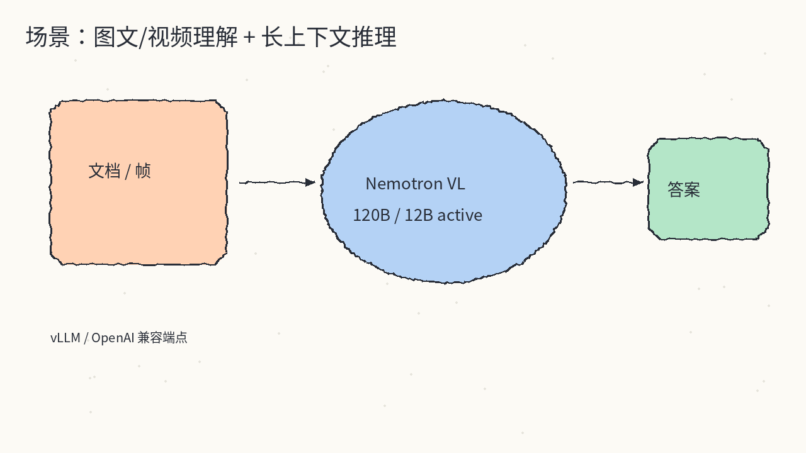
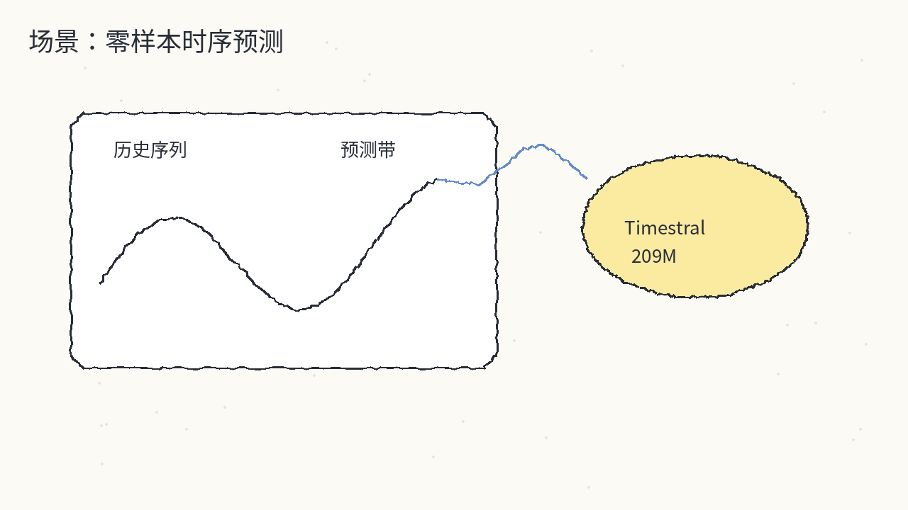
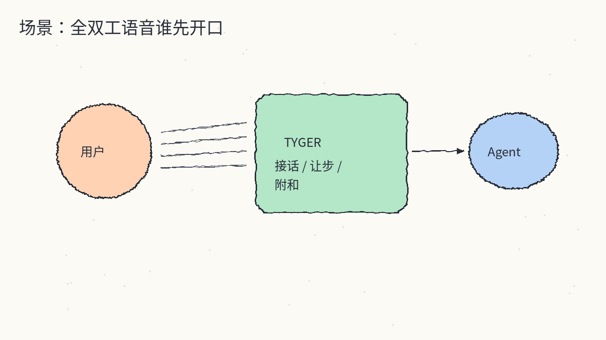
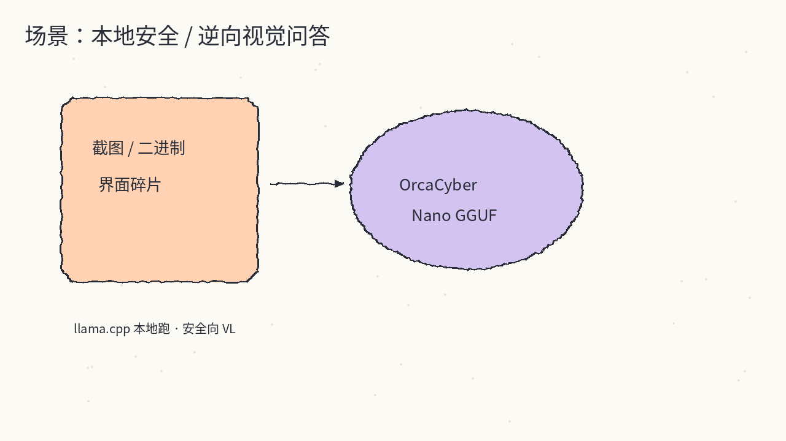
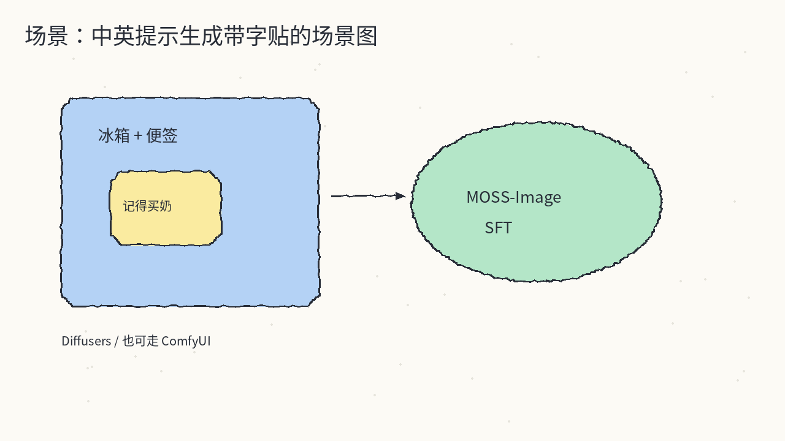
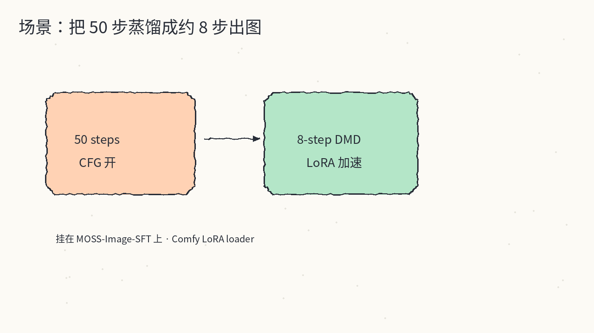

# 2026-10-20 Hugging Face 日报

今日精选 6 个可跟进的模型 / 权重（Nemotron VL / Timestral 时序 / Tyger 语音决策 / OrcaCyber 安全向 GGUF / MOSS-Image 文生图 + 8-step DMD 加速）。跳过私有或强 token 门控条目；Comfy 重打包不单独占坑，放进 OpenMOSS 用法提示。

## 1. nvidia/NVIDIA-Nemotron-3.5-Super-VL-120B-A12B-BF16 — 长上下文多模态推理 VL

**介绍**  
NVIDIA Nemotron 3.5 Super VL 的 BF16 全精度发布（OpenMDW 1.1，likes~78，downloads~15k）：图文 / 文档 / 视频理解，兼推理、代码与工具调用。约 120B 总参、12B 激活，上下文可达约 1M tokens；Mamba-2 + MoE + Attention，配 C-RADIO 视觉编码。面向商用与非商用；推荐 vLLM / SGLang 服务。

**用法**  
模型卡：[huggingface.co/nvidia/NVIDIA-Nemotron-3.5-Super-VL-120B-A12B-BF16](https://huggingface.co/nvidia/NVIDIA-Nemotron-3.5-Super-VL-120B-A12B-BF16)。  
```bash
export MODEL=nvidia/NVIDIA-Nemotron-3.5-Super-VL-120B-A12B-BF16
# 示例：4×H100，镜像可用 vllm/vllm-openai:v0.32.0 或文档指定的 nightly tag
vllm serve $MODEL \
  --served-model-name nemotron-3.5-super-vl \
  --tensor-parallel-size 4 \
  --trust-remote-code \
  --enable-auto-tool-choice \
  --tool-call-parser qwen3_coder \
  --reasoning-parser nemotron_v3
```
再用 OpenAI 兼容客户端打 `http://localhost:8000/v1`（详见模型卡 Quick Start）。

**应用场景**  
要在私有集群上跑「看图 / 看视频还能长文推理和调工具」的开源 VL，而不是只做短 caption。



**推荐学习程度**：深度

---

## 2. mistralai/Timestral-209M — 零样本时序基础模型

**介绍**  
Mistral 时序基础模型族中的 209M 档（license: other，likes~196）：零样本预测，支持单变量 / 多变量、协变量与最多 21 分位概率预测；历史最长约 32,768 步，一次前向可预测约 1,024 步。同族还有 5M / 28M / 123M。

**用法**  
模型卡：[huggingface.co/mistralai/Timestral-209M](https://huggingface.co/mistralai/Timestral-209M)；代码：[github.com/mistralai/timestral](https://github.com/mistralai/timestral)；博客：[mistral.ai/news/timestral](https://mistral.ai/news/timestral/)。  
```bash
pip install git+https://github.com/mistralai/timestral.git   # Python >= 3.10, torch >= 2.4
```
```python
from timestral import TimestralForecaster
import numpy as np, torch
model = TimestralForecaster.from_pretrained(
    "mistralai/Timestral-209M",
    device="cuda" if torch.cuda.is_available() else "cpu",
)
context = np.random.default_rng(42).standard_normal(1000).cumsum()
forecast = model.forecast(context, prediction_length=96)
```

**应用场景**  
业务序列还没堆出专模，想先用开源时序 FM 做零样本基线或分位区间。



**推荐学习程度**：进阶

---

## 3. nineninesix/tyger — 全双工语音「该不该接话」决策小模型

**介绍**  
开源语音决策权重（OpenMDW 1.1，likes~72）：给实时全双工 voice agent 用——判断何时回应、继续听、让步、附和。配套开源运行时 [nineninesix-ai/tyger-s2s](https://github.com/nineninesix-ai/tyger-s2s)（Apache-2.0）在浏览器里像打电话一样对话。

**用法**  
模型卡：[huggingface.co/nineninesix/tyger](https://huggingface.co/nineninesix/tyger)。建议从 tyger-s2s 起：  
```bash
git clone https://github.com/nineninesix-ai/tyger-s2s.git && cd tyger-s2s
uv venv .venv --python 3.12
uv pip install --python .venv/bin/python -r requirements.txt --torch-backend=auto
# 复制 .env.example → .env，填 HF_TOKEN 等；详见仓库 Quick start
```

**应用场景**  
自研语音助手时，端点检测 / barge-in / backchannel 不想只靠静音阈值。



**推荐学习程度**：深度

---

## 4. orcarouter/OrcaCyber-Nano-1.0 — 本地安全向视觉语言 GGUF

**介绍**  
面向网络安全 / 逆向 / 推理与 function calling 的视觉语言量化包（license_name: qwen，likes~128，downloads~10k）：库形态为 GGUF + `mmproj`，标签强调 llama.cpp 本地跑。公开 API 可见若干 Mix / DFlash2 Q8 与 F16 mmproj 文件；完整 README 正文目前对未登录请求返回 401，装用前请在 HF 页确认许可与文件列表。

**用法**  
模型页：[huggingface.co/orcarouter/OrcaCyber-Nano-1.0](https://huggingface.co/orcarouter/OrcaCyber-Nano-1.0)。典型路径是用 [llama.cpp](https://github.com/ggerganov/llama.cpp) 加载仓内 `.gguf`，并挂上同仓 `mmproj-*.gguf` 做多模态；具体 flag 以你本机 llama.cpp 版本文档为准（HF README 若需登录，以页面文件树为准）。

**应用场景**  
想在离线环境里对安全截图 / UI 碎片做本地 VL 问答，而不是把敏感图传到云端。



**推荐学习程度**：进阶

---

## 5. OpenMOSS-Team/MOSS-Image-SFT — 开源中英文生图 SFT

**介绍**  
OpenMOSS 文生图 SFT 权重（Apache-2.0，likes~406）：Diffusers 自定义 pipeline，中英提示均可；模型卡示例含「冰箱便签写中文」一类带字场景。推理默认约 50 steps、guidance 3。ComfyUI 可走官方插件说明或 [Comfy-Org/MOSS-Image](https://huggingface.co/Comfy-Org/MOSS-Image) 单文件权重当用法旁路，不单独占日报坑。

**用法**  
模型卡：[huggingface.co/OpenMOSS-Team/MOSS-Image-SFT](https://huggingface.co/OpenMOSS-Team/MOSS-Image-SFT)；Comfy 指南：[OpenMOSS/MOSS-Image comfyui](https://github.com/OpenMOSS/MOSS-Image/blob/main/comfyui/README.md)。  
```bash
pip install "diffusers>=0.38" "transformers>=5.3" "accelerate>=1.10" "safetensors>=0.6" "Pillow>=10"
```
```python
import torch
from diffusers import DiffusionPipeline
pipe = DiffusionPipeline.from_pretrained(
    "OpenMOSS-Team/MOSS-Image-SFT",
    custom_pipeline="pipeline_moss_image",
    trust_remote_code=True,
    torch_dtype={"default": torch.bfloat16, "vae": torch.float32},
)
pipe.to("cuda")
image = pipe("a kitchen scene with a Chinese sticky note", height=1024, width=1024,
             num_inference_steps=50, guidance_scale=3.0).images[0]
```

**应用场景**  
需要可复现、可自托管的中英文生图，并想在 Diffusers 或 Comfy 里继续微调 / 接工作流。



**推荐学习程度**：进阶

---

## 6. lodestones/MOSS-Image-SFT-8-steps-dmd — 约 8 步 DMD 加速适配

**介绍**  
把 MOSS-Image-SFT（约 50 steps + CFG）蒸馏到约 8 次网络评估、无 CFG 的 data-space DMD 适配（Apache-2.0，likes~158，downloads~45k）。提供 `lora.safetensors` / `lora_latest.safetensors` 等，文档建议直接挂进 ComfyUI LoRA loader；另有 demo Space。作为 OpenMOSS 条目的「加速旁路」单独列出，便于对照基座。

**用法**  
模型卡：[huggingface.co/lodestones/MOSS-Image-SFT-8-steps-dmd](https://huggingface.co/lodestones/MOSS-Image-SFT-8-steps-dmd)；demo：[spaces/hugging-apps/moss-image-8-step-dmd](https://huggingface.co/spaces/hugging-apps/moss-image-8-step-dmd)。  
在 Comfy 中加载基座 MOSS-Image 后，对 LoRA loader 挂本仓 `lora.safetensors`（文档建议 strength≈1）或 `lora_latest.safetensors`（≈0.7）。高级路径见卡内 `dataspace.safetensors` + fp32 transformer 说明。

**应用场景**  
已经在跑 MOSS-Image-SFT，想把出图步数压到个位数做预览或批量。



**推荐学习程度**：深度
