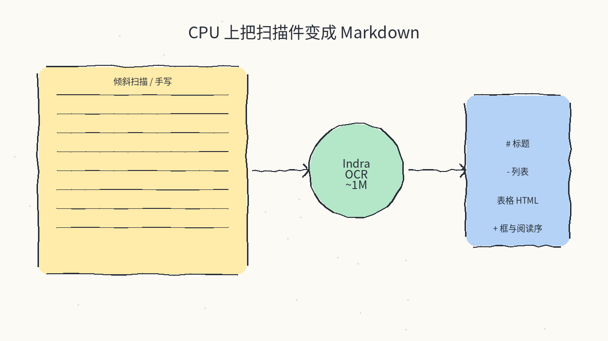
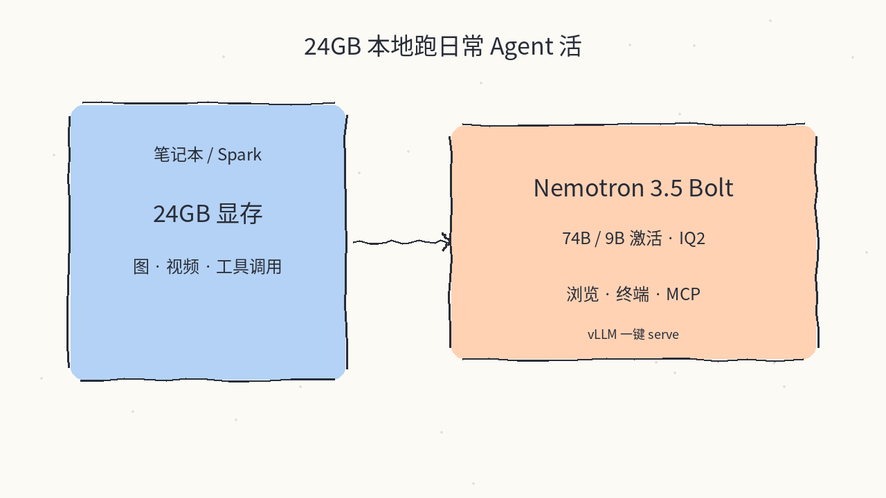
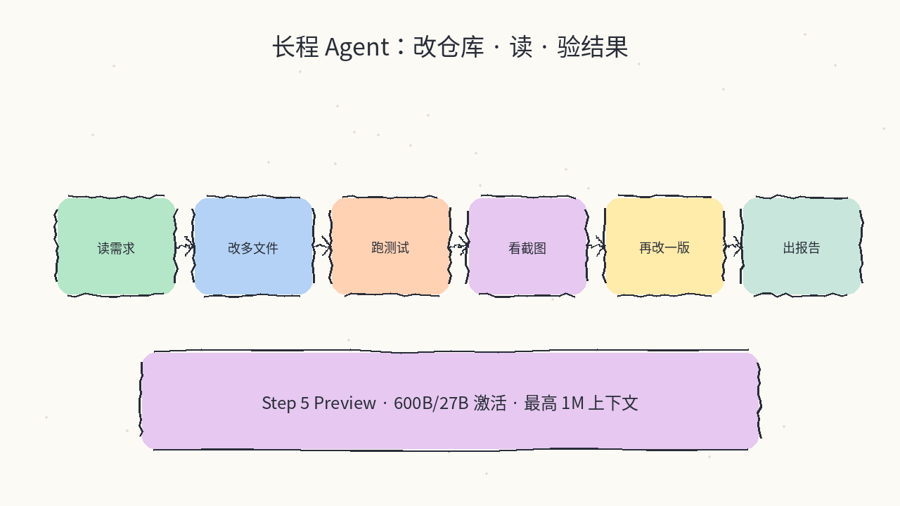
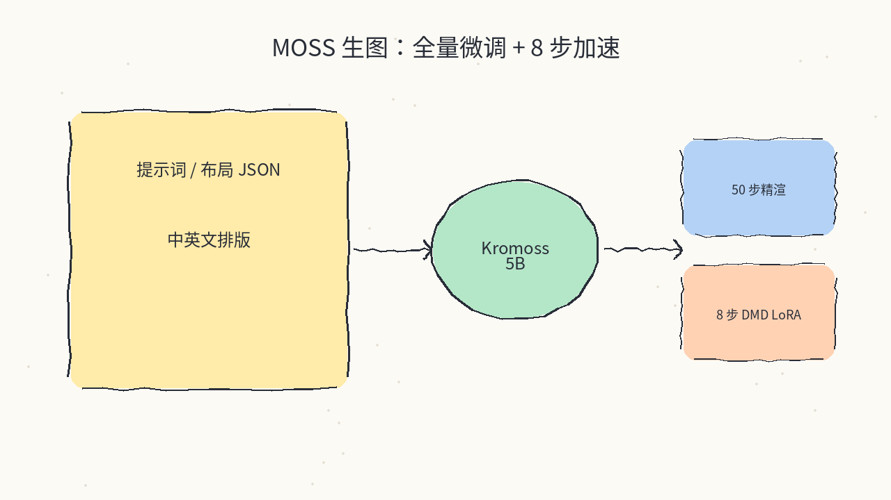
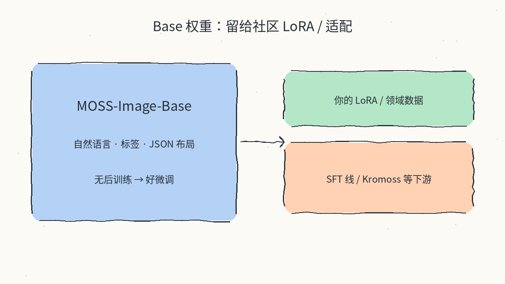

# 2026-10-21 Hugging Face 日报

今日精选 5 个值得跟进的新权重/模型卡（CPU 文档 OCR / 24GB 本地 Agent VL / StepFun 旗舰 Agent MoE / MOSS 生图全量微调 Kromoss / MOSS-Image Base）。与往日日报、周报不重复；昨日已推的 Flash-1017、MOSS-Image-SFT、Timestral 等不再复述。

## 1. datalab-to/indra-ocr — 约 1M 参数、纯 CPU 的文档 OCR

**介绍**  
Datalab 的 Indra OCR（代码 Apache-2.0；权重为修改版 OpenRAIL-M）：ONNX Runtime、无 PyTorch/GPU，把 PDF/图片打成 Markdown / 纯文本 / 带框 JSON；宣称 OmniParseBench 总分 66.7（`--math` 时 71.4），32 核约 44 页/秒量级，支持 80+ 语种、手写与倾斜页。主识别器约 1.25M 参数，默认包约 76MB。

**用法**  
模型卡：[huggingface.co/datalab-to/indra-ocr](https://huggingface.co/datalab-to/indra-ocr)；代码：[github.com/datalab-to/indra](https://github.com/datalab-to/indra)；博文：[Indra OCR](https://www.datalab.to/blog/indra-ocr)。  
```bash
pip install indra-ocr
indra-ocr paper.pdf
indra-ocr scan.png --format json
indra-ocr-viewer   # http://localhost:8765
```

**应用场景**  
笔记本上批量把扫描合同/论文变成可检索 Markdown，又不想起 GPU OCR 服务。



**推荐学习程度**：入门

---

## 2. nvidia/NVIDIA-Nemotron-3.5-Bolt-74B-A9B-24GB — 塞进 24GB 的本地 Agent VL

**介绍**  
从 Nemotron 3.5 Super VL 压缩量化而来的本地向 VLM（OpenMDW-1.1，HF 标注约 2026-10-15）：总参 74B / 激活约 9B，IQ2 打包进约 24GB，上下文最高 256K，吃图/视频+文本，强调工具调用、浏览与终端类 agent 任务。配套 vLLM 配方与 LiLiCorr 投机解码草稿模型。

**用法**  
模型卡：[huggingface.co/nvidia/NVIDIA-Nemotron-3.5-Bolt-74B-A9B-24GB](https://huggingface.co/nvidia/NVIDIA-Nemotron-3.5-Bolt-74B-A9B-24GB)；技术页：[research.nvidia.com/…/Nemotron-3.5-Bolt-24GB](https://research.nvidia.com/labs/nemotron/Nemotron-3.5-Bolt-24GB/)。  
```bash
# 见模型卡 Quick Start：指定 nightly vLLM 镜像后
export VLLM_USE_V2_MODEL_RUNNER=1
vllm serve nvidia/NVIDIA-Nemotron-3.5-Bolt-74B-A9B-24GB \
  --trust-remote-code --load-format auto \
  --tensor-parallel-size 1 --max-model-len 262144 \
  --enable-auto-tool-choice --tool-call-parser qwen3_coder
# 完整 speculative-config / reasoning-parser 以模型卡为准
```

**应用场景**  
单卡 24GB（如 RTX Spark / 本机）想跑「能点网页、能调工具」的日常 agent，而不是只聊天。



**推荐学习程度**：进阶

---

## 3. stepfun-ai/Step-5-Preview — 面向 Agent 工作的 600B/27B MoE

**介绍**  
StepFun 旗舰 Preview（StepFun Model License 1.0）：稀疏 MoE，总参约 600B / 激活约 27B，上下文最高约 1M，文本+图像输入，强调仓库级软件工程、长程工具环与金融知识工作。提供 vLLM / SGLang 镜像与 FP8、BF16 部署表（多卡）。

**用法**  
模型卡：[huggingface.co/stepfun-ai/Step-5-Preview](https://huggingface.co/stepfun-ai/Step-5-Preview)。  
```bash
docker pull vllm/vllm-openai:step-5-preview
docker run --rm -it --gpus all --ipc=host --network=host \
  -v "$HOME/.cache/huggingface:/root/.cache/huggingface" \
  --entrypoint /bin/bash vllm/vllm-openai:step-5-preview
# 容器内按模型卡选 TP4/TEP4/DEP4 等：
vllm serve stepfun-ai/Step-5-Preview \
  --served-model-name step5 --tensor-parallel-size 4 \
  --reasoning-parser step5 --tool-call-parser step5 \
  --enable-auto-tool-choice --port 18000
```

**应用场景**  
有多卡预算、要跑「改大仓库 + 长工具链 + 读图表」一类 agent 工作负载时，对照 Flash/Bolt 之外的旗舰 MoE。



**推荐学习程度**：专精

---

## 4. lodestones/Kromoss — MOSS-Image 全量微调 + 8 步 DMD LoRA

**介绍**  
对 MOSS-Image-Base 在 1024px 上的全参数微调（Apache-2.0，约 5B）：与 MOSS-Image-SFT 同管线/文本编码器/VAE，可当 drop-in；另附两枚 8-step turbo LoRA（DMD / DMD2）。PartiPrompts CLIP 分高于 Base；可走 Diffusers 或 ComfyUI 单文件。

**用法**  
模型卡：[huggingface.co/lodestones/Kromoss](https://huggingface.co/lodestones/Kromoss)。  
```bash
pip install "diffusers>=0.38" "transformers>=5.3" "accelerate>=1.10" "safetensors>=0.6" "Pillow>=10"
# Python：DiffusionPipeline.from_pretrained("lodestones/Kromoss", custom_pipeline="pipeline_moss_image", trust_remote_code=True, ...)
# 50 步 CFG3；或加载 8-steps-dmd2-lora.safetensors 后 8 步 CFG1
```

**应用场景**  
已经在跟 MOSS-Image 线，想要比 SFT 更「满血微调」的主权重，或直接上 8 步快速出图。



**推荐学习程度**：进阶

---

## 5. OpenMOSS-Team/MOSS-Image-Base — 留给社区适配的 5B 生图基座

**介绍**  
MOSS-Image 家族基座（Apache-2.0，约 5B）：支持自然语言、标签序列与 JSON 布局控字排版；相对 SFT 未做后训练，更适合自己做 LoRA / 领域适应。与昨日日报的 MOSS-Image-SFT 互补——SFT 开箱更齐，Base 更适合当训练起点。仓库还带 Prompt Enhancer Skill 说明。

**用法**  
模型卡：[huggingface.co/OpenMOSS-Team/MOSS-Image-Base](https://huggingface.co/OpenMOSS-Team/MOSS-Image-Base)。  
```bash
pip install "diffusers>=0.38" "transformers>=5.3" "accelerate>=1.10" "safetensors>=0.6" "Pillow>=10"
# DiffusionPipeline.from_pretrained("OpenMOSS-Team/MOSS-Image-Base", custom_pipeline="pipeline_moss_image", trust_remote_code=True, ...)
# 默认约 50 步、CFG 3、uncond_skip_layers=[22]
```

**应用场景**  
要在中英文海报/白板布局上做自己的风格 LoRA，或接 vLLM-Omni `/v1/images/generations` 当可微调底模。



**推荐学习程度**：进阶

---
