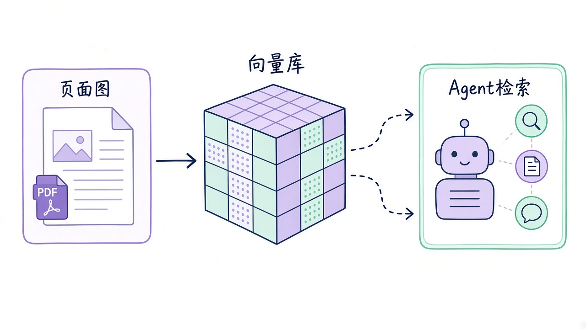
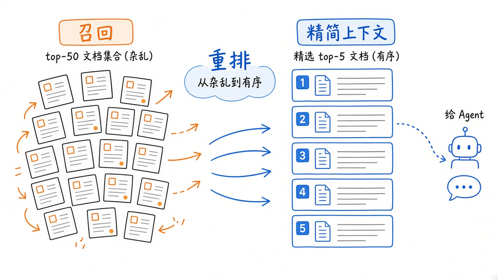
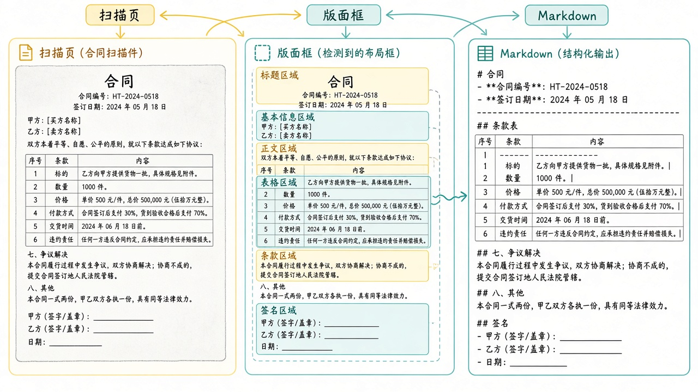
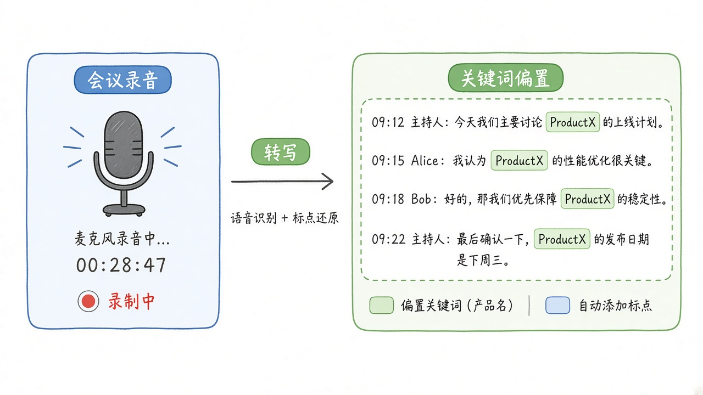
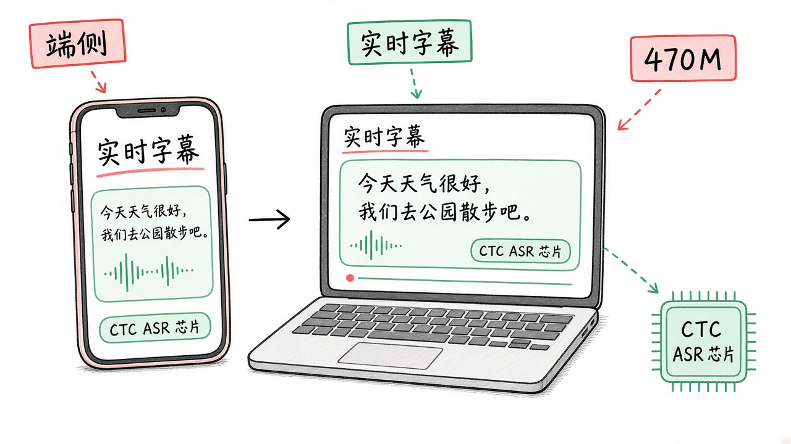
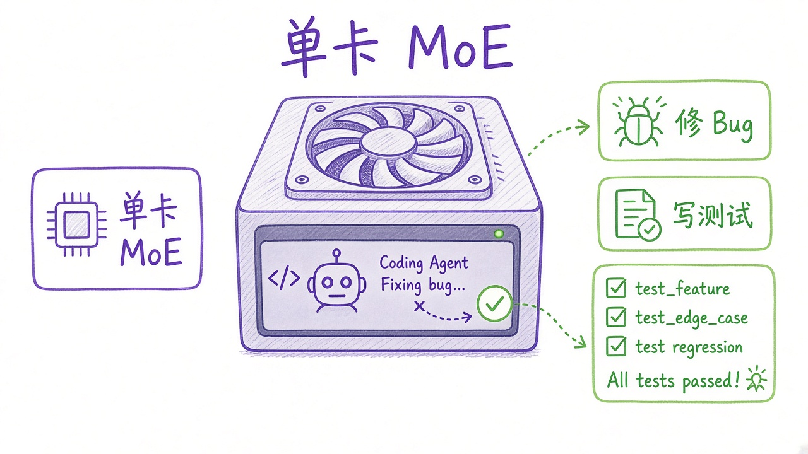
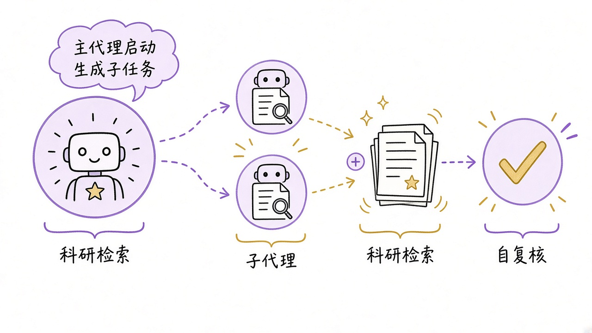

# 2026-10-22 Hugging Face 日报

今日精选 7 个可落地试跑的新权重（Nemotron 3.5 检索三件套 Embed/Rerank/Parse、Granite Speech 5.0、编码 MoE Flint、科研 Agent Sage-A1.5）。与往日日报、周报不重复；已推过的 Hy-Memory、Dory 等不再复述。

## 1. nvidia/Nemotron-3.5-Embed-8B-BF16 — 多模态稠密检索

**介绍**  
NVIDIA Nemotron 3.5 Embed（OpenMDW-1.1，约 8.38B）：查询为文本，文档可为文本/页面图/图表；约 34 语文本检索与多语视觉检索，面向 agentic Vision RAG。配套检索栈博文。

**用法**  
模型卡：[huggingface.co/nvidia/Nemotron-3.5-Embed-8B-BF16](https://huggingface.co/nvidia/Nemotron-3.5-Embed-8B-BF16)；博文：[Nemotron Retriever](https://huggingface.co/blog/nvidia/nemotron-retriever-world-class-agentic-retrieval)。  
```bash
uv pip install torch "transformers==5.20.0" accelerate pillow
# 或：
vllm serve nvidia/Nemotron-3.5-Embed-8B-BF16 \
  --served-model-name nvidia/Nemotron-3.5-Embed-8B-BF16 \
  --dtype bfloat16 --max-model-len 32768 --port 8000
```
```python
from sentence_transformers import SentenceTransformer
model = SentenceTransformer(
    "nvidia/Nemotron-3.5-Embed-8B-BF16", device="cuda",
    model_kwargs={"dtype": "bfloat16", "attn_implementation": "flash_attention_2"},
)
q = model.encode_query(["What is NVIDIA NeMo Framework?"])
```

**应用场景**  
给企业 Agent 建「PDF 截图 + 表格图」向量库，用自然语言查财报页里的数字。



**推荐学习程度**：进阶

---

## 2. nvidia/Nemotron-3.5-Rerank-8B-BF16 — 多模态 CrossEncoder 重排

**介绍**  
同系列 Rerank（OpenMDW-1.1，约 8.38B）：对 query–document（文本/图/图文）打相关性，做 RAG 二阶段精排；与 Embed 成套使用。

**用法**  
模型卡：[huggingface.co/nvidia/Nemotron-3.5-Rerank-8B-BF16](https://huggingface.co/nvidia/Nemotron-3.5-Rerank-8B-BF16)。  
```python
from sentence_transformers import CrossEncoder
model = CrossEncoder(
    "nvidia/Nemotron-3.5-Rerank-8B-BF16", device="cuda",
    model_kwargs={"dtype": "bfloat16", "attn_implementation": "flash_attention_2"},
)
rankings = model.rank("What is NVIDIA NeMo Framework?", documents, batch_size=1)
```

**应用场景**  
Embed 召回 top-50 后重排再塞进 Agent 上下文，少翻无效页。



**推荐学习程度**：进阶

---

## 3. nvidia/Nemotron-3.5-Parse — ~0.63B 文档解析

**介绍**  
Nemotron 3.5 Parse（OpenMDW-1.1）：C-RADIO 视觉编码器 + mBART 解码，输出版面类、框、阅读序与表/图结构化；补齐检索前的「像素→可索引文本」。

**用法**  
模型卡：[huggingface.co/nvidia/Nemotron-3.5-Parse](https://huggingface.co/nvidia/Nemotron-3.5-Parse)。  
```python
import torch
from PIL import Image
from transformers import AutoModel, AutoProcessor, GenerationConfig
mid = "nvidia/Nemotron-3.5-Parse"
model = AutoModel.from_pretrained(mid, trust_remote_code=True, dtype=torch.bfloat16).cuda().eval()
processor = AutoProcessor.from_pretrained(mid, trust_remote_code=True)
image = Image.open("page.jpg").convert("RGB")
prompt = "</s><s><predict_bbox><predict_classes><output_markdown><predict_text_in_pic>"
inputs = processor(images=[image], text=prompt, return_tensors="pt", add_special_tokens=False).to("cuda")
cfg = GenerationConfig.from_pretrained(mid); cfg.max_new_tokens = 8744
out = model.generate(**inputs, generation_config=cfg)
print(processor.batch_decode(out, skip_special_tokens=False)[0])
```

**应用场景**  
扫描合同/研报入库前先 Parse 成带框 Markdown，再交给 Embed 建库。



**推荐学习程度**：进阶

---

## 4. ibm-granite/granite-speech-5.0-2b — 多语 ASR + 双向 AST

**介绍**  
IBM Granite Speech 5.0 2B（Apache-2.0）：英/法/德/西/葡/日等 ASR 与互译；关键词偏置至约 2000 词，噪声场景更稳。支持 transformers / vLLM / llama.cpp GGUF。

**用法**  
模型卡：[huggingface.co/ibm-granite/granite-speech-5.0-2b](https://huggingface.co/ibm-granite/granite-speech-5.0-2b)；博文：[Granite Speech 5](https://huggingface.co/blog/ibm-granite/granite-speech-5)。  
```bash
pip install transformers torchaudio soundfile
# 或：vllm serve ibm-granite/granite-speech-5.0-2b --max-model-len 2048
```

**应用场景**  
客服/会议录音做带标点转写，并对产品名做 keyword-biased ASR。



**推荐学习程度**：入门

---

## 5. ibm-granite/granite-speech-5.0-470m-turboctc — 边缘 CTC ASR

**介绍**  
同日系 470M Conformer+CTC（Apache-2.0）：非自回归、边缘友好；七语 + 原生标点，适合笔记本/手机端高吞吐转写。

**用法**  
模型卡：[huggingface.co/ibm-granite/granite-speech-5.0-470m-turboctc](https://huggingface.co/ibm-granite/granite-speech-5.0-470m-turboctc)。  
```python
from transformers import AutoModelForCTC, AutoProcessor
mid = "ibm-granite/granite-speech-5.0-470m-turboctc"
processor = AutoProcessor.from_pretrained(mid)
model = AutoModelForCTC.from_pretrained(mid, device_map="auto")
# 完整音频加载与 batch_decode 见模型卡
```

**应用场景**  
端侧实时字幕或录音机离线转写，不占大模型显存。



**推荐学习程度**：入门

---

## 6. RecursiveSI/flint — 编码 Agent 向 39.8B/2.5B MoE

**介绍**  
Flint（Apache-2.0）：约 39.8B MoE / ~2.5B 激活，面向编码 Agent；卡片自报 Terminal-Bench / SWE-bench 分数，工具调用+推理开箱。Transformers 建模代码未附带，走仓内 SGLang Docker。

**用法**  
模型卡：[huggingface.co/RecursiveSI/flint](https://huggingface.co/RecursiveSI/flint)。  
```bash
hf download RecursiveSI/flint --local-dir flint && cd flint
docker build -t flint-sglang sglang
docker run -d --name flint --gpus '"device=0"' --ipc=host -p 127.0.0.1:30000:30000 \
  -v "$PWD:/model" -e MODEL=/model flint-sglang bash /model/sglang/serve_b300.sh
python3 sglang/example_client.py --base-url http://localhost:30000/v1
```

**应用场景**  
单卡起一个会查仓库、修 bug、写测试的本地 coding agent 后端。



**推荐学习程度**：深入

---

## 7. InternScience/Sage-A1.5 — 科研 Agent MoE

**介绍**  
上实开源 Sage-A1.5（Apache-2.0，约 35–36B MoE）：原生约 256K 上下文，强调子代理编排与可选 Verification；可用 vLLM / SGLang。相关框架 [InternScience/Agents-A1](https://github.com/InternScience/Agents-A1)。

**用法**  
模型卡：[huggingface.co/InternScience/Sage-A1.5](https://huggingface.co/InternScience/Sage-A1.5)。  
```bash
vllm serve InternScience/Sage-A1.5 \
  --port 8000 --max-model-len 262144 \
  --reasoning-parser qwen3 --enable-auto-tool-choice --tool-call-parser qwen3_coder
# 验证模式：chat_template_kwargs={"verification": true}
```

**应用场景**  
搭可并行子调研的科研/深度检索 Agent，并按需打开轨迹内自复核。



**推荐学习程度**：深入
