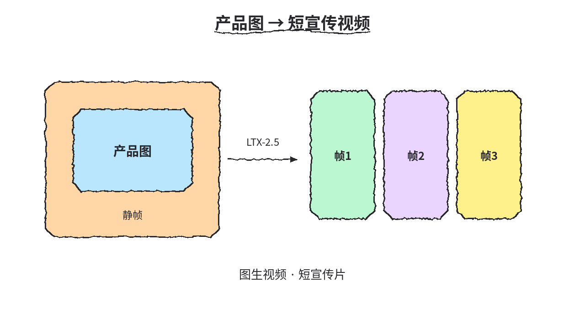
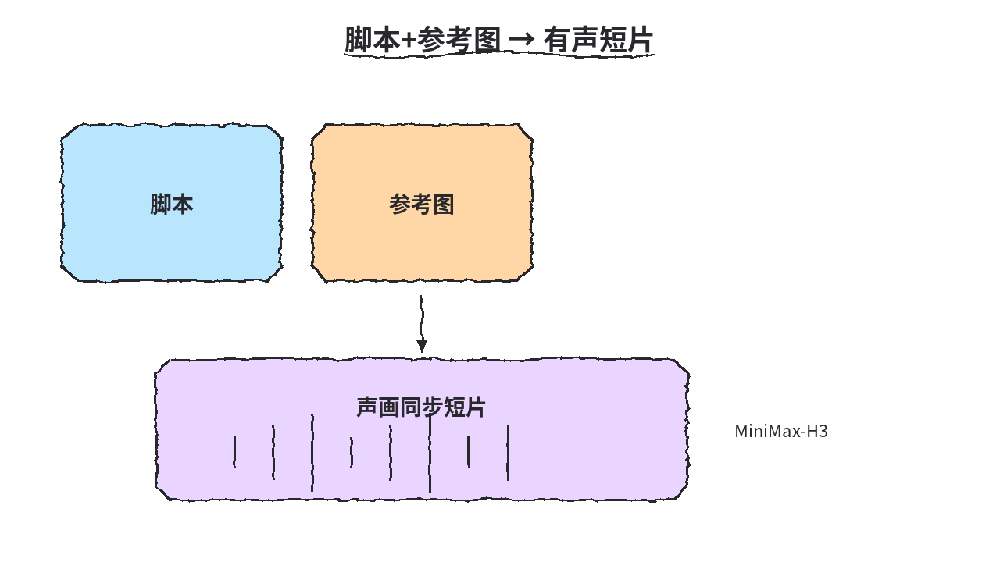
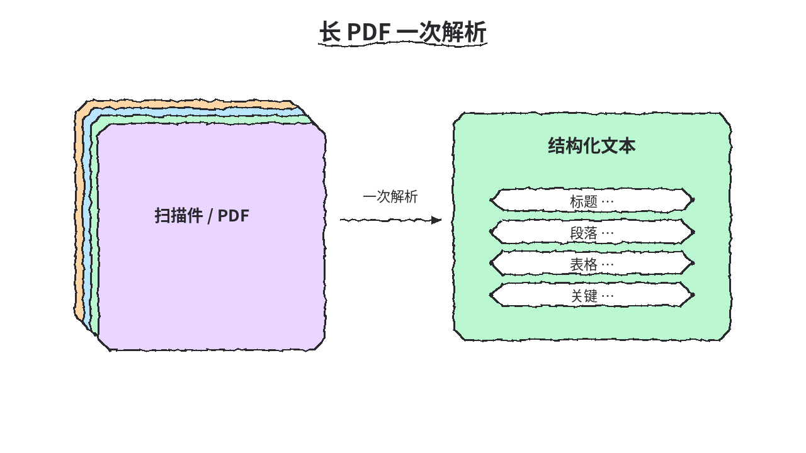
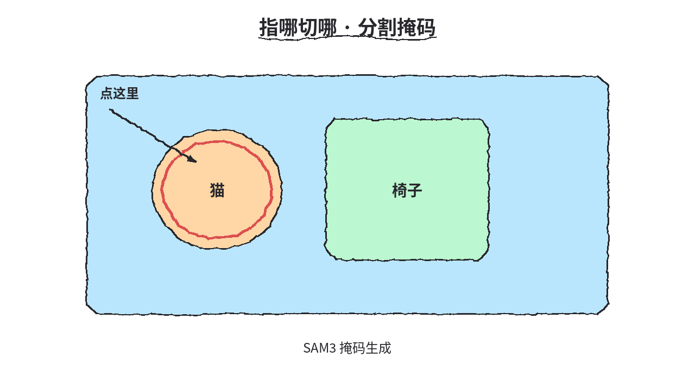
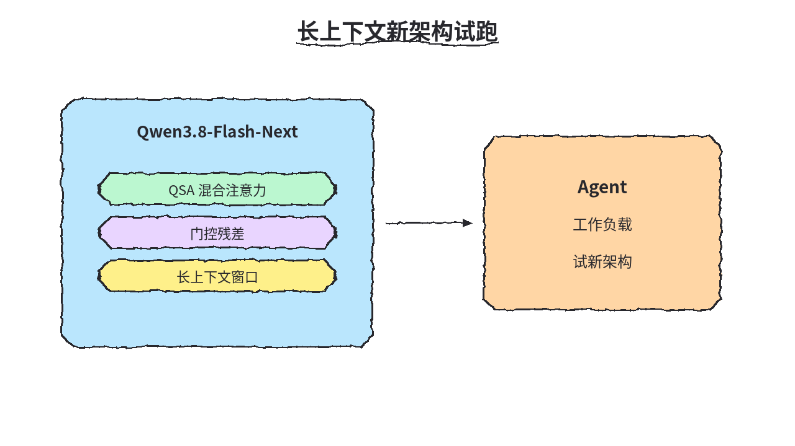
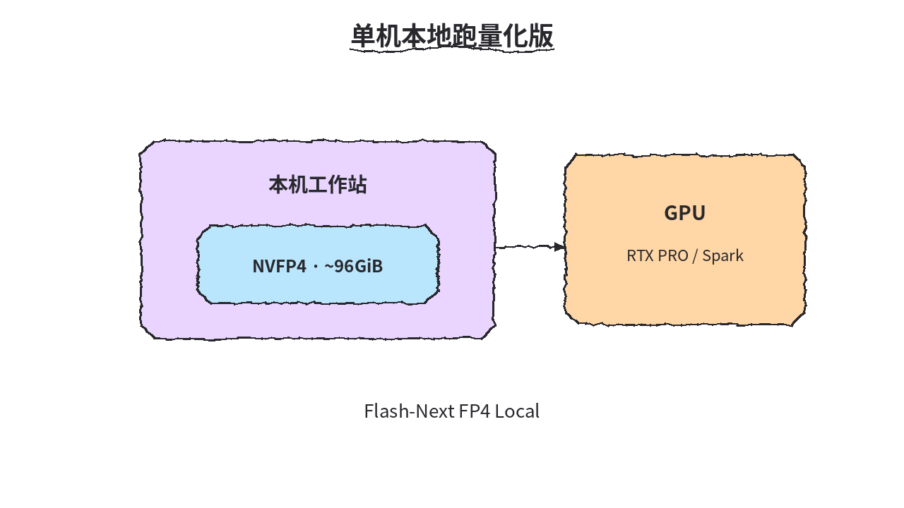
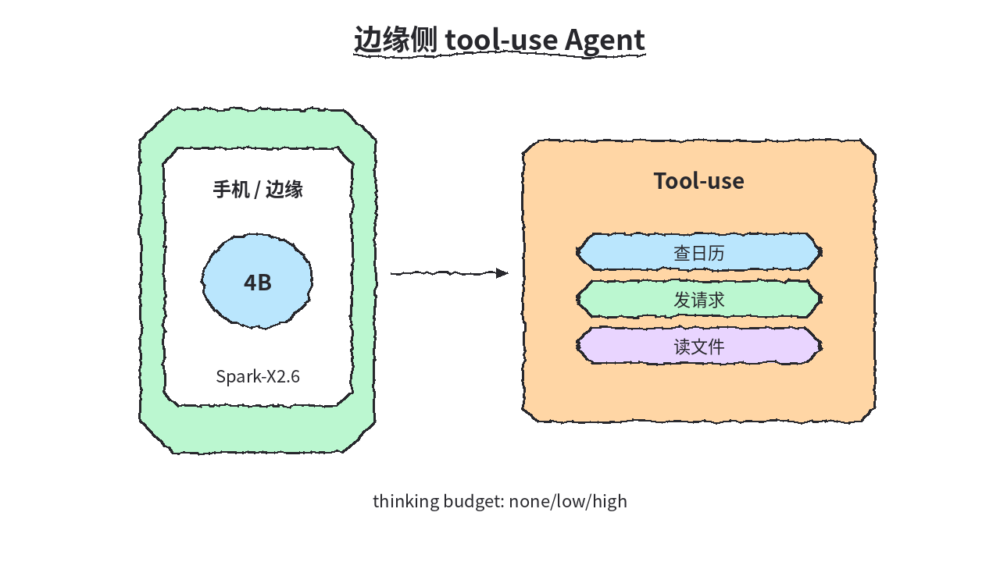
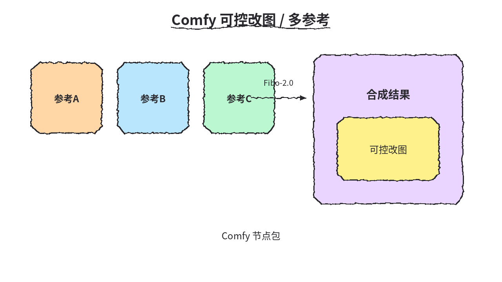
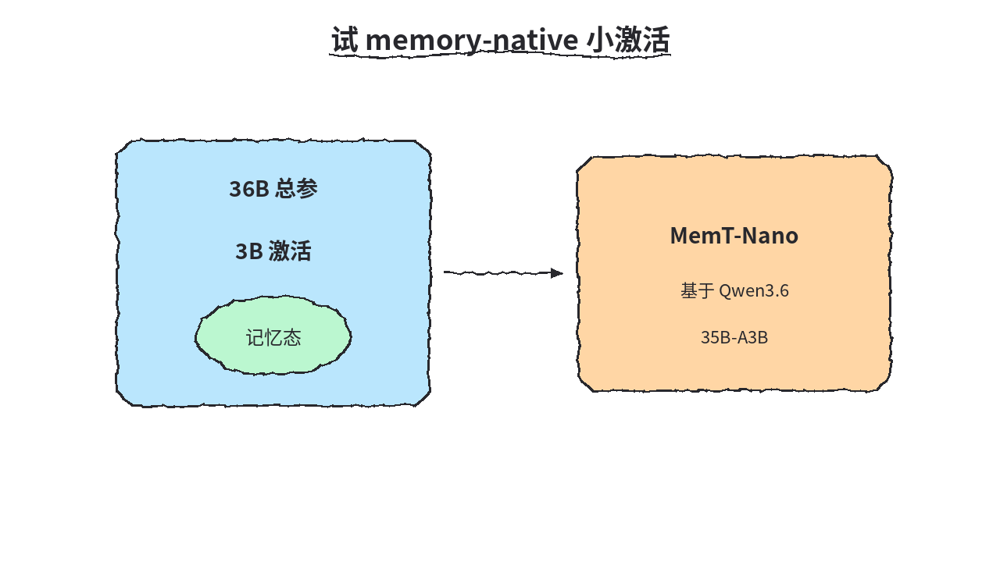

# 2026-10-23 Hugging Face 日报

今日精选 9 个权重：图/文生视频与 OCR、分割、Qwen3.8 Flash-Next 架构与 FP4 本地包、边缘 4B agent、Comfy 改图与 MemT Nano。

## 1. Lightricks/LTX-2.5 — 图生视频

**介绍**  
LTX-2.5（likes~8907，下载~2.05M）：图像到视频为主，并覆盖 t2v 等；常配合 diffusers 试跑。

**用法**  
模型卡：[huggingface.co/Lightricks/LTX-2.5](https://huggingface.co/Lightricks/LTX-2.5)。  
```bash
pip install git+https://github.com/huggingface/diffusers
# 再按模型卡用 diffusers pipeline 加载 Lightricks/LTX-2.5
```

**应用场景**  
产品图→短宣传视频。



**推荐学习程度**：进阶

---

## 2. MiniMaxAI/MiniMax-H3 — 图文生视频 + 同步音频

**介绍**  
MiniMax-H3（likes~6299，下载~5M）：image-text-to-video，输出可带声画同步；有官方仓库与 API。

**用法**  
模型卡：[huggingface.co/MiniMaxAI/MiniMax-H3](https://huggingface.co/MiniMaxAI/MiniMax-H3)；仓库：[github.com/MiniMax-AI/MiniMax-H3](https://github.com/MiniMax-AI/MiniMax-H3)；API：[platform.minimax.io](https://platform.minimax.io)。

**应用场景**  
脚本/参考图出带声画同步短片。



**推荐学习程度**：进阶

---

## 3. baidu/Unlimited-OCR — 长程一次性 OCR/解析

**介绍**  
Unlimited-OCR（MIT，likes~4869）：one-shot 长视野 OCR/文档解析；有 Space，可用 transformers AutoModel。

**用法**  
模型卡：[huggingface.co/baidu/Unlimited-OCR](https://huggingface.co/baidu/Unlimited-OCR)；Space：[spaces/baidu/Unlimited-OCR](https://huggingface.co/spaces/baidu/Unlimited-OCR)；仓库：[github.com/baidu/Unlimited-OCR](https://github.com/baidu/Unlimited-OCR)。  
```bash
# transformers AutoModel 按模型卡加载 baidu/Unlimited-OCR
```

**应用场景**  
长 PDF/扫描件一次解析成结构化文本。



**推荐学习程度**：进阶

---

## 4. facebook/sam3 — 掩码生成

**介绍**  
SAM3（likes~4921）：分割掩码生成；gated，需先申请 HF 访问。

**用法**  
模型卡：[huggingface.co/facebook/sam3](https://huggingface.co/facebook/sam3)（gated：需 HF access）。

**应用场景**  
视频/图像里指哪切哪的分割掩码。



**推荐学习程度**：进阶

---

## 5. Qwen/Qwen3.8-Flash-Next — 混合注意力新架构预览

**介绍**  
Qwen3.8-Flash-Next（likes~6411）：Hybrid attn QSA + gated residual，Qwen4 预览架构，适合长上下文 agent 试跑。

**用法**  
模型卡：[huggingface.co/Qwen/Qwen3.8-Flash-Next](https://huggingface.co/Qwen/Qwen3.8-Flash-Next)；博文：[qwen.ai/blog?id=qwen3.8-flash-next](https://qwen.ai/blog?id=qwen3.8-flash-next)。

**应用场景**  
长上下文 agent 工作负载试新架构。



**推荐学习程度**：深入

---

## 6. nvidia/Qwen3.8-Flash-Next-FP4-Local — NVFP4 本地包

**介绍**  
Qwen3.8-Flash-Next-FP4-Local（likes~313）：NVFP4 本地打包约 96GiB；面向 RTX PRO 6000 / DGX Spark 容器。

**用法**  
模型卡：[huggingface.co/nvidia/Qwen3.8-Flash-Next-FP4-Local](https://huggingface.co/nvidia/Qwen3.8-Flash-Next-FP4-Local)。

**应用场景**  
单机本地跑 Flash-Next 量化版。



**推荐学习程度**：深入

---

## 7. XHToken/Spark-X2.6-4B — 端侧 Agent LLM

**介绍**  
Spark-X2.6-4B（Apache-2.0，likes~257）：on-device agent LLM（4B）；thinking budget 可设 none/low/high。

**用法**  
模型卡：[huggingface.co/XHToken/Spark-X2.6-4B](https://huggingface.co/XHToken/Spark-X2.6-4B)。  
```bash
pip install "transformers==4.57.1"
# 加载时 trust_remote_code=True
```

**应用场景**  
手机/边缘侧跑 tool-use agent。



**推荐学习程度**：进阶

---

## 8. briaai/Fibo-2.0-dev — 可控改图 / 多参考

**介绍**  
Fibo-2.0-dev（likes~117）：文本/图像编辑与多参考合成；Comfy 包见 Comfy-Org/Fibo-2.0。

**用法**  
模型卡：[huggingface.co/briaai/Fibo-2.0-dev](https://huggingface.co/briaai/Fibo-2.0-dev)；Comfy：[huggingface.co/Comfy-Org/Fibo-2.0](https://huggingface.co/Comfy-Org/Fibo-2.0)。

**应用场景**  
Comfy 里做可控改图/多参考合成。



**推荐学习程度**：进阶

---

## 9. MemTensor/MemT-1.0-Nano — 记忆原生小激活

**介绍**  
MemT-1.0-Nano（likes~85）：36B/3B act memory-native，基于 Qwen3.6-35B-A3B；另有 Flash 变体。

**用法**  
模型卡：[huggingface.co/MemTensor/MemT-1.0-Nano](https://huggingface.co/MemTensor/MemT-1.0-Nano)；Flash：[MemT-1.0-Flash](https://huggingface.co/MemTensor/MemT-1.0-Flash)。

**应用场景**  
试 memory-native 小激活记忆模型。



**推荐学习程度**：深入
