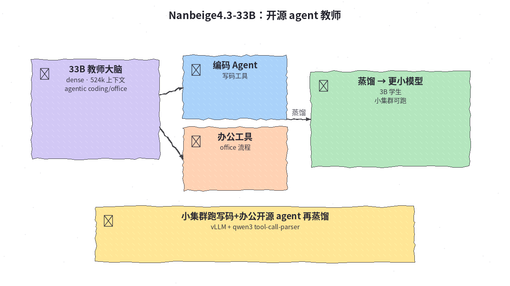
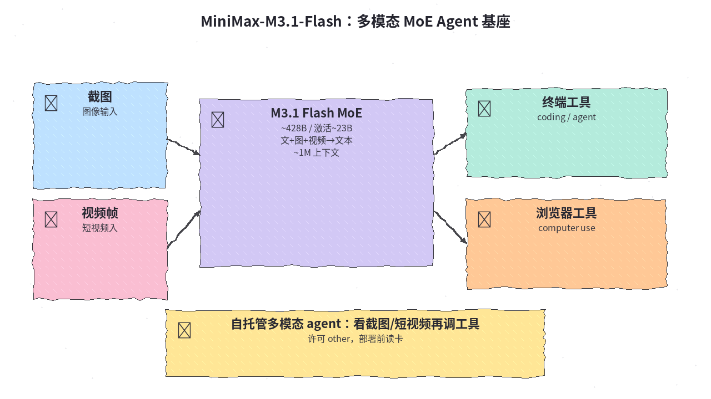
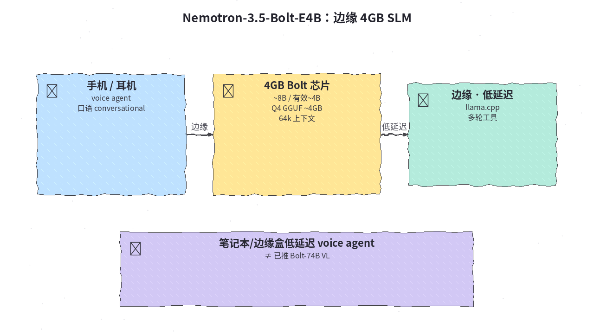
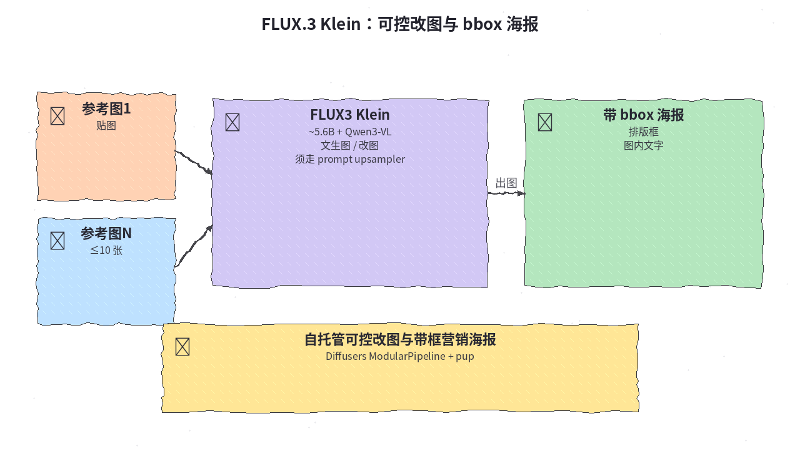
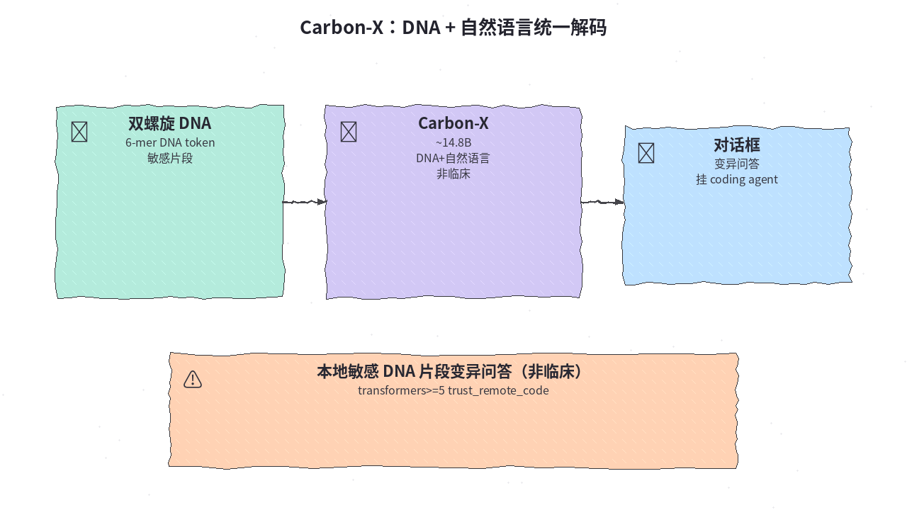
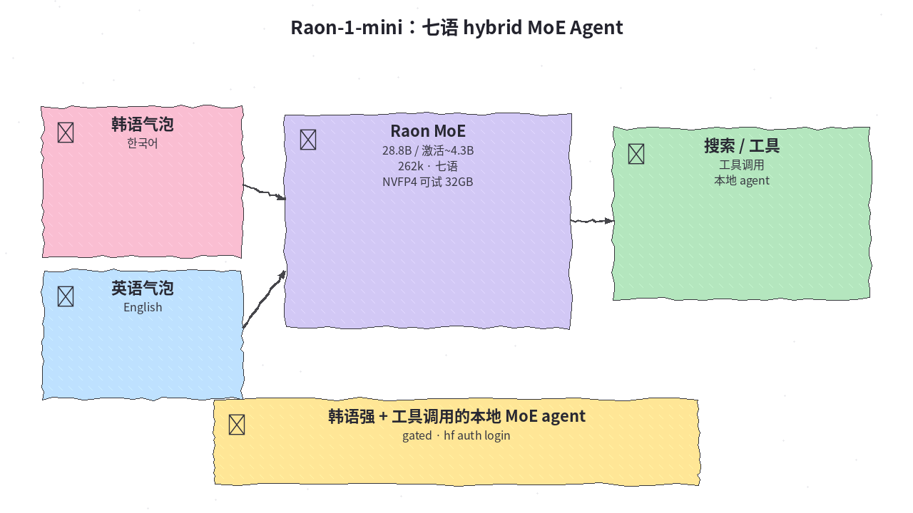
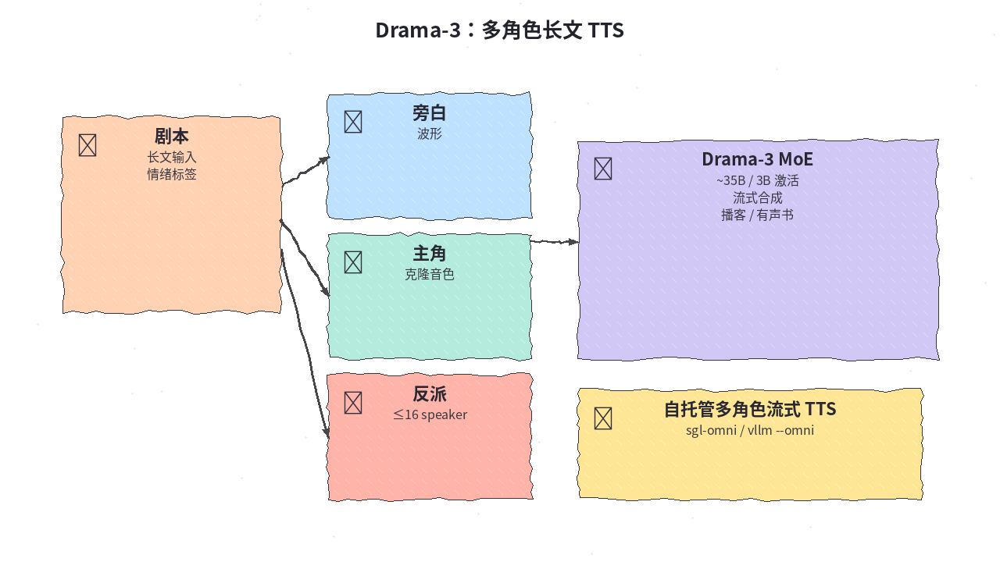
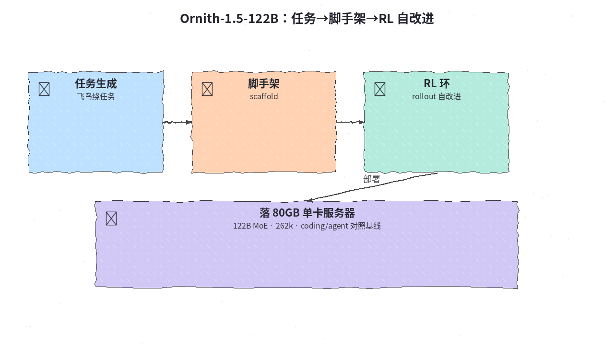

# 2026-10-26 Hugging Face 日报

今日精选 8 条：开源 agent 教师与多模态 Flash、边缘 Bolt、FLUX 改图、DNA 模型与多角色 TTS 等。

## 1. Nanbeige/Nanbeige4.3-33B — 33B 开源 agent 教师

**介绍**  
Nanbeige4.3-33B（Apache-2.0，likes~387，2026-10-24）：33B dense，~30B 档开源 agent 教师；524k 上下文；面向 agentic coding/office。勿臆造下载量。

**用法**  
模型卡：[huggingface.co/Nanbeige/Nanbeige4.3-33B](https://huggingface.co/Nanbeige/Nanbeige4.3-33B)。  
```bash
# transformers / SGLang / vLLM，trust_remote_code
vllm serve Nanbeige/Nanbeige4.3-33B \
  --enable-auto-tool-choice \
  --reasoning-parser qwen3 \
  --tool-call-parser qwen3_coder
```

**应用场景**  
小集群跑写码+办公开源 agent，再蒸馏更小模型。



**推荐学习程度**：进阶

---

## 2. MiniMaxAI/MiniMax-M3.1-Flash — 多模态 MoE Agent 基座

**介绍**  
MiniMax-M3.1-Flash（许可 other，likes~353，下载~7k）：多模态 MoE（~428B / 激活~23B），文+图+视频入、文本出，~1M 上下文；面向 coding/agent/computer use。部署前读卡。≠ MiniMax-H3 视频线。

**用法**  
模型卡：[huggingface.co/MiniMaxAI/MiniMax-M3.1-Flash](https://huggingface.co/MiniMaxAI/MiniMax-M3.1-Flash)。  
```bash
hf download MiniMaxAI/MiniMax-M3.1-Flash
# SGLang / vLLM / TokenSpeed；temp=1.0 top_p=0.95
```

**应用场景**  
自托管看截图/短视频再调工具的多模态 agent 基座。



**推荐学习程度**：深度

---

## 3. nvidia/NVIDIA-Nemotron-3.5-Bolt-E4B-4GB — 边缘 4GB SLM

**介绍**  
Nemotron-3.5-Bolt-E4B-4GB（OpenMDW，likes~127，下载~17k）：边缘 SLM，~8B / 有效~4B，Q4 GGUF ~4GB；64k；多轮工具 + 口语 conversational_mode。≠ 已推 Bolt-74B VL。

**用法**  
模型卡：[huggingface.co/nvidia/NVIDIA-Nemotron-3.5-Bolt-E4B-4GB](https://huggingface.co/nvidia/NVIDIA-Nemotron-3.5-Bolt-E4B-4GB)。  
```bash
hf download nvidia/NVIDIA-Nemotron-3.5-Bolt-E4B-4GB   # GGUF
# llama.cpp；可选 DFlash 草稿仓
```

**应用场景**  
笔记本/边缘盒低延迟 voice agent。



**推荐学习程度**：进阶

---

## 4. black-forest-labs/flux-3-image-klein — FLUX.3 可控改图

**介绍**  
flux-3-image-klein（FLUX Kommunity，likes~695，下载~115k）：~5.6B + Qwen3-VL-4B 编码器；文生图 / 单参考改图 / 多参考(≤10)；bbox 排版与图内文字。须走 prompt upsampler。

**用法**  
模型卡：[huggingface.co/black-forest-labs/flux-3-image-klein](https://huggingface.co/black-forest-labs/flux-3-image-klein)。  
```bash
# Diffusers ModularPipeline + prompt upsampler；或 Comfy 旁路仓
```

**应用场景**  
自托管可控改图与带框营销海报。



**推荐学习程度**：进阶

---

## 5. HuggingFaceBio/Carbon-X — DNA + 自然语言统一解码

**介绍**  
Carbon-X（Apache-2.0，likes~183）：~14.8B DNA + 自然语言统一解码器；6-mer DNA token；非临床。

**用法**  
模型卡：[huggingface.co/HuggingFaceBio/Carbon-X](https://huggingface.co/HuggingFaceBio/Carbon-X)。  
```bash
# transformers>=5 trust_remote_code；或 vllm serve
```

**应用场景**  
本地敏感 DNA 片段变异问答挂 coding agent（非临床）。



**推荐学习程度**：深度

---

## 6. KRAFTON/Raon-1-mini-preview — 七语 hybrid MoE

**介绍**  
Raon-1-mini-preview（Apache-2.0，gated，likes~186）：28.8B / 激活~4.3B hybrid MoE；七语；262k；NVFP4 可试 32GB。

**用法**  
模型卡：[huggingface.co/KRAFTON/Raon-1-mini-preview](https://huggingface.co/KRAFTON/Raon-1-mini-preview)。  
```bash
hf auth login
vllm serve KRAFTON/Raon-1-mini-preview   # + dflash
```

**应用场景**  
韩语强 + 工具调用的本地 MoE agent。



**推荐学习程度**：进阶

---

## 7. fishaudio/drama-3 — 多角色长文 TTS

**介绍**  
Drama-3（Fish Community License，likes~1013，下载~21k）：多角色长文 TTS MoE ~35B / 3B；≤16 speaker；克隆 + 情绪标签。

**用法**  
模型卡：[huggingface.co/fishaudio/drama-3](https://huggingface.co/fishaudio/drama-3)。  
```bash
# sgl-omni 或 vllm --omni /v1/tts
```

**应用场景**  
自托管播客/有声书多角色流式合成。



**推荐学习程度**：进阶

---

## 8. ornith-ai/Ornith-1.5-122B — 任务脚手架 RL 自改进

**介绍**  
Ornith-1.5-122B（MIT，likes~177，下载~48k）：122B MoE；任务生成—脚手架—rollout 自改进；单卡 80GB；262k。

**用法**  
模型卡：[huggingface.co/ornith-ai/Ornith-1.5-122B](https://huggingface.co/ornith-ai/Ornith-1.5-122B)。  
```bash
# vLLM / SGLang tool-call-parser qwen3_xml
```

**应用场景**  
单卡 80GB 开源 coding/agent 对照基线。



**推荐学习程度**：深度
