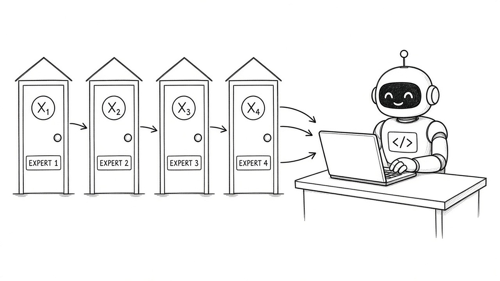
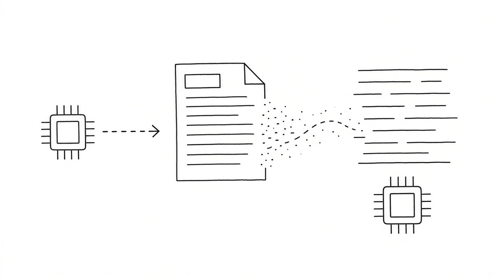

# 2026-10-26 Hugging Face 周报

上周（10/19–10/25）精选 10 个值得跟进的模型与权重（偏视频 / Flash 基座 / OCR / 编码 MoE / 时序与本地 VL）。

## 1. Lightricks/LTX-2.5 — 图生视频主力档

**介绍**  
Lightricks 开源图生视频模型（likes≈9340，近 30 日下载约 210 万）：本周仍在 HF Trending 前列，适合作为本地/自托管 I2V 基线，而不是只跑闭源 API。

**用法**  
模型卡：[huggingface.co/Lightricks/LTX-2.5](https://huggingface.co/Lightricks/LTX-2.5)。用 Diffusers / Comfy 工作流加载权重，输入首帧图与提示词导出短视频；注意显存与许可条款。

**应用场景**  
产品演示要「静图动起来」的短镜头，想在自有机器上可控出片。

**推荐学习程度**：进阶

---

## 2. deepseek-ai/DeepSeek-V4.1-Flash-1017 — Flash 小更新：更快更短多 harness

**介绍**  
DeepSeek V4.1 Flash 1017 权重（likes≈2989，下载约 8.5 万）：面向更快、更短输出与多种 agent harness 抬头；本周仍是开源对话/工具调用热门基座，可与 DeepInfer 官方推理栈搭配。

**用法**  
模型卡：[huggingface.co/deepseek-ai/DeepSeek-V4.1-Flash-1017](https://huggingface.co/deepseek-ai/DeepSeek-V4.1-Flash-1017)。经 vLLM / SGLang / DeepInfer 拉取；本地可设 `HF_HOME` 缓存后接 OpenAI 兼容网关。

**应用场景**  
给 coding agent 换更便宜的 Flash 路由，或自建推理节点对齐官方行为。

**推荐学习程度**：进阶

---

## 3. MiniMaxAI/MiniMax-H3 — 图文生视频 + 同步音频

**介绍**  
MiniMax 开源 H3（likes≈6361，下载约 517 万）：图文条件生成视频并同步音频，日刊与 Trending 双线出现；适合评测「带声画」的开源视频管线。

**用法**  
模型卡：[huggingface.co/MiniMaxAI/MiniMax-H3](https://huggingface.co/MiniMaxAI/MiniMax-H3)。按卡内推理示例或官方脚本加载；准备图/文提示与音频对齐参数后导出。

**应用场景**  
短视频脚本要画面和旁白一起出，想先用开源栈打样再决定是否上云 API。

**推荐学习程度**：进阶

---

## 4. baidu/Unlimited-OCR — 长程一次性 OCR/解析

**介绍**  
百度开源长文档 OCR/解析（likes≈4896，下载约 257 万）：面向长程一次性识别，而不是逐页拼碎片；本周日刊与下载量都靠前。

**用法**  
模型卡：[huggingface.co/baidu/Unlimited-OCR](https://huggingface.co/baidu/Unlimited-OCR)。按 README 装推理依赖，喂 PDF/长图一次拿结构化文本；可接 RAG 入库前处理。

**应用场景**  
合同、研报、扫描件一叠，想少切页、少丢跨页表格。

**推荐学习程度**：入门

---

## 5. RecursiveSI/flint — 编码 Agent 向 39.8B/2.5B MoE

**介绍**  
面向编码 Agent 的 MoE（约 39.8B / 2.5B 激活，likes≈860）：本周 Trending 抬头，强调工具调用与代码任务；有社区 GGUF（如 unsloth/flint-GGUF）方便本地试。

**用法**  
模型卡：[huggingface.co/RecursiveSI/flint](https://huggingface.co/RecursiveSI/flint)。用 transformers / llama.cpp（GGUF）加载；接到 OpenAI 兼容代理后挂 Claude Code / Cursor 自定义模型。

**应用场景**  
想在本机或小集群跑「专治写码」的 MoE，而不是通用对话模型。

**推荐学习程度**：进阶

---

## 6. OpenMOSS-Team/MOSS-Image-SFT — 开源中英文生图 SFT

**介绍**  
OpenMOSS 5B 级中英文生图 SFT（likes≈728，下载约 1 万+）：本周与 Base / DMD 加速适配一起出现，适合作为可微调的中文友好生图起点。

**用法**  
模型卡：[huggingface.co/OpenMOSS-Team/MOSS-Image-SFT](https://huggingface.co/OpenMOSS-Team/MOSS-Image-SFT)。按卡内示例推理；需要更快可看 lodestones/Kromoss 等 8 步 DMD 适配。

**应用场景**  
产品要中英文营销图、想自托管并可继续 SFT，而不是只调闭源生图 API。

**推荐学习程度**：进阶

---

## 7. mistralai/Timestral-209M — 零样本时序基础模型

**介绍**  
Mistral 时序基础小模型（209M，likes≈368）：零样本预报定位，体积小、好挂边缘或特征服务；本周日刊首发后仍在讨论区。

**用法**  
模型卡：[huggingface.co/mistralai/Timestral-209M](https://huggingface.co/mistralai/Timestral-209M)。按卡内 API/示例喂历史序列做预报；可嵌入特征管道做异常检测基线。

**应用场景**  
业务指标、库存、能耗这类表格式时序，想先上一个轻量零样本预报。

**推荐学习程度**：进阶

---

## 8. datalab-to/indra-ocr — 约 1M 参数、纯 CPU 文档 OCR

**介绍**  
极小文档 OCR（约 1M 参数，likes≈425）：强调纯 CPU 可跑，适合边缘与批量预处理；日刊 10/21 重点条目。

**用法**  
模型卡：[huggingface.co/datalab-to/indra-ocr](https://huggingface.co/datalab-to/indra-ocr)。按 README 用 pip/transformers 加载，对扫描页跑 CPU 推理；可做入库前的廉价第一道。

**应用场景**  
笔记本或小容器上要扫一堆票据/截图，不想为 OCR 占一张 GPU。

**推荐学习程度**：入门

---

## 9. stepfun-ai/Step-5-Preview — 面向 Agent 工作的 600B/27B MoE

**介绍**  
StepFun Step-5 Preview（约 600B / 27B 激活，likes≈130）：定位 Agent 工作流，本周出现在日刊与部分雷达；权重与许可以模型卡为准，适合跟进评测而非盲目全量部署。

**用法**  
模型卡：[huggingface.co/stepfun-ai/Step-5-Preview](https://huggingface.co/stepfun-ai/Step-5-Preview)。先读卡内硬件与许可，再用官方推理脚本或兼容引擎做抽样评测。

**应用场景**  
评估下一代 Agent 基座时，需要一个「为工具调用/长任务」宣传的开源预览点。

**推荐学习程度**：专家

---

## 10. nvidia/NVIDIA-Nemotron-3.5-Bolt-74B-A9B-24GB — 塞进 24GB 的本地 Agent VL

**介绍**  
NVIDIA Nemotron 3.5 Bolt VL（74B / 9B 激活量级，likes≈161）：宣称可塞进约 24GB 本地显存做多模态 Agent，本周与 Embed/Rerank/Parse 一族同期放出。

**用法**  
模型卡：[huggingface.co/nvidia/NVIDIA-Nemotron-3.5-Bolt-74B-A9B-24GB](https://huggingface.co/nvidia/NVIDIA-Nemotron-3.5-Bolt-74B-A9B-24GB)。按卡内量化/推理说明在 24GB 级 GPU 上拉起；可与同系列 Embed/Rerank 组本地 RAG。

**应用场景**  
单卡工作站想跑「看图 + 工具调用」的本地 Agent，预算卡在 24GB。

**推荐学习程度**：进阶
