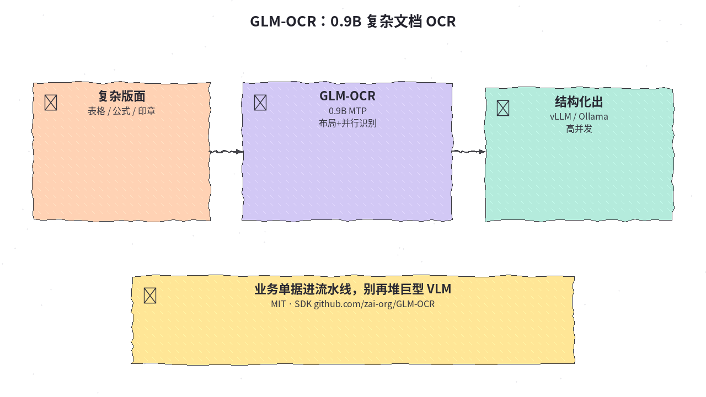
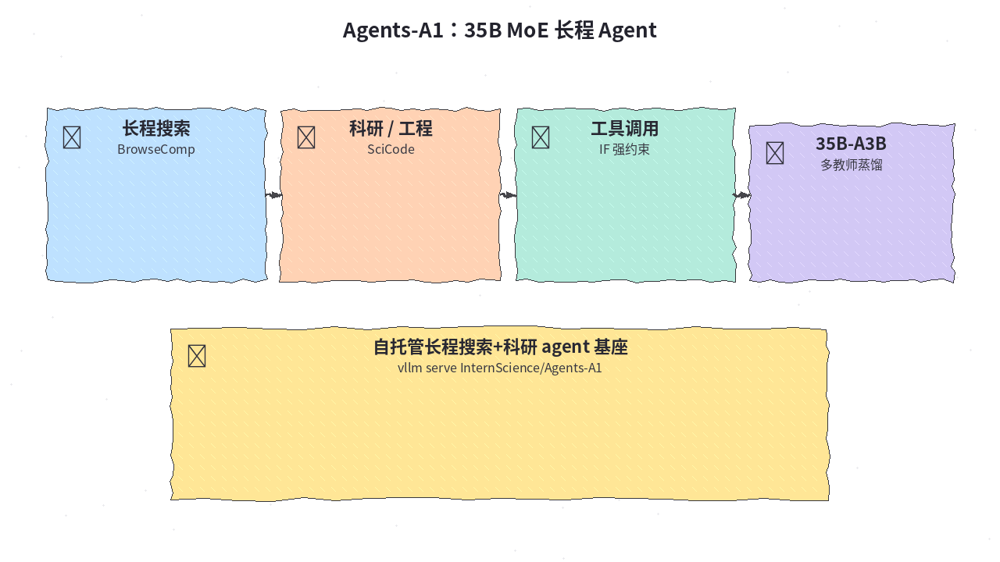
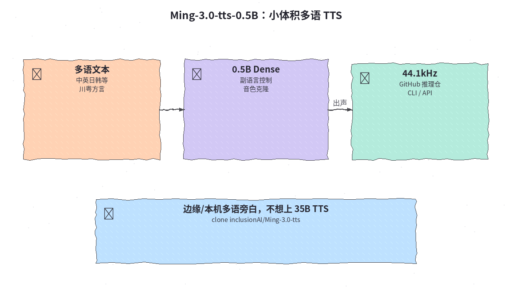
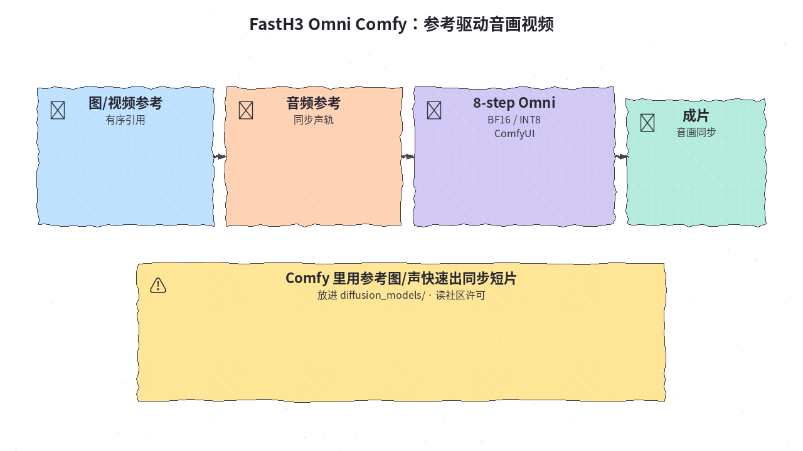
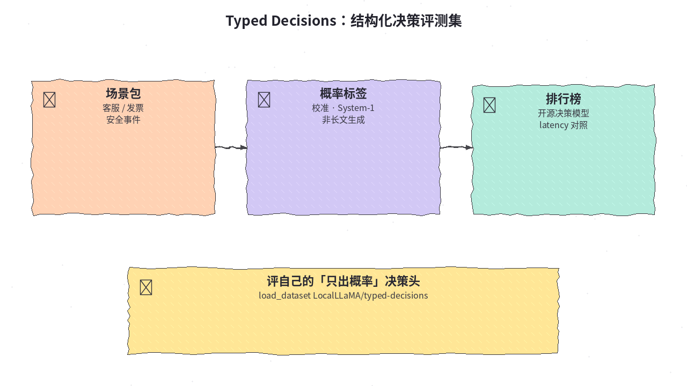
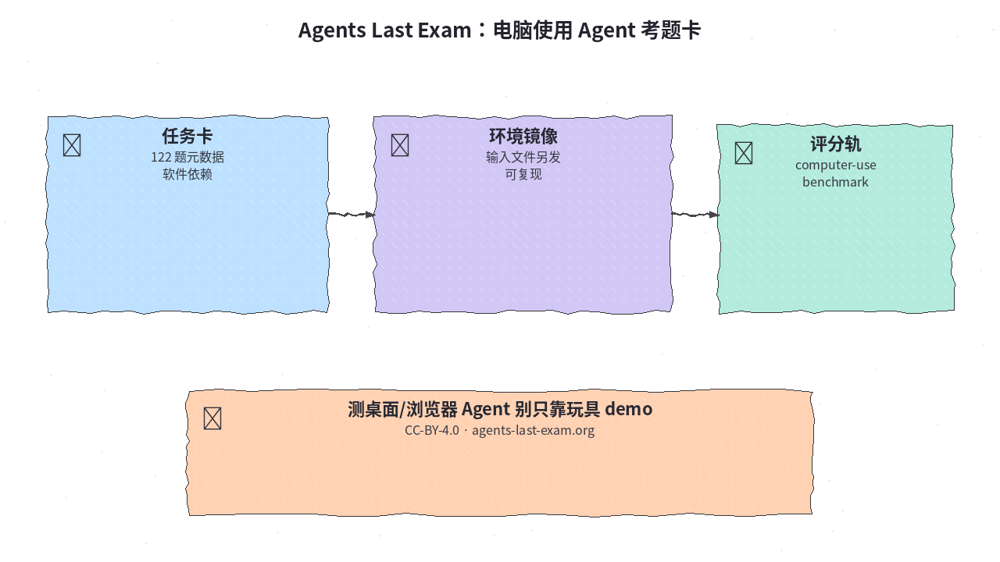
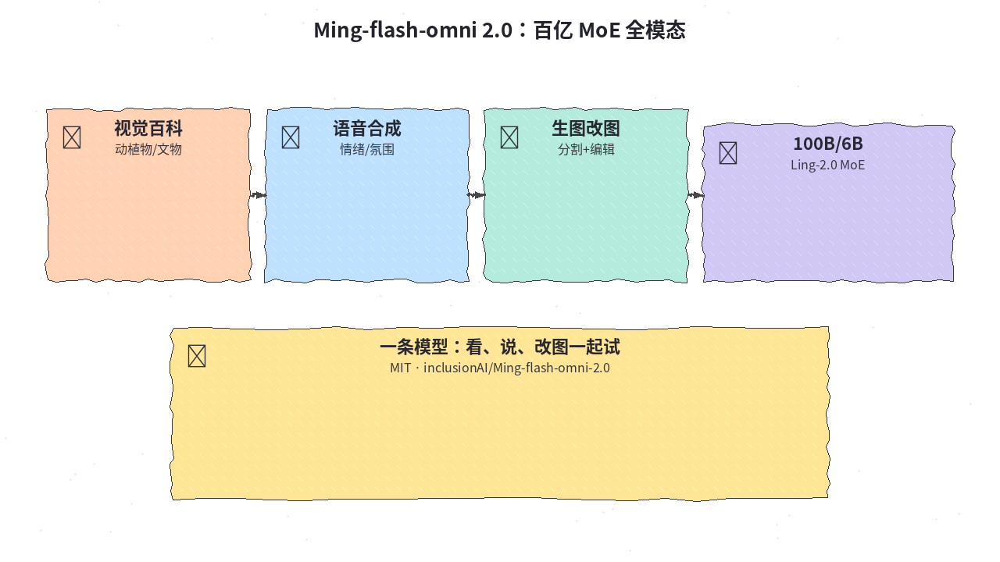

# 2026-10-27 Hugging Face 日报

今日精选 7 个可跟进条目（轻量文档 OCR / 长程 Agent MoE / 小体积多语 TTS / Comfy 音画视频包 / 结构化决策评测 / 电脑使用考题卡 / 全模态 Ming）。与往日日报、周报及今日仍在刷榜但已写过的 DeepSeek Flash / flint / Nanbeige / drama-3 等不重复。

## 1. zai-org/GLM-OCR — 0.9B 复杂文档 OCR

**介绍**  
智谱开源的文档理解 OCR（MIT，❤~2.2k）：GLM-V 编解码 + MTP 与稳定全任务 RL；CogViT 视觉编码 + 轻量连接器 + 0.5B 语言解码，配合 PP-DocLayout-V3 两段式布局与并行识别。OmniDocBench V1.5 官方宣称总分 94.62；强调表格、公式、印章等业务版面，可走 vLLM / SGLang / Ollama。

**用法**  
模型卡：[huggingface.co/zai-org/GLM-OCR](https://huggingface.co/zai-org/GLM-OCR)；SDK：[github.com/zai-org/GLM-OCR](https://github.com/zai-org/GLM-OCR)；API 文档见卡内 z.ai 链接。按 SDK README 一键调用；高并发部署用 vLLM/SGLang。

**应用场景**  
发票、合同、代码截图进流水线，不想为 OCR 单独养巨型 VLM。



**推荐学习程度**：入门

---

## 2. InternScience/Agents-A1 — 35B MoE 长程 Agent 基座

**介绍**  
Agents-A1（Apache-2.0，❤~662）：约 35B MoE agent 模型，强调长程轨迹与异质能力缩放——全域 SFT → 域教师 → 多教师 on-policy 蒸馏。覆盖长程搜索、工程、科研、指令遵循与工具调用；卡面给出与同级 ~35B 及更大模型对照。权重兼容 Transformers / vLLM / SGLang，并有量化与 mlx 社区包。

**用法**  
模型卡：[huggingface.co/InternScience/Agents-A1](https://huggingface.co/InternScience/Agents-A1)；主页：[internscience.github.io/Agents-A1](https://internscience.github.io/Agents-A1/)。  
```bash
uv pip install vllm --torch-backend=auto
vllm serve InternScience/Agents-A1
# 细节与 SGLang 段见模型卡 Inference
```

**应用场景**  
自托管「能搜、能调工具、能扛长任务」的开源 agent 基座，对照更大闭源模型。



**推荐学习程度**：专精

---

## 3. inclusionAI/Ming-3.0-tts-0.5B — 0.5B 多语可控 TTS

**介绍**  
Ming-3.0-tts 稠密 0.5B 检查点（MIT，❤~146）：Qwen2.5-0.5B 骨干 + DiT head / audio tokenizer / speaker encoder；中英德西法韩日，含川粤；44.1 kHz；副语言与自由形式控制、音色克隆。HF 仓只发权重，推理需克隆 GitHub 仓。

**用法**  
模型卡：[huggingface.co/inclusionAI/Ming-3.0-tts-0.5B](https://huggingface.co/inclusionAI/Ming-3.0-tts-0.5B)；推理：[github.com/inclusionAI/Ming-3.0-tts](https://github.com/inclusionAI/Ming-3.0-tts)；演示博客见卡内链接。  
```bash
git clone https://github.com/inclusionAI/Ming-3.0-tts
# 按仓库 README 装依赖后用 ming_tts.MingTTS / infer.py
```

**应用场景**  
本机/边缘多语旁白或方言试用，不想上 drama-3 一类更大 TTS。



**推荐学习程度**：进阶

---

## 4. FastVideo/FastH3-Omni-Comfy — ComfyUI 音画同步短片包

**介绍**  
FastH3 Omni 的 ComfyUI 发行（社区许可，跟随 MiniMax-H3，❤~163）：按提示 + 有序图/视频/音频参考生成视频与同步音频；提供 BF16 与 INT8 ConvRot diffusion 权重，并需配套 text encoder 与 video/audio VAE。适合已有 Comfy 流水线的人快速试「参考驱动音画」。

**用法**  
模型卡：[huggingface.co/FastVideo/FastH3-Omni-Comfy](https://huggingface.co/FastVideo/FastH3-Omni-Comfy)；集合：[huggingface.co/collections/FastVideo/fasth3-omniref](https://huggingface.co/collections/FastVideo/fasth3-omniref)。把选定 `diffusion_models/*.safetensors` 放进 `ComfyUI/models/diffusion_models/`，再按卡面装 text encoder 与 VAE；商用前读 MiniMax-H3 社区许可。

**应用场景**  
产品短视频要「参考图/参考声 → 同步成片」，已在用 ComfyUI。



**推荐学习程度**：进阶

---

## 5. LocalLLaMA/typed-decisions — 结构化决策评测集

**介绍**  
Typed Decisions（Apache-2.0，❤~250，下载~43k）：面向「输出类别概率而非长文」的 System-1 决策评测——含客服、发票处理、安全事件、agent trace 可观测等配置；社区在讨论区贴开源决策模型分数与延迟。适合校准/分类头，而不是生成式问答榜。

**用法**  
数据集：[huggingface.co/datasets/LocalLLaMA/typed-decisions](https://huggingface.co/datasets/LocalLLaMA/typed-decisions)。  
```python
from datasets import load_dataset
ds = load_dataset("LocalLLaMA/typed-decisions", "all")
# 或 customer_service / invoice_processing / security_incidents / agent_trace_observability
```

**应用场景**  
你在训/选「只出概率」的决策小模型（clef / d1 / JEV 一类），需要可复现对照集。



**推荐学习程度**：进阶

---

## 6. agents-last-exam/agents-last-exam — 电脑使用 Agent 考题卡

**介绍**  
Agents Last Exam v1.1 任务卡元数据（CC-BY-4.0，❤~231）：122 道活跃任务的标题、提示、分类、软件依赖与输入描述；输入文件、参考输出与环境镜像另发。定位 computer-use agent 基准，而不是纯文本答题。

**用法**  
数据集：[huggingface.co/datasets/agents-last-exam/agents-last-exam](https://huggingface.co/datasets/agents-last-exam/agents-last-exam)；站：[agents-last-exam.org](https://agents-last-exam.org)；源码：[github.com/rdi-berkeley/agents-last-exam](https://github.com/rdi-berkeley/agents-last-exam)。加载 `task_cards.parquet`（split `v1_1`）后，按清单对齐镜像与输入修订。

**应用场景**  
评测桌面/浏览器 Agent 时，需要标准化任务卡与可复现环境，而不是临时手写 demo。



**推荐学习程度**：专精

---

## 7. inclusionAI/Ming-flash-omni-2.0 — 100B/6B 全模态 MoE

**介绍**  
Ming-flash-omni 2.0（MIT，❤~280）：基于 Ling-2.0 MoE（总参约 100B、激活约 6B）的开源全模态模型——视觉百科认知、统一语音/音频/音乐合成（含零样本克隆与情绪控制）、以及分割/生成/编辑一体的高动态改图。卡面标注 `new_version` 指向更新线路，部署前对照最新说明。

**用法**  
模型卡：[huggingface.co/inclusionAI/Ming-flash-omni-2.0](https://huggingface.co/inclusionAI/Ming-flash-omni-2.0)；代码与报告见 [github.com/inclusionAI/Ming](https://github.com/inclusionAI/Ming) 与 arXiv:2506.09344。按仓库当前 README 拉权重与推理依赖（diffusers / 官方脚本）。

**应用场景**  
想在一条开源栈上同时试「看图百科 + 可控语音 + 改图」，做原型对照闭源 omni 模型。



**推荐学习程度**：专精
