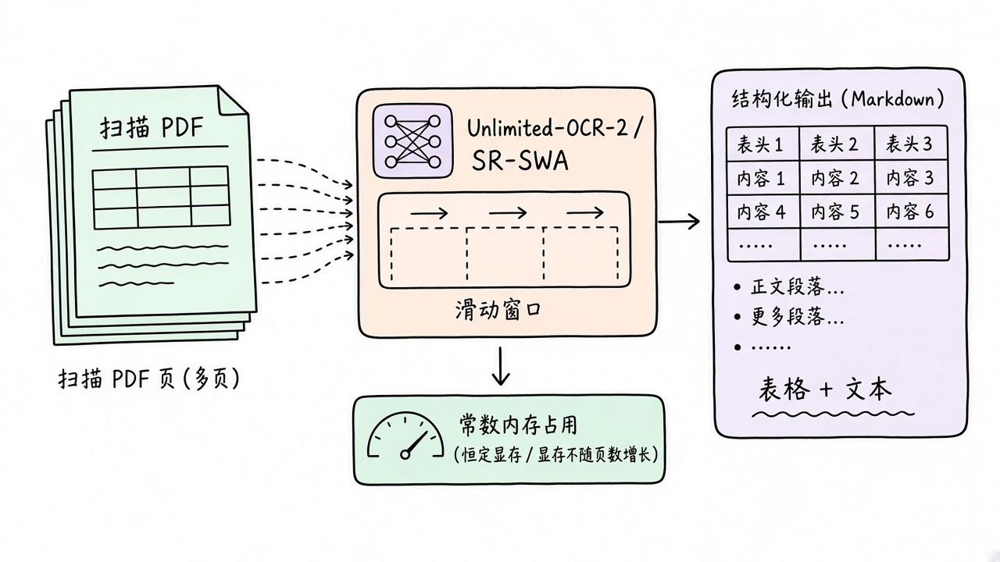
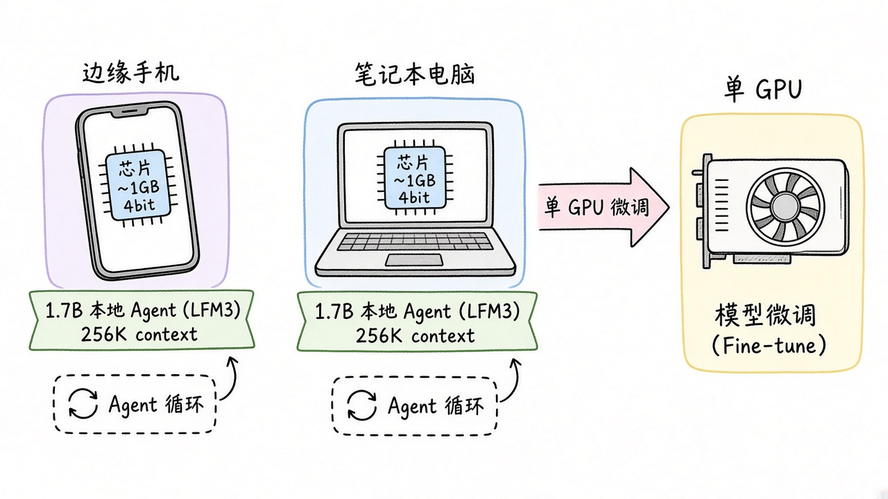
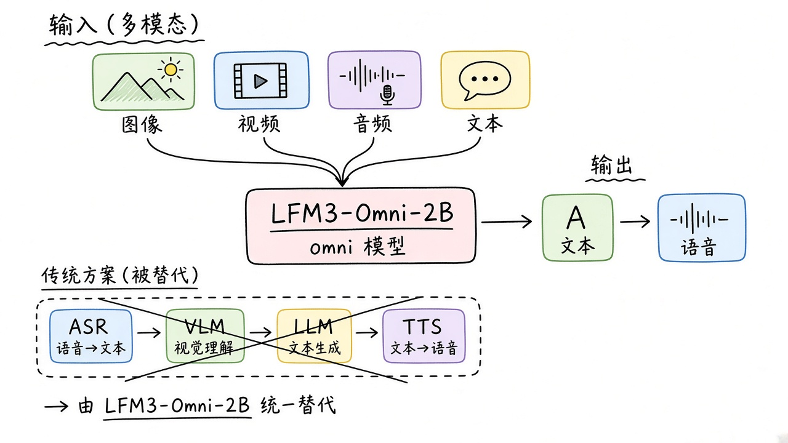
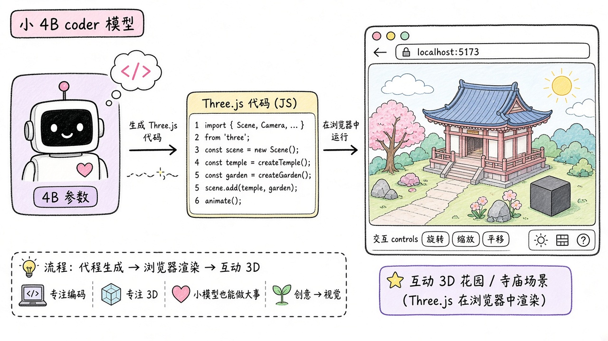
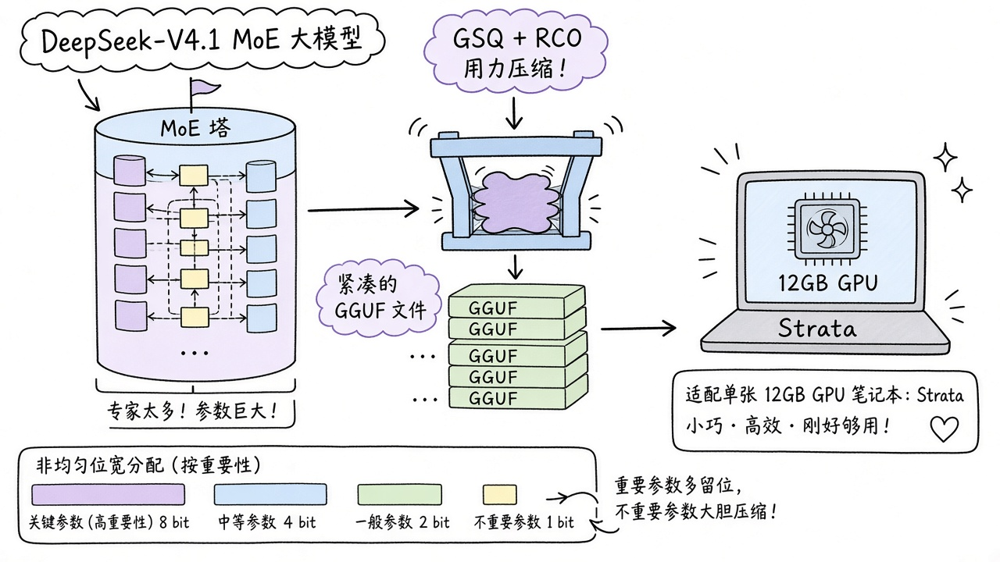

# 2026-10-28 Hugging Face 日报

今日精选 5 个新权重：Unlimited-OCR 2、LFM3 边缘文本与 Omni、小 4B Three.js 编码预览，以及 DeepSeek-V4.1 Flash 的 GSQ-RCO GGUF。

## 1. baidu/Unlimited-OCR-2 — 无限视野文档解析

**介绍**  
Unlimited-OCR-2（MIT，likes~249，2026-10-27）：SR-SWA 把超长文视注意力压到固定工作集，页数涨显存几乎不涨；附 MarathonDocBench，Space 可试。

**用法**  
模型卡：[huggingface.co/baidu/Unlimited-OCR-2](https://huggingface.co/baidu/Unlimited-OCR-2)；Space：[spaces/baidu/Unlimited-OCR-2](https://huggingface.co/spaces/baidu/Unlimited-OCR-2)；仓库：[github.com/baidu/Unlimited-OCR](https://github.com/baidu/Unlimited-OCR)。  
```bash
pip install torch==2.13.0 torchvision pillow transformers==4.52.1 \
  huggingface-hub==0.36.0 tokenizers==0.21.4 addict einops easydict
```
```python
from transformers import AutoModel, AutoTokenizer
name = "baidu/Unlimited-OCR-2"
tok = AutoTokenizer.from_pretrained(name, trust_remote_code=True)
model = AutoModel.from_pretrained(name, trust_remote_code=True,
                                  use_safetensors=True, torch_dtype="bfloat16").eval().cuda()
```

**应用场景**  
百页扫描件/长 PDF 一次结构化解析，不想被上下文长度卡住。



**推荐学习程度**：进阶

---

## 2. LiquidAI/LFM3-1.7B — 边缘本地 Agent 文本基座

**介绍**  
LFM3-1.7B（LFM1.0 license，likes~191，2026-10-27）：三混合架构约 1.73B，256K 上下文；4bit ~1GB，面向 Hermes/Pi/OpenClaw 等本地 agent，可单卡微调。同族还有 VL / Audio / Omni / d1。

**用法**  
模型卡：[huggingface.co/LiquidAI/LFM3-1.7B](https://huggingface.co/LiquidAI/LFM3-1.7B)；博文：[liquid.ai/blog/lfm3](https://www.liquid.ai/blog/lfm3)；集合：[LiquidAI/lfm3](https://huggingface.co/collections/LiquidAI/lfm3)。  
```python
from transformers import pipeline
generator = pipeline("text-generation", model="LiquidAI/LFM3-1.7B", trust_remote_code=True)
print(generator([{"role":"user","content":"What is C. elegans?"}],
                max_new_tokens=512)[0]["generated_text"][-1]["content"])
```

**应用场景**  
手机/笔记本上跑长上下文本地 agent，再按业务单卡微调。



**推荐学习程度**：进阶

---

## 3. LiquidAI/LFM3-Omni-2B — 端侧全模态一体

**介绍**  
LFM3-Omni-2B（LFM1.0，likes~79）：同一端到端模型吃文本/图/视频/音频，吐文本与语音，意图替代 ASR+VLM+LLM+TTS 四件套，面向 on-device。

**用法**  
模型卡：[huggingface.co/LiquidAI/LFM3-Omni-2B](https://huggingface.co/LiquidAI/LFM3-Omni-2B)；试玩：[playground.liquid.ai/talk](https://playground.liquid.ai/talk)。按卡内 transformers / 官方 docs 加载（`trust_remote_code=True`）。

**应用场景**  
端侧语音对话 + 看图/短视频，不想拼四套模型时试 Omni。



**推荐学习程度**：进阶

---

## 4. ccore/Qwen3.5-4B-3D-Coder — 小模型写 Three.js 互动 3D

**介绍**  
Qwen3.5-4B-3D-Coder（Apache-2.0，likes~177，预览，2026-10-26）：基于 Qwen3.5-4B 的早期微调，兼顾通用编码与高质量 Three.js 场景；训练仍在继续，先有 Q4/Q8 GGUF。

**用法**  
模型卡：[huggingface.co/ccore/Qwen3.5-4B-3D-Coder](https://huggingface.co/ccore/Qwen3.5-4B-3D-Coder)。用 llama.cpp / 兼容前端加载卡内 GGUF；生成设置见模型卡（Q4_K_M / Q8）。

**应用场景**  
本地小模型出可交互 Three.js 场景原型，顺带当轻量 coder。



**推荐学习程度**：进阶

---

## 5. ISTA-DASLab/DeepSeek-V4.1-Flash-1017-GSQ-RCO-GGUF — 非均匀 GGUF 塞进 12GB

**介绍**  
GSQ-RCO GGUF（MIT，likes~402，下载~1.1M，2026-10-27 更新）：对 DeepSeek-V4.1-Flash-1017（763B MoE）做按张量敏感度分配的非均匀量化（IQ1_M / IQ2_XXS / IQ2_XS）；配合 Strata 可单卡 12GB 跑。

**用法**  
模型卡：[huggingface.co/ISTA-DASLab/DeepSeek-V4.1-Flash-1017-GSQ-RCO-GGUF](https://huggingface.co/ISTA-DASLab/DeepSeek-V4.1-Flash-1017-GSQ-RCO-GGUF)；需 llama.cpp ≥ b11870。Engram 分片可按卡内说明 `ln -s` 复用。

**应用场景**  
消费级单卡想摸 DeepSeek-V4.1 Flash 量化版时选这条 GGUF。



**推荐学习程度**：深入
