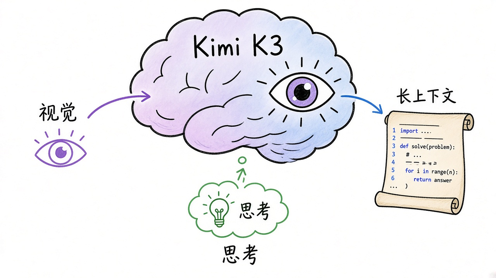
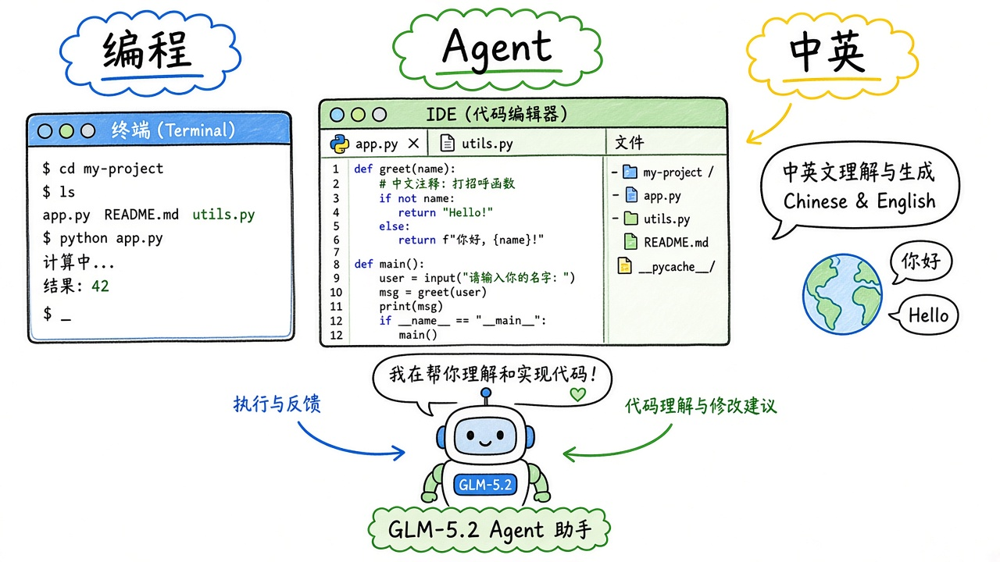
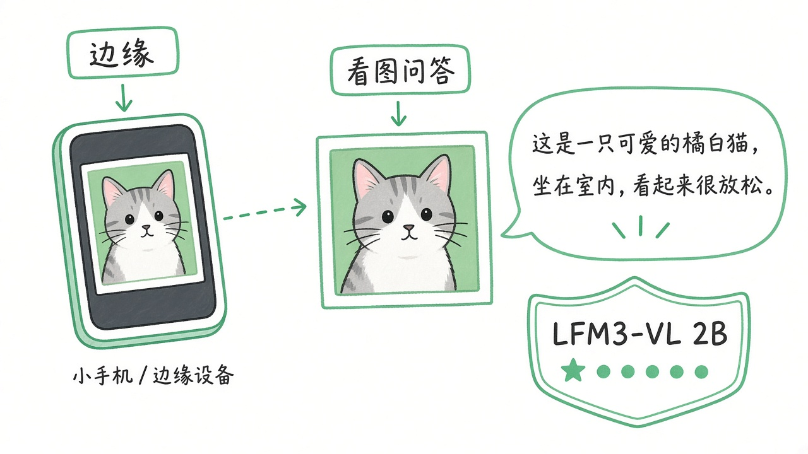
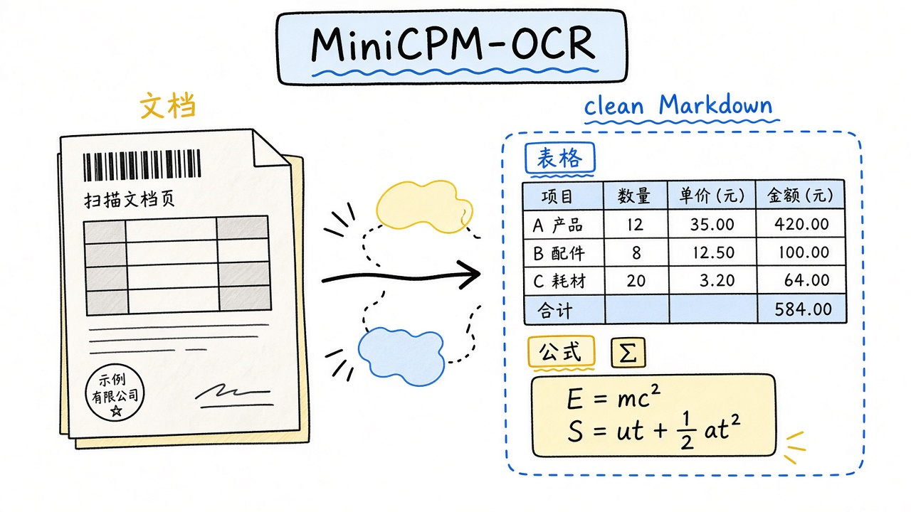
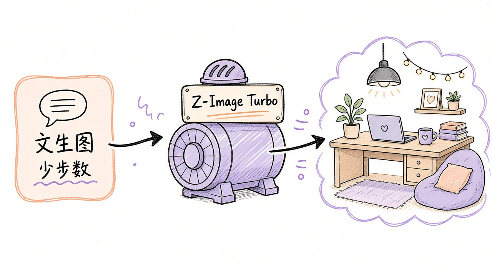
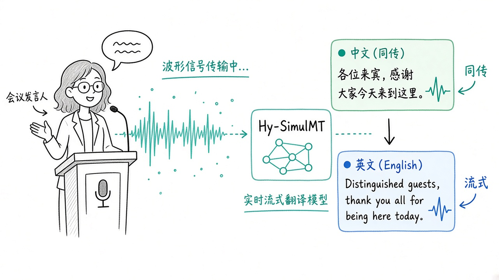
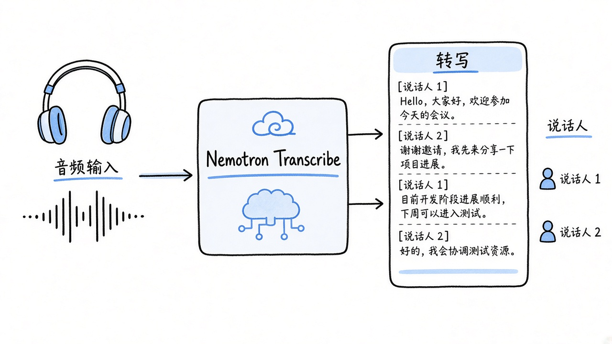

# 2026-10-29 Hugging Face 日报

今日精选 7 个：Kimi K3 与 GLM-5.2 两座编码向大模型、LFM3 视觉边端、MiniCPM OCR、Z-Image Turbo 生图、混元同传，以及 Nemotron 转写。

## 1. moonshotai/Kimi-K3 — 开源级 3T 档多模态推理

**介绍**  
Kimi-K3（Moonshot，likes~1.2 万，downloads~85 万）：约 2.8T 参数、原生视觉、百万级上下文；默认带 thinking（`reasoning_effort`），适合长程编码与知识工作。多轮须回传完整 `reasoning_content`。

**用法**  
模型卡：[huggingface.co/moonshotai/Kimi-K3](https://huggingface.co/moonshotai/Kimi-K3)；快速开始：[platform.kimi.ai docs](https://platform.kimi.ai/docs/guide/kimi-k3-quickstart)。推理可用 [vLLM recipes](https://recipes.vllm.ai/moonshotai/Kimi-K3) / SGLang；本地 agent 可配 [Kimi Code CLI](https://www.kimi.com/code) 用 `/model` 选 K3。

**应用场景**  
长仓库改动、带图的技术问答，或给 coding agent 换一档开源向大模型。



**推荐学习程度**：进阶

---

## 2. zai-org/GLM-5.2 — 中英 Agent / 编程向 MoE

**介绍**  
GLM-5.2（MIT，likes~5192）：智谱开源 MoE，偏 Agent、终端与仓库级任务；卡上列 vLLM / Transformers / KTransformers / Unsloth 配方。已有更新线 `GLM-5.3-BF16`。

**用法**  
模型卡：[huggingface.co/zai-org/GLM-5.2](https://huggingface.co/zai-org/GLM-5.2)；vLLM：[recipes.vllm.ai/zai-org/GLM-5.2](https://recipes.vllm.ai/zai-org/GLM-5.2)。
```bash
pip install -U "transformers>=4.5.12" vllm
# 按 recipes 起服务后用 OpenAI 兼容客户端调用
```

**应用场景**  
中文为主的 coding / 终端 agent 评测或私有化部署基座。



**推荐学习程度**：进阶

---

## 3. LiquidAI/LFM3-VL-2B — 边缘多模态视觉语言

**介绍**  
LFM3-VL-2B（LFM license，likes~135，2026-10-19）：与昨天推的 LFM3 文本同族，2B 级图文理解，面向端侧；支持视频帧采样参数。

**用法**  
模型卡：[huggingface.co/LiquidAI/LFM3-VL-2B](https://huggingface.co/LiquidAI/LFM3-VL-2B)。
```bash
pip install "transformers>=5.21.0" torch torchvision pillow
```
```python
import torch
from transformers import AutoModelForImageTextToText, AutoProcessor
mid = "LiquidAI/LFM3-VL-2B"
model = AutoModelForImageTextToText.from_pretrained(
    mid, dtype=torch.bfloat16, device_map="auto", trust_remote_code=True)
processor = AutoProcessor.from_pretrained(mid, trust_remote_code=True)
```

**应用场景**  
笔记本/小卡上看图问答、截图理解，不想上大 VL。



**推荐学习程度**：进阶

---

## 4. openbmb/MiniCPM-OCR-1.0 — 1.3B 文档 OCR 专精

**介绍**  
MiniCPM-OCR-1.0（likes~264，2026-10-21）：MiniCPM 家族首个 OCR 专模，侧重文字/表格/公式/印章与结构化抽取；宣称高吞吐，附 SDK、Space 与 Agent Skill。

**用法**  
模型卡：[huggingface.co/openbmb/MiniCPM-OCR-1.0](https://huggingface.co/openbmb/MiniCPM-OCR-1.0)；Space：[spaces/openbmb/MiniCPM-OCR](https://huggingface.co/spaces/openbmb/MiniCPM-OCR)；教程：[GitHub OpenBMB/MiniCPM-OCR](https://github.com/OpenBMB/MiniCPM-OCR)。本地优先官方 SDK + DSpark，或 vLLM / SGLang / llama.cpp。

**应用场景**  
合同/试卷/扫描 PDF 转 Markdown，要又快又开源可私部。



**推荐学习程度**：入门

---

## 5. Tongyi-MAI/Z-Image-Turbo — 单流 DiT 高效文生图

**介绍**  
Z-Image-Turbo（Apache-2.0，likes~5522）：通义 Z-Image 高效文生图线，单流 Diffusion Transformer；diffusers 已合入，需较新 diffusers。

**用法**  
模型卡：[huggingface.co/Tongyi-MAI/Z-Image-Turbo](https://huggingface.co/Tongyi-MAI/Z-Image-Turbo)。
```bash
pip install git+https://github.com/huggingface/diffusers
```
```python
import torch
from diffusers import ZImagePipeline
pipe = ZImagePipeline.from_pretrained(
    "Tongyi-MAI/Z-Image-Turbo", torch_dtype=torch.bfloat16, low_cpu_mem_usage=False)
pipe.to("cuda")
image = pipe("a cozy desk with a laptop and tea", num_inference_steps=8).images[0]
```

**应用场景**  
产品示意、封面草图，要开源管线且推理步数少。



**推荐学习程度**：入门

---

## 6. tencent/Hy-SimulMT-30B-A3B-FP8 — 混元同声传译 MoE

**介绍**  
Hy-SimulMT-30B-A3B-FP8（likes~366，2026-10-22）：腾讯混元同传线 FP8 权重，流式翻译；配套 [Hy-SimulMT](https://github.com/Tencent-Hunyuan/Hy-SimulMT) 部署脚本与 SimulInfer。

**用法**  
模型卡：[huggingface.co/tencent/Hy-SimulMT-30B-A3B-FP8](https://huggingface.co/tencent/Hy-SimulMT-30B-A3B-FP8)。
```bash
git clone https://github.com/Tencent-Hunyuan/Hy-SimulMT.git
cd Hy-SimulMT/SimulInfer
bash deploy.sh --install-server --model tencent/Hy-SimulMT-30B-A3B-FP8
# 流式：curl -N http://127.0.0.1:8080/translate/stream ...
```

**应用场景**  
会议/直播需要近实时中英（等多语）字幕或同传服务。



**推荐学习程度**：深入

---

## 7. nvidia/NVIDIA-Nemotron-3.5-Transcribe-30B-A4B — 转写 + 语种翻译 ASR

**介绍**  
Nemotron-3.5-Transcribe-30B-A4B（NVIDIA，likes~191）：语音转写，兼语音翻译与说话人相关能力；可用 vLLM + NeMo Speech 或 Transformers 源码推理。

**用法**  
模型卡：[huggingface.co/nvidia/NVIDIA-Nemotron-3.5-Transcribe-30B-A4B](https://huggingface.co/nvidia/NVIDIA-Nemotron-3.5-Transcribe-30B-A4B)。按卡内 Quick Start：装 vLLM 0.32 + NeMo Speech，或
```bash
pip install git+https://github.com/huggingface/transformers
# 再按模型卡 Transformers 示例转写音频
```

**应用场景**  
会议录音转写、多语字幕管线，要开源权重可微调。



**推荐学习程度**：进阶
