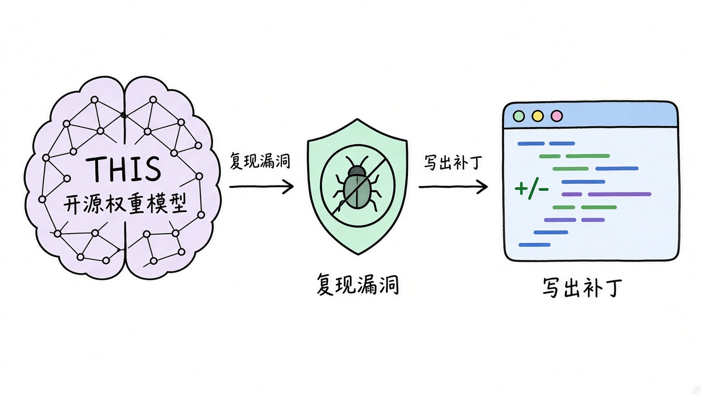
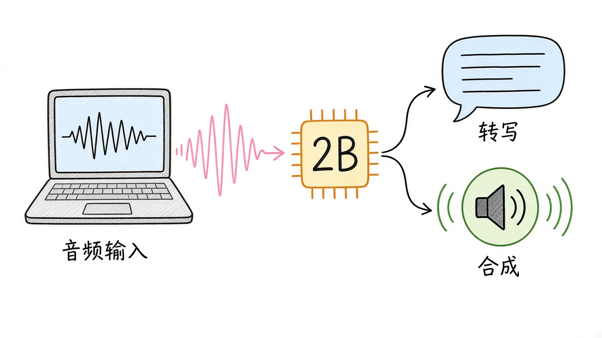
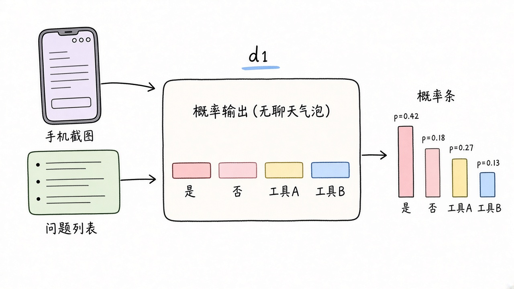
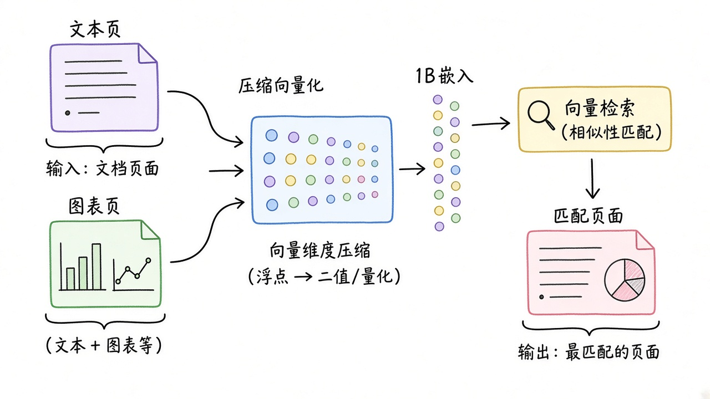
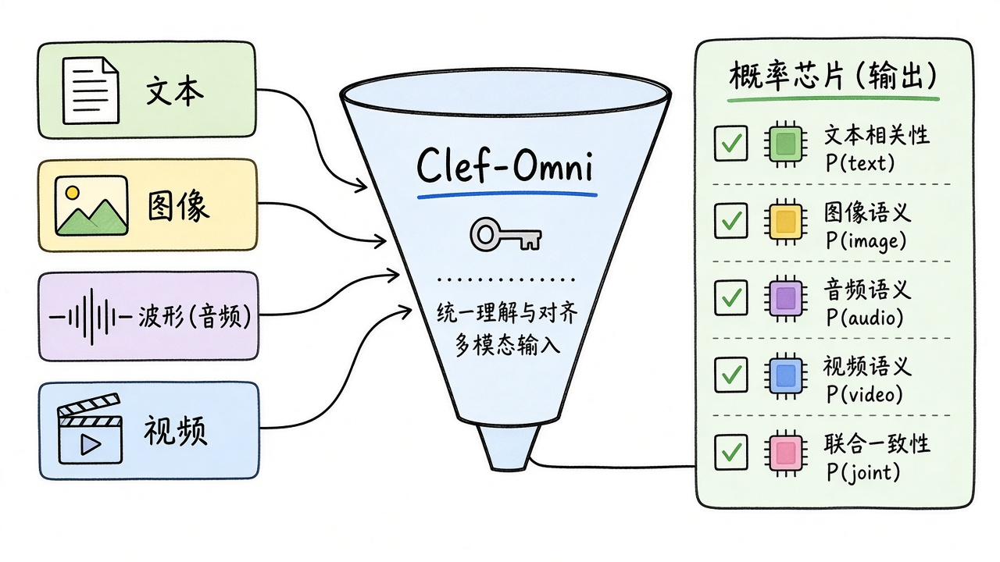
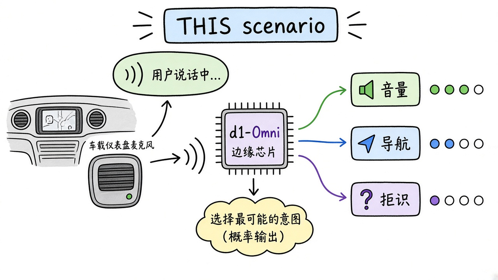

# 2026-10-30 Hugging Face 日报

今日精选 7 个近几天值得试用的模型/库（Mistral Large 4（Le、LFM3-Audio-2B、d1-2B、Clover-35B 等）。与往日日报、周报不重复。

## 1. mistralai/Mistral-Large-4-1T-A52B — Mistral Large 4（Le Chonk）：约 1T MoE 开源多模态

**介绍**  
Mistral 于 2026-10-29 在 HF 博客正式推介 Large 4（别名 Le Chonk）：约 1T 总参、约 52B 激活的多模态 MoE，支持图文输入与 1M 上下文。架构结合稀疏专家路由、稀疏注意力与 Pixtral 视觉编码器；官方强调网络安全（漏洞复现与修补）、编码 Agent 与多模态工作流。提供 FP8 / NVFP4 官方权重，以及 Unsloth、llama.cpp 等社区 GGUF。

**用法**  
Hub 下载 mistralai/Mistral-Large-4-1T-A52B（或 *-NVFP4）；transformers 用 AutoModelForMultimodalLM + AutoProcessor，可设 reasoning_effort=low|medium|high。生产可用 vLLM（NVFP4 + 专家并行）或 Inference Endpoints；本机可试 ggml-org/Mistral-Large-4-1T-A52B-GGUF。许可为 Mistral Ecosystem Open-Weight（MIT 衍生，对 MaaS 有限制）。

**应用场景**  
自建安全运营 / 编码 Agent：需要开源权重复现漏洞并出补丁，又不想被闭源安全过滤器拦下。

**推荐学习程度**：深入

---

## 2. LiquidAI/LFM3-Audio-2B — LFM3-Audio-2B：端侧语音对话 + 多语 ASR/TTS

**介绍**  
LiquidAI LFM3 家族的音频分支：约 2B 参数，文本或音频进，文本、24kHz 语音或交错音字出。支持语音聊天、约 18 语种转写/合成/翻译、音频理解与工具调用；自研因果音频编码器与 LiquidCodec，强调流式与边缘部署。相对 LFM2.5-Audio 提升语音质量与口语指令跟随；另有 GGUF / MLX / ONNX 变体。

**用法**  
pip install "transformers>=5.20.2" torch librosa soundfile；AutoModelForMultimodalLM + AutoProcessor（trust_remote_code）。系统提示切换 ASR / TTS / 交错音字 / LiveASR；可用 vLLM、SGLang、llama.cpp 或 MLX 量化。单卡笔记本即可试，语音聊天目前主推英语。

**应用场景**  
笔记本或边缘设备上的本地语音助手：边说边转写，或口语直接触发设备工具调用。

**推荐学习程度**：进阶

---

## 3. LiquidAI/d1-2B — d1-2B：LFM3 上的毫秒级多模态决策模型

**介绍**  
基于 LFM3-VL-2B 的决策模型：对文本/图片/视频一次前向给出校准答案，不生成自由文本。可做分类、抽取（带 span）、定位与带区间的数量估计；官方称在开源 d1 系列平均分领先且小于旧版 d1-3B。单状态可并行回答任意多个命名问题，H100 上约数毫秒级决策。

**用法**  
从 LiquidAI/d1-2B 加载（trust_remote_code）；输入状态（文本/JSON）+ 可选图像/视频 + 一组命名问题与选项 schema。适合塞进 Agent 路由、审核闸门、结构化抽取管线；需要音频决策时改用同系列 d1-Omni-2B。

**应用场景**  
内容审核或 Agent 路由：给一张截图/视频帧，一次前向得到「是否违规 / 选哪条工具」的概率，而不是再跑一轮 LLM。

**推荐学习程度**：进阶

---

## 4. Diffuspace/Clover-35B-A3B-Preview — Clover-35B：开源扩散语言模型预览（35B/3B 激活）

**介绍**  
DiffuSpace 首发开源扩散语言模型：35B MoE 骨干、约 3B 激活，块扩散（block diffusion）解码与 128K 上下文，Apache-2.0。自 Qwen3.6-35B-A3B 衍生，保留混合注意力 MoE，并加入双向块内注意力与 LowConfidence 并行填空解码。官方推荐 SGLang 做服务与评测，HF Transformers 路径可单机试用；另有 GGUF。

**用法**  
pip install "transformers==5.19.0" accelerate；BF16 权重大约需 ~69GB 显存。AutoModelForCausalLM + trust_remote_code，generate 时设 block_size=32、threshold=0.95。生产/复现基准优先官方 SGLang；本机可试 Diffuspace/Clover-35B-A3B-Preview-GGUF。

**应用场景**  
想对比「自回归 vs 扩散」长文生成：同一 3B 激活量级下试并行块解码能否更快填完长回答。

**推荐学习程度**：深入

---

## 5. nvidia/Nemotron-3.5-Embed-1B-BF16 — Nemotron 3.5 Embed 1B：轻量多模态检索

**介绍**  
NVIDIA Nemotron Retriever 系列的 1B 稠密嵌入：可把文档页（纯文本、页图或图文混合）编成向量，用文本查询检索。多语文本与多语图像检索评测表现强，定位为 8B 版的蒸馏小脚印；另有 NVFP4 量化与同系列 Rerank/Parse。适合 RAG / Agent 取证时控制索引与在线成本。

**用法**  
Hub 拉取 nvidia/Nemotron-3.5-Embed-1B-BF16（或 *-NVFP4）；可用 sentence-transformers / transformers / vLLM，或 NVIDIA NIM 与多家 Inference Partner。文档页可当图像喂入，查询用文本；需要更高召回可升到 Embed-8B，二阶段用 Rerank-8B。

**应用场景**  
企业知识库：扫描版 PDF 页直接入库向量，小模型扛住多语图文检索，再交给 Agent 引用。

**推荐学习程度**：进阶

---

## 6. Cloudflare/clef-omni — Clef-Omni：音视频也能决策的 System-1 模型

**介绍**  
Cloudflare Clef 家族的 Omni 版：从 Qwen3-Omni-30B-A3B 后训练，30B MoE / 3B 激活。输入状态可以是文本、JSON、图像、音频或视频，按 schema 对所有问题的所有选项一次前向出概率，不做自由生成、无需解析输出。API 与 JEV / SystemOne 兼容；相对稠密 Clef / Clef-Flash，补齐了音频与视频状态。

**用法**  
按模型卡用 load_release_model / joint schema 头；构造 typed questions schema，把多模态 state 喂入，对每题 softmax 得选项概率。适合替换「先 VL 描述再 LLM 分类」的两段式管线。权重 Apache-2.0。

**应用场景**  
客服质检或内容闸门：一段通话录音或屏幕录像直接进模型，一次得到多标签合规判定概率。

**推荐学习程度**：进阶

---

## 7. LiquidAI/d1-Omni-2B — d1-Omni-2B：带音频的边缘决策模型

**介绍**  
LFM3 决策线的 Omni 变体：在 d1-2B 的文本/图/视频决策能力上增加音频输入，仍是一次前向、校准选项、不生成文本。与 LFM3-Omni / LFM3-Audio 同骨干生态，面向边缘 Agent 的「听完立刻做选择」场景；有 GGUF / MLX / ONNX 量化。

**用法**  
加载 LiquidAI/d1-Omni-2B（trust_remote_code），state 可含音频片段；问题与选项 schema 同 d1 系列。边缘可用 GGUF 或 MLX；只要图文决策则用更轻的 d1-2B 即可。

**应用场景**  
智能音箱或车机本地路由：听完用户一句话，毫秒级决定是调高音量、导航还是拒识，不上云生成长回复。

**推荐学习程度**：进阶
