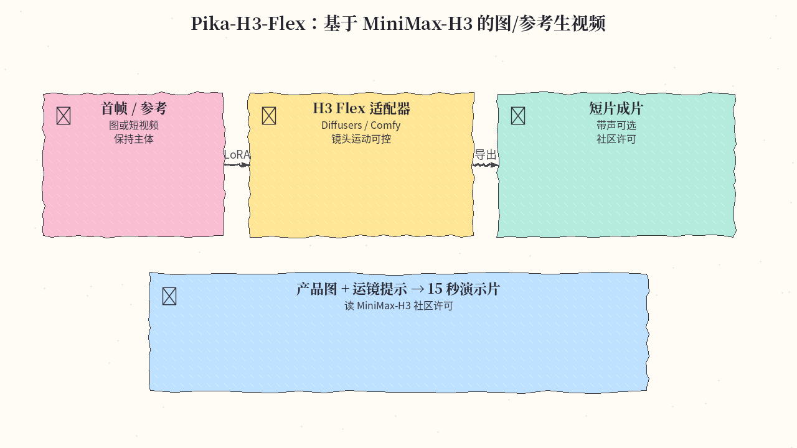
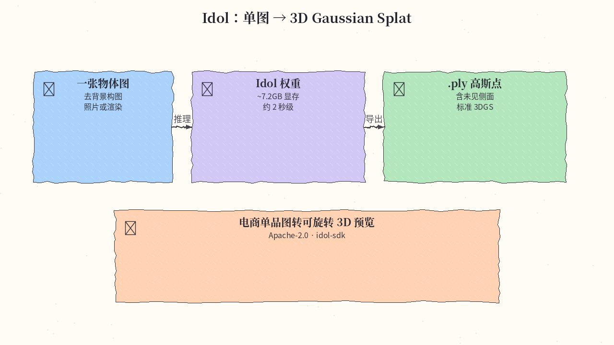
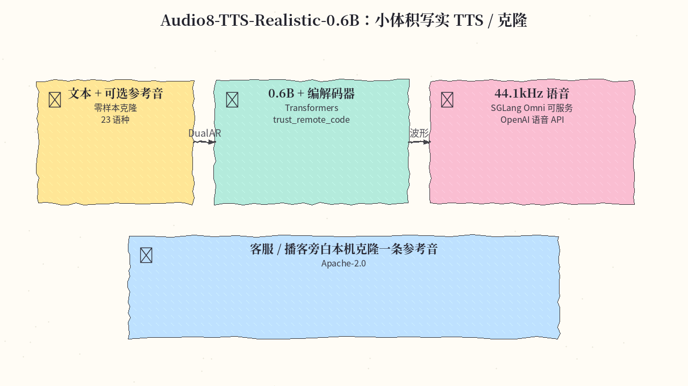
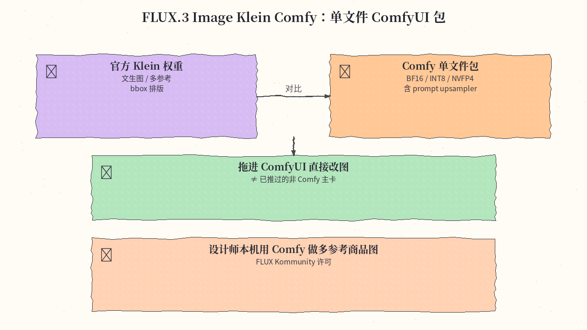
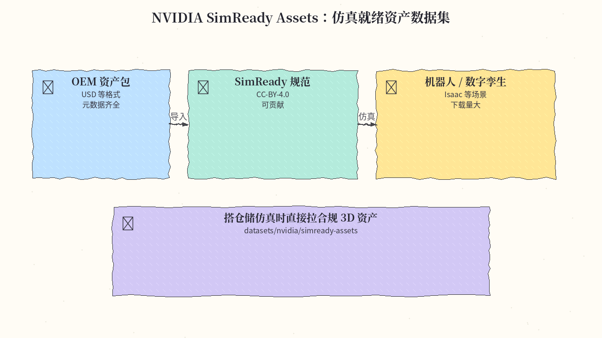
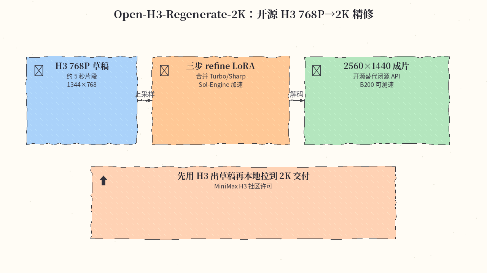

# 2026-11-02 Hugging Face 日报

今日精选 6 条：Pika H3 Flex 图生视频、Idol 单图 3DGS、Audio8 写实 TTS、FLUX.3 Klein 的 Comfy 单文件包、NVIDIA SimReady 资产数据集，以及开源 H3 2K 精修。与往日日报、周报（含 DeepSeek-V4.1-Flash、Mistral Large 4、LFM3、Nemotron、LTX 等）不重复。

## 1. Pika-Labs/Pika-H3-Flex — MiniMax-H3 上的 Flex 图/参考生视频

**介绍**  
挂在 MiniMax-H3 上的图像/参考到视频适配器（LoRA，likes≈312）：可用 Diffusers 或 Comfy 工作流，强调镜头运动与主体一致性；权重走 MiniMax-H3 社区许可。2026-10-29 上线。

**用法**  
模型卡：[huggingface.co/Pika-Labs/Pika-H3-Flex](https://huggingface.co/Pika-Labs/Pika-H3-Flex)；Diffusers 文档与示例见卡内 `examples/`；Comfy 教程：[docs.comfy.org … pika-h3-flex](https://docs.comfy.org/tutorials/video/pika/pika-h3-flex)。部署前阅读许可与显存说明（官方在 H100 测过 480p/768p）。

**应用场景**  
产品静帧 + 运镜提示生成十几秒演示短片。



**推荐学习程度**：进阶

---

## 2. speridlabs/idol — 单图到 3D Gaussian Splat

**介绍**  
一张物体图 → 标准 3DGS `.ply`（可含未见侧面），消费级 GPU 约 7.2GB 显存、可在约 2 秒内出结果。Apache-2.0，likes≈304，下载约 4k+；另有 Space 与 idol-sdk。

**用法**  
模型卡：[huggingface.co/speridlabs/idol](https://huggingface.co/speridlabs/idol)；代码：[github.com/speridlabs/idol-sdk](https://github.com/speridlabs/idol-sdk)；Demo：[spaces/speridlabs/idol](https://huggingface.co/spaces/speridlabs/idol)。

```bash
# 需先接受卡内两个 gated 编码器条款并 hf auth login
git clone https://github.com/speridlabs/idol-sdk.git && cd idol-sdk
pip install -e .   # Python 3.10+、PyTorch 2.5+、NVIDIA CUDA
# 首次运行自动拉 Idol 权重与编码器到 HF cache
```

**应用场景**  
电商单品图转可旋转 3D 预览再进自己的查看器。



**推荐学习程度**：进阶

---

## 3. Edge0/Audio8-TTS-Realistic-0.6b — 0.6B 写实 TTS / 零样本克隆

**介绍**  
在 Preview 上加强真实感与语种覆盖的 DualAR TTS：主模型约 0.6B，捆绑 44.1kHz 编解码器；支持零样本克隆与无参考合成，宣称 23 语种。Apache-2.0，likes≈207；可用 Transformers 或 SGLang Omni 服务。

**用法**  
模型卡：[huggingface.co/Edge0/Audio8-TTS-Realistic-0.6b](https://huggingface.co/Edge0/Audio8-TTS-Realistic-0.6b)；Playground：[spaces/Edge0/Audio8-TTS-Realistic-0.6b](https://huggingface.co/spaces/Edge0/Audio8-TTS-Realistic-0.6b)；代码：[github.com/Edge0-AI/Audio8_TTS](https://github.com/Edge0-AI/Audio8_TTS)。

```bash
pip install "torch>=2.5.0" "torchaudio>=2.5.0" \
  "transformers>=4.57.0,<5" "soundfile>=0.12" "safetensors>=0.4"
# 然后按卡内示例：
# from transformers import AutoModel, AutoProcessor
# model = AutoModel.from_pretrained("Edge0/Audio8-TTS-Realistic-0.6b", trust_remote_code=True)
```

**应用场景**  
用一条参考音在本机克隆客服/播客旁白，再接 OpenAI 兼容语音 API。



**推荐学习程度**：进阶

---

## 4. black-forest-labs/flux-3-image-klein-comfy — FLUX.3 Klein 的 ComfyUI 单文件包

**介绍**  
面向 ComfyUI 的 diffusion-single-file 发行：含 Klein / base 的 BF16、INT8、NVFP4 与 Qwen3-VL / prompt upsampler 权重。likes≈2.3k，下载约 97 万。与已推过的 `flux-3-image-klein` 主卡不同——这是 Comfy 打包线；许可为 FLUX Kommunity。

**用法**  
模型卡：[huggingface.co/black-forest-labs/flux-3-image-klein-comfy](https://huggingface.co/black-forest-labs/flux-3-image-klein-comfy)（gated：需 HF 登录并接受条款）。按卡内路径把 `diffusion_models/` 与 `text_encoders/` 放进 ComfyUI 对应目录，走文生图 / 多参考编辑工作流；须使用 prompt upsampler。

**应用场景**  
设计师本机用 Comfy 做多参考商品图与带 bbox 的海报排版。



**推荐学习程度**：进阶

---

## 5. nvidia/simready-assets — SimReady 仿真资产数据集

**介绍**  
NVIDIA 开放的 SimReady 资产集（CC-BY-4.0，likes≈1.2k，下载约 112 万）：OEM 风格仿真就绪包（含 USD 与合规元数据），可与 SimReady Central / 贡献库配合。2026-10-29 仍有更新。

**用法**  
数据集卡：[huggingface.co/datasets/nvidia/simready-assets](https://huggingface.co/datasets/nvidia/simready-assets)。用 `huggingface-cli download nvidia/simready-assets --repo-type dataset`（或 Hub UI）拉取所需资产子目录；导入支持 USD 的仿真栈（如 Isaac 生态）前先读包内 LICENSE/元数据。

**应用场景**  
搭仓储/医疗设备数字孪生时直接引用合规 3D 资产，而不是从零建模。



**推荐学习程度**：入门

---

## 6. Efficient-Large-Model/Open-H3-Regenerate-2K — 开源 H3 768P→2K 精修

**介绍**  
开源替代闭源 H3-Regenerate-2K：把约 5 秒的 MiniMax-H3 768P 草稿（1344×768，121 帧）经 latent 上采样 + 三步 refine 拉到 2560×1440。提供合并 LoRA、快速 VAE 与 Sol-Engine 测速；走 MiniMax H3 社区许可。likes≈155。

**用法**  
模型卡：[huggingface.co/Efficient-Large-Model/Open-H3-Regenerate-2K](https://huggingface.co/Efficient-Large-Model/Open-H3-Regenerate-2K)；项目页：[nvlabs.github.io/Sana/Open-H3-Regenerate-2K](https://nvlabs.github.io/Sana/Open-H3-Regenerate-2K/)；代码：[github.com/NVlabs/Sana … Open-H3-Regenerate-2K](https://github.com/NVlabs/Sana/tree/sol-engine/models/Open-H3-Regenerate-2K)。按代码目录 `download.py` 拉齐 LoRA / upsampler / VAE 与 base_model 后按 README 采样公式跑三步 Euler。

**应用场景**  
先用 H3 快速出草稿，再在本机/集群精修到 2K 交付客户。



**推荐学习程度**：深水

---
