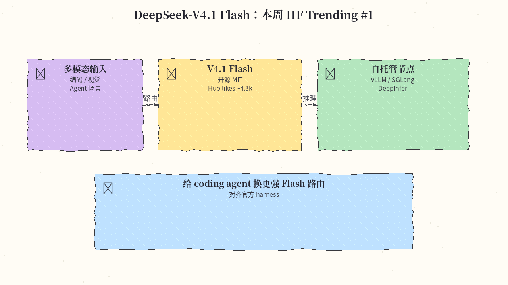
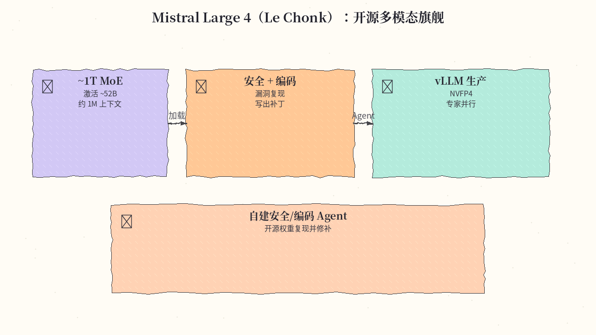
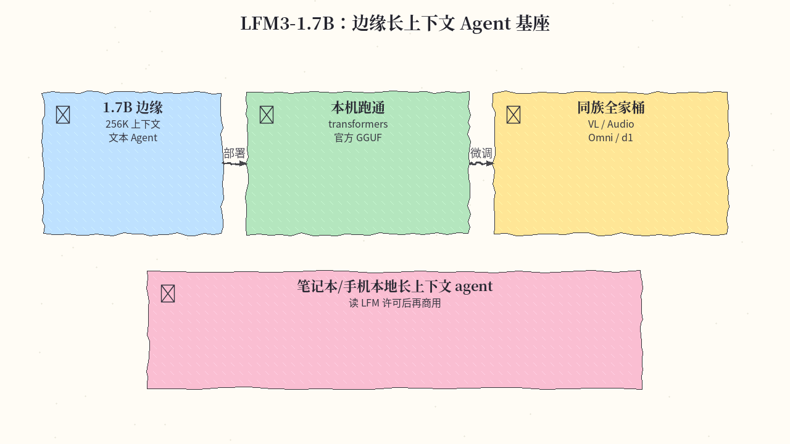
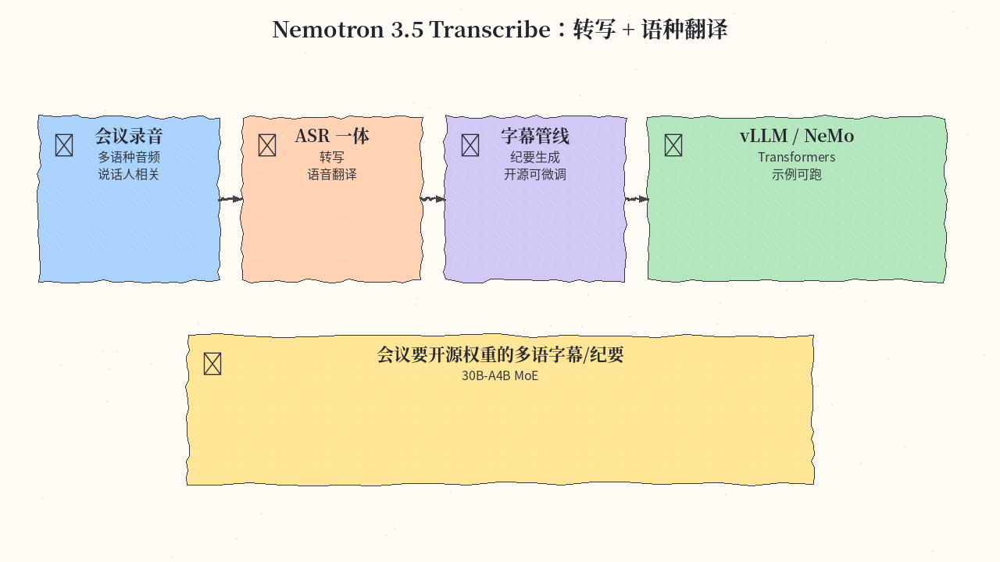
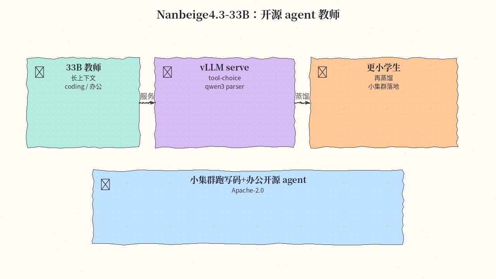
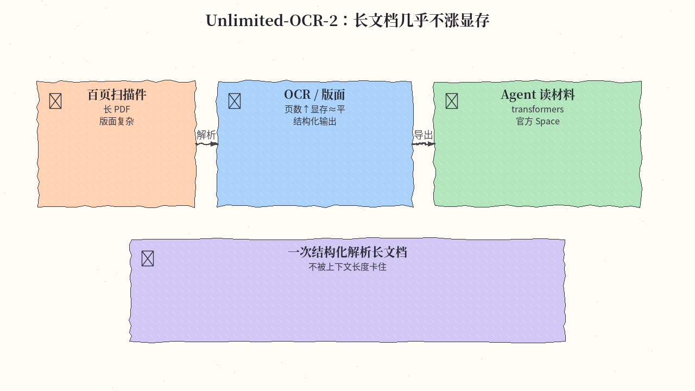
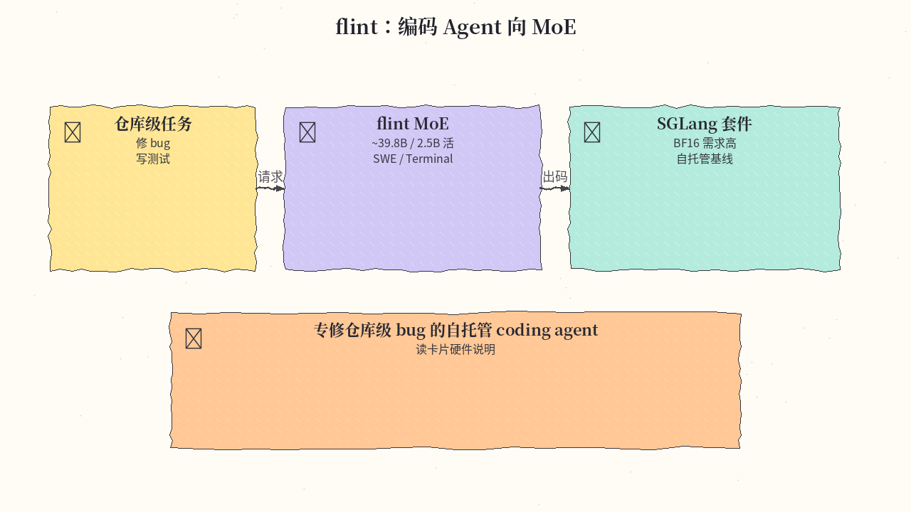
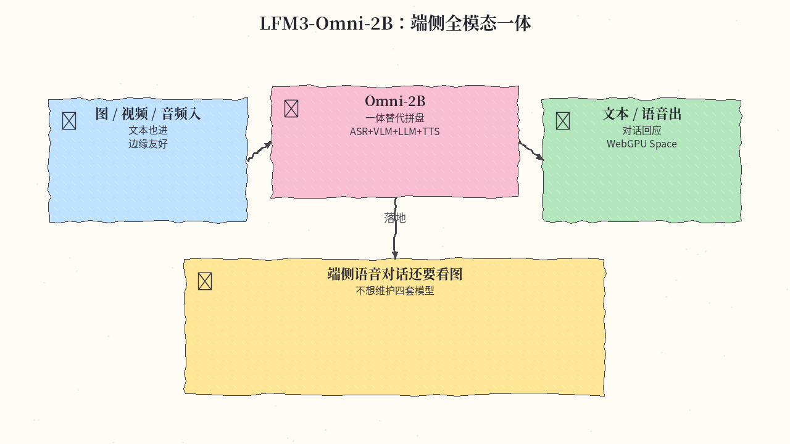
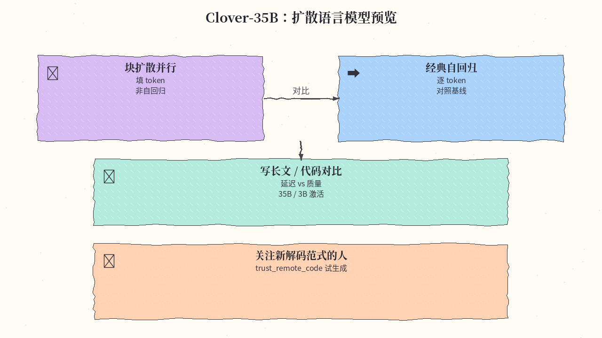
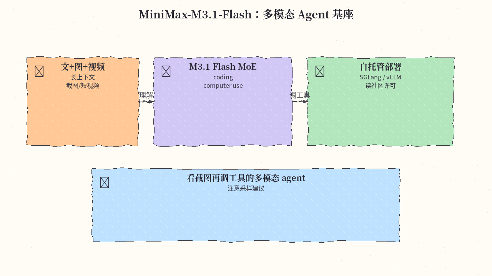

# 2026-11-02 Hugging Face 周报

上周（10/26–11/01）精选 10 个值得跟进的模型与权重（偏 Flash 基座 / 边缘 Omni / ASR / OCR / 编码 MoE / 扩散 LM）。

## 1. deepseek-ai/DeepSeek-V4.1-Flash-1017 — DeepSeek-V4.1 Flash：本周 HF Trending #1

**介绍**  
DeepSeek-V4.1-Flash-1017（MIT）：整周 Hugging Face Trending 常驻 #1 的开源多模态 Flash 基座，编码 / agent / 视觉场景都热；Hub likes ~4.3k。适合作为自托管 coding agent 的主力路由模型。

**用法**  
卡片：[huggingface.co/deepseek-ai/DeepSeek-V4.1-Flash-1017](https://huggingface.co/deepseek-ai/DeepSeek-V4.1-Flash-1017)。用 vLLM / SGLang / DeepInfer 拉权重；无标准 Jinja chat template 时按官方 deepseek-recipe 拼 prompt。

**应用场景**  
给 coding agent 换更强 Flash 路由，或自建推理节点对齐官方 harness。

**推荐学习程度**：进阶

---

## 2. mistralai/Mistral-Large-4-1T-A52B — Mistral Large 4（Le Chonk）开源多模态

**介绍**  
Mistral Large 4（~1T / 激活 ~52B MoE，多模态，约 1M 上下文）：本周 HF 博客正式推介的开源权重旗舰，偏安全运营与编码 Agent。许可为 Mistral Ecosystem Open-Weight。

**用法**  
卡片：[huggingface.co/mistralai/Mistral-Large-4-1T-A52B](https://huggingface.co/mistralai/Mistral-Large-4-1T-A52B)。Transformers `AutoModelForMultimodalLM` + Processor；生产优先 vLLM（NVFP4 + 专家并行）。博客：[Welcome Le Chonk](https://huggingface.co/blog/mistral-large4)。

**应用场景**  
自建安全/编码 Agent：开源权重复现漏洞并写出补丁。

**推荐学习程度**：专家

---

## 3. LiquidAI/LFM3-1.7B — LFM3-1.7B：边缘长上下文 Agent 基座

**介绍**  
LiquidAI LFM3-1.7B（创建于 2026-10-23）：~1.7B 边缘文本 Agent 基座，256K 上下文，本周冲到 Trending 前列；同族还有 VL / Audio / Omni / d1 决策变体，适合端侧全家桶。

**用法**  
卡片：[huggingface.co/LiquidAI/LFM3-1.7B](https://huggingface.co/LiquidAI/LFM3-1.7B)。`transformers` + `trust_remote_code`；另有官方 GGUF。读 LFM 许可后再商用。系列介绍：[Build with LFM3](https://huggingface.co/blog/LiquidAI/lfm3)。

**应用场景**  
笔记本/手机长上下文本地 agent，再按业务单卡微调。

**推荐学习程度**：进阶

---

## 4. nvidia/NVIDIA-Nemotron-3.5-Transcribe-30B-A4B — Nemotron 3.5 Transcribe：转写 + 语种翻译 ASR

**介绍**  
NVIDIA Nemotron-3.5-Transcribe-30B-A4B：本周 Trending 前列的开源 ASR——转写、语音翻译与说话人相关能力一体，适合会议与字幕管线。

**用法**  
卡片：[huggingface.co/nvidia/NVIDIA-Nemotron-3.5-Transcribe-30B-A4B](https://huggingface.co/nvidia/NVIDIA-Nemotron-3.5-Transcribe-30B-A4B)。vLLM + NeMo Speech，或按模型卡 Transformers 示例跑转写。

**应用场景**  
会议录音要开源权重可微调的多语字幕/纪要。

**推荐学习程度**：进阶

---

## 5. Nanbeige/Nanbeige4.3-33B — Nanbeige4.3-33B：开源 agent 教师

**介绍**  
Nanbeige4.3-33B（Apache-2.0，创建于 2026-10-24）：33B 开源 agent 教师模型，长上下文偏 coding/办公，可再蒸馏小模型；本周持续在 Trending。

**用法**  
卡片：[huggingface.co/Nanbeige/Nanbeige4.3-33B](https://huggingface.co/Nanbeige/Nanbeige4.3-33B)。示例：`vllm serve Nanbeige/Nanbeige4.3-33B --enable-auto-tool-choice --reasoning-parser qwen3 --tool-call-parser qwen3_coder`。

**应用场景**  
小集群跑写码+办公开源 agent，再蒸馏更小模型。

**推荐学习程度**：进阶

---

## 6. baidu/Unlimited-OCR-2 — Unlimited-OCR-2：长文档几乎不涨显存

**介绍**  
百度 Unlimited-OCR-2（MIT，创建于 2026-10-26）：面向长文档的 OCR/版面解析，页数增加时显存几乎不涨；Hub 下载活跃，附 Space。

**用法**  
卡片：[huggingface.co/baidu/Unlimited-OCR-2](https://huggingface.co/baidu/Unlimited-OCR-2)。`transformers` AutoModel/AutoTokenizer + `trust_remote_code`；可试官方 Space。

**应用场景**  
百页扫描件/长 PDF 一次结构化解析，不被上下文长度卡住。

**推荐学习程度**：进阶

---

## 7. RecursiveSI/flint — flint：编码 Agent 向 MoE

**介绍**  
RecursiveSI/flint（Apache-2.0）：编码 Agent 向 MoE（约 39.8B / 激活 ~2.5B），SWE/Terminal 成绩强，本周持续上榜。偏仓库级修 bug 自托管基线。

**用法**  
卡片：[huggingface.co/RecursiveSI/flint](https://huggingface.co/RecursiveSI/flint)。BF16 显存需求高；优先官方 SGLang serving kit。部署前读卡片硬件说明。

**应用场景**  
自托管 coding agent 专修仓库级 bug / 写测试。

**推荐学习程度**：专家

---

## 8. LiquidAI/LFM3-Omni-2B — LFM3-Omni-2B：端侧全模态一体

**介绍**  
LFM3-Omni-2B（创建于 2026-10-21）：文本/图/视频/音频进，文本与语音出，意图替代 ASR+VLM+LLM+TTS 拼盘；边缘部署友好。

**用法**  
卡片：[huggingface.co/LiquidAI/LFM3-Omni-2B](https://huggingface.co/LiquidAI/LFM3-Omni-2B)。`transformers` + `trust_remote_code`；可对照 Liquid playground / WebGPU Space。

**应用场景**  
端侧语音对话还要看图/短视频，不想维护四套模型。

**推荐学习程度**：进阶

---

## 9. Diffuspace/Clover-35B-A3B-Preview — Clover-35B：扩散语言模型预览

**介绍**  
Clover-35B-A3B-Preview（创建于 2026-10-24）：开源扩散语言模型预览（35B / 3B 激活），块扩散并行填 token，对比经典自回归路径；适合关注新解码范式的人。

**用法**  
卡片：[huggingface.co/Diffuspace/Clover-35B-A3B-Preview](https://huggingface.co/Diffuspace/Clover-35B-A3B-Preview)。按卡内 `trust_remote_code` 与采样说明用 Transformers 试生成。

**应用场景**  
对比「块扩散 vs 自回归」在写长文/代码时的延迟与质量。

**推荐学习程度**：专家

---

## 10. MiniMaxAI/MiniMax-M3.1-Flash — MiniMax-M3.1-Flash：多模态 Agent 基座

**介绍**  
MiniMax-M3.1-Flash：多模态 MoE（文+图+视频入、长上下文），偏 coding / computer use / 安全；本周日刊多次点名。部署前读社区许可。

**用法**  
卡片：[huggingface.co/MiniMaxAI/MiniMax-M3.1-Flash](https://huggingface.co/MiniMaxAI/MiniMax-M3.1-Flash)。`hf download` 后用 SGLang / vLLM 等按卡内部署；注意采样建议。

**应用场景**  
自托管看截图/短视频再调工具的多模态 agent。

**推荐学习程度**：专家

---
