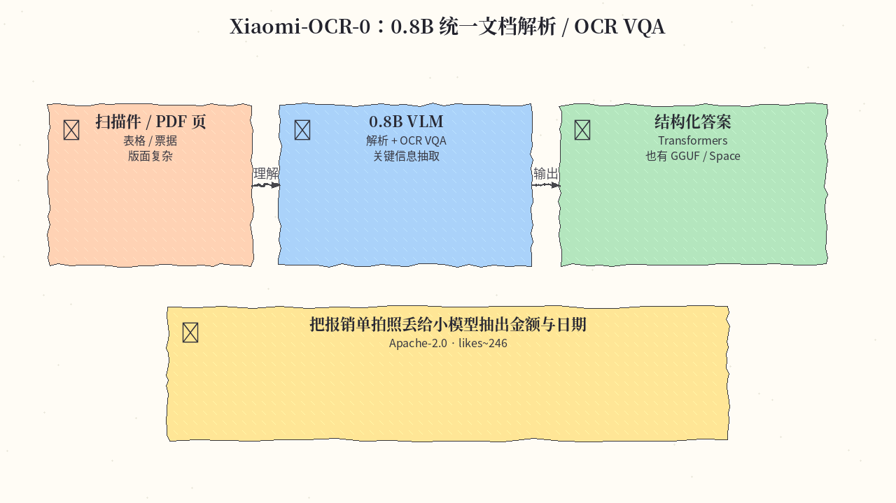
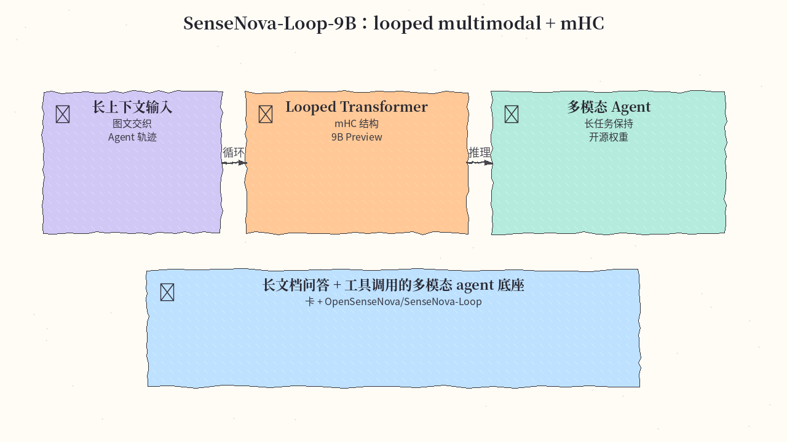
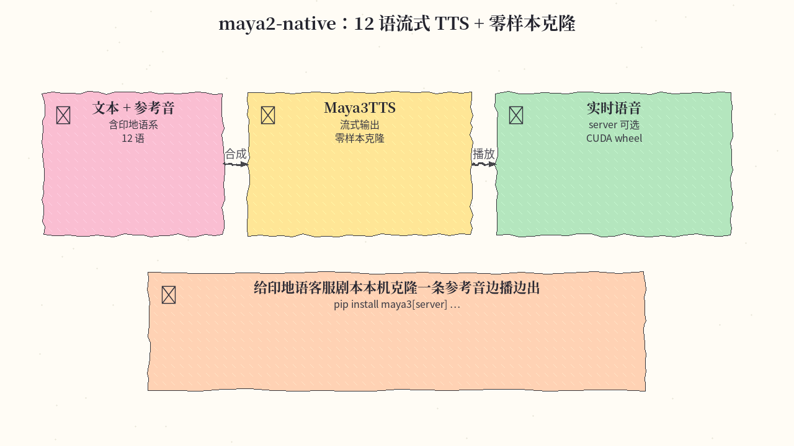
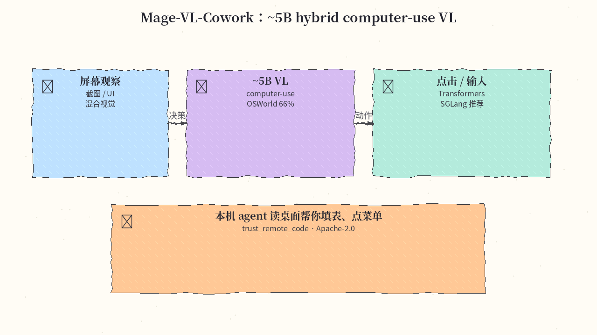
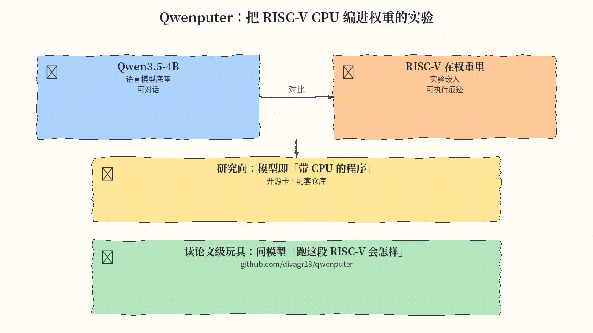
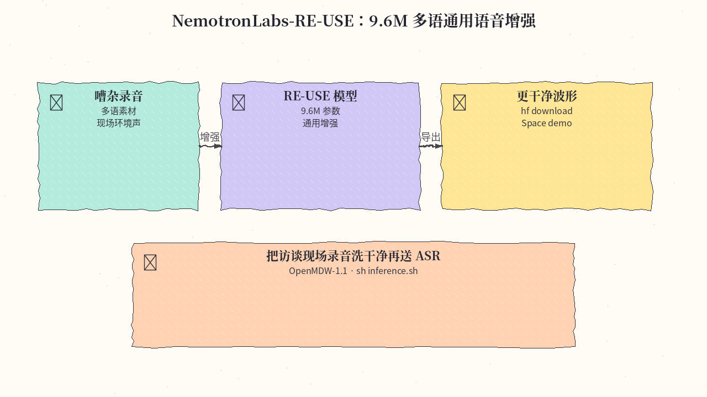

# 2026-11-03 Hugging Face 日报

今日精选 6 条：小米 0.8B 文档 OCR、SenseNova Loop 多模态、Maya 多语流式 TTS、Mage computer-use VL、Qwenputer 实验模型，以及 Nemotron 通用语音增强。与往日日报、周报不重复。

## 1. xiaomi-research/Xiaomi-OCR-0 — 0.8B 统一文档解析 / OCR VQA

**介绍**  
基于 Qwen3.5-0.8B-Base 的统一文档理解模型：文档解析、OCR VQA、关键信息抽取等；Transformers 可用，社区另有 SeerRay-Lab 镜像 / Space / GGUF。Apache-2.0，likes≈246。

**用法**  
模型卡：[huggingface.co/xiaomi-research/Xiaomi-OCR-0](https://huggingface.co/xiaomi-research/Xiaomi-OCR-0)。按卡内 Transformers 示例加载；需要端侧/量化时可搜同系 GGUF 或 Space demo（以卡内链接为准）。

**应用场景**  
把报销单拍照丢给小模型，抽出金额、日期与商户。



**推荐学习程度**：入门

---

## 2. sensenova/SenseNova-Loop-9B-Preview — looped multimodal + mHC

**介绍**  
SenseNova Loop 9B Preview：looped transformer + mHC，面向长上下文与多模态 agent。Apache-2.0，likes≈187；配套代码在 OpenSenseNova/SenseNova-Loop。

**用法**  
模型卡：[huggingface.co/sensenova/SenseNova-Loop-9B-Preview](https://huggingface.co/sensenova/SenseNova-Loop-9B-Preview)；代码：[github.com/OpenSenseNova/SenseNova-Loop](https://github.com/OpenSenseNova/SenseNova-Loop)。按卡与仓库 README 用 Transformers / 推荐推理栈加载（含 custom code 时注意 `trust_remote_code`）。

**应用场景**  
长文档 + 截图交织的多模态 agent 底座，跑跨多步工具调用。



**推荐学习程度**：进阶

---

## 3. maya-research/maya2-native — 12 语流式 TTS + 零样本克隆

**介绍**  
Maya2 native：覆盖 12 语（含印地语系）的流式 TTS，支持零样本音色克隆；提供 server 安装变体。Apache-2.0，likes≈148。

**用法**  
模型卡：[huggingface.co/maya-research/maya2-native](https://huggingface.co/maya-research/maya2-native)；代码仓库见卡内 / MayaResearch/maya2-native。

```bash
pip install "maya3[server] @ git+https://github.com/MayaResearch/maya2-native" \
  --extra-index-url https://download.pytorch.org/whl/cu128
# 然后：Maya3TTS.from_pretrained(...) 按卡内示例流式合成
```

**应用场景**  
给印地语客服剧本本机克隆一条参考音，边生成边播放。



**推荐学习程度**：进阶

---

## 4. microsoft/Mage-VL-Cowork — ~5B hybrid computer-use VL

**介绍**  
约 5B 的混合 computer-use 视觉语言模型；在 OSWorld-Verified 上报约 66%。Apache-2.0，likes≈143；推荐较新 Transformers，生产可用 SGLang Docker。

**用法**  
模型卡：[huggingface.co/microsoft/Mage-VL-Cowork](https://huggingface.co/microsoft/Mage-VL-Cowork)。

```bash
pip install "transformers>=4.57.3"  # 及其他卡内依赖
# AutoModel / processor + trust_remote_code=True
# 高并发推荐按卡内说明使用 SGLang docker
```

**应用场景**  
本机 agent 读桌面截图帮你填表、点菜单完成办公流程。



**推荐学习程度**：深水

---

## 5. divagr1925/Qwen3.5-4B-Qwenputer — 把 RISC-V CPU 编进权重

**介绍**  
实验模型：在 Qwen3.5-4B 权重里编码 RISC-V CPU 行为痕迹，探索「模型即带 CPU 的程序」。Apache-2.0，likes≈139；配套仓库 divagr18/qwenputer。

**用法**  
模型卡：[huggingface.co/divagr1925/Qwen3.5-4B-Qwenputer](https://huggingface.co/divagr1925/Qwen3.5-4B-Qwenputer)；代码：[github.com/divagr18/qwenputer](https://github.com/divagr18/qwenputer)。按仓库说明加载权重并复现实验提示，勿当作生产推理引擎。

**应用场景**  
读论文级玩具：问模型「这段 RISC-V 跑起来会怎样」，观察权重内嵌计算。



**推荐学习程度**：专精

---

## 6. nvidia/NVIDIA-NemotronLabs-RE-USE — 9.6M 多语通用语音增强

**介绍**  
Nemotron Labs 的通用语音增强：约 9.6M 参数，面向多语嘈杂录音清洗。OpenMDW-1.1，likes≈127；提供推理脚本与 Space demo。

**用法**  
模型卡：[huggingface.co/nvidia/NVIDIA-NemotronLabs-RE-USE](https://huggingface.co/nvidia/NVIDIA-NemotronLabs-RE-USE)。

```bash
huggingface-cli download nvidia/NVIDIA-NemotronLabs-RE-USE --local-dir ./nemotron-reuse
cd ./nemotron-reuse && sh inference.sh
# 也可先在卡内 Space 试听效果
```

**应用场景**  
把访谈现场录音洗干净再送 ASR，提高转写可用率。



**推荐学习程度**：入门

---
