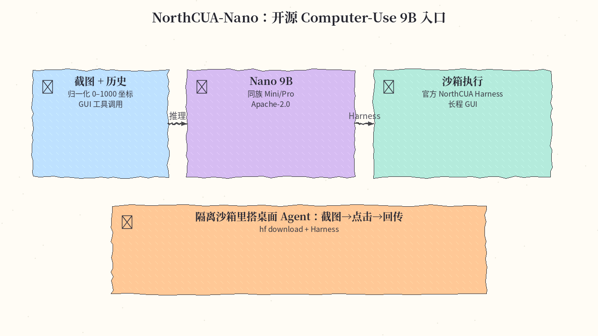
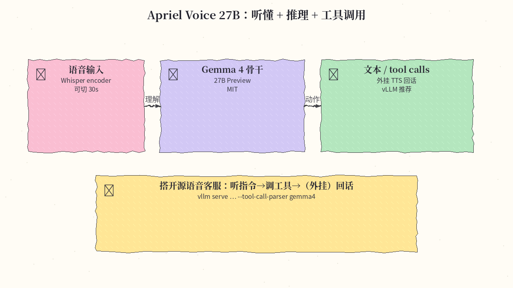
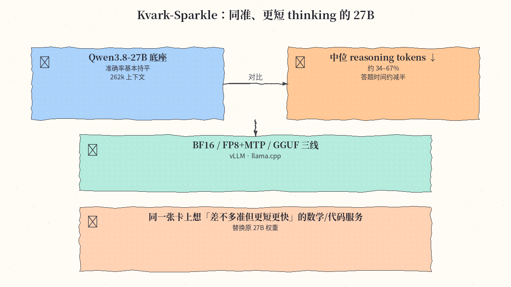
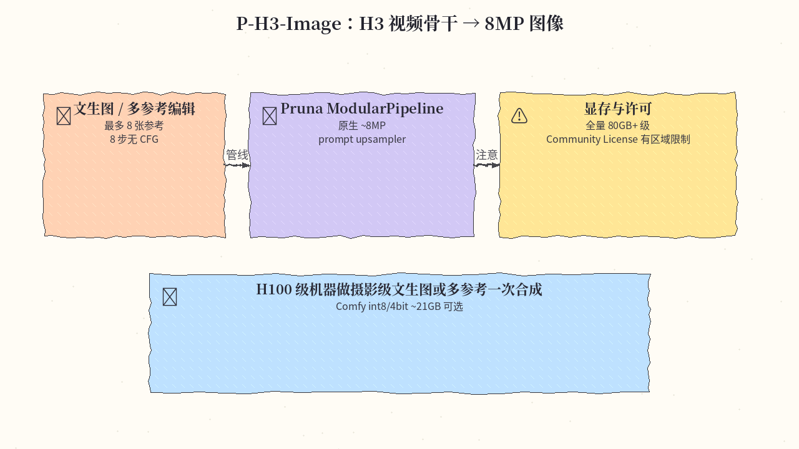

# 2026-11-04 Hugging Face 日报

今日精选 4 条：开源 Computer-Use 入口 NorthCUA-Nano、语音推理+工具调用 Apriel Voice、缩短 thinking 的 Kvark-Sparkle，以及 H3 改造成像的 P-H3-Image。与往日日报、周报不重复（含已覆盖的 speridlabs/idol）。

## 1. beipo-ai/NorthCUA-Nano — 开源 Computer-Use 9B 入口

**介绍**  
NorthCUA 是 2026-11 前后上线的开源 Computer-Use 家族（基于 Qwen3.5 独立后训练）：Nano 9B 稠密，同族还有 Mini 35B-A3B、Pro 397B-A17B，全系 Apache-2.0。输入请求+截图+交互历史，输出推理、回复与 GUI 工具调用；坐标为截图相对的 0–1000 归一化空间，需配合官方 Harness。likes 仍低，但文档与家族完整。

**用法**  
模型卡：[huggingface.co/beipo-ai/NorthCUA-Nano](https://huggingface.co/beipo-ai/NorthCUA-Nano)；Harness：[github.com/beipo-ai/NorthCUA](https://github.com/beipo-ai/NorthCUA)。

```bash
pip install -U huggingface_hub
hf download beipo-ai/NorthCUA-Nano --local-dir ./NorthCUA-Nano
# 完整 computer-use 按 Harness README；冒烟可用 Transformers + Qwen3_5 + AutoProcessor（bfloat16）
```

**应用场景**  
在隔离沙箱里搭桌面/浏览器 Agent：截图理解 → 归一化坐标点击 → Harness 回传新截图。



**推荐学习程度**：进阶

---

## 2. ServiceNow-AI/Apriel-Voice-27B-preview — 听懂 + 推理 + 工具调用

**介绍**  
ServiceNow 开源的 Apriel Voice 27B Preview：Whisper large-v3-turbo 语音编码器 + Gemma 4 26B-A4B 骨干；理解语音并保留文本/图像输入，输出文本与结构化 tool calls（完整语音助手需外挂 TTS）。MIT，likes≈71。

**用法**  
模型卡：[huggingface.co/ServiceNow-AI/Apriel-Voice-27B-preview](https://huggingface.co/ServiceNow-AI/Apriel-Voice-27B-preview)。推荐 vLLM 镜像 `amant555/vllm_apriel_voice`：

```bash
vllm serve --model ServiceNow-AI/Apriel-Voice-27B-preview \
  --trust-remote-code --tensor-parallel-size 4 \
  --enable-auto-tool-choice --tool-call-parser gemma4 --reasoning-parser gemma4
```

Transformers：`AutoModel` / `AutoProcessor` + `trust_remote_code=True`，音频 16kHz mono。

**应用场景**  
搭建「听懂指令→推理→调工具→（外挂合成）回话」的开源语音客服/运维助手。



**推荐学习程度**：深水

---

## 3. Egzakta/Kvark-Sparkle-1.0-27B — 同准、更短 thinking

**介绍**  
在 Qwen3.8-27B 上的效率向微调：准确率基本持平基准，中位 reasoning tokens 约砍 34–67%，单用户 H200 上中位答题时间约减半。提供 BF16、FP8+MTP、GGUF 三线；Apache-2.0。

**用法**  
模型卡：[huggingface.co/Egzakta/Kvark-Sparkle-1.0-27B](https://huggingface.co/Egzakta/Kvark-Sparkle-1.0-27B)。

```bash
# vLLM FP8 + MTP 示例（卡内还有 GGUF / Transformers 路径）
vllm serve Egzakta/Kvark-Sparkle-1.0-27B-FP8 \
  --max-model-len 131072 --kv-cache-dtype fp8 \
  --reasoning-parser qwen3 --enable-auto-tool-choice --tool-call-parser qwen3_coder
```

采样建议 temperature 1.0 / top_p 0.95 / top_k 20。

**应用场景**  
同一张 27B 卡上想「差不多准、但思考更短、延迟更低」的数学/代码服务，直接替换原权重。



**推荐学习程度**：进阶

---

## 4. PrunaAI/P-H3-Image — H3 视频骨干改造成像

**介绍**  
Pruna 把 MiniMax-H3 视频模型改造成图像生成/编辑管线：8 步、无 CFG、原生约 8MP；支持文生图与最多 8 张参考图编辑，并内置基于 Qwen3.5-9B 的 prompt upsampler。bf16 全量约需 80GB+ VRAM；消费卡可看 `PrunaAI/P-H3-Image-Comfy`（int8/4-bit，约 21GB）。许可为 MiniMax H3 Community License（排除部分地区，商用需核对条款）。

**用法**  
模型卡：[huggingface.co/PrunaAI/P-H3-Image](https://huggingface.co/PrunaAI/P-H3-Image)。

```bash
pip install git+https://github.com/huggingface/diffusers transformers accelerate torch pillow
# ModularPipeline.from_pretrained('PrunaAI/P-H3-Image')；load_components(dtype=bfloat16)
# 文生图传 prompt；编辑传 image= 或最多 8 张列表
```

**应用场景**  
在 H100/H200 级机器上做 8MP 摄影级文生图，或「图1改色 + 图2帽子」多参考一次合成。



**推荐学习程度**：专精

---
