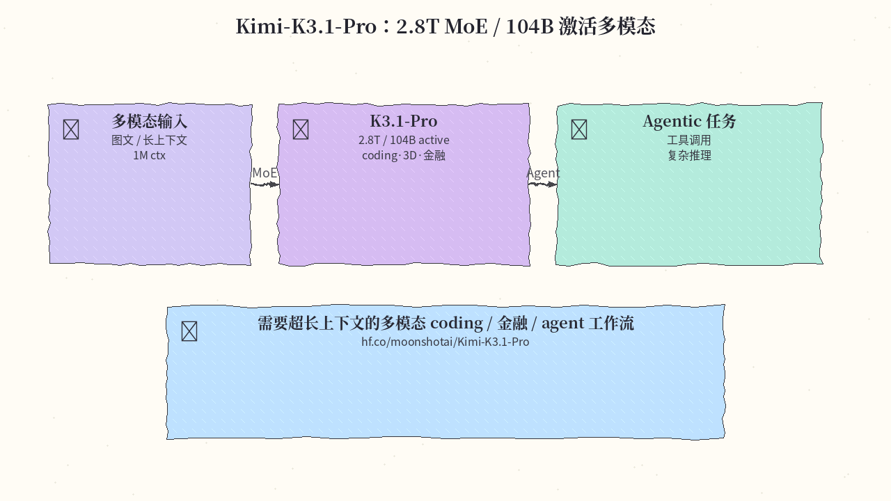
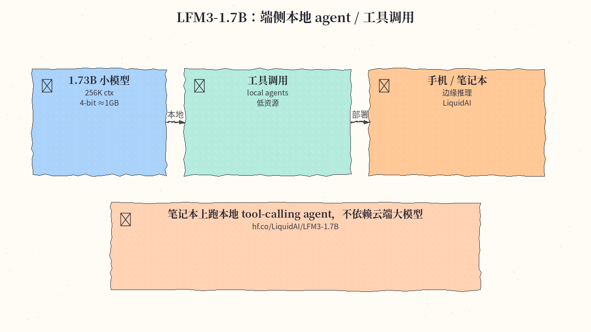
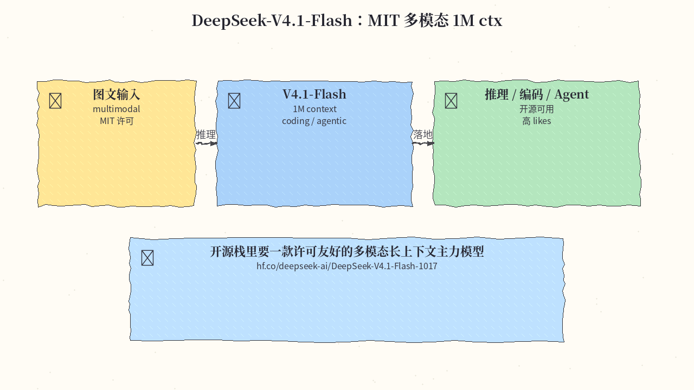
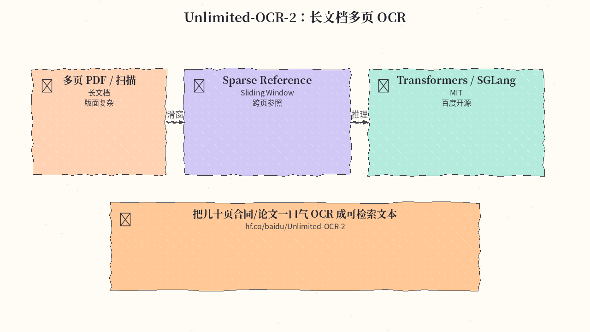
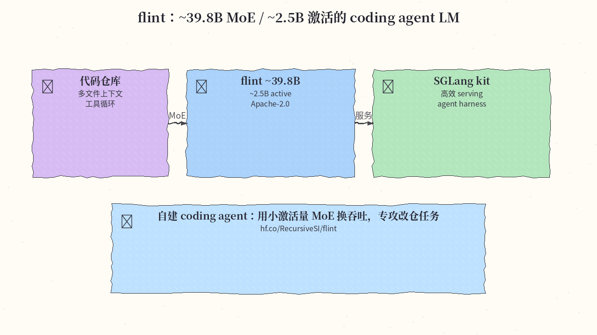
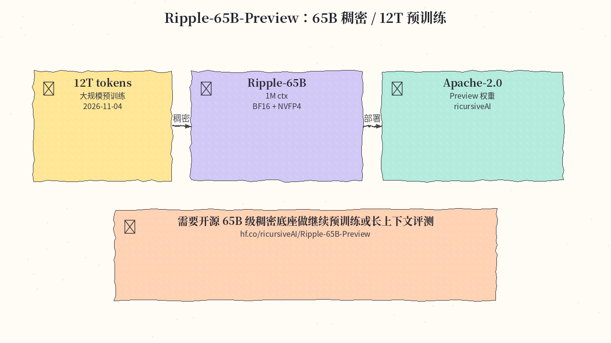
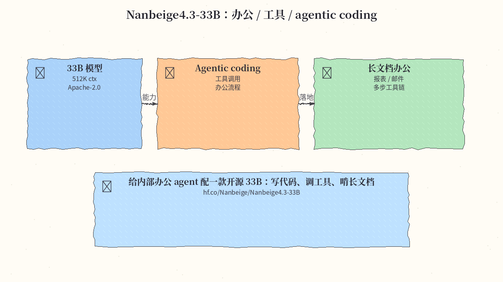
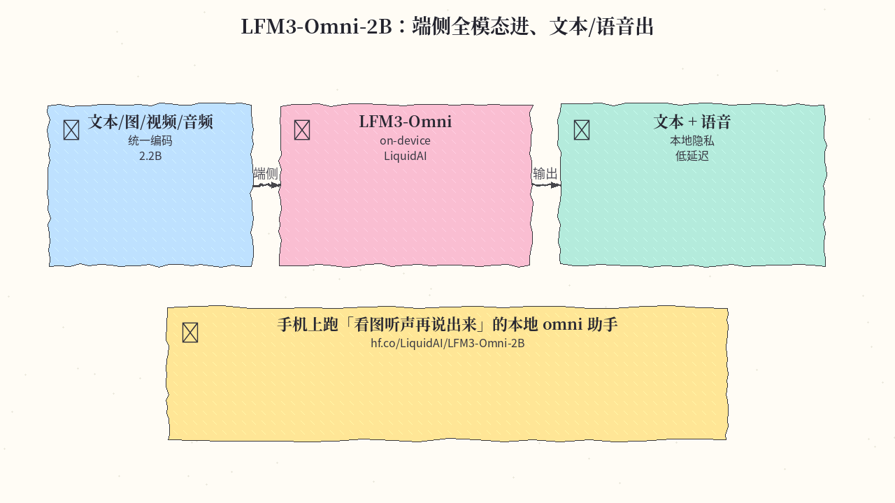

# 2026-11-05 Hugging Face 日报

今日精选 8 条：Kimi K3.1 Pro、端侧 LFM3、DeepSeek V4.1 Flash、长文档 OCR、flint coding MoE、Ripple 65B、南贝 33B，以及 LFM3 Omni。与往日日报、周报不重复。

## 1. moonshotai/Kimi-K3.1-Pro — 2.8T MoE / 104B 激活多模态

**介绍**  
月之暗面 Kimi-K3.1-Pro（约 2026-11-02 上线）：多模态 MoE，总参约 2.8T、激活约 104B，1M 上下文，面向 coding / 3D / 金融 / agentic。likes 约 517。

**用法**  
模型卡：[huggingface.co/moonshotai/Kimi-K3.1-Pro](https://huggingface.co/moonshotai/Kimi-K3.1-Pro)。按卡片说明用官方推荐推理栈（Transformers / 厂商 serving）拉取权重；长上下文与工具调用参数以 README 为准。

**应用场景**  
需要超长上下文的多模态 coding、金融研报或复杂 agent 工作流时作主力模型。



**推荐学习程度**：深水

---

## 2. LiquidAI/LFM3-1.7B — 端侧本地 agent / 工具调用

**介绍**  
LiquidAI LFM3-1.7B：约 1.73B 参数、256K 上下文，面向本地 agents 与 tool calling；4-bit 约 1GB，适合笔记本/边缘设备。

**用法**  
模型卡：[huggingface.co/LiquidAI/LFM3-1.7B](https://huggingface.co/LiquidAI/LFM3-1.7B)。

```bash
pip install -U huggingface_hub
hf download LiquidAI/LFM3-1.7B --local-dir ./LFM3-1.7B
# 量化与 tool-calling 样例见模型卡 README
```

**应用场景**  
笔记本上跑本地 tool-calling agent，不依赖云端大模型额度。



**推荐学习程度**：进阶

---

## 3. deepseek-ai/DeepSeek-V4.1-Flash-1017 — MIT 多模态 1M ctx

**介绍**  
DeepSeek-V4.1-Flash-1017：MIT 许可的多模态图文模型，1M 上下文，侧重推理 / coding / agentic；likes 约 5.2k。

**用法**  
模型卡：[huggingface.co/deepseek-ai/DeepSeek-V4.1-Flash-1017](https://huggingface.co/deepseek-ai/DeepSeek-V4.1-Flash-1017)。按 README 用 Transformers / vLLM / SGLang 等拉取并服务；注意 Flash 变体与完整版在延迟与能力上的取舍。

**应用场景**  
开源栈里要一款许可友好的多模态长上下文主力，做编码助手或 agent 骨干。



**推荐学习程度**：进阶

---

## 4. baidu/Unlimited-OCR-2 — 长多页 OCR

**介绍**  
百度开源 Unlimited-OCR-2：面向长多页文档 OCR，使用 Sparse Reference Sliding Window；支持 Transformers / SGLang。MIT。

**用法**  
模型卡：[huggingface.co/baidu/Unlimited-OCR-2](https://huggingface.co/baidu/Unlimited-OCR-2)。按 README 安装依赖后对 PDF/扫描件跑推理；长文档建议走官方滑动窗口配置。

**应用场景**  
把几十页合同或论文一口气 OCR 成可检索文本，再交给下游 RAG / agent。



**推荐学习程度**：进阶

---

## 5. RecursiveSI/flint — coding-agent 向 MoE LM

**介绍**  
flint：面向 coding agent 的 MoE 语言模型，约 39.8B 总参 / 约 2.5B 激活；Apache-2.0，配 SGLang kit。

**用法**  
模型卡：[huggingface.co/RecursiveSI/flint](https://huggingface.co/RecursiveSI/flint)。按卡片用 SGLang kit 起服务，再接到自有 coding harness / 工具循环。

**应用场景**  
自建 coding agent：用小激活量 MoE 换吞吐，专攻改仓与多文件编辑。



**推荐学习程度**：深水

---

## 6. ricursiveAI/Ripple-65B-Preview — 65B 稠密 / 12T 预训练

**介绍**  
Ripple-65B-Preview（约 2026-11-04）：65B 稠密模型，约 12T tokens 预训练，1M 上下文，提供 BF16 与 NVFP4；Apache-2.0。

**用法**  
模型卡：[huggingface.co/ricursiveAI/Ripple-65B-Preview](https://huggingface.co/ricursiveAI/Ripple-65B-Preview)。按 README 选择 BF16 或 NVFP4 权重下载；Preview 阶段能力与稳定性以官方评测为准。

**应用场景**  
需要开源 65B 级稠密底座做继续预训练、对齐实验或长上下文评测。



**推荐学习程度**：专精

---

## 7. Nanbeige/Nanbeige4.3-33B — 办公 / 工具 / agentic coding

**介绍**  
南贝 Nanbeige4.3-33B：33B，侧重 agentic coding、工具调用与办公场景，512K 上下文，Apache-2.0。

**用法**  
模型卡：[huggingface.co/Nanbeige/Nanbeige4.3-33B](https://huggingface.co/Nanbeige/Nanbeige4.3-33B)。按 README 用推荐推理框架加载；工具调用与长文档模板见官方示例。

**应用场景**  
给内部办公 agent 配一款开源 33B：写代码、调工具、啃长文档与报表。



**推荐学习程度**：进阶

---

## 8. LiquidAI/LFM3-Omni-2B — 端侧全模态进、文本/语音出

**介绍**  
LFM3-Omni-2B：约 2.2B 的 on-device omni 模型，支持文本 / 图像 / 视频 / 音频输入，输出文本与语音。

**用法**  
模型卡：[huggingface.co/LiquidAI/LFM3-Omni-2B](https://huggingface.co/LiquidAI/LFM3-Omni-2B)。按 README 下载端侧包或 GGUF/量化变体，接入本地 runtime；音频输出路径以卡片说明为准。

**应用场景**  
手机或边缘设备上跑「看图听声再说出来」的本地 omni 助手，数据尽量不出设备。



**推荐学习程度**：进阶

---
