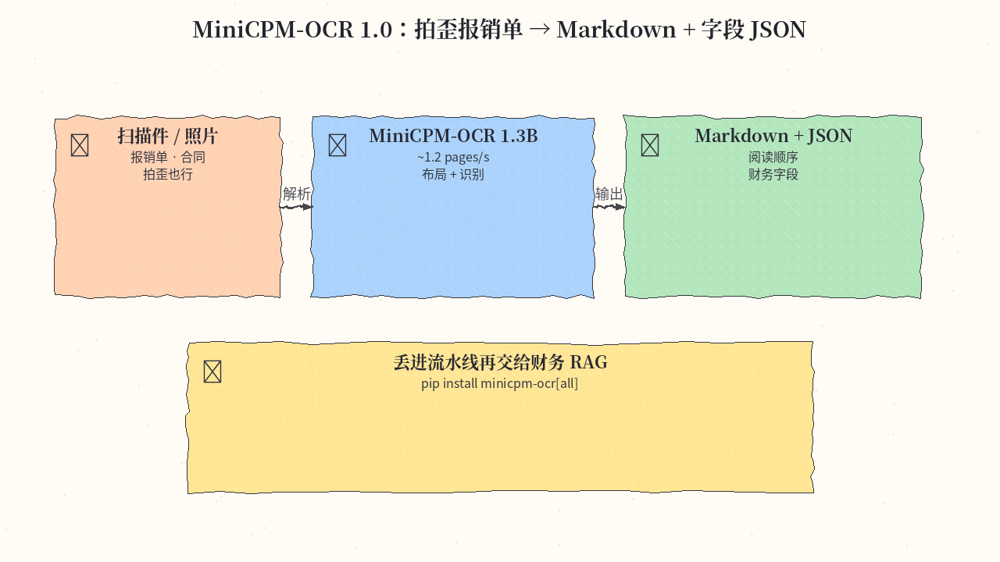
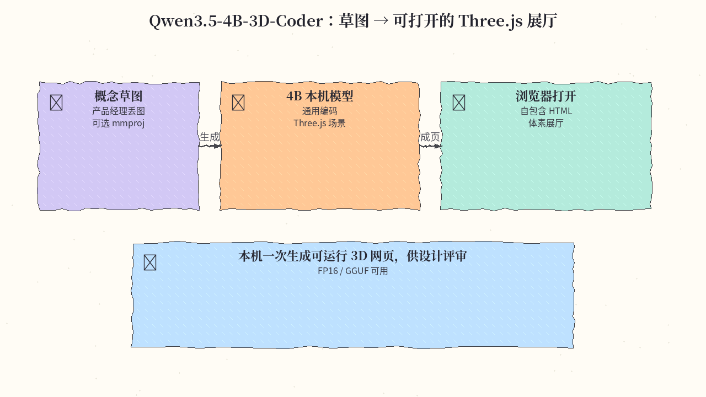
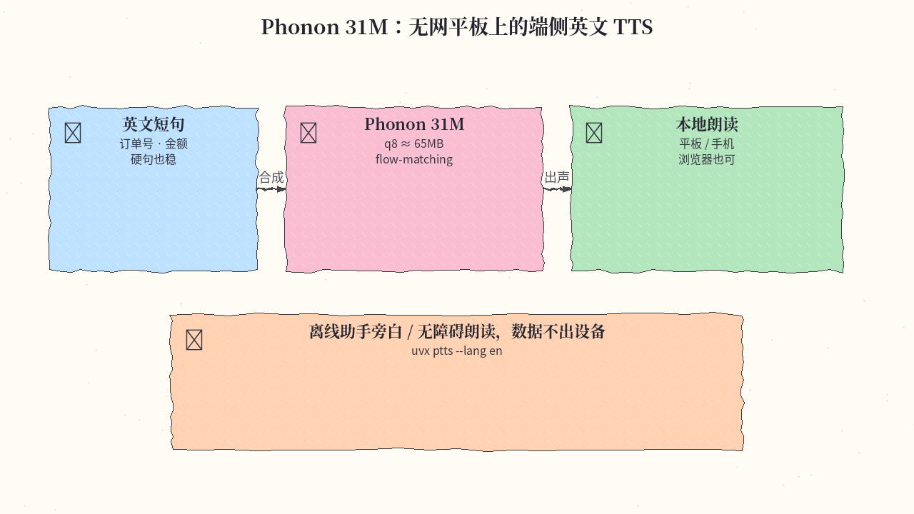

# 2026-11-06 Hugging Face 日报

今日三条：MiniCPM OCR 吞吐、4B Three.js 3D 编程实验、端侧 31M Phonon TTS。

## 1. openbmb/MiniCPM-OCR-1.0 — 1.3B OCR 专精 · 吞吐拉满

**介绍**  
OpenBMB MiniCPM-OCR 1.0（1.3B，Apache-2.0）：面向中英文档的文本/表格/公式/图表/印章与关键信息抽取；布局用 PP-DocLayoutV3，识别走独立推理服务，配套 `minicpm-ocr` SDK 与 Space。宣称吞吐约 1.2 pages/s（5090），vLLM / SGLang / llama.cpp / Ollama 齐备。likes 约 446。

**用法**  
模型卡：[huggingface.co/openbmb/MiniCPM-OCR-1.0](https://huggingface.co/openbmb/MiniCPM-OCR-1.0)。

```bash
pip install "minicpm-ocr[all]"
# 先按卡内部署指南起 vLLM 等识别服务（示例监听 :8080）
hf download openbmb/MiniCPM-OCR-1.0 --local-dir ./MiniCPM-OCR-1.0
minicpmvocr parse demo.png \
  --backend vllm --server-url http://127.0.0.1:8080 \
  --model minicpm-ocr --device cuda:0 --output output/demo.md
```

**应用场景**  
把拍歪的报销单/合同扫描页丢进流水线，自动出带阅读顺序的 Markdown + 字段 JSON，再交给财务 RAG。



**推荐学习程度**：进阶

---

## 2. ccore/Qwen3.5-4B-3D-Coder — 4B 级 Three.js 3D 编程实验

**介绍**  
CCORE 基于 Qwen3.5-4B 的早期预览：侧重一般编程与高质量 Three.js 3D 场景（自包含 HTML）；可选 mmproj 做「参考图→体素场景」；另有 GLB-3D-Coder 姐妹线。已开 FP16、GGUF、训练数据与技术报告——小模型做「可运行 3D 网页」的实验样本。likes 约 705，当日仍在更新。

**用法**  
模型卡：[huggingface.co/ccore/Qwen3.5-4B-3D-Coder](https://huggingface.co/ccore/Qwen3.5-4B-3D-Coder)。

```bash
pip install -U "transformers>=4.57" huggingface_hub
hf download ccore/Qwen3.5-4B-3D-Coder --local-dir ./Qwen3.5-4B-3D-Coder
# GGUF + 视觉（llama.cpp 示例）:
# llama-server -m Qwen3.5-4B-3D-Coder-Q4_K_M.gguf \
#   --mmproj mmproj-Qwen3.5-4B-BF16.gguf --n-gpu-layers all --ctx-size 65536
# 采样：temp 0.6–0.8 / top_p 0.90–0.95；LM Studio 须关 MTP
```

**应用场景**  
产品经理丢一张概念草图，本机 4B 模型一次生成可浏览器打开的 Three.js 体素展厅，供设计评审。



**推荐学习程度**：进阶

---

## 3. gradium/phonon-31m-en — 端侧 31M 英文流式 TTS

**介绍**  
Gradium Phonon 英文 31M：flow-matching + Mimi codec，24kHz 流式合成；约 31M / q8≈65MB，Apache-2.0 可商用；可在浏览器/手机/笔记本跑，硬句（电话号、日期、代码）WER 很强。运行时 `ptts` / Transformers / npm 浏览器包均可用。likes 约 143。

**用法**  
模型卡：[huggingface.co/gradium/phonon-31m-en](https://huggingface.co/gradium/phonon-31m-en)。

```bash
pip install ptts
# CLI（uvx 免安装也可）:
uvx ptts --lang en --quant q8 --voice Easton "Hello from Phonon." -o speech.wav
# Python:
# import ptts
# tts = ptts.TTS("hf://gradium/phonon-31m-en", lang="en", quant="q8")
# tts.save("speech.wav", "Hello from Phonon.", voice="Easton")
```

**应用场景**  
无网平板上的本地无障碍朗读 / 离线助手旁白，输入含订单号与金额的英文短句即时出声。



**推荐学习程度**：入门

---
