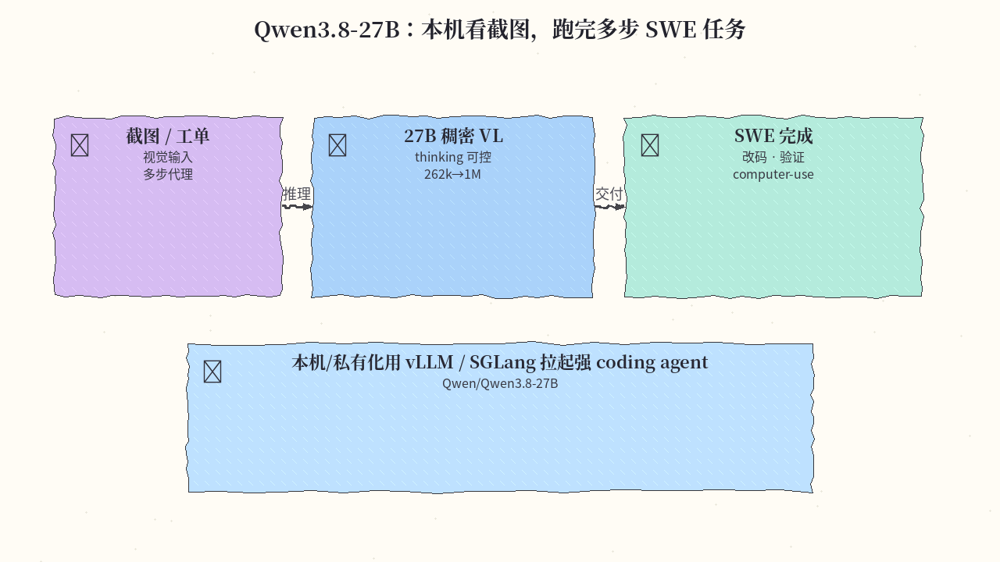
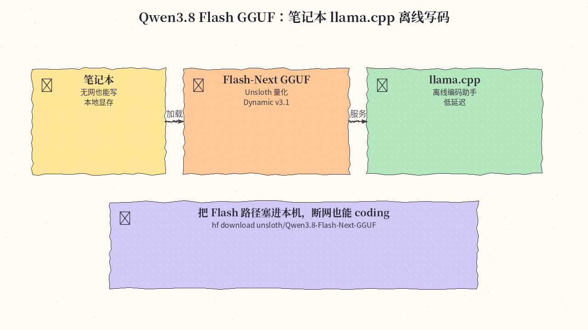
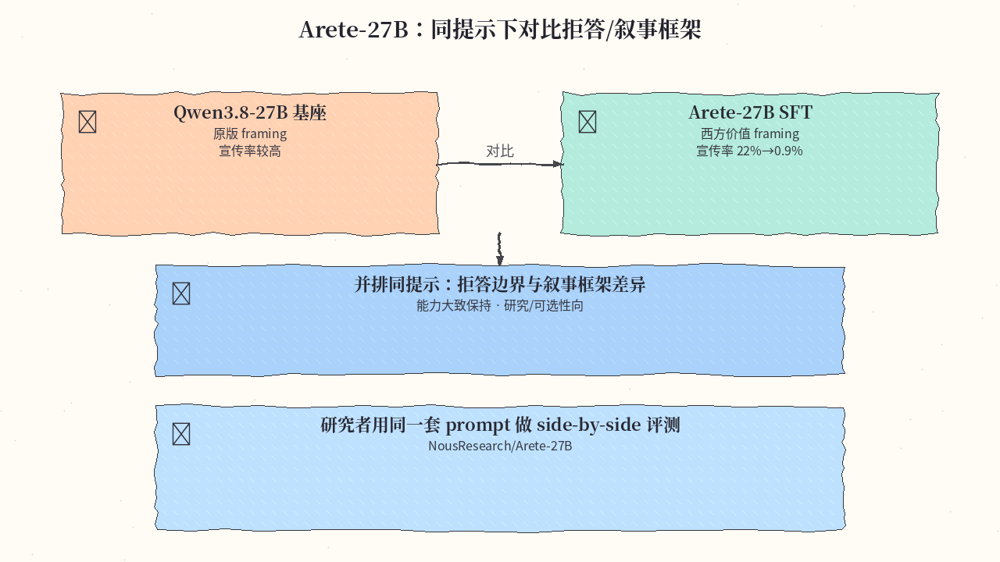
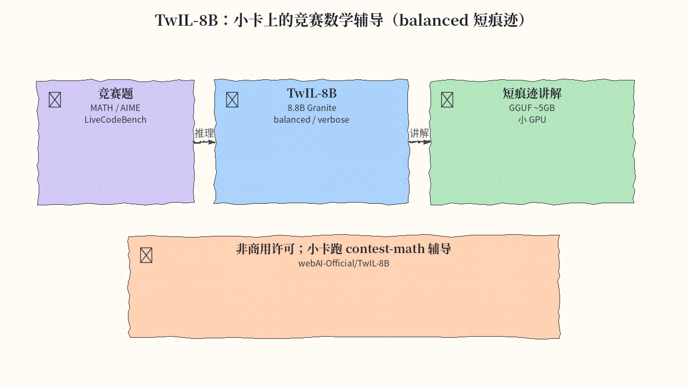
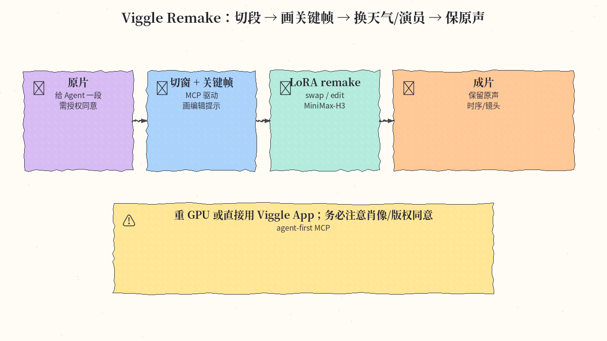

# 2026-11-09 Hugging Face 日报

今日五条：Qwen3.8-27B 主线、Flash 本机 GGUF、价值对齐研究向 Arete、小卡竞赛数学 TwIL、以及 agent-first 视频 remake。

## 1. Qwen/Qwen3.8-27B — 27B 稠密 VL · coding / agent / computer-use

**介绍**  
Qwen3.8-27B：部署友好的稠密视觉语言模型，强化编码、专业工作与长程 agent 任务；thinking 默认可关，可用 `reasoning_effort` / `preserve_thinking`；原生上下文 262,144，可扩到约 1M。兼容 Transformers / vLLM / SGLang 等。likes 约 19.4k（2026-11-07 更新）。

**用法**  
模型卡：[huggingface.co/Qwen/Qwen3.8-27B](https://huggingface.co/Qwen/Qwen3.8-27B)。

```bash
# 以 vLLM / SGLang 等方式拉起（详见模型卡）
# 示例：按卡内 Serving 指南部署后，把 agent 的视觉/工具回路接到该端点
hf download Qwen/Qwen3.8-27B --local-dir ./Qwen3.8-27B
```

**应用场景**  
本机 agent 看着截图跑完多步 SWE：读报错、改文件、再验证。



**推荐学习程度**：进阶

---

## 2. unsloth/Qwen3.8-Flash-Next-GGUF — Flash 本地 GGUF 路径

**介绍**  
Unsloth 提供的 Qwen3.8 Flash-Next GGUF（含 Dynamic v3.1 量化路径），方便用 llama.cpp / Strata / Unsloth Desktop 在本机跑 Flash。likes 约 1.5k。

**用法**  
模型卡：[huggingface.co/unsloth/Qwen3.8-Flash-Next-GGUF](https://huggingface.co/unsloth/Qwen3.8-Flash-Next-GGUF)。

```bash
hf download unsloth/Qwen3.8-Flash-Next-GGUF --local-dir ./Qwen3.8-Flash-Next-GGUF
# llama.cpp 示例（按实际文件名调整）：
# llama-server -m ./Qwen3.8-Flash-Next-GGUF/<quant>.gguf --n-gpu-layers all
```

**应用场景**  
笔记本上 llama.cpp 起 Flash，断网也能写码、改补丁。



**推荐学习程度**：入门

---

## 3. NousResearch/Arete-27B — 西方价值 framing 的 Qwen3.8-27B SFT

**介绍**  
Arete-27B 是对 Qwen3.8-27B 的 SFT：把叙事/拒答框架往西方价值对齐方向推；其 Propaganda_Eval 上宣称宣传率约 22%→0.9%，能力大致保持。偏研究与可选性，不是「通用更强」宣传。likes 约 294。

**用法**  
模型卡：[huggingface.co/NousResearch/Arete-27B](https://huggingface.co/NousResearch/Arete-27B)。

```bash
hf download NousResearch/Arete-27B --local-dir ./Arete-27B
# 与基座 Qwen3.8-27B 用同一套提示做 side-by-side
```

**应用场景**  
研究者对同一批 prompt 并排看拒答边界与 framing 差异，再决定是否纳入评测矩阵。



**推荐学习程度**：深度

---

## 4. webAI-Official/TwIL-8B — 8.8B 竞赛数学 / 代码推理（非商用）

**介绍**  
TwIL-8B：基于 Granite-4.2-8B 的 8.8B 后训练模型，MATH / LiveCodeBench 等表现强；`balanced`（默认，短痕迹）与 `verbose` 两变体；Q4_K_M GGUF 约 5GB。许可证为 webAI Non-Commercial。likes 约 234（约 16h 内有更新）。

**用法**  
模型卡：[huggingface.co/webAI-Official/TwIL-8B](https://huggingface.co/webAI-Official/TwIL-8B)。

```bash
hf download webAI-Official/TwIL-8B --local-dir ./TwIL-8B
# balanced GGUF：TwIL-8B-Q4_K_M-balanced.gguf
# from_pretrained("webAI-Official/TwIL-8B") 默认 balanced；verbose 用 subfolder="verbose"
```

**应用场景**  
小 GPU 上做竞赛数学辅导：开 balanced，短 thinking 痕迹讲题。



**推荐学习程度**：进阶

---

## 5. Viggle/Viggle-Remake — Agent-first 视频 remake LoRA + MCP

**介绍**  
Viggle Remake：在 MiniMax-H3 上的 swap/edit LoRA，按 agent-first 设计——MCP 可切窗、画关键帧、写提示、渲染并拼回原声轨。重 GPU 自托管，或直接用 Viggle App。务必注意肖像/版权同意。likes 约 195。

**用法**  
模型卡：[huggingface.co/Viggle/Viggle-Remake](https://huggingface.co/Viggle/Viggle-Remake)。App：[viggle.ai](https://viggle.ai/meme/app/home?ui=v2)。

```bash
pip install -U "huggingface_hub>=1.0"
hf download MiniMaxAI/MiniMax-H3 --local-dir ./MiniMax-H3
hf download Viggle/Viggle-Remake --local-dir ./Viggle-Remake   --include "lora/*" --include "inference/*" --include "examples/*"
pip install -r Viggle-Remake/requirements.txt
# MCP / worker 见仓库 mcp/；小卡可走 ComfyUI int8/GGUF
```

**应用场景**  
Agent 把片子切段、画关键帧、换成另一套天气/演员，并保留原声——前提是素材授权清楚。



**推荐学习程度**：深度

---
