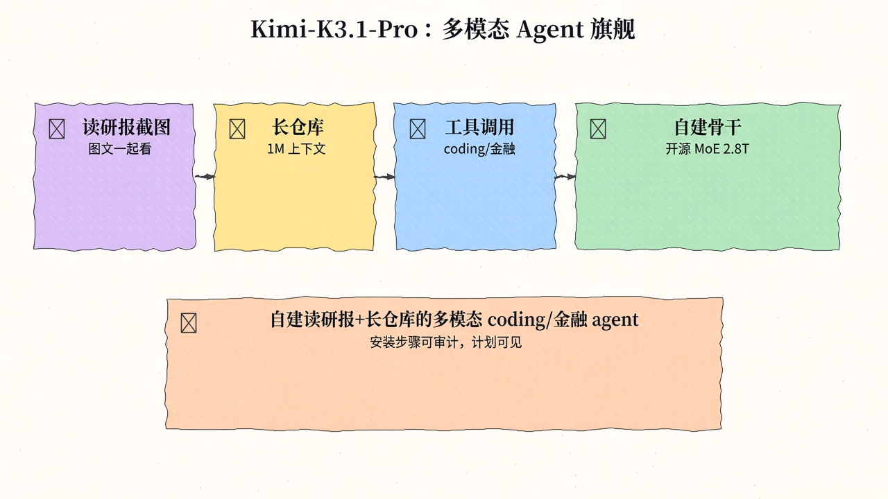
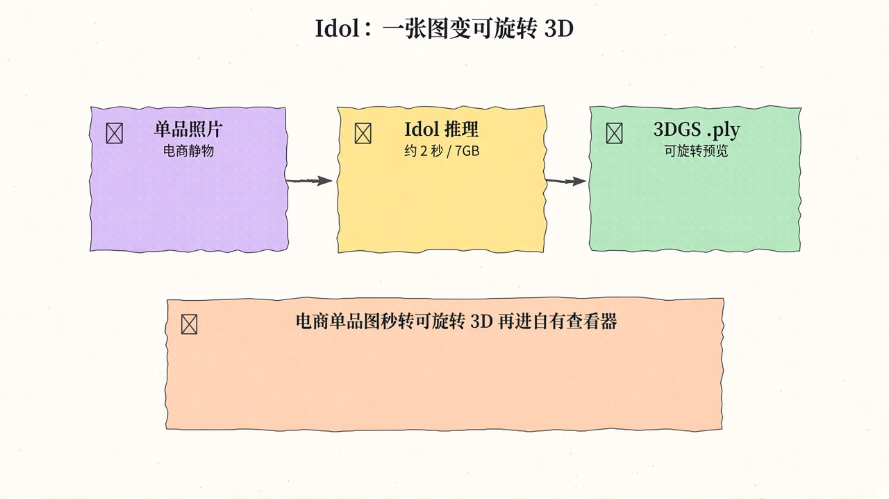
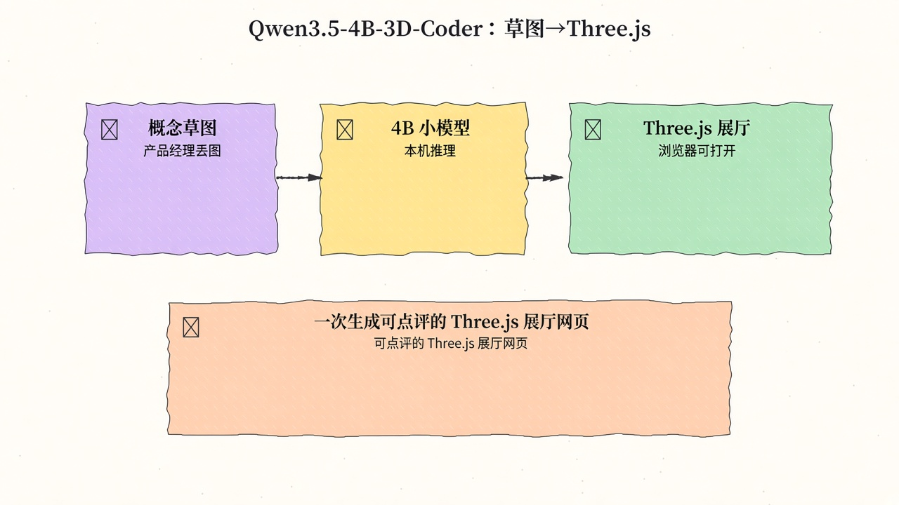
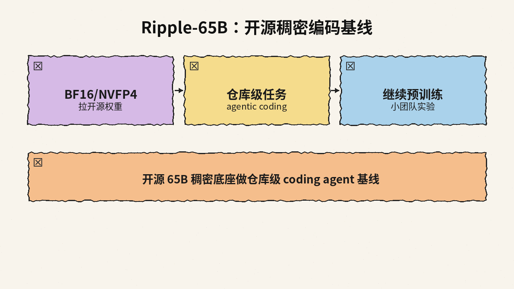
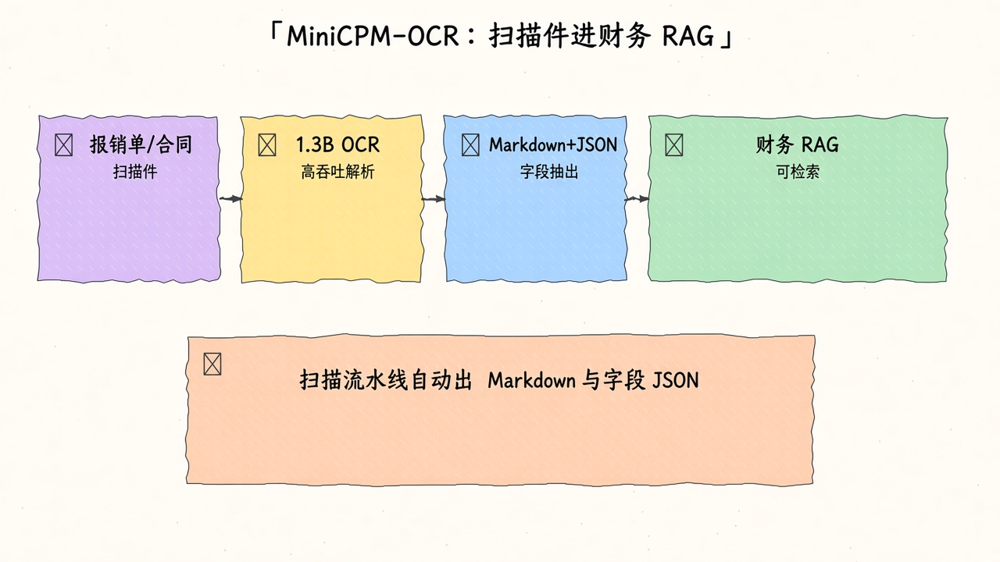
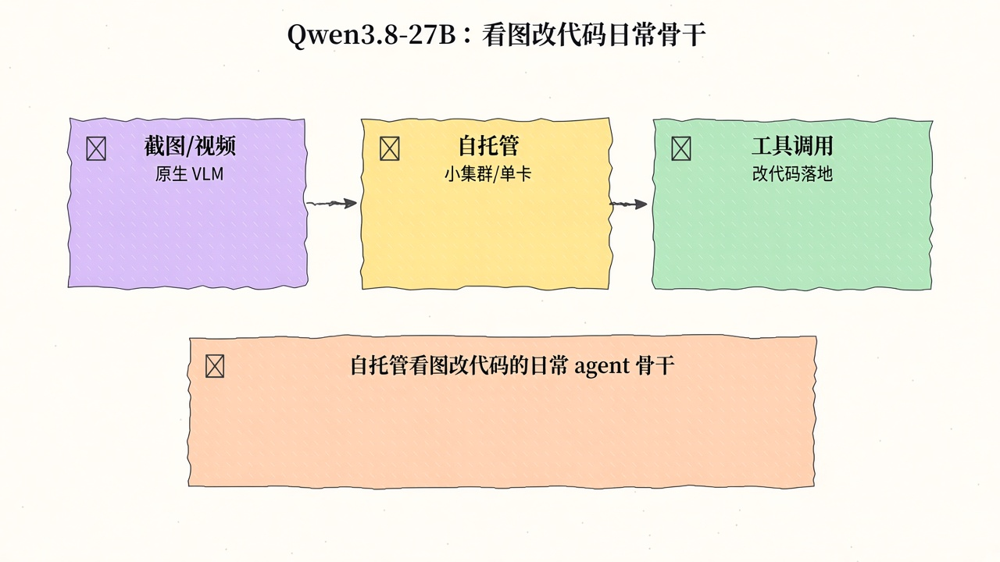
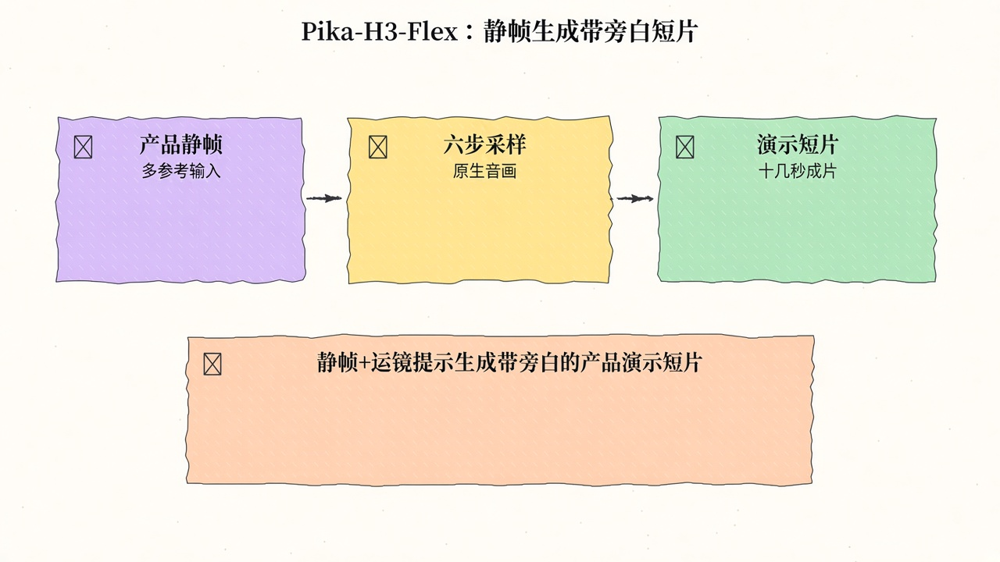
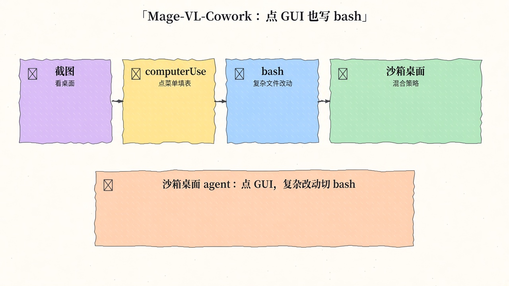
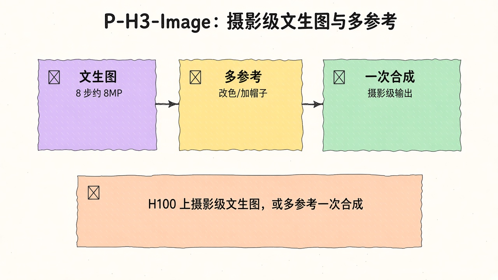
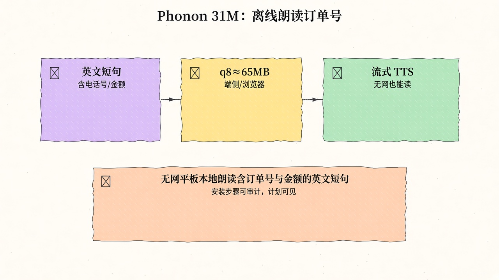

# 2026-11-09 Hugging Face 周报

上周（11/02–11/08）精选 10 个值得跟进的模型与权重（偏 Kimi 旗舰 / 单图 3D / 小模型写 Three.js）。

## 1. moonshotai/Kimi-K3.1-Pro — Kimi K3.1 Pro：2.8T MoE / 104B 激活多模态

**介绍**  
月之暗面 Kimi-K3.1-Pro（约 2026-11-02 开源）：多模态 MoE，总参约 2.8T、激活约 104B，1M 上下文，面向 coding / 3D / 金融 / agentic；Hub likes ~1.7k。vLLM 与昇腾有 Day-0 适配，本地部署门槛仍高。

**用法**  
模型卡：[huggingface.co/moonshotai/Kimi-K3.1-Pro](https://huggingface.co/moonshotai/Kimi-K3.1-Pro)。按卡片用官方推荐推理栈（Transformers / 厂商 serving）拉取权重；长上下文与工具调用参数以 README 为准。

**应用场景**  
需要超长上下文的多模态 coding、金融研报或复杂 agent 工作流时作主力模型。



**推荐学习程度**：专家

---

## 2. speridlabs/idol — 单图到 3D Gaussian Splat

**介绍**  
Idol（Apache-2.0）：一张物体图 → 标准 3DGS `.ply`（可含未见侧面），消费级 GPU 约 7.2GB 显存、可在约 2 秒内出结果；Hub likes ~1.4k。另有 Space 与 idol-sdk。

**用法**  
模型卡：[huggingface.co/speridlabs/idol](https://huggingface.co/speridlabs/idol)；代码：[github.com/speridlabs/idol-sdk](https://github.com/speridlabs/idol-sdk)；Demo：[spaces/speridlabs/idol](https://huggingface.co/spaces/speridlabs/idol)。

```bash
# 需先接受卡内两个 gated 编码器条款并 hf auth login
git clone https://github.com/speridlabs/idol-sdk.git && cd idol-sdk
pip install -e .   # Python 3.10+、PyTorch 2.5+、NVIDIA CUDA
# 首次运行自动拉 Idol 权重与编码器到 HF cache
```

**应用场景**  
电商单品图转可旋转 3D 预览再进自己的查看器。



**推荐学习程度**：进阶

---

## 3. ccore/Qwen3.5-4B-3D-Coder — 4B 写可运行 Three.js 3D 场景

**介绍**  
CCORE 基于 Qwen3.5-4B 的早期预览（Hub likes ~0.9k，下载活跃）：侧重一般编程与高质量 Three.js 3D 场景（自包含 HTML）；可选 mmproj 做「参考图→体素场景」；另有 GLB-3D-Coder 姐妹线。本周仍在 Trending 前列。

**用法**  
模型卡：[huggingface.co/ccore/Qwen3.5-4B-3D-Coder](https://huggingface.co/ccore/Qwen3.5-4B-3D-Coder)。

```bash
pip install -U "transformers>=4.57" huggingface_hub
hf download ccore/Qwen3.5-4B-3D-Coder --local-dir ./Qwen3.5-4B-3D-Coder
# GGUF + 视觉（llama.cpp 示例）:
# llama-server -m Qwen3.5-4B-3D-Coder-Q4_K_M.gguf \
#   --mmproj mmproj-Qwen3.5-4B-BF16.gguf --n-gpu-layers all --ctx-size 65536
# 采样：temp 0.6–0.8 / top_p 0.90–0.95 / top_k 20–40；LM Studio 须关 MTP
```

**应用场景**  
产品经理丢一张概念草图，本机 4B 模型一次生成可浏览器打开的 Three.js 体素展厅，供设计评审。



**推荐学习程度**：进阶

---

## 4. ricursiveAI/Ripple-65B-Preview — 65B 稠密 / 12T 预训练

**介绍**  
Ripple-65B-Preview（约 2026-11-04，Apache-2.0）：65B 稠密 Transformer，约 12T tokens 预训练，支持至约 1M 上下文；提供 BF16 与 NVFP4；偏 agentic coding（官方称 TerminalBench 2.1 等成绩强）。Hub likes ~0.4k。

**用法**  
模型卡：[huggingface.co/ricursiveAI/Ripple-65B-Preview](https://huggingface.co/ricursiveAI/Ripple-65B-Preview)。按 README 选择 BF16 或 NVFP4 权重下载；另有 Base / DFlash2 变体。Preview 阶段能力与稳定性以官方评测为准。

**应用场景**  
需要开源 65B 级稠密底座做继续预训练、对齐实验或长上下文 agentic coding 评测。



**推荐学习程度**：专家

---

## 5. openbmb/MiniCPM-OCR-1.0 — MiniCPM 专精 OCR（1.3B）

**介绍**  
OpenBMB MiniCPM-OCR 1.0（1.3B，Apache-2.0）：面向中英文档的文本/表格/公式/图表/印章与关键信息抽取；布局用 PP-DocLayoutV3，识别走独立推理服务，配套 `minicpm-ocr` SDK 与 Space。Hub likes ~0.45k。

**用法**  
模型卡：[huggingface.co/openbmb/MiniCPM-OCR-1.0](https://huggingface.co/openbmb/MiniCPM-OCR-1.0)。

```bash
pip install "minicpm-ocr[all]"
# 先按卡内部署指南起 vLLM 等识别服务（示例监听 :8080，served name=minicpm-ocr）
hf download openbmb/MiniCPM-OCR-1.0 --local-dir ./MiniCPM-OCR-1.0
minicpmvocr parse demo.png \
  --backend vllm --server-url http://127.0.0.1:8080 \
  --model minicpm-ocr --device cuda:0 --output output/demo.md
```

**应用场景**  
把拍歪的报销单/合同扫描页丢进流水线，自动出带阅读顺序的 Markdown + 字段 JSON，再交给财务 RAG。



**推荐学习程度**：进阶

---

## 6. Qwen/Qwen3.8-27B — Qwen3.8 稠密多模态 27B

**介绍**  
Qwen3.8-27B（Apache-2.0）：Qwen 开源族最新一代稠密多模态，原生视觉-语言，偏 coding / 专业工作 / 长程 agent；原生约 262K 上下文、可扩展至 1M。Hub likes ~19k、下载极高；Transformers / vLLM / SGLang 可用。

**用法**  
模型卡：[huggingface.co/Qwen/Qwen3.8-27B](https://huggingface.co/Qwen/Qwen3.8-27B)。

```bash
# 示例（按卡内最新 serving 说明微调参数）
vllm serve Qwen/Qwen3.8-27B \
  --max-model-len 131072 \
  --reasoning-parser qwen3 --enable-auto-tool-choice --tool-call-parser qwen3_coder
```

Thinking 默认开启，可按请求关闭；亦可用 Transformers `AutoModel` / Processor。

**应用场景**  
自托管 27B 级多模态 coding / agent 骨干：读图读文档再驱动工具闭环。



**推荐学习程度**：进阶

---

## 7. Pika-Labs/Pika-H3-Flex — MiniMax-H3 上的 Flex 图/参考生视频

**介绍**  
挂在 MiniMax-H3 上的图像/参考到视频适配器（LoRA，Hub likes ~0.5k）：可用 Diffusers 或 Comfy 工作流，强调镜头运动与主体一致性；权重走 MiniMax-H3 社区许可。

**用法**  
模型卡：[huggingface.co/Pika-Labs/Pika-H3-Flex](https://huggingface.co/Pika-Labs/Pika-H3-Flex)；Diffusers 文档与示例见卡内 `examples/`；Comfy 教程：[docs.comfy.org … pika-h3-flex](https://docs.comfy.org/tutorials/video/pika/pika-h3-flex)。部署前阅读许可与显存说明（官方在 H100 测过 480p/768p）。

**应用场景**  
产品静帧 + 运镜提示生成十几秒演示短片。



**推荐学习程度**：进阶

---

## 8. microsoft/Mage-VL-Cowork — 4B 混合 Computer-Use（GUI + bash）

**介绍**  
Microsoft Mage-VL-Cowork（Apache-2.0，4B）：单一视觉-语言策略同时掌握截图接地的 GUI（`computer_use`）与持久终端/代码（`bash`），无外部编排器；OSWorld-Verified 约 66.0%（50-step）。项目页 [microsoft.github.io/Mage/cowork](https://microsoft.github.io/Mage/cowork/)。

**用法**  
模型卡：[huggingface.co/microsoft/Mage-VL-Cowork](https://huggingface.co/microsoft/Mage-VL-Cowork)；代码：[github.com/microsoft/Mage … mage_vl_cowork](https://github.com/microsoft/Mage/tree/main/mage_vl_cowork)。按仓库 harness / README 拉取 4B 权重并接入 `MAGEHybridAgent` 评测或自建桌面沙箱。

**应用场景**  
端侧/小集群 computer-use：该点点 GUI，该改 spreadsheet 就切 bash，而不是只靠像素点。



**推荐学习程度**：专家

---

## 9. PrunaAI/P-H3-Image — H3 视频骨干改造成像

**介绍**  
Pruna 把 MiniMax-H3 视频模型改造成图像生成/编辑管线：8 步、无 CFG、原生约 8MP；支持文生图与最多 8 张参考图编辑，并内置基于 Qwen3.5-9B 的 prompt upsampler。bf16 全量约需 80GB+ VRAM；消费卡可看 `PrunaAI/P-H3-Image-Comfy`（int8/4-bit，约 21GB）。许可为 MiniMax H3 Community License（排除部分地区，商用需核对条款）。

**用法**  
模型卡：[huggingface.co/PrunaAI/P-H3-Image](https://huggingface.co/PrunaAI/P-H3-Image)。

```bash
pip install git+https://github.com/huggingface/diffusers transformers accelerate torch pillow
# ModularPipeline.from_pretrained('PrunaAI/P-H3-Image')；load_components(dtype=bfloat16)
# 文生图传 prompt；编辑传 image= 或最多 8 张列表
```

**应用场景**  
在 H100/H200 级机器上做 8MP 摄影级文生图，或「图1改色 + 图2帽子」多参考一次合成。



**推荐学习程度**：专家

---

## 10. gradium/phonon-31m-en — 31M 端侧流式英文 TTS

**介绍**  
Gradium Phonon 英文 31M（Apache-2.0）：flow-matching + Mimi codec，24kHz 流式合成；q8≈65MB，可在浏览器/手机/笔记本跑。Hub likes ~0.15k、下载活跃；运行时 `ptts` / Transformers / npm 浏览器包均可用。

**用法**  
模型卡：[huggingface.co/gradium/phonon-31m-en](https://huggingface.co/gradium/phonon-31m-en)。

```bash
pip install ptts
# CLI（uvx 免安装也可）:
uvx ptts --lang en --quant q8 --voice Easton "Hello from Phonon." -o speech.wav
# Python:
# import ptts
# tts = ptts.TTS("hf://gradium/phonon-31m-en", lang="en", quant="q8")
# tts.save("speech.wav", "Hello from Phonon.", voice="Easton")
```

**应用场景**  
无网平板上的本地无障碍朗读 / 离线助手旁白，输入含订单号与金额的英文短句即时出声。



**推荐学习程度**：入门

---
