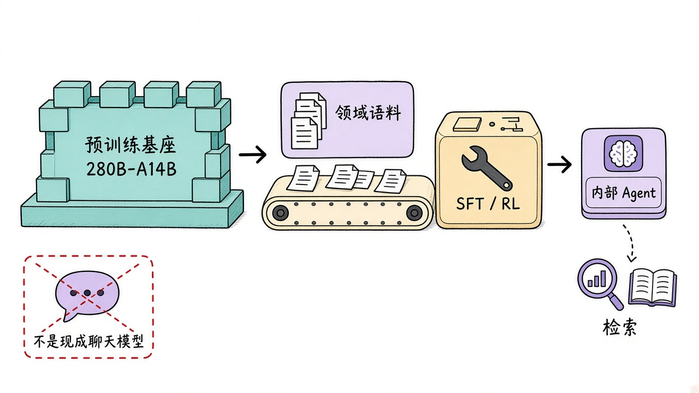
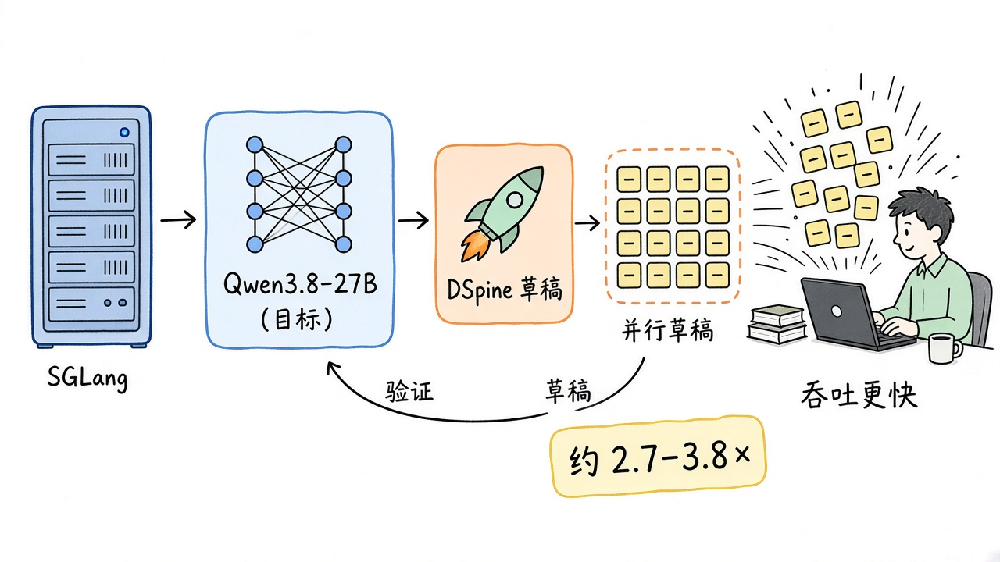
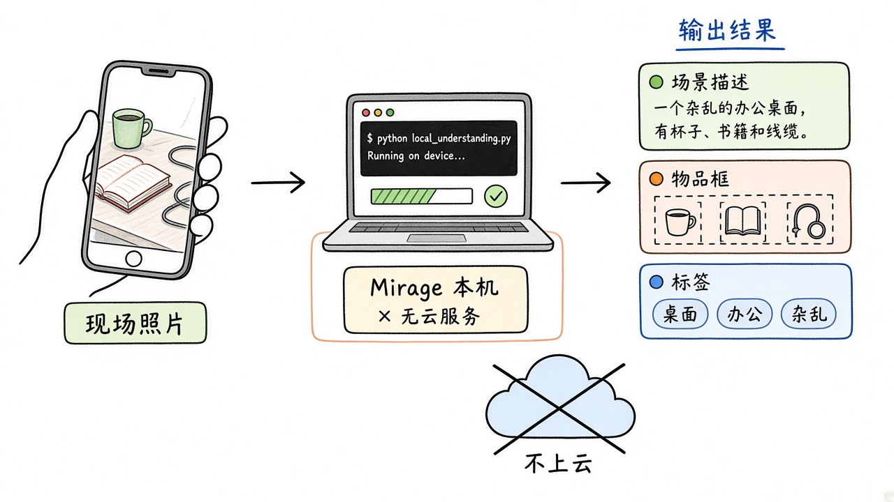

# 2026-11-10 Hugging Face 日报

今日三条：百度开源的 280B-A14B 基座、给 Qwen3.8-27B 的腾讯投机解码草稿，以及端侧视觉理解 Mirage。

## 1. baidu/ERNIE-5.5-Flash-Base — 280B / 14B 激活的预训练基座

**介绍**  
ERNIE-5.5-Flash-Base：稀疏 MoE 语言模型，总参 280B、每 token 激活 14B，从零预训练约 33.5T tokens；训练上下文最长 128K，微调与推理可到 1M。这是预训练结束、尚未 mid/post-training 的权重，面向继续预训练、指令微调与 RL 研究，不是对话成品。提供 FP8 与 BF16。服务走 SGLang / [vLLM-ERNIE](https://github.com/baidu/vLLM-ERNIE)，走 completions 接口。许可为 ERNIE 5.5 Flash Base Model License v1.0，商用前先读条款。likes 约 239（FP8）/ 383（BF16）。

**用法**  
模型卡：[huggingface.co/baidu/ERNIE-5.5-Flash-Base](https://huggingface.co/baidu/ERNIE-5.5-Flash-Base)。BF16：[baidu/ERNIE-5.5-Flash-Base-BF16](https://huggingface.co/baidu/ERNIE-5.5-Flash-Base-BF16)。博客：[ernie.baidu.com/release/ernie-5-5-flash-base](https://ernie.baidu.com/release/ernie-5-5-flash-base/)。

```bash
# SGLang（官方预构建镜像示例）
# docker run ... lmsysorg/sglang:dev-ernie-55-flash
sglang serve --model-path baidu/ERNIE-5.5-Flash-Base \
  --tp 4 --attn-dp-size 4 --context-length 131072 --port 30000
# 基座模型请打 /v1/completions，而不是 chat
```

**应用场景**  
团队用自家语料在这颗基座上做领域 SFT，再接到内部检索 agent，而不是直接当聊天模型用。



**推荐学习程度**：深度

---

## 2. tencent/Qwen3.8-27B-DSpine-b16 — Qwen3.8-27B 的投机解码草稿模型

**介绍**  
DSpine 是腾讯的并行草稿投机解码方法：五层草稿模型，block size 16，滑动窗口 8,192。这份权重专门给 [Qwen/Qwen3.8-27B](https://huggingface.co/Qwen/Qwen3.8-27B) 做 draft，本身不是独立聊天模型。官方在 SGLang 上评测称，相对自回归，agent 场景吞吐可到约 2.7–3.8×（如 WorkBuddy Office low 档 3.84×）。Apache-2.0。likes 约 148（2026-11-07 创建，11-09 更新）。

**用法**  
模型卡：[huggingface.co/tencent/Qwen3.8-27B-DSpine-b16](https://huggingface.co/tencent/Qwen3.8-27B-DSpine-b16)。代码：[github.com/Tencent/DSpine](https://github.com/Tencent/DSpine)。项目页：[dspine-project.github.io](https://dspine-project.github.io)。

```bash
git clone https://github.com/Tencent/DSpine.git && cd DSpine && pip install -e .
hf download tencent/Qwen3.8-27B-DSpine-b16 --local-dir ./Qwen3.8-27B-DSpine-b16
sglang serve \
  --model-path Qwen/Qwen3.8-27B \
  --speculative-algorithm DSPINE \
  --speculative-draft-model-path ./Qwen3.8-27B-DSpine-b16 \
  --speculative-num-draft-tokens 16 \
  --dtype bfloat16 --trust-remote-code
# 其余 serving 参数见模型卡
```

**应用场景**  
已经在跑 Qwen3.8-27B 的编码/办公 agent 服务：加上这份草稿模型，同样硬件上把输出速度提上去。



**推荐学习程度**：深度

---

## 3. Cactus-Compute/mirage — 端侧图像理解与结构化抽取

**介绍**  
Mirage 是 Cactus Compute 的视觉模型，面向图像理解与结构化抽取，标签覆盖描述、目标检测、分割、分类、VQA 与文档问答。Apache-2.0。Python 包会在首次使用时下载引擎与权重。likes 约 101，下载约 1.0 万（2026-11-05 上线）。

**用法**  
模型卡：[huggingface.co/Cactus-Compute/mirage](https://huggingface.co/Cactus-Compute/mirage)。介绍与 playground：[cactuscompute.com/blog/mirage](https://cactuscompute.com/blog/mirage)。源码：[github.com/cactus-compute/cactus](https://github.com/cactus-compute/cactus)。

```bash
pip install -U cactus-compute
```

```python
import cactus
print(cactus.Mirage().describe("photo.png"))
```

**应用场景**  
把现场照片丢给本机脚本：先出场景描述，再抽出物品框与标签，不必把原图送到云端。



**推荐学习程度**：入门

---
