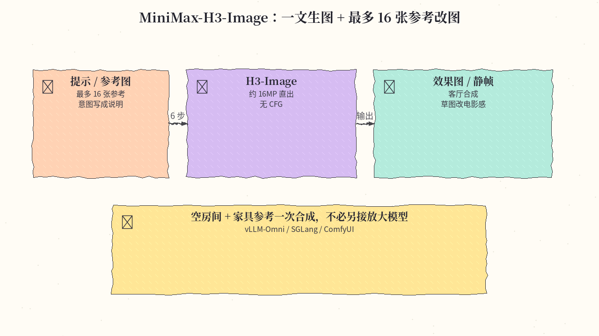
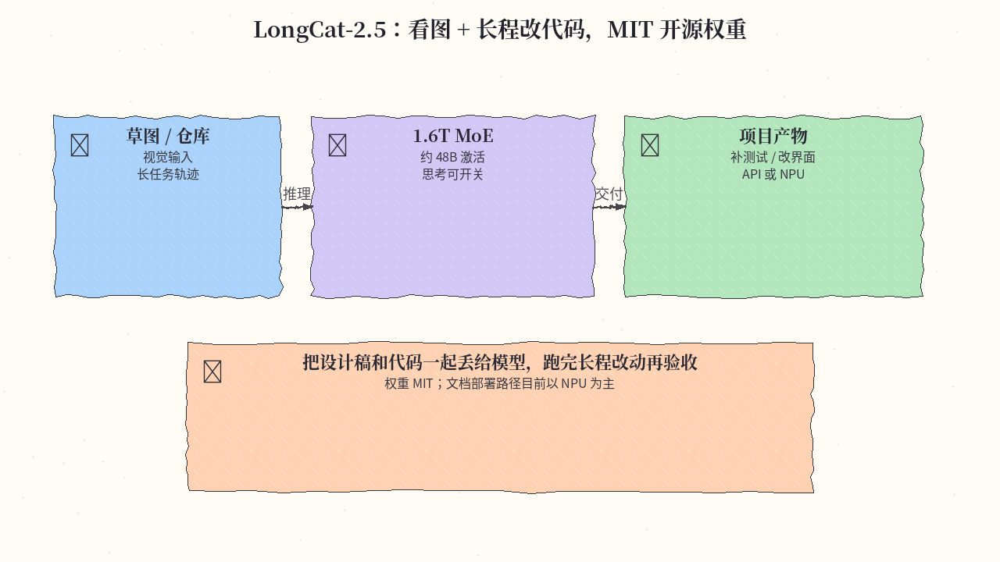
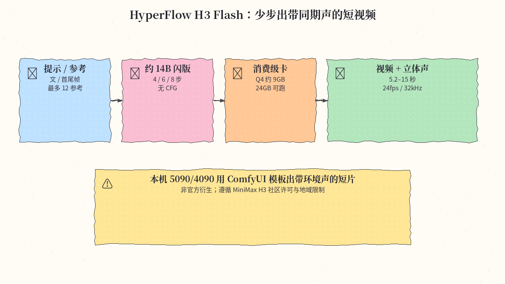
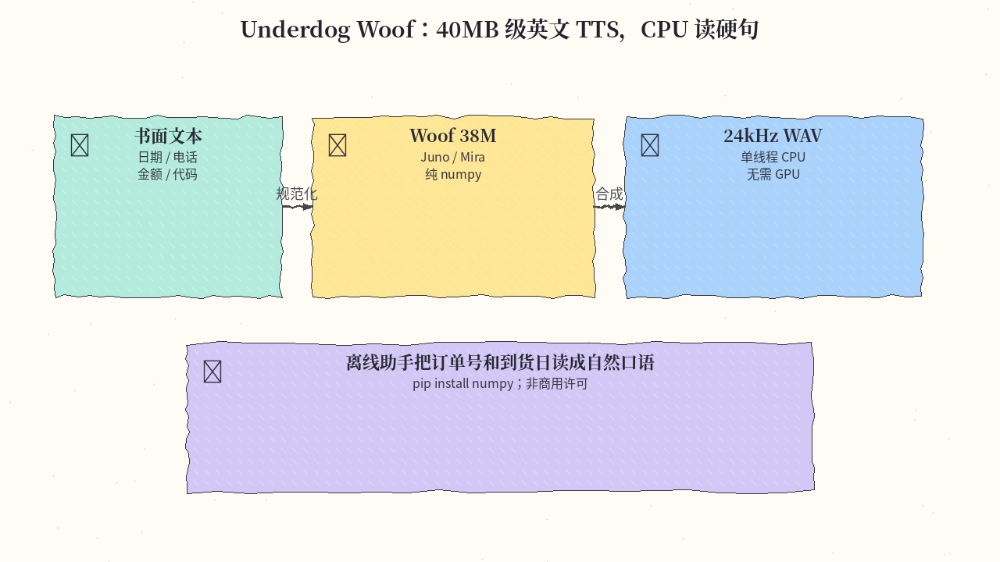

# 2026-11-11 Hugging Face 日报

今日四条：MiniMax 官方 H3 生图/改图一体、美团 LongCat-2.5 权重开源、消费级卡能跑的 H3 音画闪版，以及 40MB 级 CPU TTS。

## 1. MiniMaxAI/MiniMax-H3-Image — 一文生图 + 最多 16 张参考改图

**介绍**  
MiniMax-H3-Image 把文生图和图像编辑放进同一套权重：最多 16 张参考，约 16MP 直出（1:1 为 4096×4096，21:9 到 6272×2688），蒸馏为 6 步、不用 classifier-free guidance。扩散变压器约 33.1B，文本编码器复用 MiniMax-H3 的 Qwen3-VL 文本侧（需另下）。likes 约 403，当日仍在 Trending 前列。许可证是 MiniMax-H3-Image 社区协议，商用门槛以协议与授权表为准。

**用法**  
模型卡：[huggingface.co/MiniMaxAI/MiniMax-H3-Image](https://huggingface.co/MiniMaxAI/MiniMax-H3-Image)。也可用官方 API / 海螺应用；本地推荐 vLLM-Omni、SGLang、diffusers 或 ComfyUI。

```bash
hf download MiniMaxAI/MiniMax-H3-Image
hf download MiniMaxAI/MiniMax-H3 --include "text_encoder/*"
# 可选提示扩写：hf download MiniMaxAI/MiniMax-H3-Image-PE

vllm serve MiniMaxAI/MiniMax-H3-Image --omni --host 0.0.0.0 --port 8000
# 或：sglang serve --model-path MiniMaxAI/MiniMax-H3-Image --host 0.0.0.0 --port 30000 --warmup-mode off
```

文生图走 `/v1/images/generations`，改图走 `/v1/images/edits`（参考图按上传顺序对应提示里的编号）。`num_inference_steps` 只接受 6，`guidance_scale` 只接受 1。短提示建议先经 H3-Image-Context-IR 或本地 PE 扩成详细英文描述。

**应用场景**  
产品把空房间和九件家具参考一次合成客厅效果图，或把概念草图改成电影静帧，直接出约 16MP，不必再接放大模型。



**推荐学习程度**：进阶

---

## 2. meituan-longcat/LongCat-2.5 — 1.6T / 48B 激活的原生多模态长程 Agent

**介绍**  
美团于 11 月 10 日以 MIT 协议开源 LongCat-2.5 权重：原生多模态 MoE，总参约 1.6T，每 token 激活约 48B，面向长程智能体（复杂代码库、整项目构建、Visual Coding、3D）。官方自测 Terminal Bench v2.1 为 88.4（相对 2.0 的 70.8；数字来自模型卡，标为 in-house / indicative）。likes 约 81（权重体量很大，刚上线）。注意：卡片上的部署路径目前写的是国产 NPU + SGLang-FluentLLM，没有公布已验证的 GPU 配方；实用路径是 [longcat.ai](https://longcat.ai/) 与官方 API。

**用法**  
模型卡：[huggingface.co/meituan-longcat/LongCat-2.5](https://huggingface.co/meituan-longcat/LongCat-2.5)。博客：[tech.meituan.com 开源说明](https://tech.meituan.com/2026/11/10/Meituan-LongCat-2.5-Open-Source.html)。思考模式用 `chat_template_kwargs.enable_thinking` 开关。API 平台：[longcat.chat/platform](https://longcat.chat/platform/product)。

```python
# 官方 API 为 OpenAI 兼容接口；自托管请按卡片走 NPU / SGLang-FluentLLM
import openai
client = openai.OpenAI()  # 填入平台 base_url 与 key
resp = client.chat.completions.create(
    model="LongCat-2.5",
    messages=[{"role": "user", "content": "解释这张设计稿并列出要改的前端项。"}],
    extra_body={"chat_template_kwargs": {"enable_thinking": True}},
)
```

**应用场景**  
把一张产品草图和现有前端仓库一起交给模型，让它跑完长程「看图改界面 + 补测试」，而不是只吐文本补丁。自托管需等社区 GPU 方案，或按文档走 NPU。



**推荐学习程度**：深水

---

## 3. VideoRebirthAI/hyperflow-h3-flash — 消费级卡上的 H3 音画少步闪版

**介绍**  
Video Rebirth 对 MiniMax-H3 做结构剪枝与 INT8/GGUF 压缩后的非官方闪版（约 14B，不到满血变压器一半）：4/6/8 步、无 CFG，输出 5.2–15 秒、24fps、默认 1344×768 的视频，并带 32kHz 立体声。任务含文生音画、首/尾帧、最多 12 路参考。`Q4_K_M` 约 9.1GB，官方测过 24/32GB 消费级卡。likes 约 175，下载已超过 11 万。权重同属 MiniMax H3 社区协议：未获授权不得在美 / 欧 / 英 / 韩下载；年收入超门槛的商用需书面授权。

**用法**  
模型卡：[huggingface.co/VideoRebirthAI/hyperflow-h3-flash](https://huggingface.co/VideoRebirthAI/hyperflow-h3-flash)。代码与 ComfyUI 工作流在 [Video-Rebirth/hyperflow-h3-flash](https://github.com/Video-Rebirth/hyperflow-h3-flash)。

```bash
pip install git+https://github.com/Video-Rebirth/hyperflow-h3-flash
hyperflow-h3-flash --prompt "A chef slides a steaming bowl of ramen across a wooden counter; rain taps on the window." \
  --output ramen.mp4
# 首尾帧: --image first.png --last-image last.png
# 24GB+ 卡上的 ComfyUI：用仓库模板 hyperflow_t2v / i2v / flf2v / ref2v（或对应 INT8 模板）
```

文本编码器、视频/音频 VAE 需从 MiniMax-H3 / Comfy-Org 配套仓加载，不在本仓库重复存放。

**应用场景**  
本机 5090 或 4090 上打开 ComfyUI 模板，一句带环境声的提示出一段同期声短片，不必上满血约 31B 的 H3。



**推荐学习程度**：进阶

---

## 4. ConwayResearch/Underdog-Woof — 40MB 级英文 TTS，CPU 读硬句

**介绍**  
Underdog Woof 是约 38M 参数的英文 TTS，双音色 Juno / Mira 打在同一个 40.6MB 文件里，运行时只需 numpy，单线程 CPU 即可。内置规则把日期、电话、金额、代码读成口语。作者用同一套 Gradium TTS Hard Cases 口径自评 Mira 的 WER 为 1.42%，并称低于 Phonon 31M 与 Fish Audio Drama 3——数字来自模型卡，未经第三方复核。likes 约 147。许可是 Underdog 非商用协议：个人/研究可用，商用需向 license@conway.tech 申请，且禁止用其音频训练其他语音模型。

**用法**  
模型卡：[huggingface.co/ConwayResearch/Underdog-Woof](https://huggingface.co/ConwayResearch/Underdog-Woof)。试听：[underdog.ai/woof](https://underdog.ai/woof)。

```bash
pip install numpy
hf download ConwayResearch/Underdog-Woof --local-dir underdog-woof
cd underdog-woof
python -m underdog_woof "Your order ships on March 3rd. Call 415-555-0199 with questions." -o hello.wav
# --voice mira
```

输出 24kHz 单声道 float32；可传 `seed` 复现。

**应用场景**  
无 GPU 笔记本上，把「3 月 3 日发货，电话 415-555-0199」读成自然口语 WAV，做离线助手旁白。



**推荐学习程度**：入门

---
