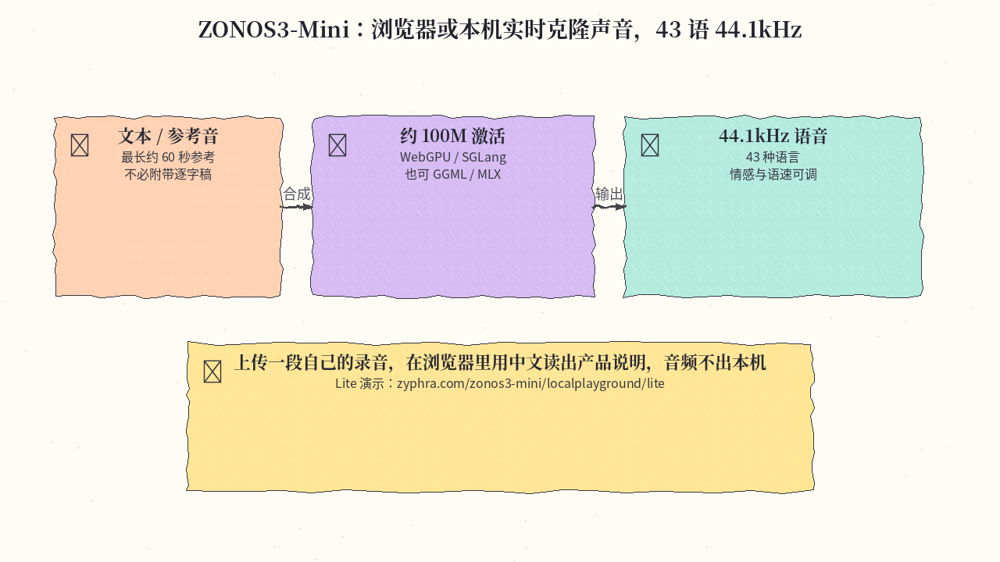

# 2026-11-12 Hugging Face 日报

今日一条：Zyphra 新发布的端侧多语 TTS，可在浏览器里实时克隆声音。

## 1. Zyphra/ZONOS3-Mini — 约 100M 激活的实时多语 TTS，浏览器可跑

**介绍**  
ZONOS3-Mini 是 Zyphra 在 2026-11-09 发布的开源文本转语音模型：总共约 8 亿参数、每次约 1 亿激活，支持 43 种语言（含中、日、韩、英等），可从参考音频做零样本音色克隆，也可按年龄、口音和声线设计角色，并调节情绪、语速和响度，细到词一级。输出 44.1 kHz 单声道，参考音频不必附带逐字稿，默认超过 60 秒会截取开头。权重 Apache-2.0。可在支持 WebGPU 的浏览器里完全在本机 GPU 上跑（首次访问下载模型，之后走缓存），也可用 SGLang-Omni、官方 CUDA / MLX / C++·GGML 运行时，或 Zyphra Cloud。技术说明与样例见[发布博文](https://www.zyphra.com/our-work/zonos3-mini)。官方给出的首包延迟参考：Pixel 9 浏览器低于 570 ms，M3 MacBook Air 低于 150 ms。

**用法**  
模型卡：[huggingface.co/Zyphra/ZONOS3-Mini](https://huggingface.co/Zyphra/ZONOS3-Mini)。浏览器试用：[Voice Studio](https://zyphra.com/zonos3-mini/localplayground#cast)、[Lite 克隆](https://zyphra.com/zonos3-mini/localplayground/lite)。官方运行时：[github.com/Zyphra/ZONOS3-Mini](https://github.com/Zyphra/ZONOS3-Mini)。用 SGLang-Omni 在 NVIDIA GPU 上提供 OpenAI 兼容的 `/v1/audio/speech`：

```bash
sgl-omni serve --model-path Zyphra/ZONOS3-Mini --port 8000
# 等 curl http://localhost:8000/health 返回 healthy 后再合成
curl -X POST http://localhost:8000/v1/audio/speech \
  -H "Content-Type: application/json" \
  -d '{"input": "Hello from ZONOS3-Mini!"}' \
  --output output.wav
```

克隆音色时在 JSON 里加 `"references": [{"audio_path": "<reference clip>"}]`；流式输出可加 `"stream": true, "response_format": "pcm"`。更完整的选项见 [SGLang-Omni cookbook](https://github.com/sgl-project/sglang-omni/blob/main/docs/cookbook/zonos3.md)。

**应用场景**  
上传一段自己的录音，在浏览器 Lite 页用中文读出产品说明或旁白：推理在本机 GPU 上完成，音频不必传到外部服务。



**推荐学习程度**：入门
