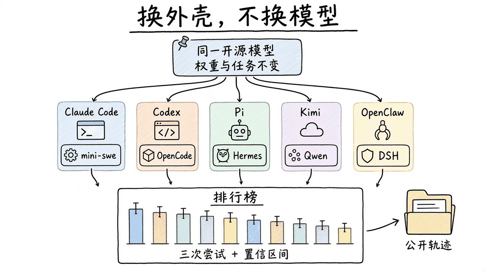

# 2026-11-13 Hugging Face 日报

今日两条：同一开源模型下对比 coding-agent harness 的排行榜，以及 Hugging Face 的 MoE 训练手册。

## 1. joelniklaus/harness-leaderboard — 同一模型，换哪套 coding-agent 外壳

**介绍**  
[Harness Leaderboard](https://huggingface.co/spaces/joelniklaus/harness-leaderboard) 是 Joel Niklaus 做的 Hugging Face Space：固定开源模型、权重、推理档位和任务，只换 harness（系统提示、工具、上下文压缩、权限），看哪套外壳更合适。目前模型是 GLM-5.3-Flash、DeepSeek-V4.1-Flash（低/高推理档）和 Flint（默认档）；基准是 Terminal-Bench 2.1 与 DeepSWE v1.1。评测过的 harness 包括 Claude Code、Codex、Pi、OpenCode、Hermes Agent、mini-swe-agent、Kimi Code、Qwen Code、OpenClaw，以及后来补进榜的 DeepSeek Harness。每项任务尝试三次，给 95% 置信区间；两条 harness 若成对分差的置信区间盖住 0，则记为并列。轨迹全部公开在 bucket [`joelniklaus/harness-leaderboard`](https://huggingface.co/buckets/joelniklaus/harness-leaderboard)。拿到标准答案、参考实现或他人轨迹即判失败（即使 grader 通过）。Space 于 2026-11-12 22:28 UTC 更新；[changelog](https://huggingface.co/spaces/joelniklaus/harness-leaderboard/blob/main/CHANGELOG.md) 在 11-11 写明：DeepSeek Harness 按与其他选手相同的缺次规则排名后，在 GLM-5.3-Flash 高档为 10 套中的第 5、与榜首统计并列，在全部模型的高档平均为第 2。数字会随新版本变动，以 Space 页面为准。Apache-2.0，约 325 likes。配套词典：[Harness Lens](https://huggingface.co/spaces/harness-hub/harness-lens)。

**用法**  
直接打开 Space，无需登录即可看总表、分模型/分档位视图、成本与「三次全中 / 至少一次中」的稳定性。要核对某次试验，到上述公开 bucket 取轨迹。方法细节见 Space 的 README。注意：榜上没有原生 Claude / GPT；Claude Code、Codex 是在这些开源模型上跑的，不能直接外推到它们自家模型。

**应用场景**  
已经选定 GLM 或 DeepSeek 这类开源模型、要挑本机或团队用的 coding-agent 外壳时，先看同模型下的分数、稳定性和单题成本，再在自己的仓库里复测，而不是只看某一家的发布数字。

**推荐学习程度**：进阶

---

## 2. huggingface/moe-blogpost — MoE 训练手册：从稠密模型走到专家混合

**介绍**  
[The Ultimate MoE Training Handbook](https://huggingface.co/spaces/huggingface/moe-blogpost) 是 Hugging Face 官方 Space 手册，写给已经训过稠密模型、接下来要训 MoE，或想看清 MoE 训练怎么做的人。第 2 章是 Megatron-LM 跑通指南：测硬件、做镜像、先训稠密基线，再在单节点上训第一个 MoE 并对照。第 3 章拆开 MoE 层（路由器、路由、负载均衡、专家、block 布局、训练与系统），每一块给出 Megatron-LM 代码、该看什么、作者建议，以及前沿 MoE 的选择。第 4 章跟到 serving 和 RL。第 3、4 章不需要 GPU。作者写明：实验结论来自在 CSCS Alps 集群上约 80 万 GH200 GPU 小时的 MoE 训练；涉及前沿模型的主张引用论文、配置或代码，玩具仿真会单独标注。另有 [55 张图的 gallery](https://huggingface.co/spaces/huggingface/moe-gallery)，以及一份汇总推荐 flag 的脚本 gist。约 590 likes，当日仍在 Spaces 热门前列。

**用法**  
在浏览器打开 [huggingface.co/spaces/huggingface/moe-blogpost](https://huggingface.co/spaces/huggingface/moe-blogpost) 按章阅读。若要动手：有 GPU 就从第 2 章的单节点流程走；只想弄清路由和负载均衡，直接读第 3 章。图集在 [moe-gallery](https://huggingface.co/spaces/huggingface/moe-gallery)。

**应用场景**  
准备用 Megatron-LM 把现有稠密训练作业改成 MoE 时，先按手册对照硬件与 flag，再决定路由器和负载均衡怎么设，避免一上来就抄一篇论文的超参。

**推荐学习程度**：深入
