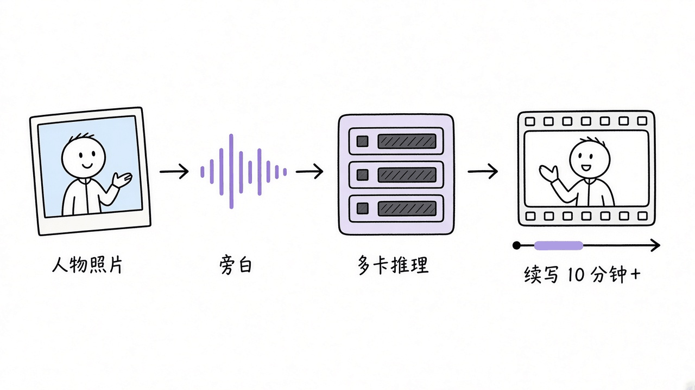
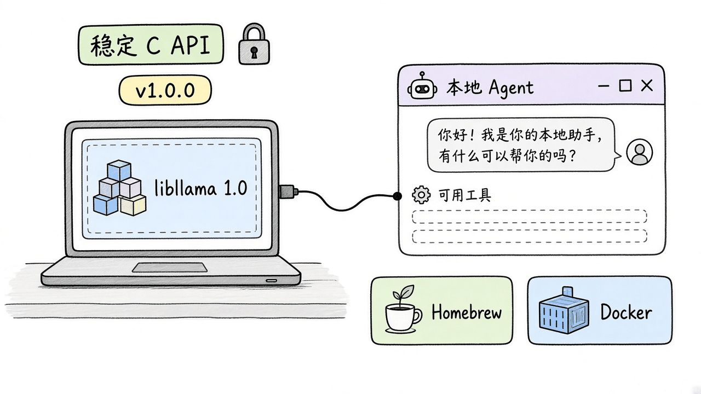

# 2026-11-16 Hugging Face 日报

今日两条：美团刚上线的音频驱动数字人 LongCat-Video-Avatar 1.6，以及 llama.cpp / ggml 的库版本 v1.0.0。

## 1. meituan-longcat/LongCat-Video-Avatar-1.6 — 开源音频驱动数字人，可续写到 10 分钟以上

**介绍**  
[LongCat-Video-Avatar 1.6](https://huggingface.co/meituan-longcat/LongCat-Video-Avatar-1.6) 是美团 LongCat 的音频驱动数字人升级（相对 1.5）：改进表情自然度、唇音同步、面身动作协调，以及长视频一致性，并做了端到端推理优化。模型卡写可按片段续写到 10 分钟以上。仓库在周五日报发出之后创建（2026-11-13 10:45 CST），当日下午上传权重，晚上更新 README。MIT，未 gated。刚发布，likes 和下载量都还很少，但卡片完整，有可核对的 safetensors / INT8 / LoRA 权重。任务标签含 audio-text-to-video、audio-image-text-to-video、audio-driven-video-continuation。模型卡还写：与 1.5 及 OmniHuman-2.0、HeyGen、OmniHuman-1.5、Kling Avatar 2.0 做全对比较，33,051 张有效票，1.6 在六套系统中排第二，Bradley–Terry Elo 1068.1，仅落后 OmniHuman-2.0。项目页：[LongCat-Video-Avatar-1.6-Page](https://meigen-ai.github.io/LongCat-Video-Avatar-1.6-Page/)，代码：[github.com/meituan-longcat/LongCat-Video](https://github.com/meituan-longcat/LongCat-Video)。

**用法**  
需同时下载基础视频模型与 Avatar 1.6。环境与依赖见模型卡（Python 3.10、`torch==2.6.0+cu124`、`flash_attn==2.7.4.post1`、`requirements.txt`、`requirements_avatar.txt` 等）：

```shell
git clone --single-branch --branch main https://github.com/meituan-longcat/LongCat-Video
cd LongCat-Video
huggingface-cli download meituan-longcat/LongCat-Video --local-dir ./weights/LongCat-Video
huggingface-cli download meituan-longcat/LongCat-Video-Avatar-1.6 --local-dir ./weights/LongCat-Video-Avatar-1.6

# 单人：语音+文本生成视频（卡片示例为 2 卡）
torchrun --nproc_per_node=2 run_demo_avatar_single_audio_to_video.py \
  --context_parallel_size=2 \
  --checkpoint_dir=./weights/LongCat-Video-Avatar-1.6 \
  --stage_1=at2v \
  --input_json=assets/avatar/single_example_1.json \
  --use_distill --lora_path loraB/lora.safetensors \
  --model_type avatar-v1.6 --mix_steps=4 --mix_alpha=1.0
```

同卡还给出 `ai2v`（语音+图像）、`--num_segments=5` 续写，以及 `run_demo_avatar_multi_audio_to_video.py` 多人示例。可选 `--use_int8`（卡片提供 `base_model_int8`）或 `--use_fp8`（需 Transformer Engine，二者不可同时开）。卡片示例一律 `torchrun --nproc_per_node=2`，没有写消费级显存数字。Hopper（H20 / H100 / H200 / H800）才建议开 FlashAttention 3。`loraA` 为 DMD、`loraB` 为 OPSD。正文有通用安全/合规提醒。

**应用场景**  
把一段讲解旁白和一张人物照片交给 1.6，在多卡上先做语音驱动的形象视频，再按片段续写，得到一段超过 10 分钟、口型更稳的讲解视频。



**推荐学习程度**：深入

---

## 2. ggml-org/llama-cpp-v1 — llama.cpp / ggml 库版本 v1.0.0，公共 C API 开始语义化

**介绍**  
[llama.cpp v1.0.0 : A stronger foundation for the local AI ecosystem](https://huggingface.co/blog/ggml-org/llama-cpp-v1) 是 ggml-org 在周五晚（2026-11-13 22:08 CST）发的官方团队博文，作者 Daniel Bevenius、Georgi Gerganov、merve。文中宣布同时发布 **llama.cpp v1.0.0（libllama）** 与 **ggml v1.0.0（libggml）**：此后公共 C API（`./include`）不兼容会升 major，向后兼容功能和后端/模型支持升 minor，纯修 bug 升 patch。文中写 llama.cpp 目前支持 150+ 架构变体及主流投机解码。这不是新的 Hub 基座模型，但是本地推理栈的一个版本节点。博文正文未写许可证。

**用法**  
博文没有给出具体安装命令，只列出发行渠道：Pre-release artifacts（Linux / macOS / Windows / Android / iOS）、Docker、Debian、Homebrew、conda-forge、MacPorts、Winget、XCFramework。按这些官方渠道取 v1.0.0 工件；具体命令以各渠道当前文档为准。源码与示例见 [github.com/ggml-org/llama.cpp](https://github.com/ggml-org/llama.cpp)，模型与相关资源在 [huggingface.co/ggml-org](https://huggingface.co/ggml-org)。文末还提到由 llama.cpp 与 Hugging Face 团队出品的 Llama desktop apps（macOS / Windows）。

**应用场景**  
用 Homebrew、Docker 或系统包装上语义化的 libllama 1.0，把已有的本地聊天或 Agent 接到稳定的 C API，避免后续小版本更新把接口弄坏。



**推荐学习程度**：入门
