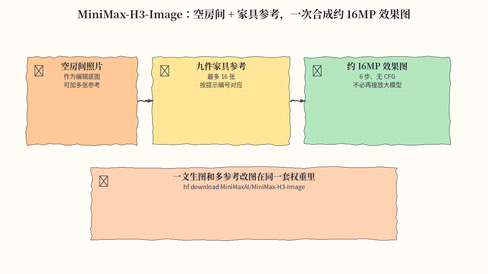
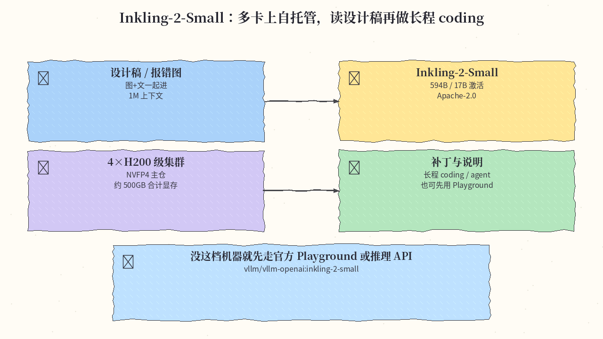
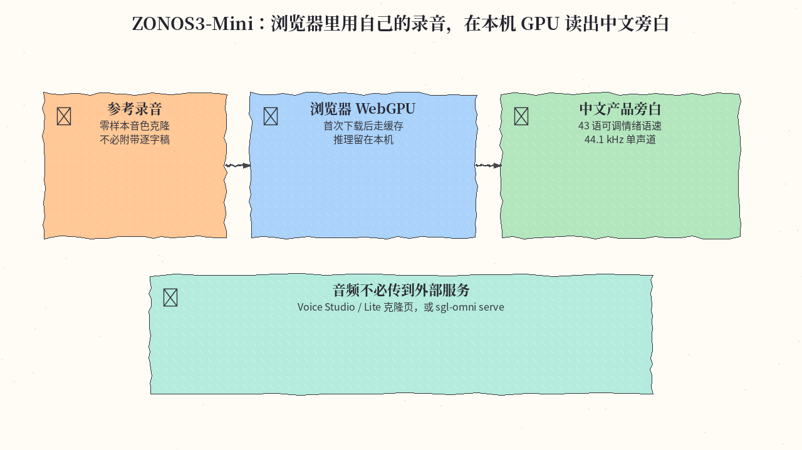
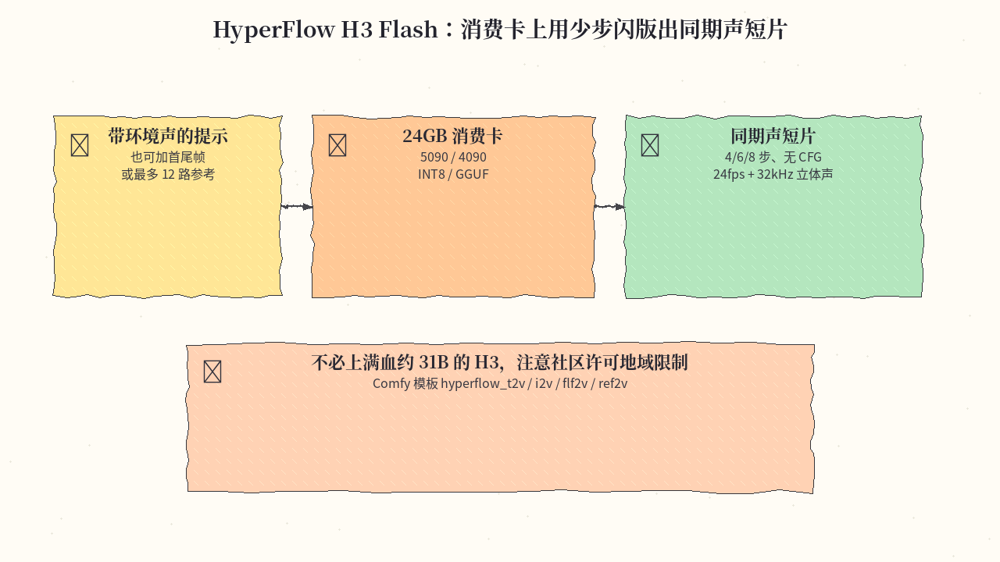
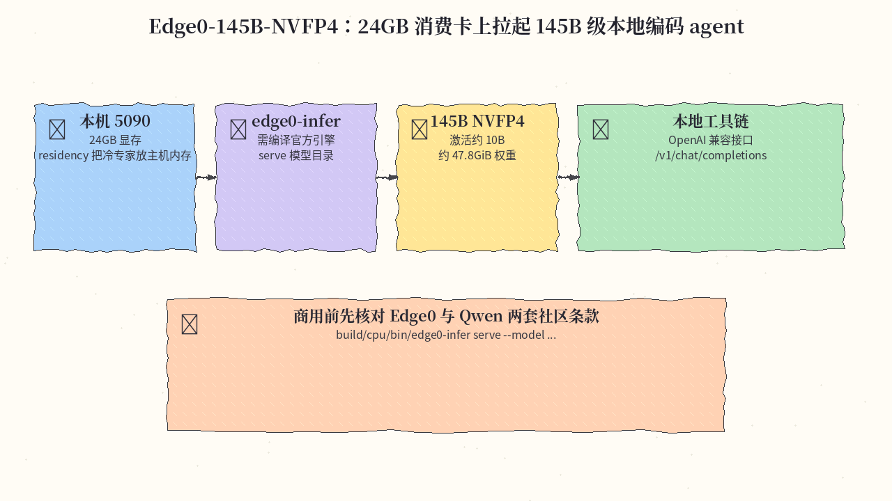
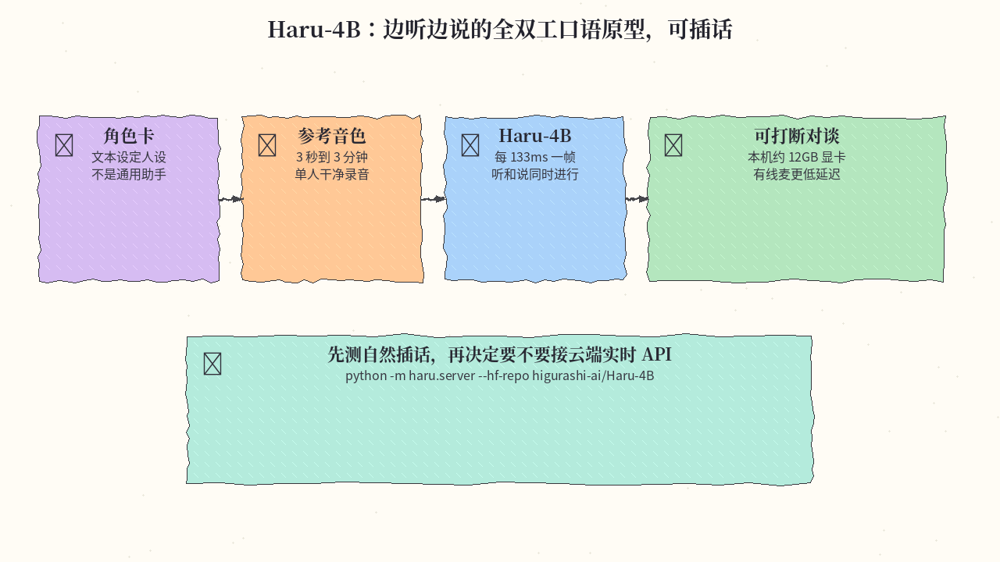
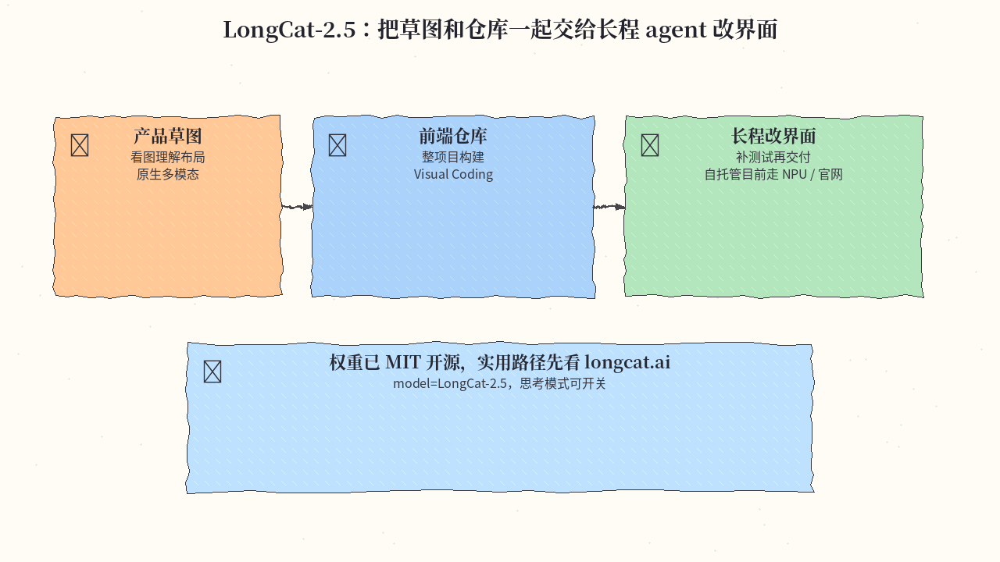
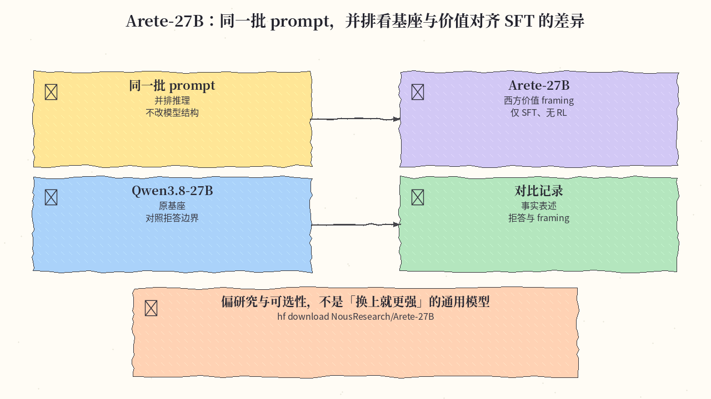
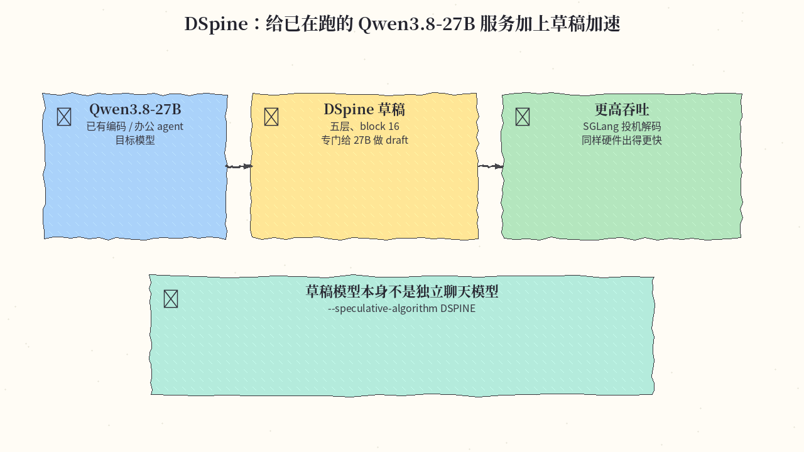
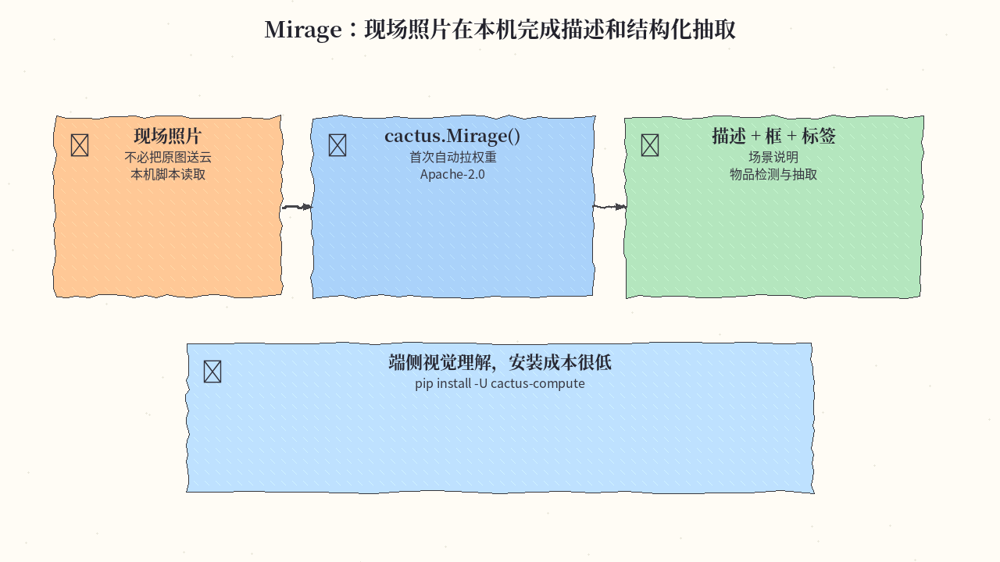

# 2026-11-16 Hugging Face 周报

上周（11/09–11/15）精选 10 个值得跟进的模型与权重（偏 MiniMax 官方生图、Thinking Machines 开源权重，以及能在消费卡或浏览器跑的语音/视频）。

## 1. MiniMaxAI/MiniMax-H3-Image — 一文生图 + 最多 16 张参考改图

**介绍**  
MiniMax-H3-Image（约 2026-11-03 上线，11/10–11/12 仍在更新）：把文生图和图像编辑放进同一套权重，最多 16 张参考；约 16MP 直出（1:1 为 4096×4096，21:9 到 6272×2688），蒸馏为 6 步、不用 classifier-free guidance。扩散变压器约 33.1B，文本编码器复用 MiniMax-H3 的 Qwen3-VL 文本侧（需另下，约 66.7GB）。Hub likes 约 1.2k、下载约 57 万，本周仍在 Trending 前列。许可证是 MiniMax-H3-Image 社区协议：适用领土排除欧盟、英国、韩国和美国（这些地区需事先书面授权）；商用授权走[申请表](https://platform.minimax.io/console/license)。

**用法**  
模型卡：[huggingface.co/MiniMaxAI/MiniMax-H3-Image](https://huggingface.co/MiniMaxAI/MiniMax-H3-Image)。也可用官方 API / 海螺应用；本地推荐 vLLM-Omni、SGLang、diffusers 或 ComfyUI。

```bash
hf download MiniMaxAI/MiniMax-H3-Image
hf download MiniMaxAI/MiniMax-H3 --include "text_encoder/*"
# 可选提示扩写：hf download MiniMaxAI/MiniMax-H3-Image-PE

vllm serve MiniMaxAI/MiniMax-H3-Image --omni --host 0.0.0.0 --port 8000
# 或：sglang serve --model-path MiniMaxAI/MiniMax-H3-Image --host 0.0.0.0 --port 30000 --warmup-mode off
```

文生图走 `/v1/images/generations`，改图走 `/v1/images/edits`（参考图按上传顺序对应提示里的编号）。`num_inference_steps` 只接受 6，`guidance_scale` 只接受 1。短提示建议先经 H3-Image-Context-IR 或本地 PE 扩成详细英文描述。

**应用场景**  
产品把空房间和九件家具参考一次合成客厅效果图，或把概念草图改成电影静帧，直接出约 16MP，不必再接放大模型。



**推荐学习程度**：进阶

---

## 2. thinkingmachines/Inkling-2-Small — 594B / 17B 激活的开源多模态 MoE

**介绍**  
Thinking Machines Lab 的 Inkling 2 Small：原生多模态 MoE（图+文进、文本出），总参 594B、每 token 激活 17B，48 层、384 专家 top-8，上下文最长约 1M。权重以 Apache-2.0 于 11 月 12 日开放下载，11/15 仍有更新；主仓是原生 NVFP4（专家层 0–39 为 NVFP4、40–47 为 MXFP8），另有 [MXFP8](https://huggingface.co/thinkingmachines/Inkling-2-Small-MXFP8) 变体。Hub likes 约 0.34k。官方要求 NVFP4 至少约 500GB 合计显存（例如 2×B300 或 4×H200），MXFP8 约 800GB（例如 4×B300 或 8×H200）。本地门槛高，但许可宽松，也可走 Tinker Playground 与多家推理 API。另须遵守[可接受使用政策](https://thinkingmachines.ai/model-acceptable-use-policy)。

**用法**  
模型卡：[huggingface.co/thinkingmachines/Inkling-2-Small](https://huggingface.co/thinkingmachines/Inkling-2-Small)。试用：[Tinker Playground](https://tinker.thinkingmachines.ai/playground)。本地推理见官方 [vLLM](https://recipes.vllm.ai/thinkingmachines/Inkling-2-Small) / [SGLang](https://docs.sglang.io/cookbook/autoregressive/ThinkingMachines/Inkling-2-Small) / TokenSpeed / Unsloth recipe。当前 vLLM 需用专用镜像，例如 4 卡、26 万上下文（完整 1M 需更大并行）：

```bash
docker run --gpus all --privileged --ipc=host -p 8000:8000 \
  -v ~/.cache/huggingface:/root/.cache/huggingface \
  vllm/vllm-openai:inkling-2-small thinkingmachines/Inkling-2-Small \
  --tensor-parallel-size 4 \
  --max-model-len 262144 \
  --reasoning-parser inkling \
  --speculative-config '{"method":"dspark","num_speculative_tokens":7,"draft_sample_method":"probabilistic"}'
# 其余硬件配方以 vLLM / SGLang cookbook 为准
```

**应用场景**  
在 4×H200 级集群上自托管一颗 Apache-2.0 的 17B 激活多模态模型，读设计稿或报错截图再做长程 coding / agent；没这档机器就先用 Playground 或第三方 API 试用。



**推荐学习程度**：专家

---

## 3. Zyphra/ZONOS3-Mini — 约 100M 激活的实时多语 TTS，浏览器可跑

**介绍**  
ZONOS3-Mini 是 Zyphra 在 11 月 9 日发布的开源 TTS（11/14 仍在更新）：总共约 8 亿参数、每次约 1 亿激活，支持 43 种语言（含中、日、韩、英等），可从参考音频做零样本音色克隆，也可按年龄、口音和声线设计角色，并调节情绪、语速和响度。输出 44.1 kHz 单声道，参考音频不必附带逐字稿，默认超过 60 秒会截取开头。权重 Apache-2.0。可在支持 WebGPU 的浏览器里完全在本机 GPU 上跑（首次访问下载模型，之后走缓存），也可用 SGLang-Omni、官方 CUDA / MLX / C++·GGML 运行时，或 Zyphra Cloud。Hub likes 约 0.40k。官方博文给出的首包延迟参考：Pixel 9 浏览器低于 570 ms，M3 MacBook Air 低于 150 ms；模型卡在单卡 H100 上测得 8 路并发的中位首包约 80 ms。

**用法**  
模型卡：[huggingface.co/Zyphra/ZONOS3-Mini](https://huggingface.co/Zyphra/ZONOS3-Mini)。浏览器试用：[Voice Studio](https://zyphra.com/zonos3-mini/localplayground#cast)、[Lite 克隆](https://zyphra.com/zonos3-mini/localplayground/lite)。官方运行时：[github.com/Zyphra/ZONOS3-Mini](https://github.com/Zyphra/ZONOS3-Mini)。技术说明与样例见[发布博文](https://www.zyphra.com/our-work/zonos3-mini)。用 SGLang-Omni 在 NVIDIA GPU 上提供 OpenAI 兼容的 `/v1/audio/speech`：

```bash
sgl-omni serve --model-path Zyphra/ZONOS3-Mini --port 8000
# 等 curl http://localhost:8000/health 返回 healthy 后再合成
curl -X POST http://localhost:8000/v1/audio/speech \
  -H "Content-Type: application/json" \
  -d '{"input": "Hello from ZONOS3-Mini!"}' \
  --output output.wav
```

克隆音色时在 JSON 里加 `"references": [{"audio_path": "<reference clip>"}]`；流式输出可加 `"stream": true, "response_format": "pcm"`。更完整的选项见 [SGLang-Omni cookbook](https://github.com/sgl-project/sglang-omni/blob/main/docs/cookbook/zonos3.md)。

**应用场景**  
上传一段自己的录音，在浏览器 Lite 页用中文读出产品说明或旁白：推理在本机 GPU 上完成，音频不必传到外部服务。



**推荐学习程度**：入门

---

## 4. VideoRebirthAI/hyperflow-h3-flash — 消费级卡上的 H3 音画少步闪版

**介绍**  
Video Rebirth 对 MiniMax-H3 做结构剪枝与 INT8/GGUF 压缩后的非官方闪版（约 13.7–13.9B，不到满血变压器一半）：4/6/8 步、无 CFG，输出 5.2–15 秒、24fps、默认 1344×768 的视频，并带 32kHz 立体声。任务含文生音画、首/尾帧、最多 12 路参考。`Q4_K_M` 约 9.1GB，官方测过 24/32GB 消费级卡（16GB 卡尚未公布数据）。Hub likes 约 0.30k，下载约 50 万；11/14 仍有更新。权重同属 MiniMax H3 社区协议：未获授权不得在美 / 欧 / 英 / 韩下载；年收入超 2000 万美元的商用需书面授权，产品须标明 "MiniMax H3"。

**用法**  
模型卡：[huggingface.co/VideoRebirthAI/hyperflow-h3-flash](https://huggingface.co/VideoRebirthAI/hyperflow-h3-flash)。代码与 ComfyUI 工作流在 [Video-Rebirth/hyperflow-h3-flash](https://github.com/Video-Rebirth/hyperflow-h3-flash)。

```bash
pip install git+https://github.com/Video-Rebirth/hyperflow-h3-flash
hyperflow-h3-flash --prompt "A chef slides a steaming bowl of ramen across a wooden counter; rain taps on the window." \
  --output ramen.mp4
# 首尾帧: --image first.png --last-image last.png
# 24GB+ 卡上的 ComfyUI：用仓库模板 hyperflow_t2v / i2v / flf2v / ref2v（或对应 INT8 模板）
```

文本编码器、视频/音频 VAE 需从 MiniMax-H3 / Comfy-Org 配套仓加载，不在本仓库重复存放。Python INT8 包首次运行会再拉编码器与 VAE（官方称合计约 90GB，fp8 文本编码器约 68GB）。

**应用场景**  
本机 5090 或 4090 上打开 ComfyUI 模板，一句带环境声的提示出一段同期声短片，不必上满血约 31B 的 H3。



**推荐学习程度**：进阶

---

## 5. Edge0/Edge0-145B-NVFP4 — 原生 NVFP4 的 145B 潜在 MoE，消费卡可跑

**介绍**  
Edge0-145B（约 2026-11-11 上线，11/15 仍在更新）：潜在稀疏 MoE，总参 145B、每 token 激活约 10.12B（512 专家中 10 个路由 + 1 个共享），256K 上下文，专家层按官方说法是原生 4-bit 训练而非事后量化。本仓库是 NVFP4 构建（约 47.79GiB）；另有 Q3_K。Hub likes 约 0.29k、下载约 4.2 万。官方在 RTX 5090 D 24GB 上、开启 residency 时测得 NVFP4 占用 23.25GiB 显存 + 38.27GiB 主机内存，agent decode 约 98.3 tok/s。NVFP4 仅支持 NVIDIA CUDA 13；Q3_K 还可走 Apple Silicon Metal。许可是 Edge0 Community Model License 1.0，且 Qwen 部分仍受 Qwen Community License 1.0 约束：个人/研究/内部使用可以，但售卖模型、商用模型服务或独立商用助手需书面授权。

**用法**  
模型卡：[huggingface.co/Edge0/Edge0-145B-NVFP4](https://huggingface.co/Edge0/Edge0-145B-NVFP4)。推理走官方 `edge0-infer`（需先按仓库文档编译 edge0-strata 与 edge0-infer）；Windows 也可用 Edge0 Chat 桌面端直接选模型目录。

```bash
git clone https://github.com/Edge0-AI/Edge0.git edge0
# 按 edge0-strata/EDGE0.md 与 edge0-infer/docs/getting-started.md 完成编译后：
build/cpu/bin/edge0-infer serve --model /path/to/Edge0-145B-NVFP4
# 加载完成后监听 http://127.0.0.1:8000，模型名 edge0_145b
curl localhost:8000/v1/chat/completions \
  -H 'content-type: application/json' \
  -d '{"model":"edge0_145b","messages":[{"role":"user","content":"hi"}],"max_tokens":64}'
```

可选视觉需额外配置 `strata-vision` 与目录内的 `mmproj-BF16.gguf`，步骤见模型卡。

**应用场景**  
在 24GB 消费卡本机拉起一颗 145B 级编码/办公 agent，用 OpenAI 兼容接口接到已有工具链；商用前先核对 Edge0 与 Qwen 两套条款。



**推荐学习程度**：进阶

---

## 6. higurashi-ai/Haru-4B — 全双工口语对话基座：边听边说

**介绍**  
Haru-4B 是 higurashi 于 11 月 12 日开源的预训练全双工口语对话基座（Apache-2.0）：文本骨干为 Qwen3.5-4B，每 133ms（7.5Hz）吃一帧用户音频、同时吐一帧自己的音频和文本，听和说不必互相等待。角色用文本卡片设定，音色用 3 秒到 3 分钟的单人干净参考音频设定。支持英、西、葡、德、法、中、日、俄、韩。Hub likes 约 0.31k，周末仍出现在热门列表。作者写明：它能把对话聊自然，但不是可靠的事实来源，也不像助手那样跟指令；只使用你有权使用的声音。

**用法**  
模型卡：[huggingface.co/higurashi-ai/Haru-4B](https://huggingface.co/higurashi-ai/Haru-4B)。代码、Web demo、MLX / macOS 应用与 vLLM-Omni 插件：[github.com/higurashi-ai/Haru](https://github.com/higurashi-ai/Haru)。技术说明见[官方博客](https://blog.higurashi.ai/melte/haru4b/)。NVIDIA GPU（官方称约需 12GB 显存）：

```bash
git clone https://github.com/higurashi-ai/Haru && cd Haru
pip install -e ./haru
python -m haru.server --hf-repo higurashi-ai/Haru-4B
# 打开 http://localhost:8998 ，选角色、提供参考音色后即可对谈
# 低延迟请用有线耳机和麦克风；蓝牙往往再加 100ms 以上
```

仓库不自带音色，需自行上传或录制参考音频。

**应用场景**  
在本机 12GB 级显卡上跑一个可打断的语音对话原型：先写好角色卡、录一段自己的声音，再测边听边说和插话，而不是先接云端实时 API。



**推荐学习程度**：进阶

---

## 7. meituan-longcat/LongCat-2.5 — 1.6T / 48B 激活的原生多模态长程 Agent

**介绍**  
美团于 11 月 10 日以 MIT 协议开源 LongCat-2.5 权重：原生多模态 MoE，总参约 1.6T，每 token 激活约 48B，面向长程智能体（复杂代码库、整项目构建、Visual Coding、3D）。官方自测 Terminal Bench v2.1 为 88.4（相对 2.0 的 70.8；数字来自模型卡，标为 in-house / indicative）。Hub likes 约 0.27k（权重体量很大，下载仍少）。注意：卡片上的部署路径目前写的是国产 NPU + SGLang-FluentLLM，没有公布已验证的 GPU 配方；实用路径是官网 [longcat.ai](https://longcat.ai/)。

**用法**  
模型卡：[huggingface.co/meituan-longcat/LongCat-2.5](https://huggingface.co/meituan-longcat/LongCat-2.5)。博客：[longcat.ai/blog/longcat-2.5](https://longcat.ai/blog/longcat-2.5/)。思考模式用 `chat_template_kwargs.enable_thinking` 开关；需要保留推理痕迹时再开 `save_history_reasoning_content`。自托管请按卡片走 [SGLang-FluentLLM 的 NPU 说明](https://github.com/meituan-longcat/SGLang-FluentLLM/blob/longcat-2.5-npu/npu_test/ReadMe.md)。

```python
# 官方示例为 OpenAI 兼容 chat.completions；base_url / key 以实际接入为准
import openai
client = openai.OpenAI()
resp = client.chat.completions.create(
    model="LongCat-2.5",
    messages=[{"role": "user", "content": "解释这张设计稿并列出要改的前端项。"}],
    extra_body={"chat_template_kwargs": {
        "enable_thinking": True,
        "save_history_reasoning_content": True,
    }},
)
```

**应用场景**  
把一张产品草图和现有前端仓库一起交给模型，让它跑完长程「看图改界面 + 补测试」，而不是只吐文本补丁。自托管需按文档走 NPU，或先在官网试用。



**推荐学习程度**：专家

---

## 8. NousResearch/Arete-27B — 西方价值 framing 的 Qwen3.8-27B SFT

**介绍**  
Arete-27B 是对 Qwen3.8-27B 的 SFT（Apache-2.0，约 2026-11-06）：把叙事/拒答框架往西方价值对齐方向推，训练只用监督微调，无 RL、无结构改动。教师是 Inkling，约 5280 万 tokens、64k 上下文、两轮 1,202 步。官方在 Propaganda_Eval 上称事实分 2.32→2.98（满分 5），含宣传内容的回答 22%→0.9%，并称通用与 agent 能力大致保持。偏研究与可选性，不是「通用更强」宣传。Hub likes 约 0.61k，本周七日都还在热门里。

**用法**  
模型卡：[huggingface.co/NousResearch/Arete-27B](https://huggingface.co/NousResearch/Arete-27B)。评测集：[NousResearch/Propaganda_Eval](https://huggingface.co/datasets/NousResearch/Propaganda_Eval)。说明：[nousresearch.com/arete](https://nousresearch.com/arete)。卡片未单独给 serving 命令，权重与基座同为 27B，可用与 [Qwen3.8-27B](https://huggingface.co/Qwen/Qwen3.8-27B) 相同的 Transformers / vLLM / SGLang 路径做并排对比。

```bash
hf download NousResearch/Arete-27B --local-dir ./Arete-27B
# 与基座 Qwen3.8-27B 用同一套提示做 side-by-side
```

**应用场景**  
研究者对同一批 prompt 并排看拒答边界与 framing 差异，再决定是否纳入评测矩阵。



**推荐学习程度**：进阶

---

## 9. tencent/Qwen3.8-27B-DSpine-b16 — Qwen3.8-27B 的投机解码草稿模型

**介绍**  
DSpine 是腾讯的并行草稿投机解码方法：五层草稿模型，block size 16，滑动窗口 8,192。这份权重专门给 [Qwen/Qwen3.8-27B](https://huggingface.co/Qwen/Qwen3.8-27B) 做 draft，本身不是独立聊天模型。官方在 SGLang 上评测称，相对自回归，agent 场景吞吐可到约 2.7–3.8×（如 WorkBuddy Office low 档 3.84×）。Apache-2.0。Hub likes 约 0.28k；11/14 仍有更新，周末还在 Trending。

**用法**  
模型卡：[huggingface.co/tencent/Qwen3.8-27B-DSpine-b16](https://huggingface.co/tencent/Qwen3.8-27B-DSpine-b16)。代码：[github.com/Tencent/DSpine](https://github.com/Tencent/DSpine)。项目页：[dspine-project.github.io](https://dspine-project.github.io)。

```bash
git clone https://github.com/Tencent/DSpine.git && cd DSpine && pip install -e .
hf download tencent/Qwen3.8-27B-DSpine-b16 --local-dir ./Qwen3.8-27B-DSpine-b16
sglang serve \
  --model-path Qwen/Qwen3.8-27B \
  --speculative-algorithm DSPINE \
  --speculative-draft-model-path ./Qwen3.8-27B-DSpine-b16 \
  --speculative-num-draft-tokens 16 \
  --dtype bfloat16 --trust-remote-code
# 其余 serving 参数（attention / mamba / reasoning-parser 等）见模型卡
```

**应用场景**  
已经在跑 Qwen3.8-27B 的编码/办公 agent 服务：加上这份草稿模型，同样硬件上把输出速度提上去。



**推荐学习程度**：进阶

---

## 10. Cactus-Compute/mirage — 端侧图像理解与结构化抽取

**介绍**  
Mirage 是 Cactus Compute 的视觉模型，面向图像理解与结构化抽取，标签覆盖描述、目标检测、分割、分类、VQA 与文档问答。Apache-2.0。Python 包会在首次使用时下载引擎与权重。Hub likes 约 0.32k，下载约 2.9 万（2026-11-05 上线），本周仍出现在 Trending。

**用法**  
模型卡：[huggingface.co/Cactus-Compute/mirage](https://huggingface.co/Cactus-Compute/mirage)。介绍与 playground：[cactuscompute.com/blog/mirage](https://cactuscompute.com/blog/mirage)。源码：[github.com/cactus-compute/cactus](https://github.com/cactus-compute/cactus)。

```bash
pip install -U cactus-compute
```

```python
import cactus
print(cactus.Mirage().describe("photo.png"))
```

**应用场景**  
把现场照片丢给本机脚本：先出场景描述，再抽出物品框与标签，不必把原图送到云端。



**推荐学习程度**：入门

---
