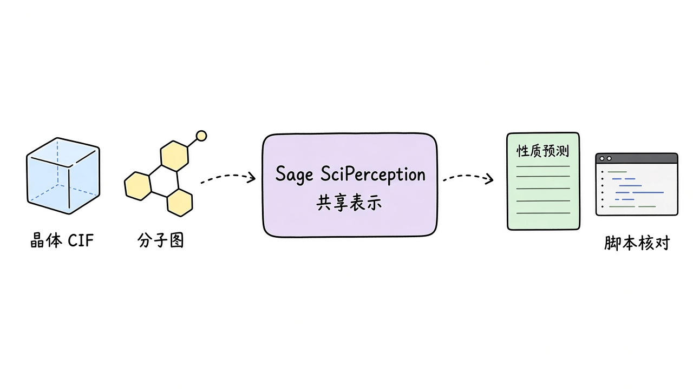
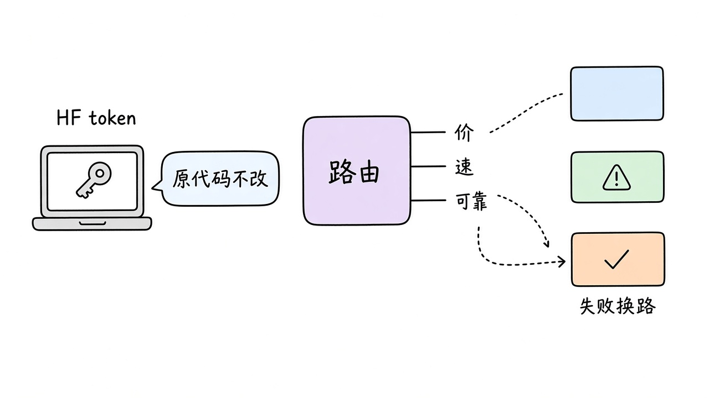
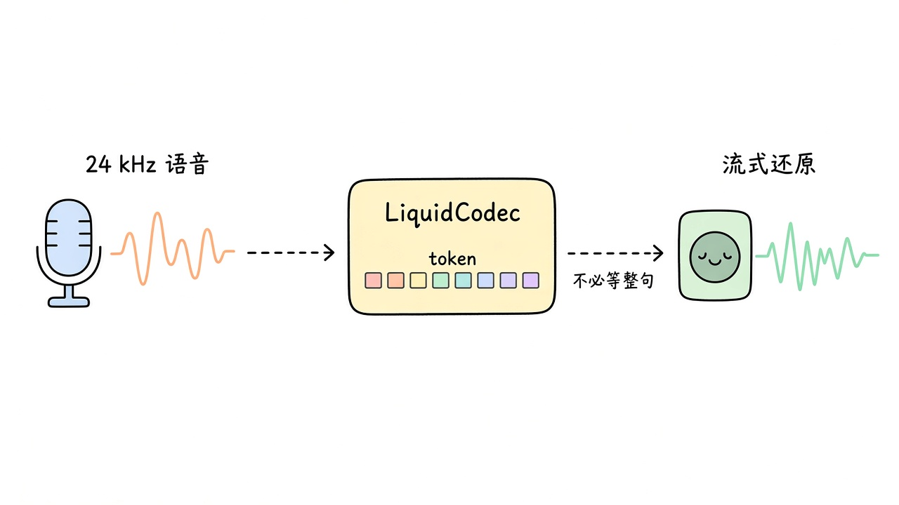

# 2026-11-17 Hugging Face 日报

今日三条：上海 AI Lab 刚上线的科学多模态 Sage S2.1 Flash、昨天宣布的 Hugging Face × OpenRouter 推理路由，以及 Liquid AI 的流式语音编解码器 LiquidCodec。

## 1. internlm/Sage-S2.1-Flash — 320B-A18B 的科学多模态 Flash 模型

**介绍**  
[Sage S2.1 Flash](https://huggingface.co/internlm/Sage-S2.1-Flash) 是上海人工智能实验室 11-16 前后放到 Hub 的科学多模态模型（卡片写 MIT，未 gated）。架构跟 GLM-5.3-Flash 同系，权重是 320B-A18B 的 MoE、BF16，约 321B 参数、约 645 GB。通过 Sage SciPerception 把分子图、晶体结构、蛋白质序列和三维结构等十多种科学输入投到和文本共享的表示空间，再做预测、分类、位点定位等。实验室自己的表：15 项基准里 4 项第一、7 项第二，MLE-bench Lite 90.3（对比表中 DeepSeek-V4.1-Flash-1017 为 89.2）。数字来自官方卡片，未见独立复现。另有 [FP8 权重](https://huggingface.co/internlm/Sage-S2.1-Flash-FP8)。集合：[Sage-S2.1](https://huggingface.co/collections/internlm/sage-s21)。刚上线，likes 约 57，下载还很少。

**用法**  
通用任务按[部署指南](https://huggingface.co/internlm/Sage-S2.1-Flash/blob/main/deployment_guide.md)，示例为 8×H200。必须加 `--trust-remote-code`，否则会静默用到库存 tokenizer，工具调用和推理可能直接断掉。vLLM 0.33.0 还要先打仓库里的 `vllm_patch/`（并行工具返回的图片顺序问题，上游 [PR #67108](https://github.com/vllm-project/vllm/pull/67108) 还在进行）。

```bash
hf download internlm/Sage-S2.1-Flash --include "vllm_patch/*" --local-dir /path/to/Sage-S2.1-Flash
# 按 vllm_patch/README.md 打补丁后再启动
vllm serve internlm/Sage-S2.1-Flash \
  --trust-remote-code \
  --tensor-parallel-size 8 \
  --enable-auto-tool-choice \
  --tool-call-parser glm47 \
  --reasoning-parser glm47
```

也可用 LMDeploy（`transformers>=5.17,<5.19`）或 SGLang 0.5.20+（需显式传入仓库的 `chat_template.jinja`）。Hopper 上保持默认 BF16 KV cache。科学输入要另下 projector 和 Sage-SciPerception 脚本，并给 vLLM 开 `--enable-prompt-embeds`，细节见卡片和 SciPerception 指南。

**应用场景**  
在私有集群上把晶体 CIF 和自然语言问题一起送给模型，先做性质预测，再用它写分析脚本、核对中间结果。



**推荐学习程度**：深入

---

## 2. huggingface/blog-openrouter — Inference Providers 的语言模型改走 OpenRouter

**介绍**  
[Hugging Face and OpenRouter join forces to make open-weight models easy to run](https://huggingface.co/blog/openrouter) 是 2026-11-16 的官方博文：Hub 上由供应商提供的开源权重语言模型，推理请求改由 OpenRouter 按实时价格、速度、可靠性选路，失败会在同一次调用里换供应商重试。代码和 Hugging Face token 不用改；图像 / 视频 / 音频生成仍走原来的 Inference Providers，不经过 OpenRouter。定价仍按供应商价格记在 HF 账单上，HF 不加价。破坏性变更：语言模型不能再用你自己的供应商 API key；图像 / 视频的自定义 key 仍可用。博文引用 OpenRouter 的测量：新路由把容量错误降 46%，首 token 时间改善 16.9%，吞吐改善 16.3%。

**用法**  
继续用现有 Hugging Face token 调 Chat Completions / Responses 或 Anthropic Messages。模型 id 可加后缀选策略：

```text
zai-org/GLM-5.3            # 默认：价格、速度、可靠性综合
zai-org/GLM-5.3:fastest    # 最高吞吐
zai-org/GLM-5.3:cheapest   # 最低价格
zai-org/GLM-5.3:novita     # 只走 Novita
```

同一段对话要贴缓存时，在 `X-HF-Session-Id` 头里放稳定 UUID。模型页新增 Providers / Metrics 标签；设置里可关掉不想用的供应商。博文链到 Claude Code、Codex、OpenCode、Pi、Hermes 的配置指南，以及 [Inference Providers 文档](https://huggingface.co/docs/inference-providers)。

**应用场景**  
把已有的 Hugging Face 推理调用保持原样，只是让同一条请求在某家变慢时自动换到下一家，并在模型页核对各家价格和可用性。



**推荐学习程度**：入门

---

## 3. LiquidAI/Liquid-Codec — 74M 的流式语音编解码器，给 LFM3 音频用

**介绍**  
[LiquidCodec](https://huggingface.co/LiquidAI/Liquid-Codec) 是 Liquid AI 的语音 tokenizer（LFM Open License v1.0）：约 74M 参数，24 kHz 单声道，12.5 Hz 帧、每帧 12 个 codebook，约 1.65 kbps，可流式编解码。它是 LFM3-Audio-2B 和 LFM3-Omni-2B 背后的音频 tokenizer。训练 264k 小时、107 种语言。卡片写明只在语音上训练和评测，音乐 / 歌唱 / 环境声未经评估。仓库 9 月创建，11-12 还有更新；likes 约 160，下载约 9.4k。量化解码器（Q4_0 等）不单独发布，在 LFM3-Audio / Omni 的 GGUF 里。官方博客：[liquid.ai/blog/liquidcodec](https://www.liquid.ai/blog/liquidcodec)。

**用法**  
需较新的 Transformers，并 `trust_remote_code`：

```python
import torch
from transformers import AutoModel

codec = AutoModel.from_pretrained(
    "LiquidAI/Liquid-Codec",
    trust_remote_code=True,
    dtype=torch.bfloat16,
    device_map="cuda",
)
waveform = torch.randn(1, 24_000 * 3, device="cuda")  # 24 kHz
codes = codec.encode(waveform).audio_codes
reconstructed = codec.decode(codes).audio_values
```

也可用 `LiquidCodecModel` + `LiquidCodecStreamingCache` 做分块流式解码。卡片给出的速度是 Apple M4 Max 单线程 FP32：编码约 361× 实时、解码约 87× 实时（厂商数据）。

**应用场景**  
在端侧语音模型里，把麦克风音频流式编成离散 token，再边到边解码回波形，不必等整句结束。



**推荐学习程度**：进阶
