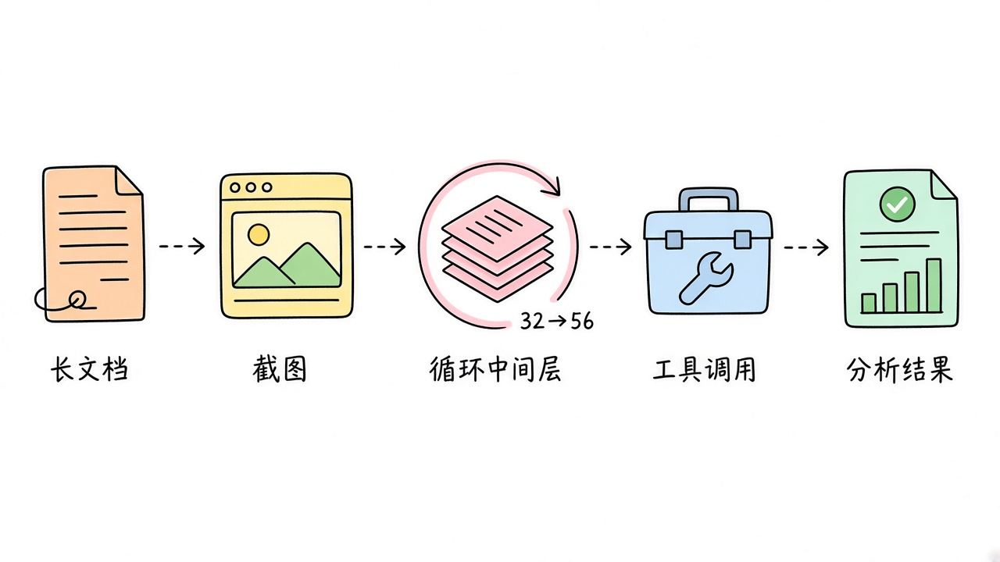
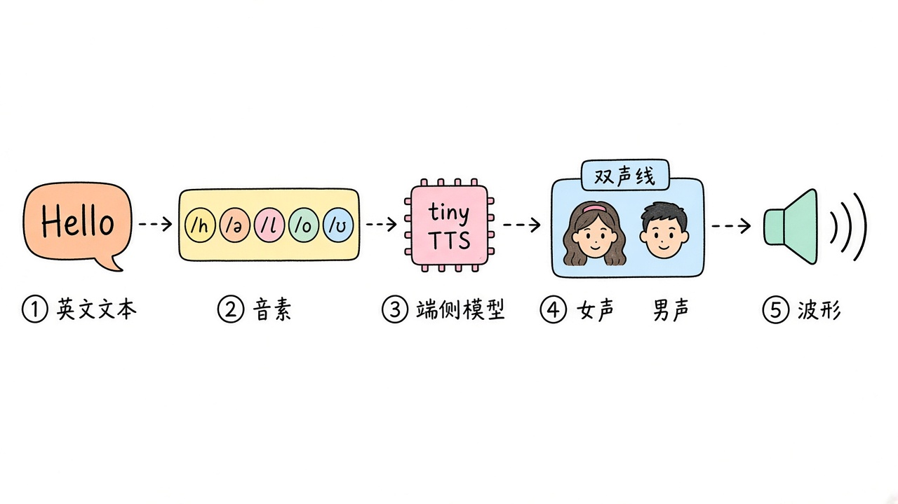

# 2026-11-18 Hugging Face 日报

今日两条：商汤 SenseNova-Loop-9B 正式版（接 10 月底 Preview），以及能在 CPU / 浏览器跑的 4.5M 英文 TTS tiny-voca。

## 1. sensenova/SenseNova-Loop-9B — 循环中间层的 9B 多模态正式版

**介绍**  
[SenseNova-Loop-9B](https://huggingface.co/sensenova/SenseNova-Loop-9B) 是商汤 11-17 放到 Hub 的正式版（卡片写 Apache-2.0；gated，下载权重需登录并同意条件）。约 9B 参数，32 个物理解码层里中间 24 层顺序执行两遍，一次前向做 56 次层计算，推理等效约 14.6B；文本 + 图像输入、文本输出，上下文 512K。架构仍是 looped block + 双流 mHC + 混合注意力。官方称在 Agent 和数据分析上接近 Qwen3.8-27B：NL2Repo 41.36（对比 44.60），AIDABench 65.31（对比 65.01）。相对 10-31 的 Preview，卡片给出的七项里都有提升，例如 AutomationBench 14.33→36.67、Terminal-Bench 2.1 40.45→59.55、GAIA 37.86→69.90。数字来自官方卡片，未见独立复现。11-03 日报写过 Preview。默认仍是两圈循环；卡片里把圈数加到 3–4 还会再涨一点，但推理成本也更高。4-bit 权重约 4.9 GB，配合 8-bit KV 时 256K 多模态推理约 15 GiB。卡片写发布首日提供官方 AWQ 4-bit，具体仓库以模型页为准。代码：[OpenSenseNova/SenseNova-Loop](https://github.com/OpenSenseNova/SenseNova-Loop)。刚上线，likes 约 190。

**用法**  
先在模型页申请访问，再按卡片用 Transformers 5.18.0（Preview 验证环境还写了 PyTorch 2.11.0、CUDA 13.0），必须 `trust_remote_code=True`：

```python
import torch
from transformers import AutoModelForCausalLM, AutoTokenizer

model_id = "sensenova/SenseNova-Loop-9B"
tokenizer = AutoTokenizer.from_pretrained(model_id, trust_remote_code=True)
model = AutoModelForCausalLM.from_pretrained(
    model_id, trust_remote_code=True, dtype=torch.bfloat16, device_map={"": "cuda:0"}
).eval()
messages = [{"role": "user", "content": "13 乘以 7 等于多少？"}]
prompt = tokenizer.apply_chat_template(
    messages, tokenize=False, add_generation_prompt=True, enable_thinking=True
)
inputs = tokenizer(prompt, return_tensors="pt").to("cuda:0")
```

服务部署需带 SenseNova Loop 实现的引擎版本：SGLang 见 [PR #47281](https://github.com/sgl-project/sglang/pull/47281)，vLLM 见 [PR #64832](https://github.com/vllm-project/vllm/pull/64832)。官方也写了已知局限：复杂工具定义和多重约束时可能跟不稳，长程 Agent 和复杂网页往往要多轮修。

**应用场景**  
把一份长文档和几张相关截图一起送给 9B 的本地服务，先做数据分析，再按需调用工具补证据，而不是直接上 27B。



**推荐学习程度**：进阶

---

## 2. n4ze3m/tiny-voca — 4.5M 参数的端侧英文 TTS，CPU 和浏览器都能跑

**介绍**  
[tiny-voca](https://huggingface.co/n4ze3m/tiny-voca) 是 Muhammed Nazeem 11-14 放到 Hub 的英文 TTS（Apache-2.0，未 gated）：整模型含波形发生器共约 4.54M 参数，两种美式英语声线 F2 / M2，24 kHz 单声道。从零训练，数据是约 17.6 小时、由 Qwen3-TTS 生成的合成语音，不含真实说话人录音，也没有迁入其他模型的预训练权重。卡片称四线程 CPU 上约 70 倍实时（作者数据）。有 PyTorch 权重（约 18 MB）、ONNX 和 GGUF。音素用作者的 [dizione](https://github.com/n4ze3m/dizione) 转换。限制写得很清楚：只做英文、不能流式；外国人名和特殊拼写常读错；训练数据本身是合成的，自然度不会超过生成它的模型。代码和试用：[github.com/n4ze3m/tiny-voca](https://github.com/n4ze3m/tiny-voca)，[Spaces](https://huggingface.co/spaces/n4ze3m/tiny-voca-studio)。likes 约 230，下载约 3k。

**用法**

```bash
pip install git+https://github.com/n4ze3m/dizione git+https://github.com/n4ze3m/tiny-voca
hf download n4ze3m/tiny-voca --local-dir tiny-voca
export DIZIONE_DATA=tiny-voca/phonemizer

python -m tiny_voca.infer \
  --checkpoint tiny-voca/tiny-voca.pt \
  --voice F2 \
  --text "Hello! This is tiny voca." \
  --output hello.wav
```

`--voice` 为 `F2` 或 `M2`。也可用 `onnx/model.onnx`（onnxruntime 或 onnxruntime-web）；图外先把文本变成音素 id，一次最多 512 个 token / 32 秒，长文本按句切开。波形偶尔会略超 1.0，保存 16-bit 前要缩放。

**应用场景**  
在没有 GPU 的笔记本或页面里，把一段英文提示读出来做本地预览，不必上云端 TTS。



**推荐学习程度**：入门
