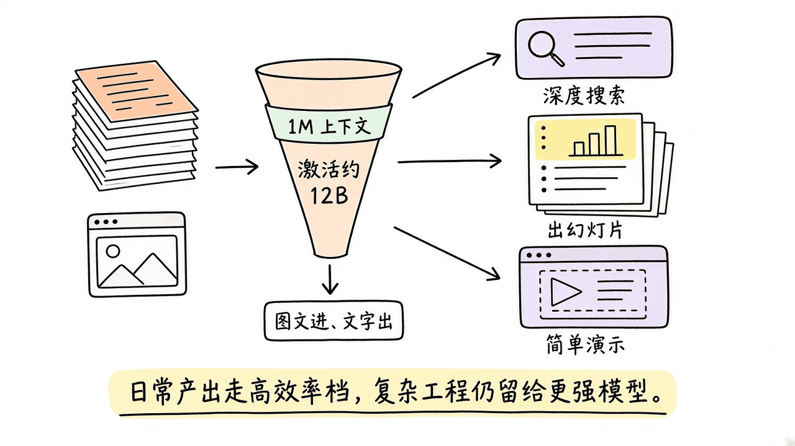
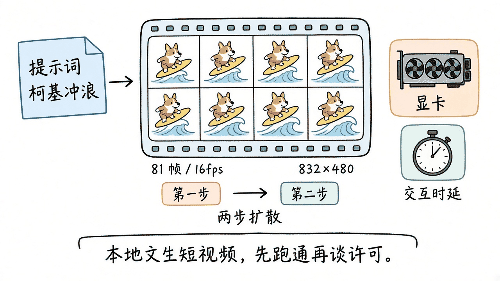
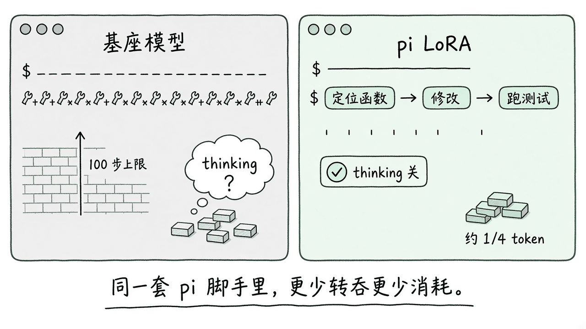

# 2026-11-19 Hugging Face 日报

今日三条：腾讯刚放到 Hub 的 Hy4 flash、Apple 的交互时延视频生成 FastFrames-L，以及给 pi 编码代理做的 Qwen3.8-27B LoRA。

## 1. tencent/Hy4-flash — 激活约 12B 的高性价比多模态

**介绍**  
[Hy4 flash](https://huggingface.co/tencent/Hy4-flash) 是腾讯 Hy 团队 11-17 放到 Hub 的开源权重（[Tencent Hy License](https://huggingface.co/tencent/Hy4-flash/blob/main/LICENSE)）。卡片写总参约 220B（含约 64B Engram），每 token 激活约 12B（文本 11.3B + 视觉 0.43B）；官网介绍写成 224B，以模型卡为准。原生接受文本和图像、输出文本，上下文 1M。相对 Hy4，卡片强调三处改动：稀疏注意力与滑动窗口按 1:3 交错、LatentMoE（512 个路由专家中激活 16 个，另加 1 个共享专家），以及用哈希检索的 bigram / trigram Engram。另有 0.85B 的内置草稿模型 DFly2，复用 KV 与稀疏下标做投机解码。官网 11-16 的介绍把它定位为日常生产力（深搜、文档、幻灯片、简单前端和 computer use），更重的长程工程仍推荐 Hy4；并给出 TokenHub 标价（每百万 token：缓存输入 $0.003、输入 $0.070、输出 $0.281），WorkBuddy 试用与折扣以官网时限为准。likes 约 236。另有 [Hy4-flash-FP8](https://huggingface.co/tencent/Hy4-flash-FP8) 和 [Hy4-flash-base](https://huggingface.co/tencent/Hy4-flash-base)。

**用法**  
Transformers 支持尚未合入主分支时，卡片要求先装这个 PR：

```bash
pip install "transformers[torch,vision] @ git+https://github.com/huggingface/transformers.git@refs/pull/50903/head"
```

```python
from transformers import AutoModelForImageTextToText, AutoProcessor

model_id = "tencent/Hy4-flash"
processor = AutoProcessor.from_pretrained(model_id)
model = AutoModelForImageTextToText.from_pretrained(model_id, device_map="auto")
```

指令模型的 `reasoning_effort` 支持 `"high"`（默认，开思考）和 `"no_think"`；官方推荐采样 `temperature=0.9`、`top_p=1.0`。生产部署用官方镜像更省事：vLLM 是 `vllm/vllm-openai:hy4-flash`，卡片示例以 `tencent/Hy4-flash-FP8`、`--tensor-parallel-size 8` 并打开 DFly 投机解码；SGLang 是 `lmsysorg/sglang:hy4-flash`。配方见 [vLLM Recipe](https://recipes.vllm.ai/tencent/Hy4-flash) 和 [SGLang Cookbook](https://docs.sglang.io/cookbook/autoregressive/Tencent/Hy4-flash)。微调说明在仓库的 [finetune/README.md](https://huggingface.co/tencent/Hy4-flash/blob/main/finetune/README.md)。商用前先读许可证。

**应用场景**  
把一份长文档和几张相关截图丢给本机或内网的 Hy4 flash 服务，先做检索摘要或出一版幻灯片草稿；只有走到长程改仓库、多约束工具调用时，再换更强的档。



**推荐学习程度**：进阶

---

## 2. apple/FastFrames-L — 交互时延的 14B 文生视频

**介绍**  
[FastFrames-L](https://huggingface.co/apple/FastFrames-L) 是 Apple 11-16 放到 Hub 的 14B 文生视频权重，对应论文 [FastFrames: Video Generation at Interactive Latency](https://arxiv.org/abs/2611.23226)（arXiv:2611.23226）。它和 1.3B 的 [FastFrames-S](https://huggingface.co/apple/FastFrames-S) 都是自回归、两步的视频扩散模型，官方示例输出 832×480、81 帧、16 fps。L 从 Wan2.1-14B 按 Causal Forcing++ 蒸馏而来，仓库还放出了教师、一致性蒸馏、DMD 和最终生成器等检查点。代码在 [apple-aiml-research/ml-fastframes](https://github.com/apple-aiml-research/ml-fastframes)（11-17 公开）。卡片与代码标签为 Apple AMLR / Apple Sample Code License（个人非独占许可，再分发需保留声明）；其中 LingBot World v2 部分另走 CC BY-NC-SA 4.0。仓库里 FastFrames-S 在单卡、480p、满 KV cache 的分项合计约 35.4 ms（论文写 36 ms），这是 S 的数字，不能直接当成 L 的时延；L 的官方 profiling 命令带 `--gpus 8`。likes 约 218。

**用法**  
需要 Linux x86-64、NVIDIA 显卡和兼容 CUDA 12.8 的驱动。按[安装与检查点说明](https://github.com/apple-aiml-research/ml-fastframes/blob/main/docs/installation.md)，在仓库根目录：

```bash
git clone https://github.com/apple-aiml-research/ml-fastframes.git
cd ml-fastframes
uv sync
uv run hf download apple/FastFrames-L --include 'fastframes-l/*' --local-dir checkpoints
uv run hf download Wan-AI/Wan2.1-T2V-14B --local-dir checkpoints/Wan2.1-T2V-14B
# 若只做生成、不训练，可给 Wan 下载加 --exclude 'diffusion_pytorch_model*'，跳过其基座 DiT
uv run python scripts/generate.py --model ff-l --checkpoint-dir checkpoints \
    --prompt "A corgi surfing a wave at sunset" --seed 0 --output outputs/corgi.mp4
```

`uv sync` 会装上锁定的 Python 3.10 与 PyTorch 2.9.1 / CUDA 12.8 环境。交互演示走的是优化过的 LingBot 1.3B（许可更紧），不要和 FastFrames-L 的文生视频命令混用。

**应用场景**  
先在本机用 L 把一句提示词打成约 5 秒的 480p 短视频，确认画质和许可能接受后，再决定要不要接到内部预览流程；需要相机交互演示时，改走文档里的 LingBot 路径，并单独核对 CC BY-NC-SA。



**推荐学习程度**：进阶

---

## 3. harness-hub/Qwen3.8-27B-pi-adapted — 给 pi 编码代理的 LoRA，默认关掉思考

**介绍**  
[Qwen3.8-27B-pi-adapted](https://huggingface.co/harness-hub/Qwen3.8-27B-pi-adapted) 是 11-16 放到 Hub 的 LoRA（Apache-2.0，PEFT，ranks 32），用强化学习把 [Qwen/Qwen3.8-27B](https://huggingface.co/Qwen/Qwen3.8-27B) 调成 [pi](https://www.npmjs.com/package/@earendil-works/pi-coding-agent) 编码代理在软件工程和终端任务上的模型。卡片给出的成对结果（同一套 pi 脚手、每题一次、思考关闭）是：SWE-bench Pro 最难 51 题 39.2%→64.7%（新建 15、丢失 2），Terminal-Bench 2.1 为 39.5%→55.8%（新建 16、丢失 2）。作者还写：关掉思考时，它打到基座在最高思考档（`xhigh`）的准确度，每题生成 token 大约少到 1/4；给适配器再开思考几乎不再涨分，只会多写 token。这些数字只在 pi 脚下成立，不能直接拿去和 Qwen 官方卡片（别的 harness、开思考、更大预算、完整 SWE-bench Pro）比。卡片也更正过一版因隧道中断被算失败的基座分数。likes 约 419，昨天还在更新。完整配方作者说会放进发布博文，目前训练摘要写在模型卡里。

**用法**  
用 vLLM 加载基座并挂上 LoRA（评测配置；前缀缓存对这个混合模型需要 `--mamba-cache-mode align`，思考保持关闭）：

```sh
vllm serve Qwen/Qwen3.8-27B \
    --enable-lora --max-lora-rank 32 \
    --lora-modules qwen3.8-pi=harness-hub/Qwen3.8-27B-pi-adapted \
    --language-model-only --enable-prefix-caching --mamba-cache-mode align \
    --enable-auto-tool-choice --tool-call-parser qwen3_xml --reasoning-parser qwen3 \
    --default-chat-template-kwargs '{"enable_thinking": false}' \
    --max-model-len 131072
```

安装 pi（Node.js 22.19+）：`npm install -g --ignore-scripts @earendil-works/pi-coding-agent`。在 `~/.pi/agent/models.json` 里把该服务配成 OpenAI Completions（不要用 Responses API），模型 id 为 `qwen3.8-pi`，然后：

```sh
pi --provider local --model qwen3.8-pi --print "Find out why the tests in tests/test_parser.py fail and fix the bug."
```

也可以按卡片把 LoRA merge 进基座，或用 [GGUF 版](https://huggingface.co/harness-hub/Qwen3.8-27B-pi-adapted-GGUF) 挂到 Qwen3.8-27B 的 GGUF 上；量化版未经重新评测。适配器必须叠在 Qwen3.8-27B 上，换基座无效。

**应用场景**  
已经用 pi 跑仓库修复时，先在本机或内网把这个 LoRA 挂上，保持 thinking 关闭，看同样的失败测试能不能用更少的工具步修完；不要把卡片上的分数直接当成换一套编码代理之后的预期。



**推荐学习程度**：进阶
