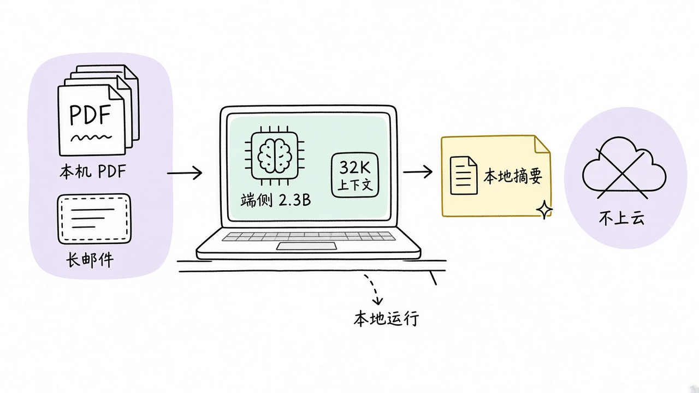
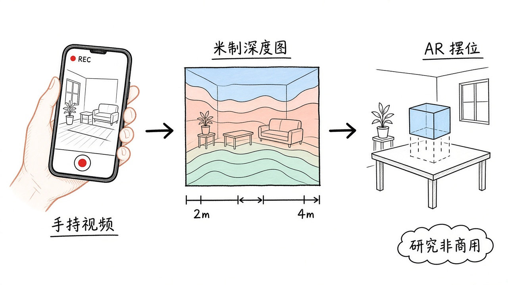
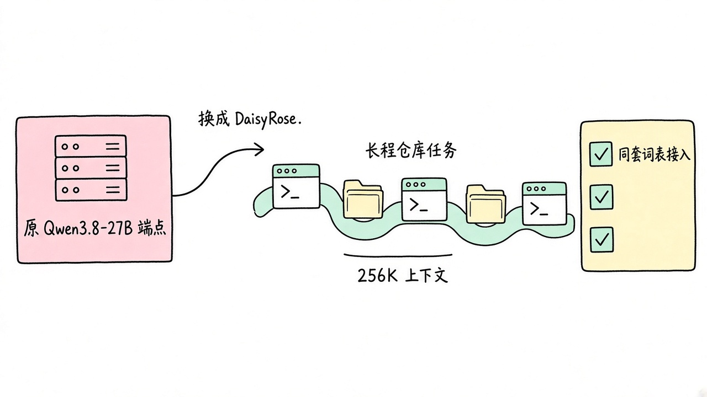
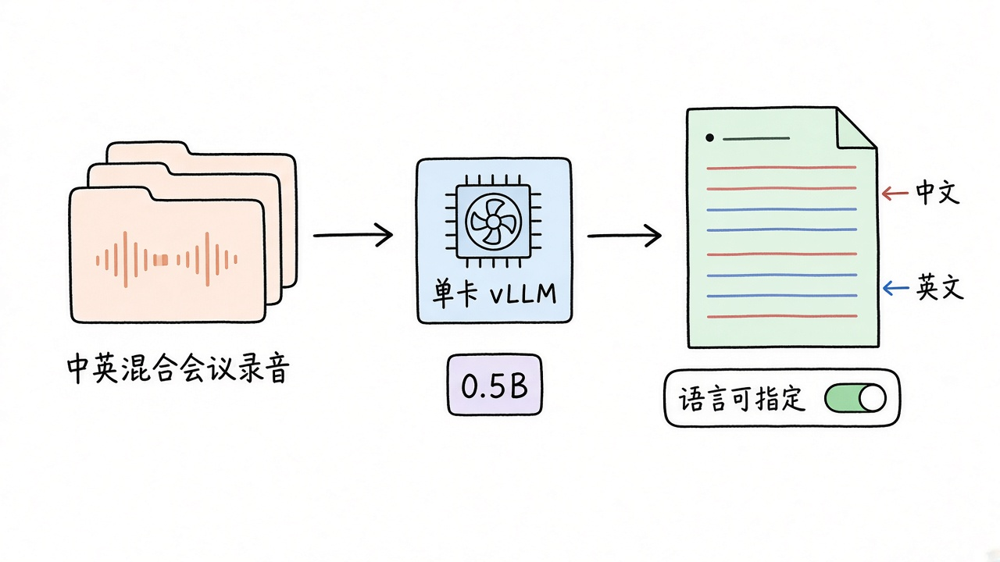

# 2026-11-20 Hugging Face 日报

今日四条：微软放到 Hub 的 Windows 端侧 SLM Aion 预览、Apple 今早才把权重推上来的 Depth Pro 2、只用 RL 后训练的 DaisyRose-27B，以及 0.5B 多语 ASR Rumble-2-Flash。

## 1. microsoft/Aion-1.0-Instruct-2.3B — Windows 端侧 SLM 预览权重

**介绍**  
[Aion-1.0-Instruct-2.3B](https://huggingface.co/microsoft/Aion-1.0-Instruct-2.3B) 是微软 Windows Applied Sciences Group 放到 Hub 的端侧基础 SLM 预览（MIT，未门禁）。因果指令模型，约 2.29B 参数（输入输出 embedding 共享），28 层、hidden 2048、GQA 24/8，混合注意力（21 层滑动窗口 2048，加 7 层全注意力），全注意力层用 RoPE + YaRN，上下文 32,768，词表 200,029，bfloat16，知识截止 2025-12。语言包括英、德、西、葡、意、法、中、日；卡片标签是 summarization、rewriting、chat，面向端上的文档理解、内容分析、问答和 NLU。卡片写：更优化的版本，加上微软的内容审核模型，「将在 2027 年 1 月底成为 Windows OS SLM」；这次 Hub 发布是「对即将到来之物的介绍」。同批次还有 [Aion-1.0-Instruct-2.3B-ONNX-WebGPU](https://huggingface.co/microsoft/Aion-1.0-Instruct-2.3B-ONNX-WebGPU)（INT4 QAT，约 1.3 GB）。仓库 11-19 01:05（Asia/Shanghai）创建，首条 commit 是从 `asgmodels/Aion-Instruct-v1` 复制；约 70 likes。卡片给出的评测（官方数字，未独立复现）包括 MMLU 55.15、GSM8K 74.91（loose matching）、IFEval 83.90 等；LLM-judge 任务用了 GPT-4o。卡片也写得很直：2.3B 会漏细节、说错事实，多步推理和安全细节都不稳，且「可能受到对抗攻击」；多语数据大约只有 6%。需要 `trust_remote_code=True`，导出时用的是 Transformers 5.x。这不是 2027 年 1 月的 Windows OS SLM 本身。

**用法**  
自定义建模代码，卡片示例：

```python
from transformers import AutoModelForCausalLM, AutoTokenizer

model_id = "microsoft/Aion-1.0-Instruct-2.3B"
tokenizer = AutoTokenizer.from_pretrained(model_id, trust_remote_code=True)
model = AutoModelForCausalLM.from_pretrained(
    model_id, dtype="auto", device_map="auto", trust_remote_code=True,
)
messages = [{"role": "user", "content": "Give me a short introduction to large language models."}]
inputs = tokenizer.apply_chat_template(
    messages, add_generation_prompt=True, return_dict=True, return_tensors="pt",
).to(model.device)
outputs = model.generate(**inputs, max_new_tokens=512)
print(tokenizer.decode(outputs[0][inputs["input_ids"].shape[-1]:], skip_special_tokens=True))
```

ONNX WebGPU 卡片的路径是：`hf download microsoft/Aion-1.0-Instruct-2.3B-ONNX-WebGPU --local-dir Aion-Instruct-v1-ONNX-WebGPU`，再按卡片安装 `onnxruntime-webgpu` 和 `onnxruntime-genai`，用 provider `webgpu`。

**应用场景**  
在笔记本电脑上摘要一份多页本地 PDF 或一串长邮件，文本先不过云；用它的 32K 窗口和 MIT 许可，做一个私有桌面助手的预览，同时记住卡片对幻觉和安全边界的提醒。



**推荐学习程度**：进阶

---

## 2. apple/DepthPro2 — 一张照片或一段视频，估计每像素的米制深度

**介绍**  
[DepthPro2](https://huggingface.co/apple/DepthPro2) 是 Apple 的度量深度模型族，卡片原话是：从普通相机估计每个像素的度量深度——单张照片、整段视频或实时画面，分辨率跟输入一样。深度「在物体边缘清晰，帧与帧之间平稳」。多视图 transformer 联合处理一帧或多帧，DPT decoder 为每帧预测反向深度图；前三分之一块之后，transformer 在帧内注意力和跨帧注意力之间交替。更大的档更清晰、更稳，更小的档更快。所有尺寸共用一个焦距估计器，在焦距未知时预测焦距；输出深度以米计，无限远处（如天空）为无穷。规格： [DepthPro2-S](https://huggingface.co/apple/DepthPro2-S)（24M）、[B](https://huggingface.co/apple/DepthPro2-B)（97M）、[L](https://huggingface.co/apple/DepthPro2-L)（334M）、[H](https://huggingface.co/apple/DepthPro2-H)（872M / 「H+」，约 3.5 GB），以及 [DepthPro2-focal](https://huggingface.co/apple/DepthPro2-focal)（23.5M）。代码在 [apple-aiml-research/ml-depth-pro-2](https://github.com/apple-aiml-research/ml-depth-pro-2)，项目页：[apple-aiml-research.github.io/ml-depth-pro-2](https://apple-aiml-research.github.io/ml-depth-pro-2/)。许可是 Apple Machine Learning Research Model（`apple-amlr`），卡片写明仅供研究：非商业的科研和学术开发。Hub 上的文档和权重仓库虽然创建记录更早，但首次 `init` 提交都在今早（约 03:40–04:45，Asia/Shanghai）；GitHub 仓库今早约 06:51 还有推送。卡片声称在 Sintel 和 Spring 上平均的 Boundary F1 / Jitter 优于此前单帧和多帧方法，README 里没有给出具体 F1/Jitter 数字表；arXiv 标记仍是 `arXiv:TODO`。官方 Space 在卡片里仍标注未公开，目前有社区 Space [akhaliq/DepthPro2](https://huggingface.co/spaces/akhaliq/DepthPro2)。

**用法**

```bash
pip install "git+https://github.com/apple-aiml-research/ml-depth-pro-2"
```

```python
from functools import partial
import torch
from depth_pro_2 import DepthPro2, load_rgb
from depth_pro_2.model import to_normalized_tensor

model = DepthPro2.from_pretrained("apple/DepthPro2-H", precision=torch.bfloat16)
model = model.to("cuda")
transform = partial(to_normalized_tensor, device=torch.device("cuda"))

image, f_px = load_rgb("photo.jpg")
depth = model.infer(transform(image), f_px=f_px)["depth"]  # 米，(H, W)
```

视频用 `model.infer_video(...)`，按 16 帧分块。只估焦距：`FOVEstimator.from_pretrained("apple/DepthPro2-focal")`，再调用 `fov.focal_length_px(...)`。这是 git 安装，不是稳定的 PyPI 包。

**应用场景**  
用一段手持室内视频，先出一张帧间更稳的米制深度图，做 AR 摆位或机器人原型；仅限研究/非商用，商用前要另读 `LICENSE_MODEL`。



**推荐学习程度**：进阶

---

## 3. RadixArk/DaisyRose-27B — 只用 RL、不做 SFT 的 Qwen3.8-27B 长程后训练

**介绍**  
[DaisyRose-27B](https://huggingface.co/RadixArk/DaisyRose-27B) 是 RadixArk 的第一个模型（Apache-2.0，派生自同许可的 Qwen3.8-27B）。卡片写：在 Qwen3.8-27B 上「只做强化学习，没有任何监督微调或蒸馏」，用约 1,200 条精心整理的长程 agent 任务、会话最长 1M token，在 144 张 H200 上训练约 18 天、约 63,000 GPU 小时，训练器是开源的 [Miles](https://github.com/radixark/miles)。保留基座的结构、词表、chat template、图像理解和 256K 上下文，定位成 Qwen3.8-27B 的 drop-in replacement。总参 27.8B，含 0.46B 视觉编码器和 0.42B MTP 头；视觉编码器和 MTP 头相对基座未改。输入文本+图像，输出文本。11-18 创建，README 今早约 05:10 还在更新；今早也上了 [GGUF](https://huggingface.co/RadixArk/DaisyRose-27B-GGUF)，另有 [FP8](https://huggingface.co/RadixArk/DaisyRose-27B-FP8)、[NVFP4](https://huggingface.co/RadixArk/DaisyRose-27B-NVFP4) 和草稿 [Qwen3.8-27B-DSpark](https://huggingface.co/RadixArk/Qwen3.8-27B-DSpark)。官方说明：[radixark.com 博文](https://www.radixark.com/blog/daisyrose-27b) 与 [HF 转载](https://huggingface.co/blog/RadixArk/daisyrose-27b-pushing-the-frontier-of-post-trainin)。约 190 likes。卡片给出的成对结果（相对 Qwen3.8-27B，作者自报，未独立复现；DaisyRose 取 BF16 与 FP8 中较高的一次）包括 Terminal Bench 4.1 12.0 vs 5.6、SWE Bench Pro v2 94.7 vs 91.3、IFBench 82.4 vs 79.5 等；评测配方写在卡片的 “How we evaluated” 里。卡片也写明：其他模型的数字「按开发者自行汇报」，部分 Terminal Bench 4.1 对比在缺少 4.1 条目时用的是 4.0。权重约 52 GB（BF16）、29 GB（FP8）、23 GB（NVFP4；NVFP4 需要 Blackwell）。这是同一基座上的后训练，不是新的基座模型；和昨天日报里给 pi 用的 LoRA 不是同一份权重。

**用法**  
卡片推荐 SGLang + DSpark，镜像 `lmsysorg/sglang:latest`，配方见 [SGLang cookbook](https://docs.sglang.io/cookbook/autoregressive/RadixArk/DaisyRose-27B)。4 卡节点、每卡一份副本的 BF16 示例：

```bash
docker run --gpus all --ipc=host --shm-size 32g -p 30000:30000 \
  -v ~/.cache/huggingface:/root/.cache/huggingface \
  lmsysorg/sglang:latest \
  python3 -m sglang.launch_server \
  --model-path RadixArk/DaisyRose-27B \
  --served-model-name DaisyRose-27B \
  --tp-size 1 --dp-size 4 \
  --context-length 262144 \
  --reasoning-parser qwen3 \
  --tool-call-parser qwen3_coder \
  --trust-remote-code \
  --mem-fraction-static 0.85 \
  --kv-cache-dtype fp8_e4m3 \
  --chunked-prefill-size 2048 \
  --mamba-full-memory-ratio 11.01 \
  --mamba-radix-cache-strategy extra_buffer_lazy \
  --mamba-ssm-dtype float32 \
  --speculative-algorithm DSPARK \
  --speculative-draft-model-path RadixArk/Qwen3.8-27B-DSpark \
  --speculative-draft-attention-backend flashinfer \
  --host 0.0.0.0 --port 30000
```

思考模式采样：temperature 1.0、top_p 0.95、top_k 20、min_p 0。

**应用场景**  
已经在跑 Qwen3.8-27B 编码/agent 端点时，先换成这个检查点，用同一套词表和 256K 上下文，再跑一轮偏 Terminal-Bench 风格的长程仓库任务；不要把卡片上的分数直接当成换一套 harness 之后的预期。



**推荐学习程度**：深入

---

## 4. Reson8/Rumble-2-Flash — 0.5B 多语 ASR，能走官方 Transformers / vLLM

**介绍**  
[Rumble-2-Flash](https://huggingface.co/Reson8/Rumble-2-Flash) 是 Reson8 的 0.5B 语音识别模型（Apache-2.0，未门禁），基座写的是 [Qwen/Qwen3-ASR-0.6B](https://huggingface.co/Qwen/Qwen3-ASR-0.6B)。卡片徽章是「Parameters 0.5B」「Languages 45」，frontmatter 列出含 `zh`、`yue` 在内的 45 个语言代码；HF 博文 [Rumble-2-Flash: an open 0.5B speech model for 40+ languages](https://huggingface.co/blog/rumble-2-flash)（11-18，作者包括 Reson8 以及 HF 的 Eustache Le Bihan、Eric Bezzam）写成「40+ 语言」。架构走 Qwen3-ASR，博文强调 day-0 支持 Transformers 和 vLLM，「没有分叉运行时，也不需要 trust_remote_code」。仓库 10-15 创建，中途更过名；11-18 补上 Open ASR Leaderboard 结果并发表博文，README 今早约 04:29 还有更新。约 170 likes。卡片数字来自 [Open ASR Leaderboard](https://huggingface.co/spaces/hf-audio/open_asr_leaderboard?version=1.16.1) 2026-11-18 的 v1.16.1（H200 + vLLM，作者/榜单数字，未在此独立复现）：英文轨平均 WER 6.60（RTFx 6338）；中文 CER 6.56。博文把多语轨平均写成 6.96%（中、德、法、意、西、葡、印地、荷、英），并给出一套 AppTek 呼叫中心内部脚本上的 7.86% WER——这些对比不要当成第三方复现。生产教师模型 Rumble-2 不是这张 Hub 卡片。

**用法**

```bash
uv pip install torch transformers accelerate
```

```python
from transformers import AutoProcessor, AutoModelForMultimodalLM
model_id = "Reson8/Rumble-2-Flash"
processor = AutoProcessor.from_pretrained(model_id)
model = AutoModelForMultimodalLM.from_pretrained(model_id, device_map="auto")
inputs = processor.apply_transcription_request(
    audio="https://hf.co/datasets/hf-internal-testing/dummy-audio-samples/resolve/main/bcn_weather.mp3",
    language="English",  # 省略则自动检测
).to(model.device, dtype=model.dtype)
output = model.generate(**inputs, max_new_tokens=512)
generated = output[:, inputs["input_ids"].shape[-1]:]
print(processor.decode(generated, return_format="transcription_only")[0])
```

vLLM：`uv pip install "vllm[audio]" openai`，然后 `vllm serve Reson8/Rumble-2-Flash --max-model-len 4096`。可用 `chat_template_kwargs` 调 `language`、`digits`（默认 true）、`filler`（默认 false）、`verbatim`（默认 true）。

**应用场景**  
把一批中英混合的会议录音丢到单卡 vLLM 上批量转写，需要时指定 `language`，并把口语填料关掉。



**推荐学习程度**：入门
