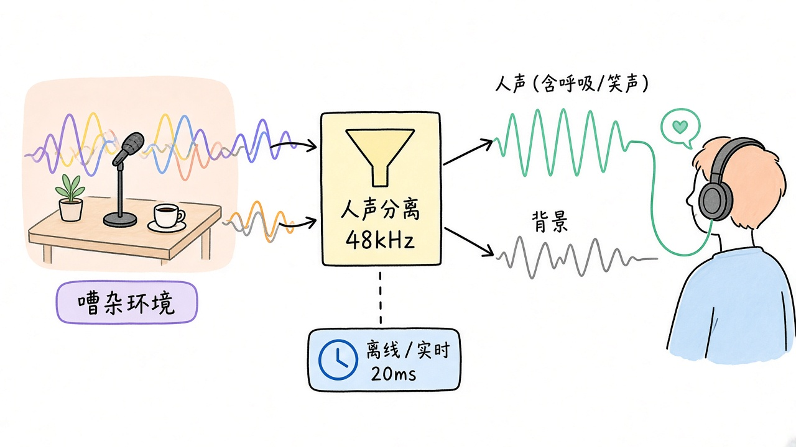
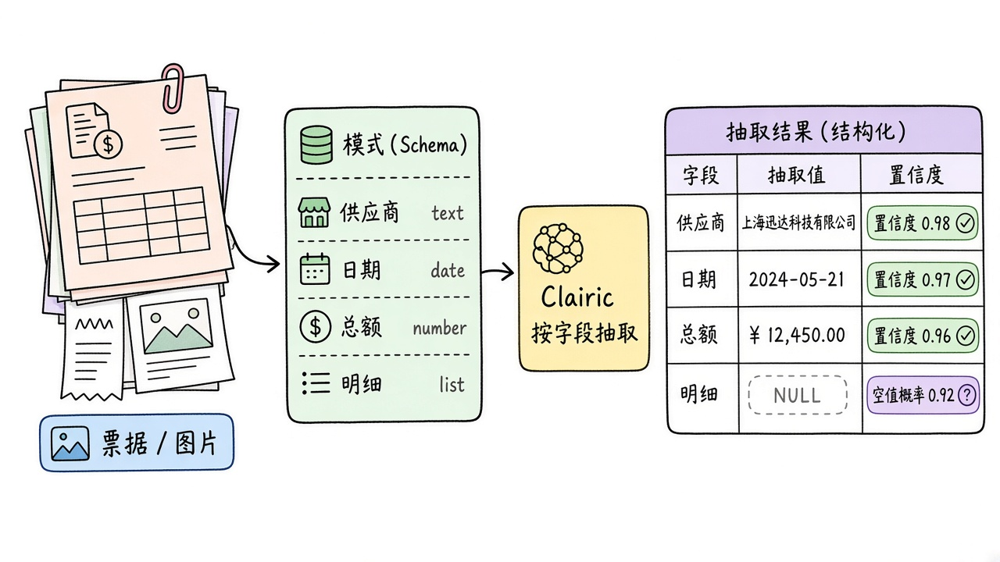
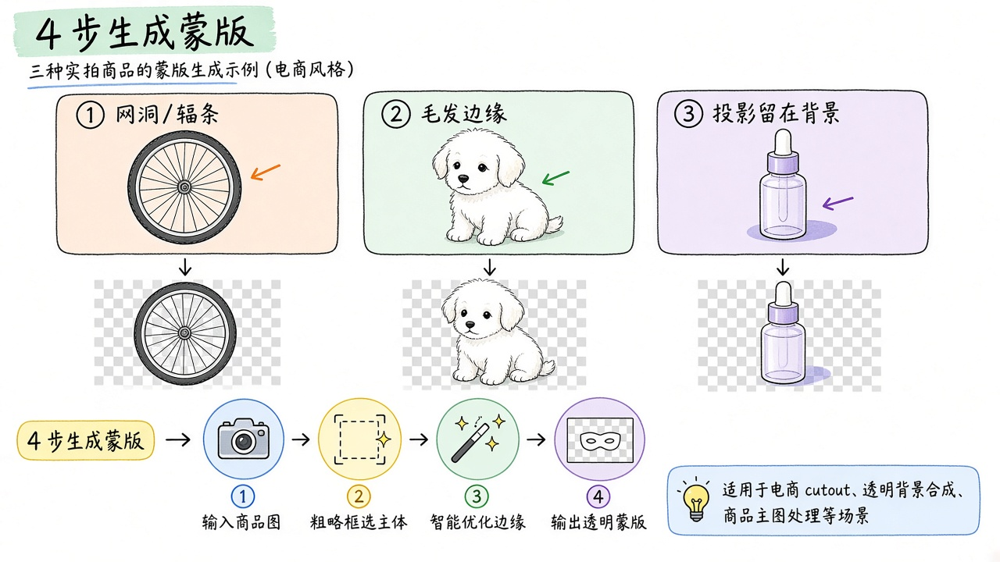

# 2026-11-23 Hugging Face 日报

今日三条：Inworld 开源的 48 kHz 人声分离、Cloudflare 开源权重的结构化抽取模型 Clairic，以及 Bria 用生成式底座做的抠图模型 RMBG 3.0。未重复今早周报已写过的 Inkling-2-Mini、Hy4-flash、LongCat-Video-Avatar-1.6、Sage-S2.1-Flash、FastFrames-L、DepthPro2、SenseNova-Loop-9B、Aion-1.0-Instruct-2.3B、Qwen3.8-27B-pi-adapted、llama.cpp v1.0.0，以及仍在榜上的量化/解禁复刻、Haru-4B、Qwen3.8-27B 基座等。

## 1. inworld/voice-isolator — 48 kHz 人声分离，保留呼吸和笑声

**介绍**  
[Voice Isolator v1](https://huggingface.co/inworld/voice-isolator) 是 Inworld 11-18 在博文 [Introducing Voice Isolator](https://inworld.ai/blog/introducing-voice-isolator) 里开源的 Apache-2.0 人声分离模型（代码与权重一起放）：去掉背景嘈杂、音乐和突发噪声，同时尽量保留音色、呼吸、笑声和音量。同一架构两个检查点——离线 `voice-isolator-v1`（64M，按 8 秒块看全上下文，质量优先）和实时 `voice-isolator-v1-realtime`（58M，因果流式，20 ms look-ahead）。不是说话人选择器，也不是修复带宽/麦克风质量的 restoration（官方把后者放到计划中的 v2）。约 637 likes。作者用自建、目前未公开的 VIBE 基准，在他们测过的开源 48 kHz 去噪模型里给出最高分；这是厂商自测，不是独立评测。官方写明已在 Ampere / Hopper / Blackwell 和 CPU 上测过，更小的 GPU 尚未测试。代码与演示：[github.com/inworld-ai/voice-isolator](https://github.com/inworld-ai/voice-isolator)。

**用法**  
模型卡：[huggingface.co/inworld/voice-isolator](https://huggingface.co/inworld/voice-isolator)。

```bash
pip install inworld-voice-isolation
curl -LO https://raw.githubusercontent.com/inworld-ai/voice-isolator/main/demo/examples/sample_14.wav
voice-isolate sample_14.wav sample_14_clean.wav
# 实时模型：
# voice-isolate sample_14.wav sample_14_streamed.wav --mode streaming --lookahead 2
```

权重第一次使用时自动下载并校验。默认写出 48 kHz float32 WAV：人声和被去掉的背景分两个文件，二者可对齐还原单声道输入。有 CUDA 用 CUDA，Apple 芯片在 PyTorch 2.6+ 上可用 `mps`，否则走 CPU。

**应用场景**  
咖啡馆录的访谈或语音样本，想先清掉背景再发布或送进 ASR；或者在实时通话里用 20 ms 延迟的流式模型，把呼吸和笑声留给语音代理判断何时接话。



**推荐学习程度**：入门

---

## 2. Cloudflare/clairic — 按字段 schema 做结构化抽取的 27B 开源权重

**介绍**  
[Clairic](https://huggingface.co/Cloudflare/clairic) 是 Cloudflare 放出的 Apache-2.0 开源权重模型：输入一段文本或 JSON 状态、可选图片/PDF，再加上一份带类型的字段说明，输出每个字段的值，并带抽取置信度、空值概率，估计类还可要分位数。27B 版底座是 Qwen3.8-27B；同系列还有 9B 的 [clairic-flash](https://huggingface.co/Cloudflare/clairic-flash)（底座 Qwen3.5-9B）。模型卡 11-18 仍有更新；27B 约 282 likes。博文：[An updated Clairic and Clairic-flash are now open-weight](https://blog.cloudflare.com/open-clairic/)。Workers AI 上的别名是 `@cf/cloudflare/clairic` 与 `@cf/cloudflare/clairic-flash`。官方在博文里给出的抽取评测是内部集，应视为方向性参考。

**用法**  
模型卡：[huggingface.co/Cloudflare/clairic](https://huggingface.co/Cloudflare/clairic)。需 Python 3.11+，按仓库 `requirements.txt` 安装；推理走 PyTorch / Transformers，`xgrammar` 做 schema 约束。

```python
import sys
from huggingface_hub import snapshot_download
from clairic_model import load_release_model, systemone

path = snapshot_download("Cloudflare/clairic")
sys.path.insert(0, path)
model, processor = load_release_model(path, device="cuda")

response = systemone(
    model,
    processor,
    {
        "state": "Invoice from Northwind Supply. Issued 2026-09-02. Total: $1080.00.",
        "fields": {
            "vendor": {"type": "text", "instructions": "The invoice vendor."},
            "total": {"type": "number", "decimals": 2},
            "issued": {"type": "date"},
        },
    },
)
print(response["answers"])
```

图片可走 PIL 或内嵌 base64；字段类型包括 text / number / date / boolean / enum / list / estimate / forecast 等。Flash 版把上面的仓库名换成 `Cloudflare/clairic-flash` 即可。

**应用场景**  
要处理一批发票照片或收据 PDF：先写好供应商、日期、总额、明细的字段 schema，让模型按字段填表并给出置信度，空值单独标出来，而不是再让通用聊天模型自由发挥一段 JSON。



**推荐学习程度**：进阶

---

## 3. briaai/RMBG-3.0 — 把抠图当成四步图像编辑

**介绍**  
[RMBG 3.0](https://huggingface.co/briaai/RMBG-3.0) 是 Bria 第三代背景去除模型，也是该系列里第一个用生成式底座的版本：在 [Fibo 2.0](https://huggingface.co/briaai/Fibo-2.0-dev) 上微调并蒸馏成 4 步、不用 classifier-free guidance，输出一张灰度 alpha 蒙版（白为主题、黑为背景）。约 333 likes，11-10 创建，11-17 仍有更新。Bria 在 234 张全分辨率难题上做了与 Photoroom、remove.bg（Canva）、Ideogram、BiRefNet、RMBG-2.0 的自家对比，平均排名 1.51、185/234 张并列或单独最好——这是厂商自测。权重按卡片说明仅开放非商用，需先填写访问表；推理还要另下 `briaai/Fibo-2.0-edit-turbo`（同样要接受其访问表）。官方测峰值约 28.5 GiB，建议 32 GB 及以上显存，L40S 上约 1MP、6 秒/张。玻璃、网纱、烟和飞溅等真透明仍容易被画成不透明，卡片里写了限制。

**用法**  
模型卡：[huggingface.co/briaai/RMBG-3.0](https://huggingface.co/briaai/RMBG-3.0)。本仓只有微调后的 transformer，其余管线来自 Fibo 2.0 Edit Turbo。提示必须用卡片里的固定英文指令，改了会出彩色图而不是蒙版。

```bash
pip install -U "diffusers>=0.42.0" torch torchvision transformers accelerate
```

```python
import json
import torch
from diffusers import AutoModel, BriaFibo2Pipeline
from huggingface_hub import hf_hub_download
from PIL import Image

BASE = "briaai/Fibo-2.0-edit-turbo"
INSTRUCTION = (
    "Generate a detailed grayscale alpha matte. Map the opaque foreground to white and the "
    "background to black. Produce soft, anti-aliased grayscale gradients at the edges of the "
    "subject to represent fine details and transparency."
)
transformer = AutoModel.from_pretrained(
    "briaai/RMBG-3.0", subfolder="transformer", dtype=torch.bfloat16
)
pipe = BriaFibo2Pipeline.from_pretrained(
    BASE, transformer=transformer, dtype=torch.bfloat16
).to("cuda")
fonts = [hf_hub_download(BASE, n, subfolder="fonts") for n in ("Aileron-Regular.otf", "DejaVuSans.ttf")]
source = Image.open("photo.jpg").convert("RGB")
result = pipe(
    prompt=json.dumps({"edit_instruction": INSTRUCTION}),
    image=source,
    num_inference_steps=4,
    guidance_scale=1.0,
    fonts=fonts,
).images[0]
matte = result.convert("L").resize(source.size, Image.LANCZOS)
cutout = source.copy()
cutout.putalpha(matte)
cutout.save("photo_cutout.png")
```

**应用场景**  
电商主图里有辐条、毛发或多人合影，普通分割模型容易把网洞填实、或把投影切进主体。在有 32 GB 级显存、且许可允许的前提下，用这套 4 步蒙版先出一张干净抠图，再决定要不要上量产管线（高吞吐仍可看更轻的 RMBG-2.0）。



**推荐学习程度**：进阶
