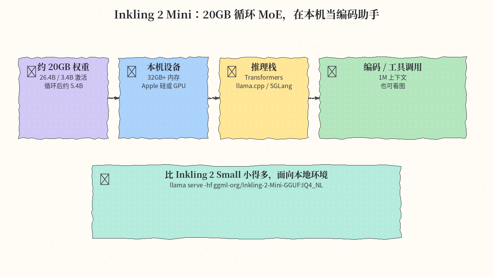
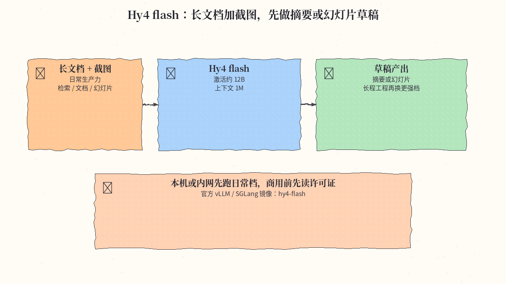
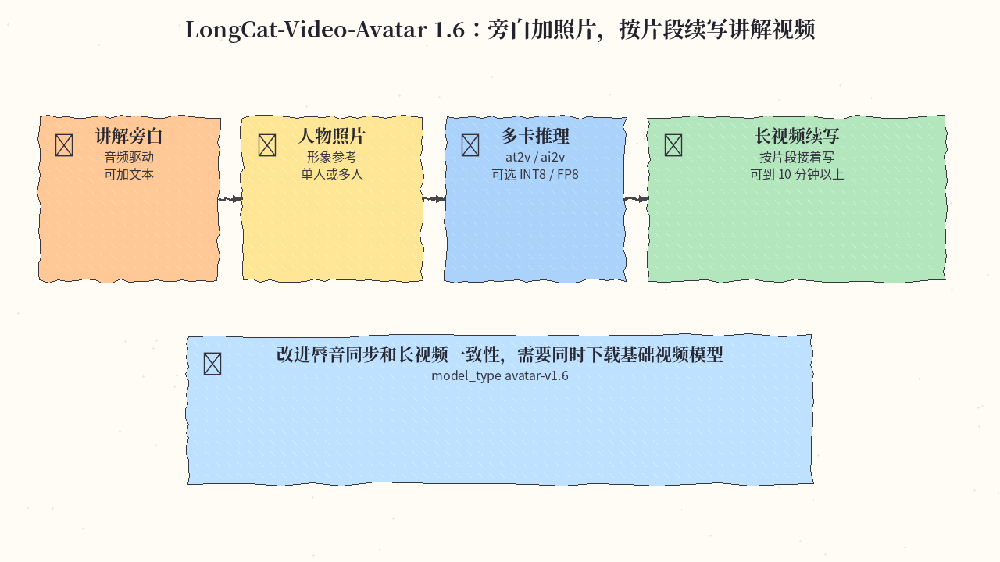
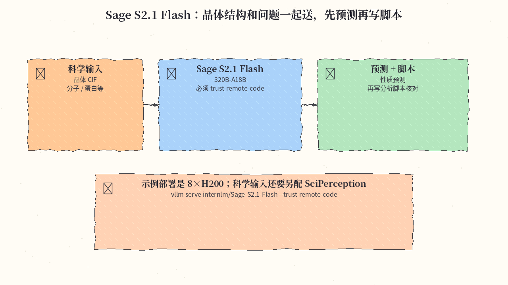
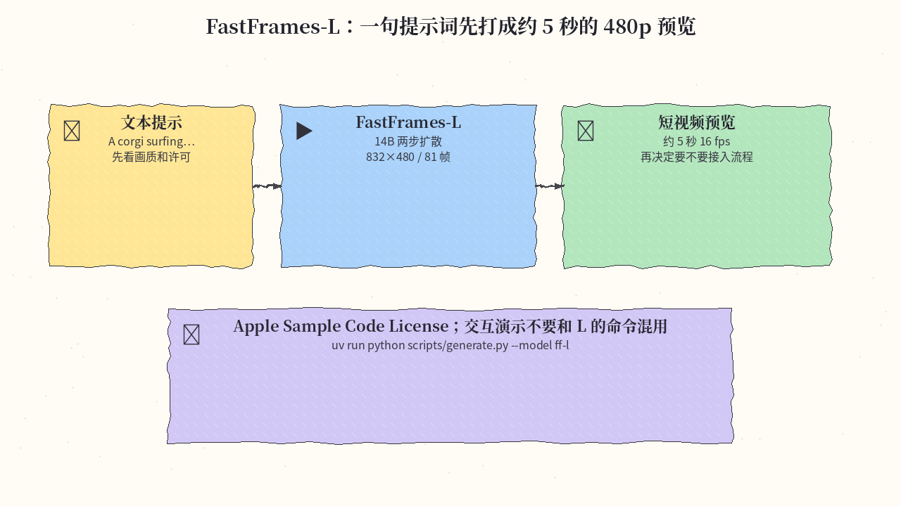
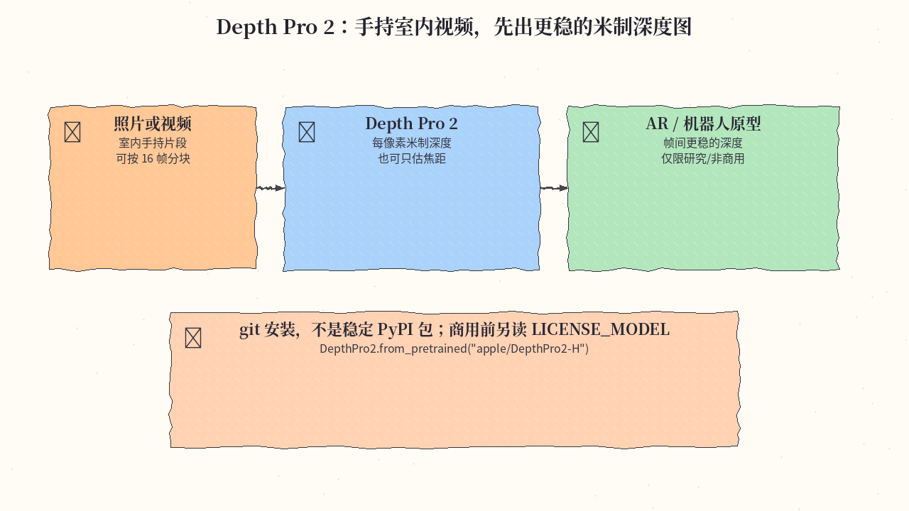
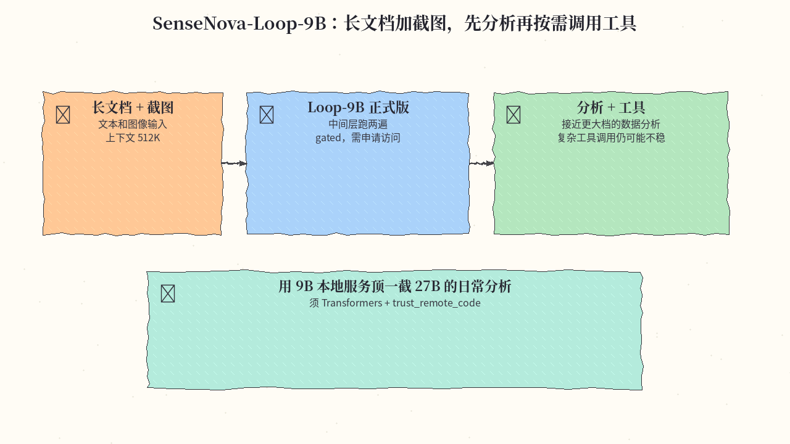
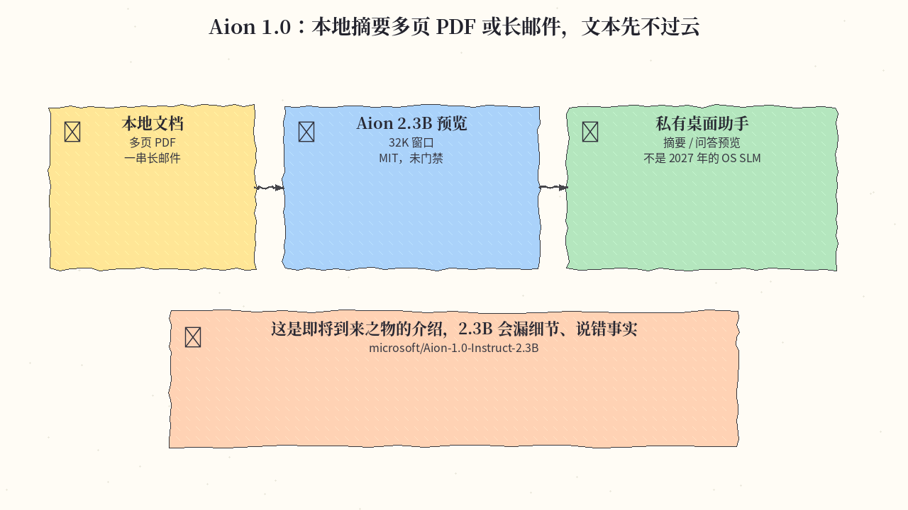
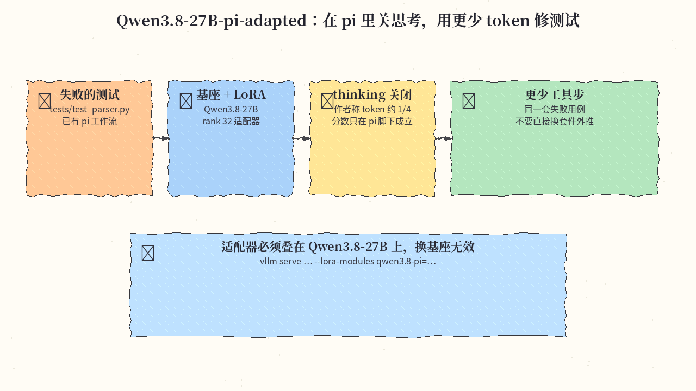
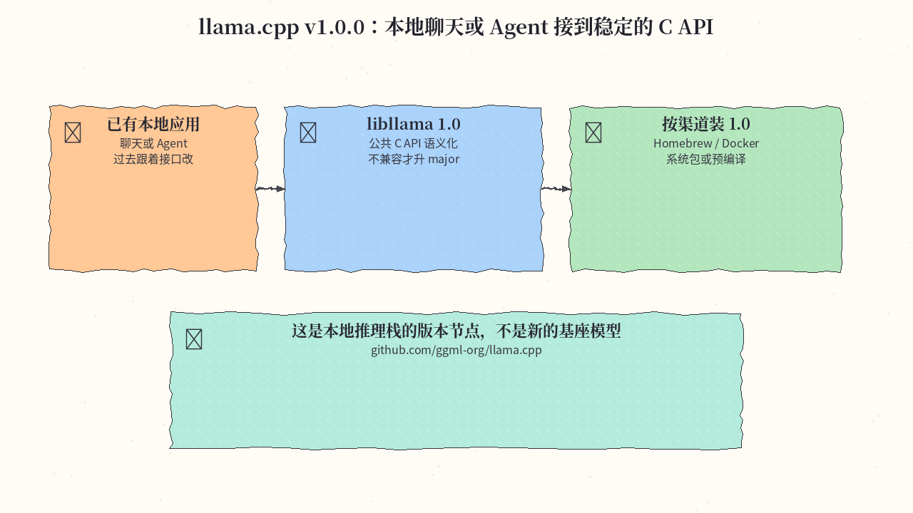

# 2026-11-23 Hugging Face 周报

上周（11/16–11/22）精选 10 条（偏本机可跑的循环 MoE 与多模态、数字人/视频/深度，以及 llama.cpp 1.0 这个版本节点）。未重复上周周报已写过的 Inkling 2 Small、MiniMax-H3-Image、Haru-4B 等；周五才发布的 Inkling 2 Mini 补进本周。

## 1. thinkingmachines/Inkling-2-Mini — 面向本机的 26.4B 循环 MoE

**介绍**  
[Inkling 2 Mini](https://huggingface.co/thinkingmachines/Inkling-2-Mini) 是 Thinking Machines Lab 11-20 发布的通用多模态模型（Apache-2.0，未门禁）：输入文本和图像，输出文本，上下文 1M。总参 26.4B、每 token 激活 3.4B；中间 12 层权重复用、顺序跑三遍，等效约 5.4B 激活。检查点约 20GB，混合 NVFP4 / MXFP8。官方定位是比 [Inkling 2 Small](https://huggingface.co/thinkingmachines/Inkling-2-Small) 小得多、给本地环境用的版本。厂商与 Hugging Face 博文都写：在 Artificial Analysis Intelligence Index v5 等对比里，它和 Qwen3.8-27B 等同档；这些是官方/博文数字，更多验证仍待进行。另有可改循环次数的研究权重 [TML-d24-varloop-research](https://huggingface.co/thinkingmachines/TML-d24-varloop-research)。推荐 32GB 及以上内存（含 32GB Apple 硅）。约 5.0k likes，周榜靠前。介绍：[thinkingmachines.ai/news/inkling-2-mini](https://thinkingmachines.ai/news/inkling-2-mini/)，HF 博文：[huggingface.co/blog/inkling2mini](https://huggingface.co/blog/inkling2mini)。

**用法**  
Transformers 可用 `AutoModelForMultimodalLM`：

```python
from transformers import AutoModelForMultimodalLM, AutoProcessor

model_id = "thinkingmachines/Inkling-2-Mini"
processor = AutoProcessor.from_pretrained(model_id)
model = AutoModelForMultimodalLM.from_pretrained(model_id)

messages = [{"role": "user", "content": [{"type": "text", "text": "Why is the sky blue?"}]}]
inputs = processor.apply_chat_template(
    messages, tokenize=True, add_generation_prompt=True, return_dict=True, return_tensors="pt",
).to(model.device)
input_len = inputs["input_ids"].shape[-1]
outputs = model.generate(**inputs, max_new_tokens=1024)
print(processor.decode(outputs[0][input_len:], skip_special_tokens=False))
```

看图时把 `content` 换成 `{"type": "image", "image": "/path/to/image.jpg"}` 加一句文本。`reasoning_effort` 默认 `high`（0.9），可改为 `none` / `low` / `medium` 等。

本地量化可走 llama.cpp（4-bit `IQ4_NL` 或 8-bit `Q8_0`）：

```sh
llama serve -hf ggml-org/Inkling-2-Mini-GGUF:IQ4_NL
```

SGLang 有 day-0 支持，官方示例需在 `SM103` 上启动，并可用 `--enable-multimodal`。卡片还列了 vLLM、MLX、Ollama 等路径，以当前文档为准。

**应用场景**  
在 32GB 内存的笔记本或单卡上，先用 4-bit 把 Inkling 2 Mini 拉起来当本地编码助手：丢一段仓库上下文和一张报错截图，让它走工具调用修 bug，而不必上 27B 满血权重。



**推荐学习程度**：进阶

---

## 2. tencent/Hy4-flash — 激活约 12B 的高性价比多模态

**介绍**  
[Hy4 flash](https://huggingface.co/tencent/Hy4-flash) 是腾讯 Hy 团队 11-17 放到 Hub 的开源权重（[Tencent Hy License](https://huggingface.co/tencent/Hy4-flash/blob/main/LICENSE)）。卡片写总参约 220B（含约 64B Engram），每 token 激活约 12B（文本 11.3B + 视觉 0.43B）；官网介绍写成 224B，以模型卡为准。原生接受文本和图像、输出文本，上下文 1M。相对 Hy4，卡片强调三处改动：稀疏注意力与滑动窗口按 1:3 交错、LatentMoE（512 个路由专家中激活 16 个，另加 1 个共享专家），以及用哈希检索的 bigram / trigram Engram。另有 0.85B 的内置草稿模型 DFly2，复用 KV 与稀疏下标做投机解码。官网把它定位为日常生产力（深搜、文档、幻灯片、简单前端和 computer use），更重的长程工程仍推荐 Hy4。约 620 likes，本周登上周榜前列。另有 [Hy4-flash-FP8](https://huggingface.co/tencent/Hy4-flash-FP8) 和 [Hy4-flash-base](https://huggingface.co/tencent/Hy4-flash-base)。

**用法**  
Transformers 支持尚未合入主分支时，卡片要求先装这个 PR：

```bash
pip install "transformers[torch,vision] @ git+https://github.com/huggingface/transformers.git@refs/pull/50903/head"
```

```python
from transformers import AutoModelForImageTextToText, AutoProcessor

model_id = "tencent/Hy4-flash"
processor = AutoProcessor.from_pretrained(model_id)
model = AutoModelForImageTextToText.from_pretrained(model_id, device_map="auto")
```

指令模型的 `reasoning_effort` 支持 `"high"`（默认，开思考）和 `"no_think"`；官方推荐采样 `temperature=0.9`、`top_p=1.0`。生产部署用官方镜像更省事：vLLM 是 `vllm/vllm-openai:hy4-flash`，卡片示例以 `tencent/Hy4-flash-FP8`、`--tensor-parallel-size 8` 并打开 DFly 投机解码；SGLang 是 `lmsysorg/sglang:hy4-flash`。配方见 [vLLM Recipe](https://recipes.vllm.ai/tencent/Hy4-flash) 和 [SGLang Cookbook](https://docs.sglang.io/cookbook/autoregressive/Tencent/Hy4-flash)。微调说明在仓库的 [finetune/README.md](https://huggingface.co/tencent/Hy4-flash/blob/main/finetune/README.md)。商用前先读许可证。

**应用场景**  
把一份长文档和几张相关截图丢给本机或内网的 Hy4 flash 服务，先做检索摘要或出一版幻灯片草稿；只有走到长程改仓库、多约束工具调用时，再换更强的档。



**推荐学习程度**：进阶

---

## 3. meituan-longcat/LongCat-Video-Avatar-1.6 — 开源音频驱动数字人，可续写到 10 分钟以上

**介绍**  
[LongCat-Video-Avatar 1.6](https://huggingface.co/meituan-longcat/LongCat-Video-Avatar-1.6) 是美团 LongCat 的音频驱动数字人升级（相对 1.5）：改进表情自然度、唇音同步、面身动作协调，以及长视频一致性，并做了端到端推理优化。模型卡写可按片段续写到 10 分钟以上。仓库在 11-13 创建并上传权重。MIT，未 gated。任务标签含 audio-text-to-video、audio-image-text-to-video、audio-driven-video-continuation。模型卡还写：与 1.5 及 OmniHuman-2.0、HeyGen、OmniHuman-1.5、Kling Avatar 2.0 做全对比较，33,051 张有效票，1.6 在六套系统中排第二，Bradley–Terry Elo 1068.1，仅落后 OmniHuman-2.0。约 440 likes。项目页：[LongCat-Video-Avatar-1.6-Page](https://meigen-ai.github.io/LongCat-Video-Avatar-1.6-Page/)，代码：[github.com/meituan-longcat/LongCat-Video](https://github.com/meituan-longcat/LongCat-Video)。

**用法**  
需同时下载基础视频模型与 Avatar 1.6。环境与依赖见模型卡（Python 3.10、`torch==2.6.0+cu124`、`flash_attn==2.7.4.post1`、`requirements.txt`、`requirements_avatar.txt` 等）：

```shell
git clone --single-branch --branch main https://github.com/meituan-longcat/LongCat-Video
cd LongCat-Video
huggingface-cli download meituan-longcat/LongCat-Video --local-dir ./weights/LongCat-Video
huggingface-cli download meituan-longcat/LongCat-Video-Avatar-1.6 --local-dir ./weights/LongCat-Video-Avatar-1.6

# 单人：语音+文本生成视频（卡片示例为 2 卡）
torchrun --nproc_per_node=2 run_demo_avatar_single_audio_to_video.py \
  --context_parallel_size=2 \
  --checkpoint_dir=./weights/LongCat-Video-Avatar-1.6 \
  --stage_1=at2v \
  --input_json=assets/avatar/single_example_1.json \
  --use_distill --lora_path loraB/lora.safetensors \
  --model_type avatar-v1.6 --mix_steps=4 --mix_alpha=1.0
```

同卡还给出 `ai2v`（语音+图像）、`--num_segments=5` 续写，以及 `run_demo_avatar_multi_audio_to_video.py` 多人示例。可选 `--use_int8`（卡片提供 `base_model_int8`）或 `--use_fp8`（需 Transformer Engine，二者不可同时开）。卡片示例一律 `torchrun --nproc_per_node=2`，没有写消费级显存数字。Hopper（H20 / H100 / H200 / H800）才建议开 FlashAttention 3。`loraA` 为 DMD、`loraB` 为 OPSD。正文有通用安全/合规提醒。

**应用场景**  
把一段讲解旁白和一张人物照片交给 1.6，在多卡上先做语音驱动的形象视频，再按片段续写，得到一段超过 10 分钟、口型更稳的讲解视频。



**推荐学习程度**：深入

---

## 4. internlm/Sage-S2.1-Flash — 320B-A18B 的科学多模态 Flash 模型

**介绍**  
[Sage S2.1 Flash](https://huggingface.co/internlm/Sage-S2.1-Flash) 是上海人工智能实验室本周放到 Hub 的科学多模态模型（卡片写 MIT，未 gated）。架构跟 GLM-5.3-Flash 同系，权重是 320B-A18B 的 MoE、BF16，约 321B 参数、约 645 GB。通过 Sage SciPerception 把分子图、晶体结构、蛋白质序列和三维结构等十多种科学输入投到和文本共享的表示空间，再做预测、分类、位点定位等。实验室自己的表：15 项基准里 4 项第一、7 项第二，MLE-bench Lite 90.3（对比表中 DeepSeek-V4.1-Flash-1017 为 89.2）。数字来自官方卡片，未见独立复现。另有 [FP8 权重](https://huggingface.co/internlm/Sage-S2.1-Flash-FP8)。集合：[Sage-S2.1](https://huggingface.co/collections/internlm/sage-s21)。

**用法**  
通用任务按[部署指南](https://huggingface.co/internlm/Sage-S2.1-Flash/blob/main/deployment_guide.md)，示例为 8×H200。必须加 `--trust-remote-code`，否则会静默用到库存 tokenizer，工具调用和推理可能直接断掉。vLLM 0.33.0 还要先打仓库里的 `vllm_patch/`（并行工具返回的图片顺序问题，上游 [PR #67108](https://github.com/vllm-project/vllm/pull/67108) 还在进行）。

```bash
hf download internlm/Sage-S2.1-Flash --include "vllm_patch/*" --local-dir /path/to/Sage-S2.1-Flash
# 按 vllm_patch/README.md 打补丁后再启动
vllm serve internlm/Sage-S2.1-Flash \
  --trust-remote-code \
  --tensor-parallel-size 8 \
  --enable-auto-tool-choice \
  --tool-call-parser glm47 \
  --reasoning-parser glm47
```

也可用 LMDeploy（`transformers>=5.17,<5.19`）或 SGLang 0.5.20+（需显式传入仓库的 `chat_template.jinja`）。Hopper 上保持默认 BF16 KV cache。科学输入要另下 projector 和 Sage-SciPerception 脚本，并给 vLLM 开 `--enable-prompt-embeds`，细节见卡片和 SciPerception 指南。

**应用场景**  
在私有集群上把晶体 CIF 和自然语言问题一起送给模型，先做性质预测，再用它写分析脚本、核对中间结果。



**推荐学习程度**：深入

---

## 5. apple/FastFrames-L — 交互时延的 14B 文生视频

**介绍**  
[FastFrames-L](https://huggingface.co/apple/FastFrames-L) 是 Apple 11-16 放到 Hub 的 14B 文生视频权重，对应论文 [FastFrames: Video Generation at Interactive Latency](https://arxiv.org/abs/2611.23226)（arXiv:2611.23226）。它和 1.3B 的 [FastFrames-S](https://huggingface.co/apple/FastFrames-S) 都是自回归、两步的视频扩散模型，官方示例输出 832×480、81 帧、16 fps。L 从 Wan2.1-14B 按 Causal Forcing++ 蒸馏而来，仓库还放出了教师、一致性蒸馏、DMD 和最终生成器等检查点。代码在 [apple-aiml-research/ml-fastframes](https://github.com/apple-aiml-research/ml-fastframes)（11-17 公开）。卡片与代码标签为 Apple AMLR / Apple Sample Code License（个人非独占许可，再分发需保留声明）；其中 LingBot World v2 部分另走 CC BY-NC-SA 4.0。仓库里 FastFrames-S 在单卡、480p、满 KV cache 的分项合计约 35.4 ms（论文写 36 ms），这是 S 的数字，不能直接当成 L 的时延；L 的官方 profiling 命令带 `--gpus 8`。约 540 likes。

**用法**  
需要 Linux x86-64、NVIDIA 显卡和兼容 CUDA 12.8 的驱动。按[安装与检查点说明](https://github.com/apple-aiml-research/ml-fastframes/blob/main/docs/installation.md)，在仓库根目录：

```bash
git clone https://github.com/apple-aiml-research/ml-fastframes.git
cd ml-fastframes
uv sync
uv run hf download apple/FastFrames-L --include 'fastframes-l/*' --local-dir checkpoints
uv run hf download Wan-AI/Wan2.1-T2V-14B --local-dir checkpoints/Wan2.1-T2V-14B
# 若只做生成、不训练，可给 Wan 下载加 --exclude 'diffusion_pytorch_model*'，跳过其基座 DiT
uv run python scripts/generate.py --model ff-l --checkpoint-dir checkpoints \
    --prompt "A corgi surfing a wave at sunset" --seed 0 --output outputs/corgi.mp4
```

`uv sync` 会装上锁定的 Python 3.10 与 PyTorch 2.9.1 / CUDA 12.8 环境。交互演示走的是优化过的 LingBot 1.3B（许可更紧），不要和 FastFrames-L 的文生视频命令混用。

**应用场景**  
先在本机用 L 把一句提示词打成约 5 秒的 480p 短视频，确认画质和许可能接受后，再决定要不要接到内部预览流程；需要相机交互演示时，改走文档里的 LingBot 路径，并单独核对 CC BY-NC-SA。



**推荐学习程度**：进阶

---

## 6. apple/DepthPro2 — 一张照片或一段视频，估计每像素的米制深度

**介绍**  
[DepthPro2](https://huggingface.co/apple/DepthPro2) 是 Apple 本周把权重推上 Hub 的深度估计模型：一张照片或一段视频，估计每像素的米制深度。代码在 [apple-aiml-research/ml-depth-pro-2](https://github.com/apple-aiml-research/ml-depth-pro-2)。主权重示例为 [DepthPro2-H](https://huggingface.co/apple/DepthPro2-H)，另有焦距估计 [DepthPro2-focal](https://huggingface.co/apple/DepthPro2-focal)。卡片声称在 Sintel 和 Spring 上平均的 Boundary F1 / Jitter 优于此前单帧和多帧方法，README 里没有给出具体 F1/Jitter 数字表。官方 Space 在卡片里仍可能标注未公开，目前有社区 Space [akhaliq/DepthPro2](https://huggingface.co/spaces/akhaliq/DepthPro2)。约 280 likes。许可偏研究/非商用，商用前要另读 `LICENSE_MODEL`。

**用法**

```bash
pip install "git+https://github.com/apple-aiml-research/ml-depth-pro-2"
```

```python
from functools import partial
import torch
from depth_pro_2 import DepthPro2, load_rgb
from depth_pro_2.model import to_normalized_tensor

model = DepthPro2.from_pretrained("apple/DepthPro2-H", precision=torch.bfloat16)
model = model.to("cuda")
transform = partial(to_normalized_tensor, device=torch.device("cuda"))

image, f_px = load_rgb("photo.jpg")
depth = model.infer(transform(image), f_px=f_px)["depth"]  # 米，(H, W)
```

视频用 `model.infer_video(...)`，按 16 帧分块。只估焦距：`FOVEstimator.from_pretrained("apple/DepthPro2-focal")`，再调用 `fov.focal_length_px(...)`。这是 git 安装，不是稳定的 PyPI 包。

**应用场景**  
用一段手持室内视频，先出一张帧间更稳的米制深度图，做 AR 摆位或机器人原型；仅限研究/非商用，商用前要另读 `LICENSE_MODEL`。



**推荐学习程度**：进阶

---

## 7. sensenova/SenseNova-Loop-9B — 循环中间层的 9B 多模态正式版

**介绍**  
[SenseNova-Loop-9B](https://huggingface.co/sensenova/SenseNova-Loop-9B) 是商汤 11-17 放到 Hub 的正式版（卡片写 Apache-2.0；gated，下载权重需登录并同意条件）。约 9B 参数，32 个物理解码层里中间 24 层顺序执行两遍，一次前向做 56 次层计算，推理等效约 14.6B；文本 + 图像输入、文本输出，上下文 512K。架构仍是 looped block + 双流 mHC + 混合注意力。官方称在 Agent 和数据分析上接近 Qwen3.8-27B：NL2Repo 41.36（对比 44.60），AIDABench 65.31（对比 65.01）。相对 10-31 的 Preview，卡片给出的七项里都有提升，例如 AutomationBench 14.33→36.67、Terminal-Bench 2.1 40.45→59.55、GAIA 37.86→69.90。数字来自官方卡片，未见独立复现。默认仍是两圈循环；卡片里把圈数加到 3–4 还会再涨一点，但推理成本也更高。4-bit 权重约 4.9 GB，配合 8-bit KV 时 256K 多模态推理约 15 GiB。代码：[OpenSenseNova/SenseNova-Loop](https://github.com/OpenSenseNova/SenseNova-Loop)。约 540 likes。

**用法**  
先在模型页申请访问，再按卡片用 Transformers 5.18.0（Preview 验证环境还写了 PyTorch 2.11.0、CUDA 13.0），必须 `trust_remote_code=True`：

```python
import torch
from transformers import AutoModelForCausalLM, AutoTokenizer

model_id = "sensenova/SenseNova-Loop-9B"
tokenizer = AutoTokenizer.from_pretrained(model_id, trust_remote_code=True)
model = AutoModelForCausalLM.from_pretrained(
    model_id, trust_remote_code=True, dtype=torch.bfloat16, device_map={"": "cuda:0"}
).eval()
messages = [{"role": "user", "content": "13 乘以 7 等于多少？"}]
prompt = tokenizer.apply_chat_template(
    messages, tokenize=False, add_generation_prompt=True, enable_thinking=True
)
inputs = tokenizer(prompt, return_tensors="pt").to("cuda:0")
```

服务部署需带 SenseNova Loop 实现的引擎版本：SGLang 见 [PR #47281](https://github.com/sgl-project/sglang/pull/47281)，vLLM 见 [PR #64832](https://github.com/vllm-project/vllm/pull/64832)。官方也写了已知局限：复杂工具定义和多重约束时可能跟不稳，长程 Agent 和复杂网页往往要多轮修。

**应用场景**  
把一份长文档和几张相关截图一起送给 9B 的本地服务，先做数据分析，再按需调用工具补证据，而不是直接上 27B。



**推荐学习程度**：进阶

---

## 8. microsoft/Aion-1.0-Instruct-2.3B — Windows 端侧 SLM 预览权重

**介绍**  
[Aion-1.0-Instruct-2.3B](https://huggingface.co/microsoft/Aion-1.0-Instruct-2.3B) 是微软 Windows Applied Sciences Group 本周放到 Hub 的端侧基础 SLM 预览（MIT，未门禁）。因果指令模型，约 2.29B 参数（输入输出 embedding 共享），28 层、hidden 2048、GQA 24/8，混合注意力（21 层滑动窗口 2048，加 7 层全注意力），全注意力层用 RoPE + YaRN，上下文 32,768，词表 200,029，bfloat16，知识截止 2025-12。语言包括英、德、西、葡、意、法、中、日；卡片标签是 summarization、rewriting、chat，面向端上的文档理解、内容分析、问答和 NLU。卡片写：更优化的版本，加上微软的内容审核模型，「将在 2027 年 1 月底成为 Windows OS SLM」；这次 Hub 发布是「对即将到来之物的介绍」。同批次还有 [Aion-1.0-Instruct-2.3B-ONNX-WebGPU](https://huggingface.co/microsoft/Aion-1.0-Instruct-2.3B-ONNX-WebGPU)（INT4 QAT，约 1.3 GB）。约 260 likes。卡片给出的评测（官方数字，未独立复现）包括 MMLU 55.15、GSM8K 74.91（loose matching）、IFEval 83.90 等。卡片也写得很直：2.3B 会漏细节、说错事实，多步推理和安全细节都不稳，且「可能受到对抗攻击」；多语数据大约只有 6%。需要 `trust_remote_code=True`。这不是 2027 年 1 月的 Windows OS SLM 本身。

**用法**  
自定义建模代码，卡片示例：

```python
from transformers import AutoModelForCausalLM, AutoTokenizer

model_id = "microsoft/Aion-1.0-Instruct-2.3B"
tokenizer = AutoTokenizer.from_pretrained(model_id, trust_remote_code=True)
model = AutoModelForCausalLM.from_pretrained(
    model_id, dtype="auto", device_map="auto", trust_remote_code=True,
)
messages = [{"role": "user", "content": "Give me a short introduction to large language models."}]
inputs = tokenizer.apply_chat_template(
    messages, add_generation_prompt=True, return_dict=True, return_tensors="pt",
).to(model.device)
outputs = model.generate(**inputs, max_new_tokens=512)
print(tokenizer.decode(outputs[0][inputs["input_ids"].shape[-1]:], skip_special_tokens=True))
```

ONNX WebGPU 卡片的路径是：`hf download microsoft/Aion-1.0-Instruct-2.3B-ONNX-WebGPU --local-dir Aion-Instruct-v1-ONNX-WebGPU`，再按卡片安装 `onnxruntime-webgpu` 和 `onnxruntime-genai`，用 provider `webgpu`。

**应用场景**  
在笔记本电脑上摘要一份多页本地 PDF 或一串长邮件，文本先不过云；用它的 32K 窗口和 MIT 许可，做一个私有桌面助手的预览，同时记住卡片对幻觉和安全边界的提醒。



**推荐学习程度**：进阶

---

## 9. harness-hub/Qwen3.8-27B-pi-adapted — 给 pi 编码代理的 LoRA，默认关掉思考

**介绍**  
[Qwen3.8-27B-pi-adapted](https://huggingface.co/harness-hub/Qwen3.8-27B-pi-adapted) 是 11-16 放到 Hub 的 LoRA（Apache-2.0，PEFT，ranks 32），用强化学习把 [Qwen/Qwen3.8-27B](https://huggingface.co/Qwen/Qwen3.8-27B) 调成 [pi](https://www.npmjs.com/package/@earendil-works/pi-coding-agent) 编码代理在软件工程和终端任务上的模型。卡片给出的成对结果（同一套 pi 脚手、每题一次、思考关闭）是：SWE-bench Pro 最难 51 题 39.2%→64.7%（新建 15、丢失 2），Terminal-Bench 2.1 为 39.5%→55.8%（新建 16、丢失 2）。作者还写：关掉思考时，它打到基座在最高思考档（`xhigh`）的准确度，每题生成 token 大约少到 1/4；给适配器再开思考几乎不再涨分，只会多写 token。这些数字只在 pi 脚下成立，不能直接拿去和 Qwen 官方卡片（别的 harness、开思考、更大预算、完整 SWE-bench Pro）比。约 990 likes。适配器必须叠在 Qwen3.8-27B 上，换基座无效。

**用法**  
用 vLLM 加载基座并挂上 LoRA（评测配置；前缀缓存对这个混合模型需要 `--mamba-cache-mode align`，思考保持关闭）：

```sh
vllm serve Qwen/Qwen3.8-27B \
    --enable-lora --max-lora-rank 32 \
    --lora-modules qwen3.8-pi=harness-hub/Qwen3.8-27B-pi-adapted \
    --language-model-only --enable-prefix-caching --mamba-cache-mode align \
    --enable-auto-tool-choice --tool-call-parser qwen3_xml --reasoning-parser qwen3 \
    --default-chat-template-kwargs '{"enable_thinking": false}' \
    --max-model-len 131072
```

安装 pi（Node.js 22.19+）：`npm install -g --ignore-scripts @earendil-works/pi-coding-agent`。在 `~/.pi/agent/models.json` 里把该服务配成 OpenAI Completions（不要用 Responses API），模型 id 为 `qwen3.8-pi`，然后：

```sh
pi --provider local --model qwen3.8-pi --print "Find out why the tests in tests/test_parser.py fail and fix the bug."
```

也可以按卡片把 LoRA merge 进基座，或用 [GGUF 版](https://huggingface.co/harness-hub/Qwen3.8-27B-pi-adapted-GGUF) 挂到 Qwen3.8-27B 的 GGUF 上；量化版未经重新评测。

**应用场景**  
已经用 pi 跑仓库修复时，先在本机或内网把这个 LoRA 挂上，保持 thinking 关闭，看同样的失败测试能不能用更少的工具步修完；不要把卡片上的分数直接当成换一套编码代理之后的预期。



**推荐学习程度**：进阶

---

## 10. ggml-org/llama-cpp-v1 — llama.cpp / ggml 库版本 v1.0.0，公共 C API 开始语义化

**介绍**  
[llama.cpp v1.0.0 : A stronger foundation for the local AI ecosystem](https://huggingface.co/blog/ggml-org/llama-cpp-v1) 是 ggml-org 在 11-13 晚发的官方团队博文，作者 Daniel Bevenius、Georgi Gerganov、merve。文中宣布同时发布 **llama.cpp v1.0.0（libllama）** 与 **ggml v1.0.0（libggml）**：此后公共 C API（`./include`）不兼容会升 major，向后兼容功能和后端/模型支持升 minor，纯修 bug 升 patch。文中写 llama.cpp 目前支持 150+ 架构变体及主流投机解码。这不是新的 Hub 基座模型，但是本地推理栈的一个版本节点。博文正文未写许可证。

**用法**  
博文没有给出具体安装命令，只列出发行渠道：Pre-release artifacts（Linux / macOS / Windows / Android / iOS）、Docker、Debian、Homebrew、conda-forge、MacPorts、Winget、XCFramework。按这些官方渠道取 v1.0.0 工件；具体命令以各渠道当前文档为准。源码与示例见 [github.com/ggml-org/llama.cpp](https://github.com/ggml-org/llama.cpp)，模型与相关资源在 [huggingface.co/ggml-org](https://huggingface.co/ggml-org)。文末还提到由 llama.cpp 与 Hugging Face 团队出品的 Llama desktop apps（macOS / Windows）。

**应用场景**  
用 Homebrew、Docker 或系统包装上语义化的 libllama 1.0，把已有的本地聊天或 Agent 接到稳定的 C API，避免后续小版本更新把接口弄坏。



**推荐学习程度**：入门
