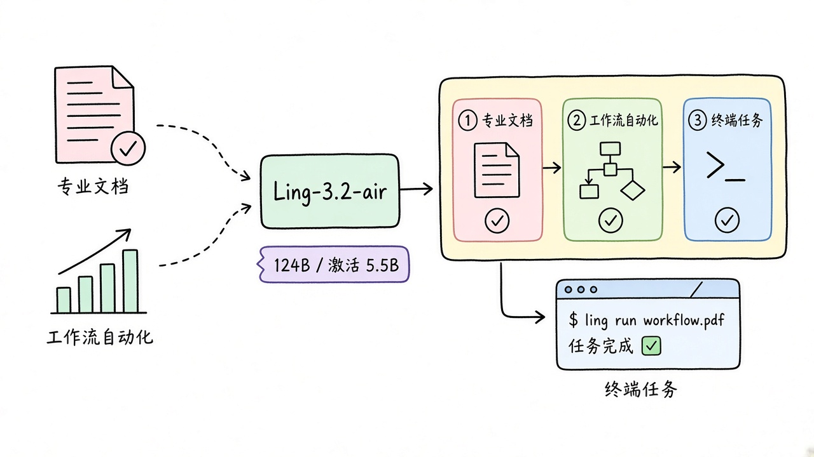
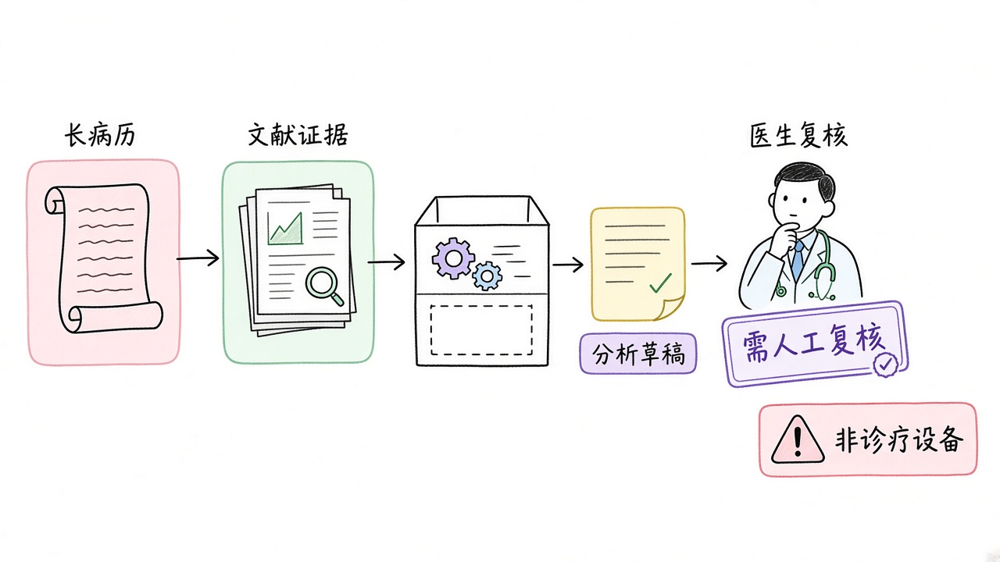

# 2026-11-24 Hugging Face 日报

今日三条：昨天刚放权的多模态 MoE Ling-3.2-air、同日开源的医疗向 LingSante-3.1-flash，以及正在热榜上、激活量更小的 Maxwell-V1-Flash。未重复周报与近日已写过的 Inkling-2-Mini、Hy4-flash、voice-isolator、Haru-4B、SenseNova-Loop-9B、FastFrames-L、DepthPro2、LongCat-Video-Avatar-1.6、MiniMax-H3-Image、LTX-2.5 等。

## 1. inclusionAI/Ling-3.2-air — 124B / 激活 5.5B 的原生多模态 MoE

**介绍**  
[Ling-3.2-air](https://huggingface.co/inclusionAI/Ling-3.2-air) 是蚂蚁 inclusionAI 于 11-23 开源的权重（MIT）：与 Ling-3.0-flash-VL 同一套原生多模态架构，Hybrid-linear MoE，总参 124B、每 token 激活 5.5B（512 个路由专家中激活 8 个，另有 1 个共享专家；35 层 KDA + 7 层 Gated MLA）。官方把它的改进放在工作流自动化和专业文档推理上，并给出一组官方评测数字（此处未复现），例如 AutomationBench-AA 从 15.7% 到 61%，AA-Briefcase v1.1 Elo 从 987 到 1340，Terminal-Bench 4.0 从 0% 到 27%，Artificial Analysis Intelligence Index v5.0.1 为 23。今早约 100 likes，卡面仍很新。

**用法**  
模型卡：[huggingface.co/inclusionAI/Ling-3.2-air](https://huggingface.co/inclusionAI/Ling-3.2-air)。官方推荐 day-0 SGLang 镜像，配方里把上下文设为 256K；文档写明在 4 张 141GB 级 GPU（H20-3e / H200）或 4 卡 Blackwell（B300 / GB300）上用 `--tp 4`，80GB 卡（H100 / H800）则 `--tp 8`：

```bash
docker pull lmsysorg/sglang:dev-Ling-3.0-flash-VL
docker run --rm --gpus all --ipc=host --shm-size 32g \
  -p 30000:30000 \
  lmsysorg/sglang:dev-Ling-3.0-flash-VL \
  python3 -m sglang.launch_server \
    --model-path inclusionAI/Ling-3.2-air \
    --tp 4 \
    --context-length 262144 \
    --speculative-algorithm NEXTN \
    --trust-remote-code \
    --reasoning-parser auto \
    --tool-call-parser auto \
    --host 0.0.0.0 \
    --port 30000
```

客户端建议 `temperature=1.0`、`top_p=0.95`、`top_k=20`，并设 `chat_template_kwargs.enable_thinking=true`。图用 `image_url`，视频用 `video_url`。卡面另有基于 [inclusionAI/vllm-ling-v3](https://github.com/inclusionAI/vllm-ling-v3) 的 vLLM 配方。

**应用场景**  
要把一份带图表的专业文档推进到可执行的终端工作流，先在自有集群用官方 SGLang 配方拉起服务，打开 thinking，再人工核对自动化步骤，而不是只看一段摘要。



**推荐学习程度**：进阶（部署需多卡）

---

## 2. inclusionAI/LingSante-3.1-flash — 面向医疗研究的 560B / 激活 25B MoE

**介绍**  
[LingSante-3.1-flash](https://huggingface.co/inclusionAI/LingSante-3.1-flash) 是 11-23 开源的 MIT 权重，基于 [Ling-3.1-flash](https://huggingface.co/inclusionAI/Ling-3.1-flash)：Hybrid-linear MoE，总参 560B、每 token 激活 25B，上下文 1M。官方定位是复杂医学推理、循证检索、长程医疗任务和专业表达，并写明它**不是医疗器械，不得作为独立的诊断、处方或治疗依据**；面向研究与评估，输出需由具备资质的人复核。卡面还列出隐私与权限方面的限制。今早约 115 likes。

**用法**  
模型卡：[huggingface.co/inclusionAI/LingSante-3.1-flash](https://huggingface.co/inclusionAI/LingSante-3.1-flash)。官方推荐 SGLang 镜像 `lmsysorg/sglang:dev-ling-3.1-flash`。文档中的 8×H200 配方为 `--tp 8 --ep 8`，4×GB300 则 `--tp 4 --ep 4`：

```bash
docker pull lmsysorg/sglang:dev-ling-3.1-flash
docker run --gpus all --network host --ipc=host --rm \
  lmsysorg/sglang:dev-ling-3.1-flash \
  python3 -m sglang.launch_server \
    --model-path inclusionAI/LingSante-3.1-flash \
    --tp 8 --ep 8 \
    --speculative-algorithm NEXTN \
    --host 0.0.0.0 --port 30000
```

客户端同样建议 `temperature=1.0`、`top_p=0.95`、`top_k=20`，并打开 `enable_thinking`。卡面另有 vLLM 配方，以及 H200 / GB300 / H800 / H100 / B200 的验证记录入口。

**应用场景**  
研究团队要梳理一份很长的病历和相关文献、先出带证据指向的分析草稿：用自有集群拉起服务，再由临床人员核对引用、遗漏和冲突。它不能代替医生做诊断或开药。



**推荐学习程度**：进阶（部署需多卡；使用需人工复核）

---

## 3. maxwell-model/Maxwell-V1-Flash — 35B / 激活 3B、256K 上下文的 MoE

**介绍**  
[Maxwell-V1-Flash](https://huggingface.co/maxwell-model/Maxwell-V1-Flash) 是 Maxwell 团队的开源文本 MoE（Apache-2.0）：正文写不含 embedding 为总参 35B、每 token 激活 3B（HF 卡面标约 37B，口径可能含 embedding），上下文 256K。特点是 Maxwell Block Sparse Attention（每组 KV 固定覆盖 8 个前缀块和 8 个局部 128-token 块，再由索引器最多加 16 个远端块，从而把主注意力限制在每组 4096 token，同时保留全历史 KV），以及细粒度专家路由和流形约束的超连接。训练数据官方称约 26T token。11-14 仍有更新，今早约 390 likes，出现在 HF 热榜。官方评测数字未在这里复现。

**用法**  
模型卡：[huggingface.co/maxwell-model/Maxwell-V1-Flash](https://huggingface.co/maxwell-model/Maxwell-V1-Flash)。也可先在 [maxwell-llm.ai/playground](https://maxwell-llm.ai/playground) 试用。本地部署要求 NVIDIA 驱动 ≥ 580（CUDA 13.0）；更老驱动需在 `docker run` 加 `-e VLLM_ENABLE_CUDA_COMPATIBILITY=1`：

```bash
export MODEL_DIR=$PWD/Maxwell-V1-Flash
hf download maxwell-model/Maxwell-V1-Flash --local-dir "$MODEL_DIR"

docker run --rm --init \
  --name vllm-maxwell \
  --gpus all \
  --shm-size 8g \
  --network host \
  -v "$MODEL_DIR":/models/Maxwell-V1-Flash:ro \
  --entrypoint vllm \
  maxwellmodel/vllm-openai:v0.30.0 \
  serve /models/Maxwell-V1-Flash \
  --trust-remote-code \
  --block-size 128 \
  --served-model-name Maxwell-V1.0-Flash \
  --port 8000 \
  --tensor-parallel-size 1 \
  --reasoning-parser qwen3 \
  --enable-auto-tool-choice \
  --tool-call-parser qwen3_coder
```

对话默认打开 thinking；多轮要把完整 assistant 消息（含 `reasoning_content` 和 `tool_calls`）回传。卡面示例用 OpenAI 兼容客户端，`temperature=0.6`、`top_p=0.95`、`top_k=20`。

**应用场景**  
想在单机或多卡上先跑一个激活量更小、上下文到 256K 的开源 MoE，做长文档问答或带工具的代理实验：按官方镜像拉起服务，需要时再对照卡面上的基准自己复测。


**推荐学习程度**：进阶
