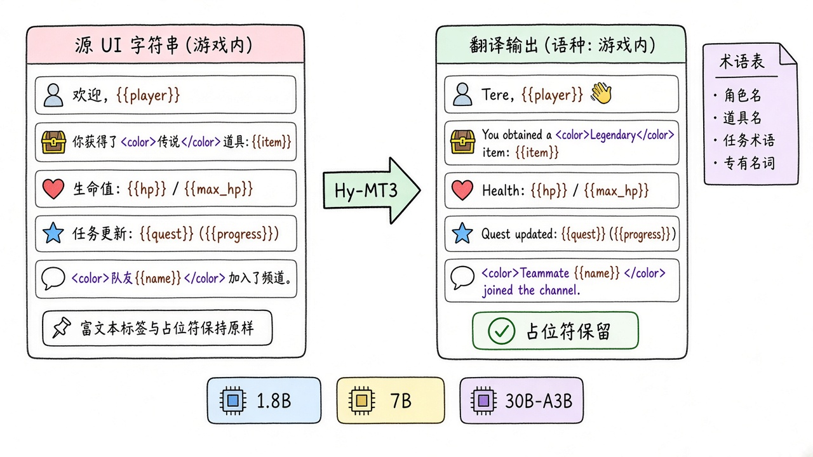
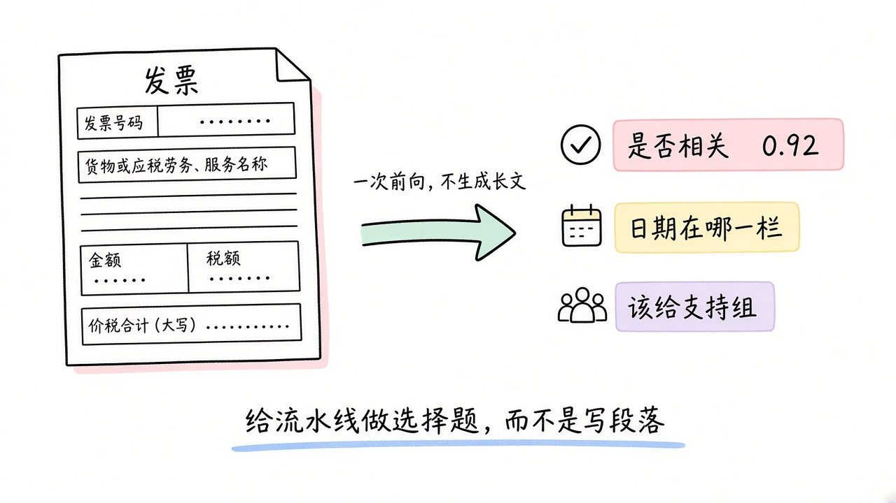

# 2026-11-25 Hugging Face 日报

今日三条：百度刚放上 Hub 的 ERNIE 5.5 Flash Preview 后训练权重；腾讯 Hy-MT3 三代翻译模型；以及 Illuin 的文档决策模型 IVE-4B。未重复周报和近几日已写过的 Inkling-2-Mini、Inkling-2-Small、Hy4-flash、Ling-3.2-air、LingSante-3.1-flash、Maxwell-V1-Flash、voice-isolator、Haru-4B、DepthPro2 等。11-10 写过的是 ERNIE 5.5 Flash Base，今天是建立在它上面的后训练 Preview。

## 1. baidu/ERNIE-5.5-Flash-Preview — 建立在 Flash Base 上的后训练中间检查点

**介绍**  
[ERNIE 5.5 Flash Preview](https://huggingface.co/baidu/ERNIE-5.5-Flash-Preview) 是百度 11-23 前后放到 Hub 的开源权重（[Apache 2.0](https://huggingface.co/baidu/ERNIE-5.5-Flash-Preview)，只覆盖这组 Preview 权重；Flash Base 仍走它自己的许可证）。卡片写：这是建立在此前发布的 ERNIE 5.5 Flash Base 上的第一份后训练模型，总参 280B、每 token 激活 14B，上下文 1M（中训练把训练上下文从 128K 扩到 1M），架构和分词器与 Base 相同，并带 DSpark 投机解码草稿头。默认仓库是带 FP4 expert 的部署向构建，另有 [FP8](https://huggingface.co/baidu/ERNIE-5.5-Flash-Preview-FP8) 和用于微调的 [BF16](https://huggingface.co/baidu/ERNIE-5.5-Flash-Preview-BF16)。卡片把它定位在编码、3D 建模、知识工作和视频创作，并写明这是后训练尚未结束的中间检查点，部分能力可能还不完整，正式版会继续改。生产部署可用 SGLang 或 vLLM（需 [vLLM-ERNIE](https://github.com/baidu/vLLM-ERNIE) 插件）。官方介绍里的长程演示（例如十数小时写出完整游戏）是卡片上的说法，不是这里实测。今早模型卡仍在更新。博客：[ernie.baidu.com/release/ernie-5-5-flash-preview](https://ernie.baidu.com/release/ernie-5-5-flash-preview/)。

**用法**  
模型卡：[huggingface.co/baidu/ERNIE-5.5-Flash-Preview](https://huggingface.co/baidu/ERNIE-5.5-Flash-Preview)。下面两条官方示例都把上下文设为 131,072；更长输入可把 SGLang 的 `--context-length` 或 vLLM 的 `--max-model-len` 调高，服务器上限是 1,048,576。

SGLang（官方预构建镜像内启动，并打开 DSpark）：

```bash
docker run -d -it --name ernie55 --gpus all --network host --ipc host \
  -v ~/.cache/huggingface:/root/.cache/huggingface lmsysorg/sglang:latest
docker exec -it ernie55 bash
sglang serve --model-path baidu/ERNIE-5.5-Flash-Preview \
  --host 0.0.0.0 --port 30000 --tp 4 --attn-dp-size 4 \
  --context-length 131072 --speculative-algorithm DSPARK \
  --reasoning-parser ernie55 --tool-call-parser ernie55 --trust-remote-code
```

vLLM 需要先装 0.32.0 和百度的插件：

```bash
uv venv --python 3.12 ernie5-venv && source ernie5-venv/bin/activate
uv pip install vllm==0.32.0
uv pip install git+https://github.com/baidu/vLLM-ERNIE.git
export VLLM_ENGINE_READY_TIMEOUT_S=3600
vllm serve baidu/ERNIE-5.5-Flash-Preview --trust-remote-code --host 0.0.0.0 --port 30000 \
  --data-parallel-size 4 --enable-expert-parallel --kv-cache-dtype fp8 --max-model-len 131072 \
  --reasoning-parser ernie5 --tool-call-parser ernie5 --enable-auto-tool-choice \
  --attention-config '{"indexer_kv_dtype":"mxfp4"}' \
  --speculative-config '{"method":"dspark","num_speculative_tokens":7,"draft_sample_method":"probabilistic"}'
```

模型总会先思考再回答：推理在 `message.reasoning_content`，答案在 `message.content`。微调建议从 BF16 仓库起步，文档指向 NVIDIA Megatron-Bridge。完整启动参数以模型卡为准。

**应用场景**  
已经能跑 Flash Base 那套工具链，想先试用后训练过的指令权重做长上下文的材料整理、编码或创作，并接受这是中间检查点：用 SGLang 或 vLLM 自行部署 Preview，先看它在你自己的任务上稳不稳，再决定要不要等正式版。


**推荐学习程度**：进阶

---

## 2. tencent/Hy-MT3 — 第三代多语翻译，1.8B / 7B / 30B-A3B，覆盖 102 种语言

**介绍**  
[Hy-MT3](https://huggingface.co/tencent/Hy-MT3-1.8B) 是腾讯 Hy 团队 11-24 放到 Hub 的第三代开源翻译模型（[Apache 2.0](https://huggingface.co/tencent/Hy-MT3-1.8B)），三个尺寸：[1.8B](https://huggingface.co/tencent/Hy-MT3-1.8B)、[7B](https://huggingface.co/tencent/Hy-MT3-7B) 和 MoE 的 [30B-A3B](https://huggingface.co/tencent/Hy-MT3-30B-A3B)（激活 3B），语言覆盖从 Hy-MT2 的 38 种扩到 102 种。另有 FP8 与 GGUF 构建。卡片写：在真实场景数据上，相对 Hy-MT2，误译样本占比降 43%、增减译降 74%、指令遵循错误降 40%（官方数字，不是这里实测）。除通用翻译外，还针对游戏本地化（与《王者荣耀》团队的评测体系一起做，可接入开源工具链 TiMiHOKGameTranslator）和 OCR 级联的图像翻译。同期开源了基于量规的翻译评估套件 TransRubric；论文页：[huggingface.co/papers/2611.27673](https://huggingface.co/papers/2611.27673)。上下文长度 8192，模型没有默认 system prompt。

**用法**  
先从较小的 1.8B 试（`transformers>=5.6.0`）：

```python
from transformers import AutoModelForCausalLM, AutoTokenizer
import torch

model_path = "tencent/Hy-MT3-1.8B"
tokenizer = AutoTokenizer.from_pretrained(model_path, trust_remote_code=True)
model = AutoModelForCausalLM.from_pretrained(
    model_path, dtype=torch.bfloat16, device_map="auto", trust_remote_code=True
).eval()

prompt = "将以下文本翻译成英语,注意只需要输出翻译后的结果,不要额外解释:\n\n今天天气真好。"
messages = [{"role": "user", "content": prompt}]
inputs = tokenizer.apply_chat_template(messages, add_generation_prompt=True, return_tensors="pt").to(model.device)
outputs = model.generate(**inputs, max_new_tokens=4096)
print(tokenizer.decode(outputs[0][inputs["input_ids"].shape[-1]:], skip_special_tokens=True))
```

卡片还提供了术语、文风、分隔符和结构化数据（只译可见文案、保留占位符与键名）的提示模板。部署可用 vLLM 或 SGLang，例如 `vllm serve tencent/Hy-MT3-1.8B --tensor-parallel-size 1`。商用前先读许可证。

**应用场景**  
要把游戏或产品界面里的文案译成多种语言，又必须保住 `{{player}}`、富文本标签和键名：先用术语表写进官方提示模板，用 1.8B 在本机试一小批，再按质量决定是否换 7B 或 30B-A3B。



**推荐学习程度**：入门

---

## 3. illuin/IVE-4B — 给文档流水线做选择题，一次前向给出校准过的概率

**介绍**  
[IVE-4B](https://huggingface.co/illuin/IVE-4B) 是 Illuin Technology 11-23 发布的开源决策模型（[Apache 2.0](https://huggingface.co/illuin/IVE-4B)），在 [Qwen3.5-4B](https://huggingface.co/Qwen/Qwen3.5-4B) 上微调。它不生成长文本：输入一个 `state`（文本或 JSON，可附图像）和若干问题（多项选择 `choice` 或是否题 `noul`），一次前向就为每个选项给出校准过的概率，协议是 Decision Index 使用的 `/v1/systemone`。同系列还有蒸馏出的更小模型 [Ivonnet-0.8B](https://huggingface.co/illuin/Ivonnet-0.8B)。作者在 [Hugging Face 博文](https://huggingface.co/blog/QuentinJG/ive-release) 里把它定位成文档流水线的杂工：页是否相关、字段在哪、该点哪个按钮。卡片写：在 Decision Index 0.4.1 上，IVE-4B 在「无人能针对训练的新域私有任务」里，于 166 个 5B 及以下模型中排第一；校准误差 1.6%。bf16 权重大约占 9 GB 显存。单题超过 32,768 token 或选项超过 255 个会被拒绝，不会截断；评测以英文为主。延迟数字是作者在一块 NVIDIA RTX PRO 6000 上测的公开文本套件：中位约 51 ms，不是这里实测。

**用法**  
模型卡：[huggingface.co/illuin/IVE-4B](https://huggingface.co/illuin/IVE-4B)。

```bash
pip install torch --index-url https://download.pytorch.org/whl/cu128
hf download illuin/IVE-4B --local-dir IVE-4B
pip install -e "IVE-4B/source[fast,server]"
```

```python
from decision_model import DecisionModel

model = DecisionModel.from_pretrained("IVE-4B", device="cuda")
model.decide(
    "My integration keeps failing with a 401.",
    {"team": {"type": "choice", "instructions": "Which team should handle this request?",
              "criteria": {"billing": "Charges and refunds",
                           "support": "Technical integration errors",
                           "sales": "Questions about buying a product"}},
     "blocked": {"type": "noul", "instructions": "Is the customer blocked?"}},
)
```

图像走 `decide(state, questions, images=[...])`。服务化：

```bash
python -m decision_model.server --model IVE-4B --port 8000
```

会提供 `POST /v1/systemone`（文本协议）和 `POST /v1/decisions`（视觉协议）。依赖是 Python ≥ 3.10、带 CUDA 的 PyTorch、`transformers>=5.7,<6`，以及 `flash-linear-attention` 0.5.2（没有的话会落到更慢的 PyTorch 回退）。

**应用场景**  
发票、扫描页或后台工单进来以后，流水线要先判断「这份材料相不相关、日期在哪一栏、该交给哪一组」，而不是让大模型写一段分析：把页面和选项交给 IVE，用概率做阈值或路由，再决定要不要进入更重的抽取步骤。



**推荐学习程度**：进阶
