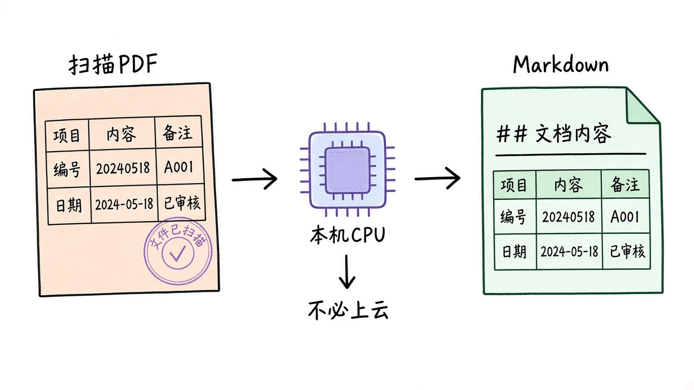
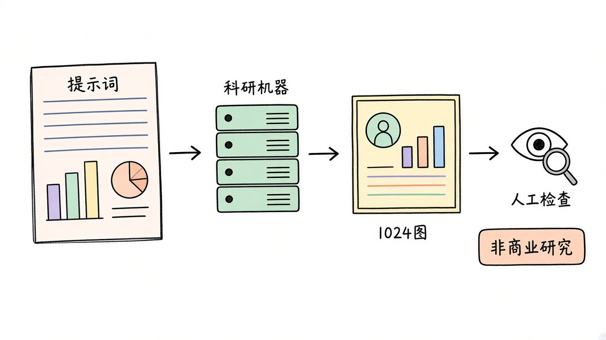
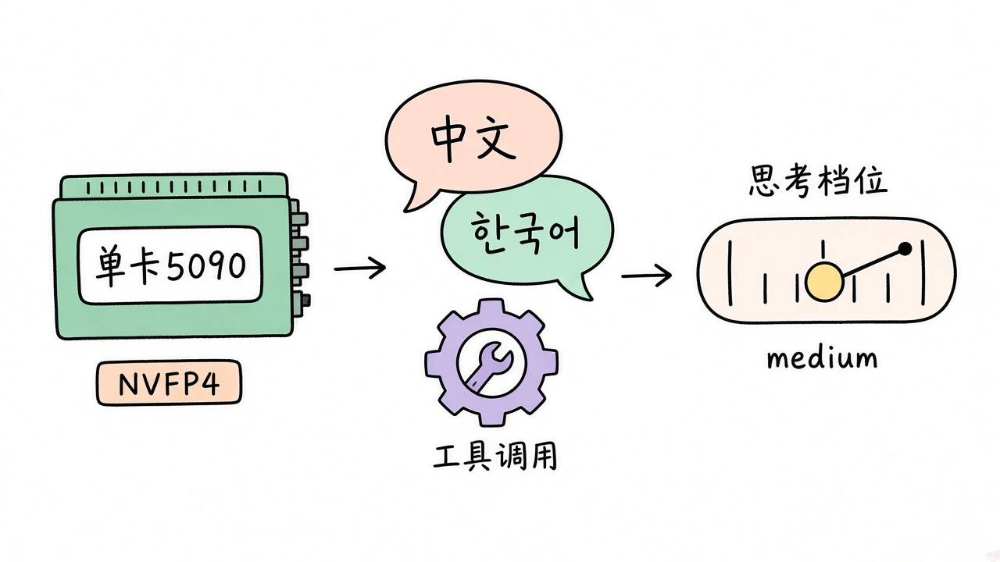

# 2026-11-26 Hugging Face 日报

今日三条：LlamaIndex 给 LiteParse 用的 CPU 文档解析栈 OCRia-nano-1；NVIDIA 刚放到 Hub 的栅格生图组件 Nemotron-Labs-Image-30B-A3B；以及 KRAFTON 从零训的开源 MoE Raon-1-mini。未重复周报和近几日已写过的 Inkling-2-Mini、Hy4-flash、ERNIE-5.5-Flash-Preview、Hy-MT3、IVE-4B、Ling-3.2-air、voice-isolator、DepthPro2、FastFrames-L 等。Sulphur-3 是 MiniMax H3 的 uncensored 衍生，今天不写。

---

## 1. llamaindex/OCRia-nano-1 — 800 万参数的本机文档解析，跑在 LiteParse 里

**介绍**  
[OCRia-nano-1](https://huggingface.co/llamaindex/OCRia-nano-1) 是 LlamaIndex 放到 Hub 上的一套约 8.1M 参数的文档解析模型，供开源本地解析器 [LiteParse](https://github.com/run-llama/liteparse) 使用，而不是一份自带推理脚本的独立模型。它从 4B 的文档 VLM OCRia-1 蒸馏而来（模型卡写约为其 1/500 参数），包含检测–识别 OCR 栈和一起做表格与版面的 LayoutNet：识别表格行列和跨单元格表头，并给标题、列表、题注、页眉页脚等分块。一行文字会由路由器送到拉丁、CJK、从右到左（阿拉伯语 / 希伯来语），或覆盖约 17 种其他文字的识别器。LiteParse 可在 Linux / macOS / Windows 的 CLI、Python、Node.js 上跑，也可经 WebAssembly 进浏览器和边缘环境。模型卡给出的 ParseBench-2 分数是 59.2，并写明高于 Indra（55.1）、Marker（52.5），也高于 LiteParse 走 Tesseract 的 48.7；速度数字是 16 vCPU 上每秒 27.8 页、单核每页 426 ms，约为其 Tesseract 路径的两倍——这些都是模型卡上的数字，不是这里实测。许可是基于 Open RAIL-M 的自定义条款（`license: other`），对竞争性文档解析 / OCR 产品等用途有限制，细节见模型卡里的 [LICENSE](https://huggingface.co/llamaindex/OCRia-nano-1/blob/main/LICENSE)。今早在 Trending 上约 230 likes。

**用法**  
模型卡：[huggingface.co/llamaindex/OCRia-nano-1](https://huggingface.co/llamaindex/OCRia-nano-1)。先装 LiteParse（`pip install liteparse`、`npm i -g @llamaindex/liteparse` 或 `cargo install liteparse`），再拉一次模型；`lit models pull` 会核对每个文件的 sha256，之后 OCRia-nano-1 就是 LiteParse 的默认 OCR 后端：

```bash
lit models pull ocria-nano                    # 一次：模型 + ONNX Runtime（模型卡写 60–75 MB）
lit parse scan.pdf --format markdown          # 用 OCRia-nano-1 做 OCR、表格和版面
lit parse scan.pdf --ocr-backend tesseract    # 这一次改走 Tesseract
```

Python：

```python
from liteparse import LiteParse, models

models.pull("ocria-nano")
result = LiteParse(ocr_backend="ocria-nano", output_format="markdown").parse("scan.pdf")
print(result.text)
```

Node.js 的入口在模型卡的 Quickstart 里。默认会去掉页眉页脚，可用 `--keep-headers-footers` 保留。

**应用场景**  
手头有一份扫描版合同 PDF，想在自己电脑上变成带表格的 Markdown：先 `lit models pull ocria-nano`，再 `lit parse contract.pdf --format markdown`，不必上云，也不用单独写推理脚本。



**推荐学习程度**：入门

---

## 2. nvidia/Nemotron-Labs-Image-30B-A3B — Pixel as Code 里刚公开的栅格生图组件

**介绍**  
[Nemotron-Labs-Image-30B-A3B](https://huggingface.co/nvidia/Nemotron-Labs-Image-30B-A3B) 是 NVIDIA 放到 Hub 上的自回归栅格生图模型，属于 Nemotron-Labs-VisualCreation 这套「Pixel as Code」框架：用离散视觉 token 表示画面，再用 SVG、HTML/CSS、绘图程序或文档标记表示可编辑结构。这次首发范围是生图组件和捆绑的视觉分词器（约 642M 的编解码器，16×16 patch，固定码本 196,560 个 Leech 格点向量）。生图模型从 Nemotron 3 Nano 初始化，总参数 30B、激活 3B。更完整的 harness 和 VisionCode 组件，模型卡里列为后续发布。许可是 NVIDIA License，限非商业研究与评估，全文见仓库 [LICENSE](https://huggingface.co/nvidia/Nemotron-Labs-Image-30B-A3B/blob/main/LICENSE)。模型卡写明加载会经 `trust_remote_code=True` 执行仓库代码，构图、解剖、物体数量和画面文字都可能出错，输出需人工检查。今早刚上 Trending，约 160 likes。

**用法**  
模型卡：[huggingface.co/nvidia/Nemotron-Labs-Image-30B-A3B](https://huggingface.co/nvidia/Nemotron-Labs-Image-30B-A3B)。文档中的参考示例跑在 Linux、Python 3.12、与 CUDA 13.0 兼容的驱动上，并且要求能看到四张 GPU（示例写的是 4× NVIDIA H100 80GB）。按模型卡安装锁定版本的 PyTorch / vLLM / Transformers 等，用 `hf download nvidia/Nemotron-Labs-Image-30B-A3B --local-dir ./Nemotron-Labs-Image-30B-A3B` 把包含 image-tokenizer 目录的整仓下下来，再使用模型卡 Quick start 里的 `infer.py` 生成一张 1024×1024 图。不要改它要求的 chat template、视觉 token 框、尺寸头和 L24SQ 解码协议。这不是 Diffusers 的 `AutoPipelineForText2Image`。部署前应钉住并审阅特定 revision。

**应用场景**  
要给一篇研究笔记配一张信息图，用文档里的参考脚本在科研机器上从提示词生成 1024×1024 栅格图，再人工检查构图和文字；商用或做成产品前，先读 NVIDIA 非商业研究许可。



**推荐学习程度**：进阶

---

## 3. KRAFTON/Raon-1-mini — 从零训的 30B-A4B MoE，NVFP4 可尝试单卡 5090

**介绍**  
[Raon-1-mini](https://huggingface.co/KRAFTON/Raon-1-mini) 是 KRAFTON AI 从零训练、Apache-2.0 发布的 MoE 语言模型。模型卡称为 30B-A4B，总参数 28.8B、每 token 激活 4.3B（128 个路由专家里选 6 个，另加 1 个共享专家）。25 层里 18 层是作者的 Raon Delta Attention，7 层是带 KV cache 的 MLA，原生上下文 262,144 tokens。内置思考，请求里可选 `none` / `low` / `medium` / `high` / `xhigh` / `max` 六档。训练语言包括韩、英、日、中、西、法、泰；模型卡强调韩语和多轮、带搜索的对话，并写明可对接 Hermes Agent、Pi 和 OpenCode 的工具调用。也提供 MXFP8 与 NVFP4 量化，卡片写 NVFP4 可在一张 32 GB 显存的 NVIDIA RTX 5090 上推理。模型卡上的 AIME 2026 96.7、HMMT Feb 2026 87.1、GPQA Diamond 86.0、MultiChallenge 64.9、BrowseComp Plus 55.9 是作者给出的数字，不是这里实测。今早在 Trending 上约 110 likes。

**用法**  
模型卡：[huggingface.co/KRAFTON/Raon-1-mini](https://huggingface.co/KRAFTON/Raon-1-mini)。Transformers 路径需要 `trust_remote_code=True`，模型卡示例钉的是 `transformers==5.16.1` 和 `accelerate==1.15.0`：

```python
from transformers import AutoModelForCausalLM, AutoTokenizer

model_id = "KRAFTON/Raon-1-mini"
tokenizer = AutoTokenizer.from_pretrained(model_id, trust_remote_code=True)
model = AutoModelForCausalLM.from_pretrained(
    model_id, dtype="auto", device_map="auto", trust_remote_code=True
)
messages = [{"role": "user", "content": "Tell me about KRAFTON AI."}]
inputs = tokenizer.apply_chat_template(
    messages, add_generation_prompt=True, tokenize=True,
    return_dict=True, return_tensors="pt",
    enable_thinking=True, truncate_history_thinking=False,
).to(model.device)
```

若走 vLLM 或 llama.cpp 的 OpenAI 兼容接口，在请求里设 `reasoning_effort`（如 `"max"`）；其他值会返回 HTTP 400。消费级单卡请先按模型卡选用 NVFP4 权重，不要默认按稠密 30B 的显存去估。

**应用场景**  
要在一张消费级 RTX 5090 上跑中韩英多轮、带工具调用的助手：先按卡片用 NVFP4 权重，再在请求里选 `reasoning_effort`（比如 medium 或 high），用官方 Transformers 或 vLLM 路径验证工具调用，而不是先上更大的稠密模型。



**推荐学习程度**：进阶
