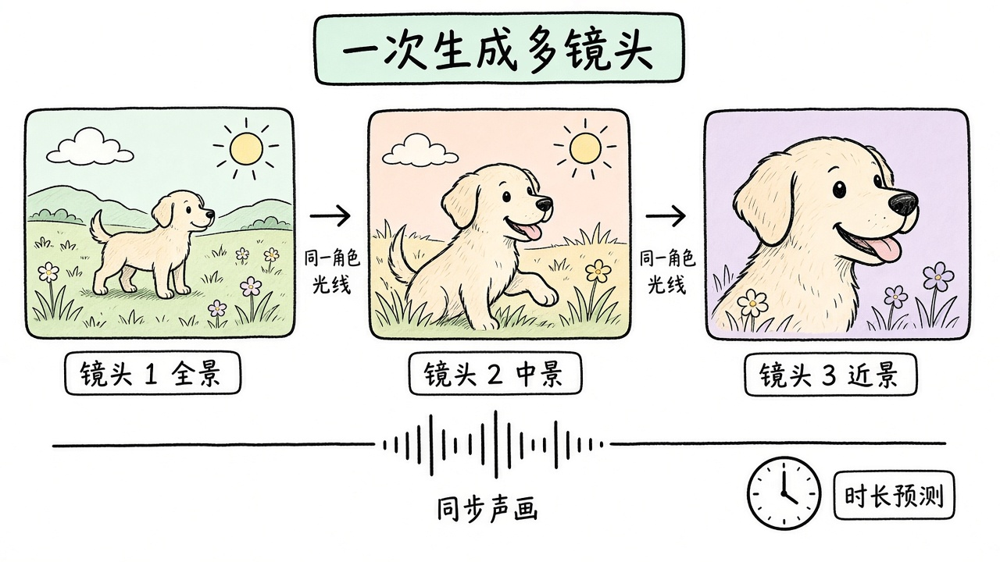
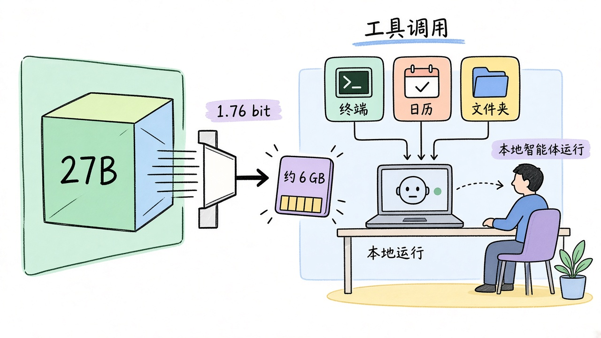

# 2026-11-27 Hugging Face 日报

今日三条：Lightricks 能一次生成多镜头并同步声画的 LTX-2.5；PrismML 的三值 27B 代理模型 Ternary Bonsai 2.5 GGUF；以及 Aleph Alpha 面向德语和英语的 Kolibri 1.1。未重复近几日与周报已写过的 Inkling-2-Mini、voice-isolator、OCRia-nano-1、Nemotron-Labs-Image、Raon-1-mini、ERNIE-5.5-Flash-Preview、Hy-MT3、DepthPro2、Hy4-flash、Ling-3.2-air 等。Inkling 与 Sulphur-3 的 uncensored 衍生今天不写。

---

## 1. Lightricks/LTX-2.5 — 一次生成相连的多镜头，画面和声音一起出

**介绍**  
[LTX-2.5](https://huggingface.co/Lightricks/LTX-2.5) 是 Lightricks 放到 Hub 上的开源权重视频与音频生成模型，按组件拆成 Comfy 对齐的 `.safetensors`，可在自己的机器上跑和微调。卡片把 2.5 的新能力写成：一次生成多个相连镜头，并尽量保持角色、环境、光线、声音和风格；按场景复杂度分配计算；新的扩散视频解码器；定制的 Gemma 4 12B 文本编码器；可选的提示词增强和时长预测；以及质量更接近完整模型的蒸馏权重。已建立的用途是从文本、图像和视频输入生成同步的视频和音频。许可是 LTX-2.x Community License：卡片写明年收入 1000 万美元以下的实体可免费商用和生产使用，微调权重的转让可能要另付许可，以仓库里的 [LICENSE](https://huggingface.co/Lightricks/LTX-2.5/blob/main/LICENSE) 为准。今早在 Trending 上约 1.36 万 likes，近 30 日下载约 304 万；权重在今天清晨前后还有更新。

**用法**  
模型卡：[huggingface.co/Lightricks/LTX-2.5](https://huggingface.co/Lightricks/LTX-2.5)。Python 路径走 [Lightricks/LTX-2](https://github.com/Lightricks/LTX-2) 的 `ltx-pipelines`（建议 Python ≥ 3.12、CUDA ≥ 12.7）。先登录 Hugging Face，再按组件下载蒸馏包：

```bash
git clone https://github.com/Lightricks/LTX-2.git
cd LTX-2
uv sync
source .venv/bin/activate
hf auth login
hf download Lightricks/LTX-2.5 \
  diffusion_models/ltx-2.5-22b-distilled-transformer-bf16.safetensors \
  text_encoders/gemma4-12b-with-proj-ltx-2.5-bf16.safetensors \
  vae/ltx-2.5-video-vae-bf16.safetensors \
  vae/ltx-2.5-audio-vae-bf16.safetensors \
  model_patches/ltx-2.5-duration-head-bf16.safetensors \
  latent_upscale_models/ltx-2.5-latent-spatial-upscaler-x2-bf16-1.0.safetensors \
  --local-dir models/ltx-2.5
```

蒸馏版文生视频示例（不设 `--num-frames` 时，由 duration head 按提示词估长度；若手动指定，需满足 `frames % 8 == 1`，宽高能被要求的倍数整除）：

```bash
uv run python -m ltx_pipelines.distilled \
  --transformer-path     models/ltx-2.5/diffusion_models/ltx-2.5-22b-distilled-transformer-bf16.safetensors \
  --text-encoder-path    models/ltx-2.5/text_encoders/gemma4-12b-with-proj-ltx-2.5-bf16.safetensors \
  --video-vae-path       models/ltx-2.5/vae/ltx-2.5-video-vae-bf16.safetensors \
  --audio-vae-path       models/ltx-2.5/vae/ltx-2.5-audio-vae-bf16.safetensors \
  --duration-head-path   models/ltx-2.5/model_patches/ltx-2.5-duration-head-bf16.safetensors \
  --spatial-upsampler-path models/ltx-2.5/latent_upscale_models/ltx-2.5-latent-spatial-upscaler-x2-bf16-1.0.safetensors \
  --prompt "A golden retriever running through a sunny meadow, cinematic lighting" \
  --seed 42 \
  --output-path output_distilled.mp4
```

ComfyUI 用卡片列出的 `comfy-int8-convrot` 或 NVFP4 权重；后者也可在 `ltx-pipelines` 里加 `--quantization nvfp4-prequant`（需 Blackwell / `ltx-kernels`）。完整组件表和在线 playground 见模型卡。

**应用场景**  
要一条带声音的短片，而且希望同一只角色在全景、中景、近景里连续出现：用 LTX-2.5 的蒸馏权重一次生成多镜头，并让时长预测按提示词估长度，而不是先分段生成再手动对齐声画。



**推荐学习程度**：进阶

---

## 2. prism-ml/Ternary-Bonsai-2.5-27B-GGUF — 约 6 GB 的 27B 三值模型，用来做带工具的本地代理

**介绍**  
[Ternary Bonsai 2.5 27B GGUF](https://huggingface.co/prism-ml/Ternary-Bonsai-2.5-27B-GGUF) 是 PrismML 11-24 放到 Hub 上的代理向发布：沿用 Qwen3.8-27B 的混合注意力和 Bonsai 2 的三值权重（卡片写 1.76 bit/权、约 5.93 GB，对照 FP16 的 53.8 GB），面向长程、带工具的任务。作者给出的数字是：五个工具调用基准平均 77.2，对照 FP16 的 77.7；在 Terminal-Bench 2.1、SWE-bench Verified、DeepSWE 上的代理编程约为 FP16 的 90%——这些都是模型卡上的数字，不是这里实测。`Q2_0` 可在上游 llama.cpp（release b11556 及以后）运行；`PTQ1_0` / `PQ2_0` 需要 [PrismML-Eng/llama.cpp](https://github.com/PrismML-Eng/llama.cpp) 分支，旧版上游加载 `Q2_0` 时可能不报错但输出是垃圾，先核对 `llama-cli --version`。许可是 Apache 2.0。今早在 Trending 上约 525 likes，近 30 日下载约 5.94 万。

**用法**  
模型卡：[huggingface.co/prism-ml/Ternary-Bonsai-2.5-27B-GGUF](https://huggingface.co/prism-ml/Ternary-Bonsai-2.5-27B-GGUF)。更完整、会随运行时更新的说明在 [PrismML-Eng/Bonsai-demo](https://github.com/PrismML-Eng/Bonsai-demo)；若与下面不一致，以它为准。NVIDIA 上作者用来做 decode 对比的是 `PTQ1_0`（需上述 fork）；Apple Silicon 上他们基准的是 `PQ2_0`。预编译包见 [fork 的 Releases](https://github.com/PrismML-Eng/llama.cpp/releases/latest)。

```bash
# 需要 fork 内核时：
# https://github.com/PrismML-Eng/llama.cpp/releases/latest
tar -xzf llama-<tag>-bin-<platform>.tar.gz -C bin --strip-components=1
hf download prism-ml/Ternary-Bonsai-2.5-27B-GGUF Ternary-Bonsai-2.5-27B-PTQ1_0.gguf --local-dir .
./bin/llama-cli -m Ternary-Bonsai-2.5-27B-PTQ1_0.gguf \
    -ngl 99 -fa on -c 32768 \
    --temp 1.0 --top-p 0.95 --top-k 20 --min-p 0 \
    -p "Explain quantum computing in simple terms." -n 16384
```

走上游 llama.cpp（b11556+）时改下 `Q2_0` 文件，参数相同。`-ngl 99` 是全层 GPU，`0` 为仅 CPU；上下文最长可到 262144。默认聊天模板的推理力度是 `xhigh`，所以 `-n` 不要设得太小。工具调用和 MTP 推理解码的现行步骤，看 Bonsai-demo。

**应用场景**  
要在消费级显存里跑一个会调终端、日历和本地文件的 27B 代理：先确认 llama.cpp 版本，拉约 6 GB 的 GGUF（NVIDIA 优先 `PTQ1_0` 分支二进制，或上游的 `Q2_0`），再按 Bonsai-demo 把工具调用跑通，而不是先上完整 FP16。



**推荐学习程度**：进阶

---

## 3. Aleph-Alpha/Kolibri-1.1 — 德英双语 MoE，长上下文更便宜，证据不足时可以说不知道

**介绍**  
[Kolibri 1.1](https://huggingface.co/Aleph-Alpha/Kolibri-1.1) 是 Aleph Alpha 在 11-23 发布的开源权重推理模型，总参数约 75B、每 token 激活约 3.44B，面向德语和英语，带显式推理模式和工具调用。1.1 在 1.0 的预训练检查点上继续做了稀疏注意力的中训与后训：原生上下文 262,144 tokens，最长可到 1,048,576（复杂任务建议不超过原生长度）。卡片给出的显存大约是 77.6 GB，最低配置写的是 2×H100、2×H200 或 1×B200 / B300。作者还写：相对 1.0，完成同组评测的 GPU 时间约为 1/3.4，综合分从 66.6 升到 73.2，并强调在资料不足以支持答案时更愿意说不知道——这些都是官方博客和模型卡上的数字，不是这里实测。权重按 Apache 2.0 发布（卡片说明许可覆盖本仓库公布的权重和配置，不自动延伸到架构与训练方法）。今早在 Trending 列表里约 190 likes。介绍博文：[Kolibri 1.1: More Efficient. More Capable.](https://aleph-alpha.com/en/blog/kolibri-1-1/)

**用法**  
模型卡：[huggingface.co/Aleph-Alpha/Kolibri-1.1](https://huggingface.co/Aleph-Alpha/Kolibri-1.1)。官方评测对应的是未经量化、用 vLLM 插件提供的版本。先装 [aleph-alpha-inference](https://github.com/Aleph-Alpha/aleph-alpha-inference)（或用镜像 `ghcr.io/aleph-alpha/aleph-alpha-inference`）：

```bash
pip install 'aleph-alpha-inference>=2'
vllm serve Aleph-Alpha/Kolibri-1.1 \
  --reasoning-parser kolibri1 \
  --tool-call-parser kolibri1 \
  --enable-auto-tool-choice
```

超过 262,144 tokens 时再加 `--max-model-len 1048576 --hf-overrides '{"max_position_embeddings": 1048576}'`。推荐采样：`temperature=1.0`、`top_p=0.99`、`top_k=128`。请求示例：

```python
from openai import OpenAI

client = OpenAI(base_url="http://localhost:8000/v1", api_key="EMPTY")
response = client.chat.completions.create(
    model="Aleph-Alpha/Kolibri-1.1",
    messages=[{"role": "user", "content": "Erkläre kurz, was ein Mixture-of-Experts-Modell ist."}],
    extra_body={"chat_template_kwargs": {"reasoning_effort": "high", "enable_thinking": True}},
)
print(response.choices[0].message.content)
```

`reasoning_effort` 可取 `low` / `medium` / `high`，或设为 `none` / `enable_thinking=false` 以关闭思考。官方量化见 [Aleph-Alpha/Kolibri-1.1-GGUF](https://huggingface.co/Aleph-Alpha/Kolibri-1.1-GGUF)；卡片写明官方评测数字只对未量化的 vLLM 路径成立。

**应用场景**  
要把一份很长的德英合同放到自有机房里做问答和引用：用 vLLM 插件拉起 Kolibri 1.1，上下文先控制在 26 万 token 以内，并允许它在材料不足时回答不知道，而不是默认上一个更大的多语言通用模型。


**推荐学习程度**：进阶
