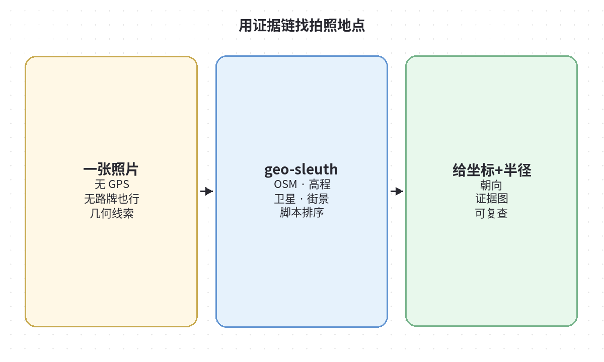
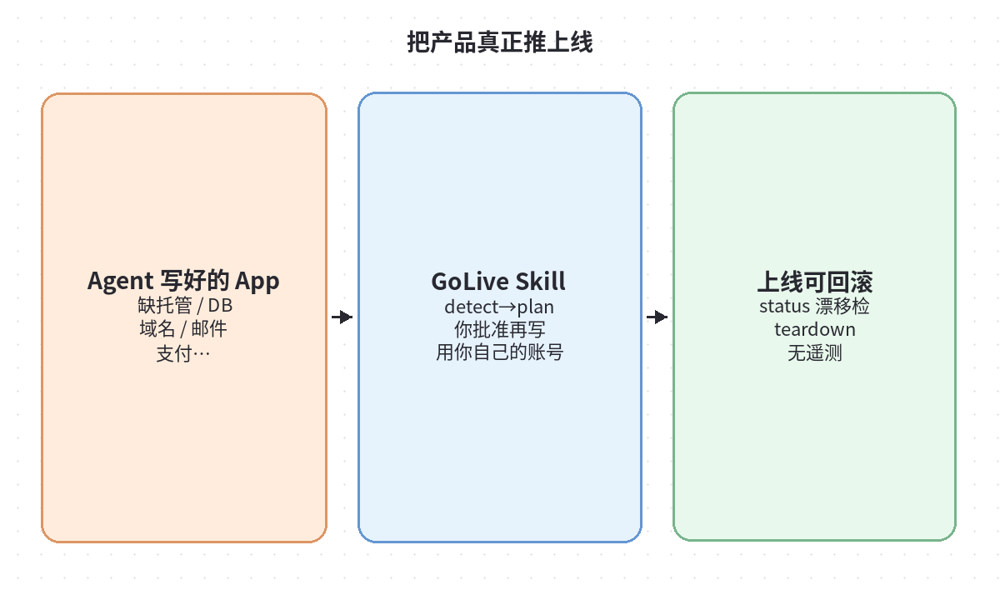
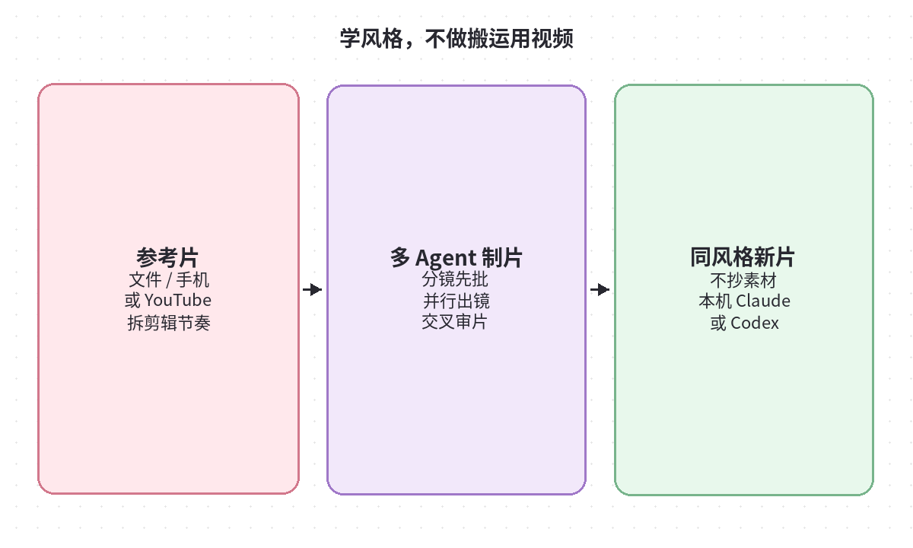
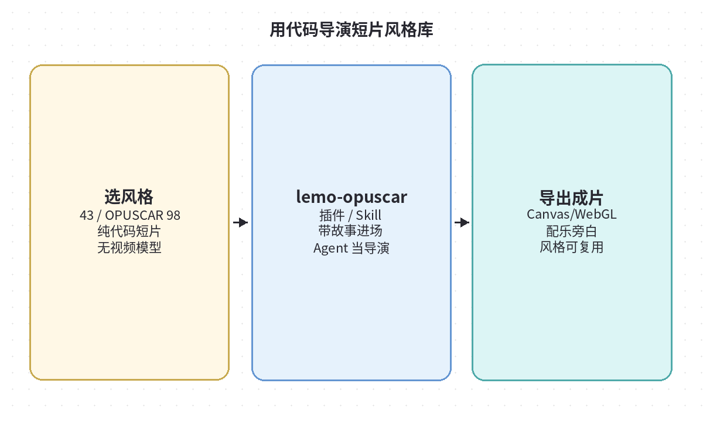
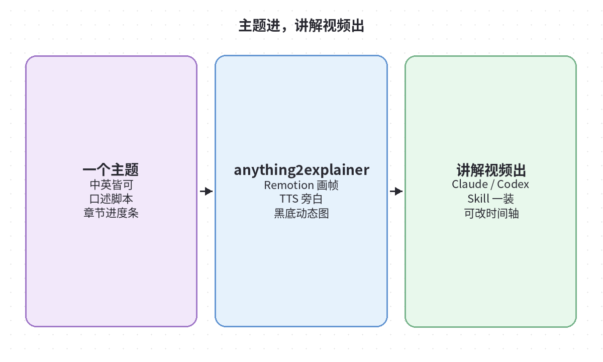

# 2026-10-12 Skills 日报

今日精选 5 个公开可靠的 Agent Skill / 技能仓（地理取证、上线运维、视频风格）。与当日周报及 10/10 日报条目不重复。

## 1. Oldcircle/geo-sleuth — 一张照片找拍摄位置（可出示证据）

**介绍**  
标准 Agent Skill：用 OSM 几何、高程天际线、卫星与街景等，在「没文字、没地标」时也能缩小相机位置与朝向，并要求每条结论指向会话里跑过的命令与产出文件。兼容 Claude Code / Codex / Cursor / Gemini CLI / OpenCode / Copilot 等读 `SKILL.md` 的 harness。

**用法**  
仓库：[github.com/Oldcircle/geo-sleuth](https://github.com/Oldcircle/geo-sleuth)。`npx skills add Oldcircle/geo-sleuth`，把照片交给 agent 并说「find where this photo was taken」；首次让 agent 跑 skill 内 `scripts/doctor.py` 补依赖。

**应用场景**  
开源情报/旅行回忆定位、需要可审计证据链的地理推理演示（注意隐私与合法使用）。

**推荐学习程度**：进阶

---

## 2. mikehasa/golive-skill — 用自己的账号把 Agent 产物真正上线

**介绍**  
开源 Agent Skill + 零依赖 Node CLI：检测应用缺什么（托管、DB、域名、邮件、支付等）→ 出计划 → **你批准后再写** → 校验；记录所有权、可 `status` 查漂移、可 `teardown`。无 GoLive 账号/后端/遥测。当前为 early alpha，覆盖 Vercel/Netlify、Supabase/Neon、部分 DNS/邮件/Stripe 测试模式等。

**用法**  
仓库：[github.com/mikehasa/golive-skill](https://github.com/mikehasa/golive-skill)。Node 20+：`npx skills add https://github.com/mikehasa/golive-skill --skill golive --global`，按提示选 agent。生产写入需计划 id 与确认旗标；先读 `docs/TRUST.md`。

**应用场景**  
Agent 能写出 Demo，但卡在「真账号上线」的个人开发者；适合当作可审查的上线清单执行器。

**推荐学习程度**：进阶

---

## 3. edenfunf/reelmimic — 参考片拆风格，多 Agent 做出新片

**介绍**  
给参考视频（文件/手机录像/YouTube）+ 一句话需求：先拆剪辑节奏、镜头、转场、构图与运镜，出分镜计划供你改，再由多路 Claude Code/Codex agent 并行制作并交叉审片。学的是做法，不搬原片素材；本机跑。

**用法**  
仓库：[github.com/edenfunf/reelmimic](https://github.com/edenfunf/reelmimic)。需 Node 22.18+、Python 3.10+、FFmpeg、Chrome 与已登录 Claude Code 或 Codex：`git clone` → `./install.sh` → `./start.sh`，浏览器打开 localhost:4318。密钥放 `~/.reelmimic/secrets.json`。

**应用场景**  
产品演示/音乐视频/解说短片要「像某条片的气质」又必须原创画面时。

**推荐学习程度**：深度

---

## 4. lemomo-ai/lemo-opuscar — 纯代码短片风格库（含 OPUSCAR 98）

**介绍**  
面向 Claude Code 等的短片 Skill/插件：大量电影感风格（含公开的 OPUSCAR 98 风格提示与导戏说明），每帧用代码（Canvas/WebGL 等）绘出，无视频生成模型、无成片素材库。作者强调风格为 Opus 5.5 调优。

**用法**  
仓库：[github.com/lemomo-ai/lemo-opuscar](https://github.com/lemomo-ai/lemo-opuscar) · 画廊：[lemomo-ai.github.io/lemo-opuscar](https://lemomo-ai.github.io/lemo-opuscar/)。Claude：`claude plugin marketplace add lemomo-ai/lemo-opuscar` 后 `claude plugin install lemo-opuscar@lemolab`；其他 agent 复制 `plugin/skills/lemo-opuscar/`。然后直接说风格与故事。

**应用场景**  
要可控、可改时间轴的讲解/品牌短片，或研究「代码动画 vs 像素视频模型」的工作流。

**推荐学习程度**：进阶

---

## 5. Vincentwei1021/anything2explainer — 主题进，黑底动态讲解视频出

**介绍**  
Claude Code / Codex skill：任意主题 → Remotion 代码绘制的黑底动态图形讲解片，带 TTS 旁白、字幕与章节进度条；中英均可。强调每一帧由代码画出，便于改时长与镜头。

**用法**  
仓库：[github.com/Vincentwei1021/anything2explainer](https://github.com/Vincentwei1021/anything2explainer)。`git clone` 后 symlink 到 `~/.claude/skills/` 或 `~/.codex/skills/`；装 ffmpeg、edge-tts（及可选 kokoro）等依赖后，让 agent 按 skill 生成。

**应用场景**  
内部培训、产品概念一分钟讲解、需要可版本管理「讲解片源码」的团队。

**推荐学习程度**：入门
