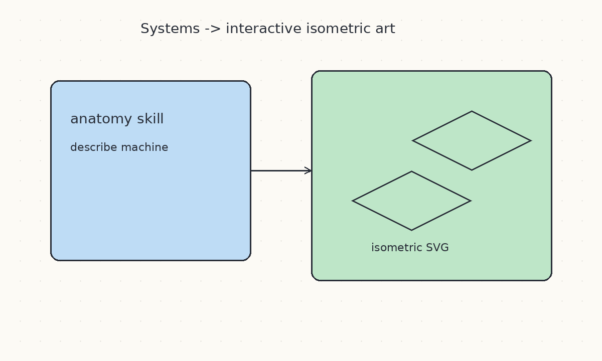
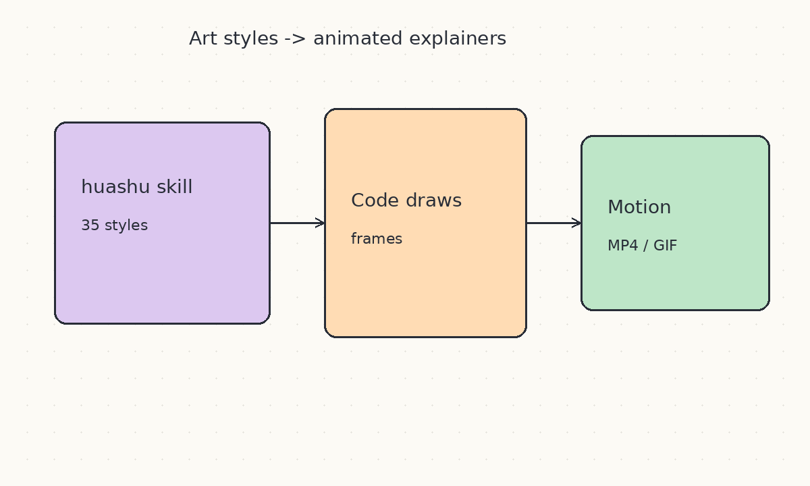
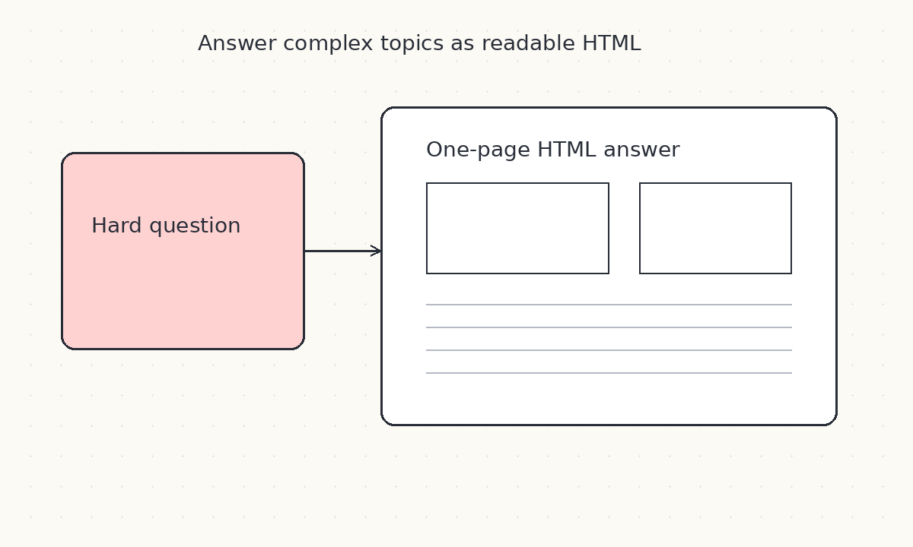
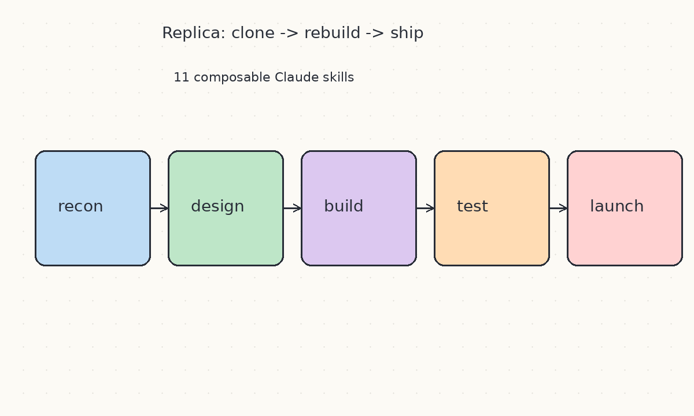
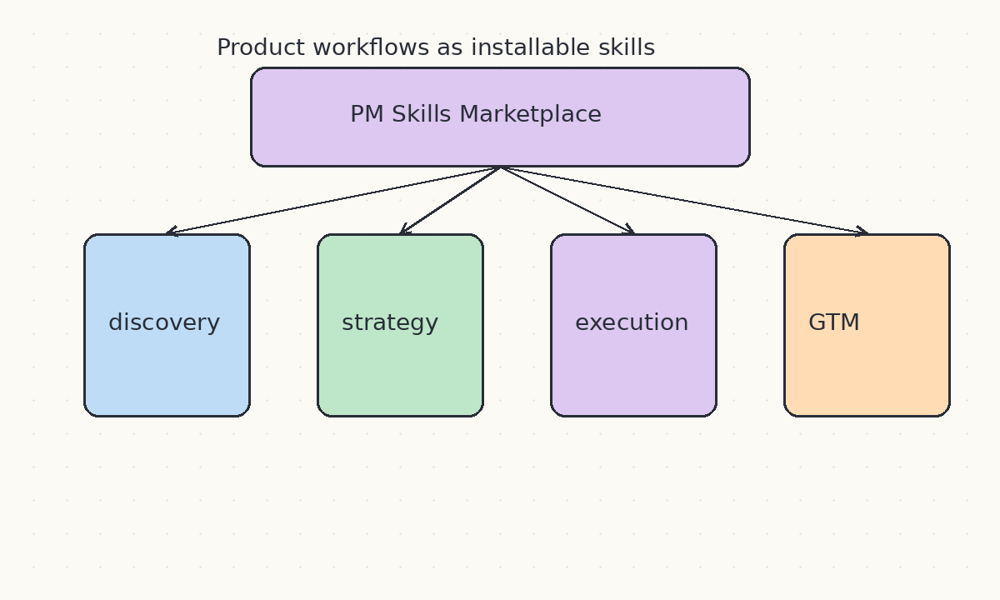
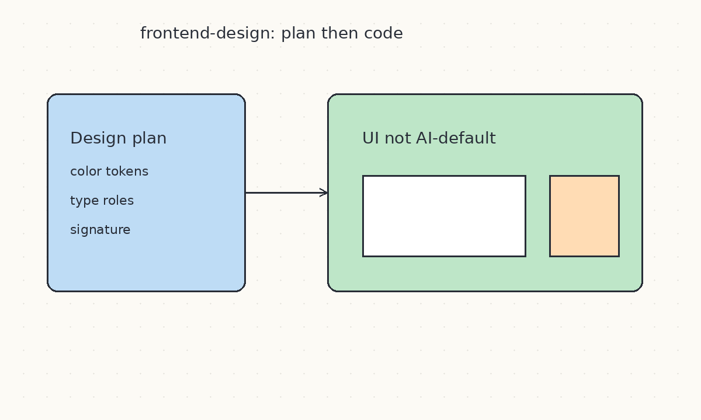
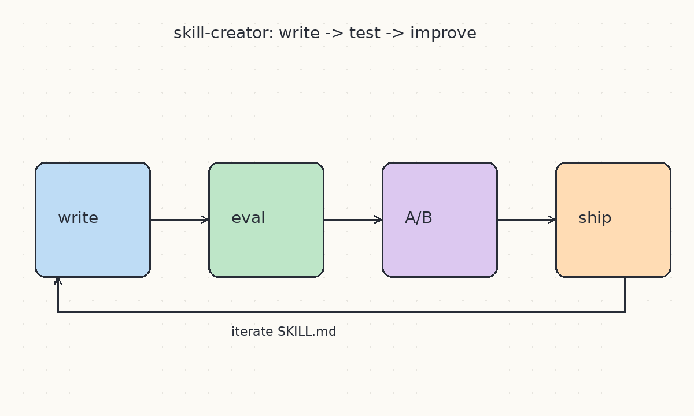
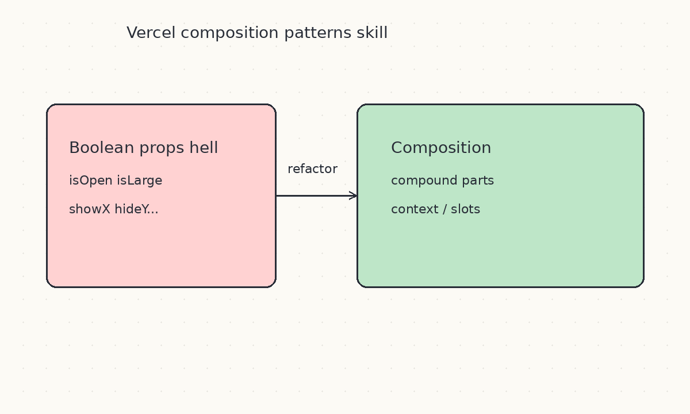
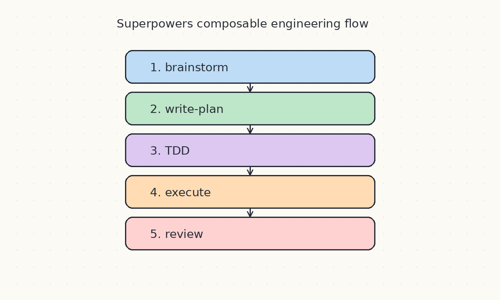
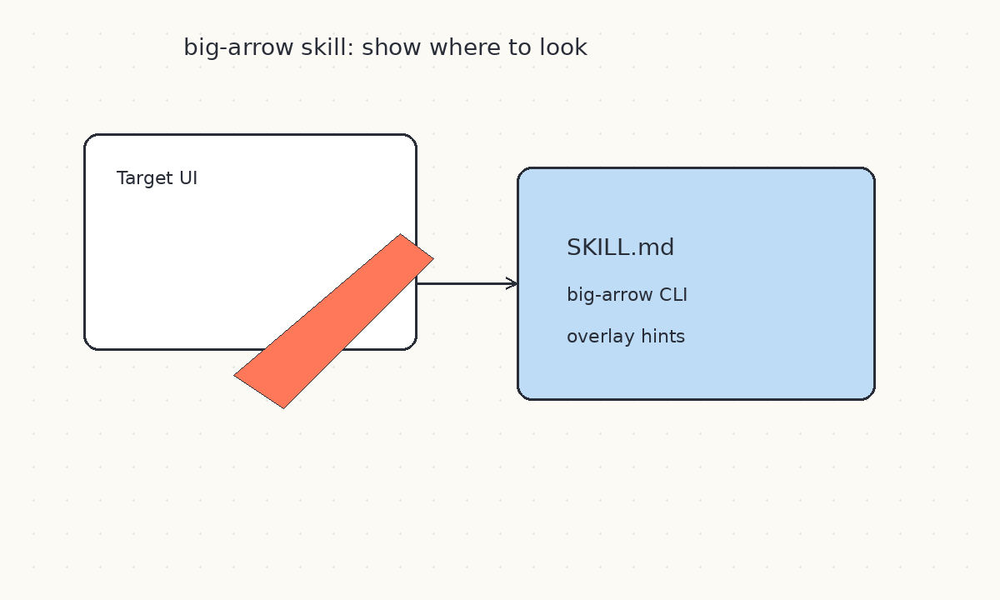

# 2026-10-12 Skills 周报

上周（10/5–10/11）精选 10 个值得装进 agent 工具箱的 Skill（本周新锐 + 官方/高星常青；来源含 Anthropic、Vercel、高质量 GitHub skill 仓库）。

## 1. wheresryan22/anatomy — 复杂系统的交互等距示意图 Skill

**介绍**  
10/8 创建即冲星：专用 agent skill，根据真实机器/复杂系统描述生成精细交互等距 SVG，可选 WebGL shader 与 3D 效果。把「讲清楚系统怎么转」从长文变成可点的结构图。

**用法**  
仓库：[github.com/wheresryan22/anatomy](https://github.com/wheresryan22/anatomy)（根目录 `SKILL.md`）  
拷进 `.cursor/skills/` / `.agents/skills/` / Claude skills 目录后，对 agent 说「用 anatomy 画某某系统」；按 SKILL 说明导出 SVG。

**应用场景**  
架构讲解、硬件/产线示意、技术博客配图、产品 onboarding 图解。

**推荐学习程度**：进阶

---

## 2. alchaincyf/huashu-art-motion — 用代码做艺术动画的 Skill

**介绍**  
10/6 前后热门中文 skill：35 种艺术风格 + 9 种解说语法，让 agent 用代码把静态画「动起来」（动画导出）。适合短视频科普与视觉叙事，而不是只会贴静图。

**用法**  
仓库：[github.com/alchaincyf/huashu-art-motion](https://github.com/alchaincyf/huashu-art-motion)  
安装其 `SKILL.md` 后，指定风格与解说语法，让 agent 生成可运行的动画脚本并导出。

**应用场景**  
技术科普短片、产品概念动画、教学演示、个人作品集动态页。

**推荐学习程度**：入门

---

## 3. QingYunA/answer-me-with-html — 用一页 HTML 回答难题

**介绍**  
让 agent 对复杂问题输出「真正能读的一页 HTML」而不是墙式 Markdown：带版式、分区与可选可视化。本周前后在 skill 圈扩散，适合需要分享/存档的深度回答。

**用法**  
仓库：[github.com/QingYunA/answer-me-with-html](https://github.com/QingYunA/answer-me-with-html)  
技能路径：`skills/answer-me-with-html/SKILL.md`；安装后对难题说「用 answer-me-with-html 回答」，可参考 `references/` 与 `scripts/am.mjs`。

**应用场景**  
调研结论页、架构决策记录、可转发的技术说明页、会议会后一页纸。

**推荐学习程度**：入门

---

## 4. Jakeschincariol/replica-skill — 十一件套「克隆任意 App」Skills

**介绍**  
MIT 开源的 11 个 Claude skills：从 `replica-recon` 反推产品，经 design/backend/build/test，到 deploy/launch，并包含对照「用户讨厌什么」的 diff/entrepreneur 视角。本周仍是「用 skill 流水线造船」的代表性集合。

**用法**  
仓库：[github.com/Jakeschincariol/replica-skill](https://github.com/Jakeschincariol/replica-skill)  
按子目录分别安装各 `SKILL.md`（如 `replica-recon`、`replica-build`、`replica-test`）；建议按 recon → design → build → test → launch 顺序触发。

**应用场景**  
竞品快速原型、内部工具仿写、教学演示「从观察到上线」的 agent 流水线。

**推荐学习程度**：深度

---

## 5. phuryn/pm-skills — 产品经理工作流 Skills 市场

**介绍**  
约 2.6 万星的 PM Skills Marketplace：9 个插件、60+ skills、40+ 链式命令，覆盖 discovery → strategy → execution → GTM → growth，以及 AI shipping。本周仍有推送，是非工程职能 skill 里最完整的一档。

**用法**  
仓库：[github.com/phuryn/pm-skills](https://github.com/phuryn/pm-skills)  
Claude Code：`claude plugin marketplace add phuryn/pm-skills` 后按需 `claude plugin install pm-product-discovery@pm-skills` 等；Cowork 可从 GitHub 添加 marketplace。常用命令如 `/discover`、`/strategy`、`/write-prd`。

**应用场景**  
PRD/OKR、用户访谈整理、竞品与 GTM、把 vibe-coded 应用整理成可上线材料。

**推荐学习程度**：进阶

---

## 6. frontend-design — 做出不像模板的前端 UI

**介绍**  
Anthropic 官方 skill：强迫 agent 先做设计计划（色彩 token、字体角色、布局与「签名元素」），再对照「会不会长得像默认奶油底+衬线」做修订，最后才写代码。专治 AI 味千篇一律的落地页与后台。

**用法**  
源码：[anthropics/skills → frontend-design](https://github.com/anthropics/skills/tree/main/skills/frontend-design)  
在 Claude Code / 兼容 Agent Skills 的工具中安装官方 skills 后触发；也可把 `SKILL.md` 拷进项目 `.cursor/skills/`。

**应用场景**  
营销站、仪表盘、产品壳子视觉改版；团队希望 agent 先出设计 token 再实现。

**推荐学习程度**：入门

---

## 7. skill-creator — 会写、会测、会迭代 Skill 本身

**介绍**  
官方「造 skill 的 skill」：从零写 SKILL.md、改描述触发精度、跑 eval、做 A/B 与 benchmark。把「重复粘贴同一段提示」升级成可版本化资产。Anthropic skills 仓库本周仍有同步更新。

**用法**  
源码：[anthropics/skills → skill-creator](https://github.com/anthropics/skills/tree/main/skills/skill-creator)  
安装后用 `/skill-creator`（或等价触发）生成/改进 skill；按仓库内 `scripts` 与 `references/schemas.md` 跑聚合 benchmark。

**应用场景**  
第二次想粘贴同一套流程时；团队要把领域 runbook 固化成可跨工具复用的 skill。

**推荐学习程度**：进阶

---

## 8. vercel-composition-patterns — 可扩展的 React 组合模式

**介绍**  
Vercel agent-skills 中的组合模式 skill：针对 boolean prop 爆炸，教 compound components、提升状态、context/slots 等，并覆盖 React 19 API 变化。比纯性能规则更偏「组件 API 怎么长寿」。

**用法**  
源码：[vercel-labs/agent-skills → composition-patterns](https://github.com/vercel-labs/agent-skills/tree/main/skills/composition-patterns)  
安装：`npx skills add vercel-labs/agent-skills --skill vercel-composition-patterns`  
对组件库或布尔 prop 成灾的模块说「按 composition patterns 重构」。

**应用场景**  
设计系统/组件库、复杂表单与对话框 API、React 19 迁移中的模式统一。

**推荐学习程度**：进阶

---

## 9. obra/superpowers — 可组合的工程方法论 Skill 集

**介绍**  
高星 agentic skills 框架：把 brainstorm → 写计划 → TDD/执行 → 调试/评审拆成可组合 skill，并强调计划能跨会话存活。适合「多文件功能别指望一轮聊完」。

**用法**  
仓库：[github.com/obra/superpowers](https://github.com/obra/superpowers)  
Claude Code：`/plugin marketplace add obra/superpowers-marketplace` 后 `/plugin install superpowers@superpowers-marketplace`；新开会话可用 `/superpowers:brainstorm`、`write-plan`、`execute-plan` 等。

**应用场景**  
跨多文件功能开发与重构、需要书面计划再动手的任务、给 agent 一套稳定工程节奏。

**推荐学习程度**：深度

---

## 10. big-arrow — 在屏幕上画箭头提示焦点的 Skill

**介绍**  
配套 [big-arrow-on-the-screen](https://github.com/franzenzenhofer/big-arrow-on-the-screen) 的 Agent Skill（10/8）：让 Claude Code / Codex 调用 CLI 在 macOS 上叠加大箭头、框与文字，帮助人类或下游步骤对齐「点哪里」。视觉反馈本身也是一种 skill 形态。

**用法**  
Skill：[skill/big-arrow/SKILL.md](https://github.com/franzenzenhofer/big-arrow-on-the-screen/tree/main/skill/big-arrow)  
先装 CLI，再把 skill 目录拷进 agent skills 路径；在电脑控制/演示任务中让 agent「用 big-arrow 标出目标控件」。

**应用场景**  
UI 自动化调试、远程结对时的焦点提示、agent 操作桌面前的可视化确认。

**推荐学习程度**：入门
