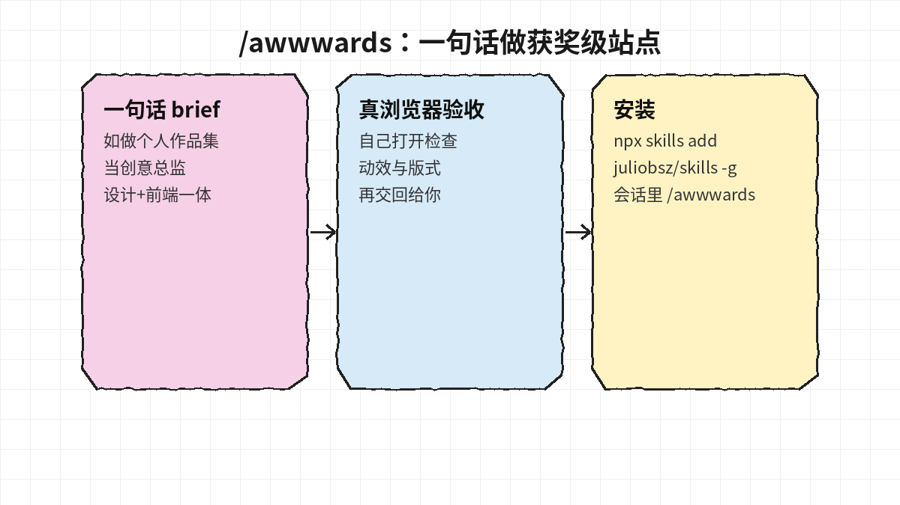
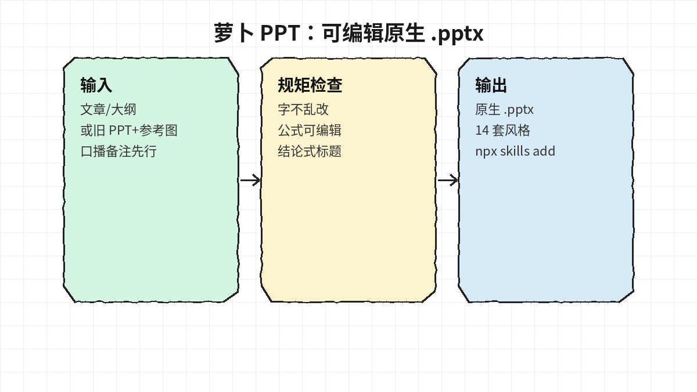
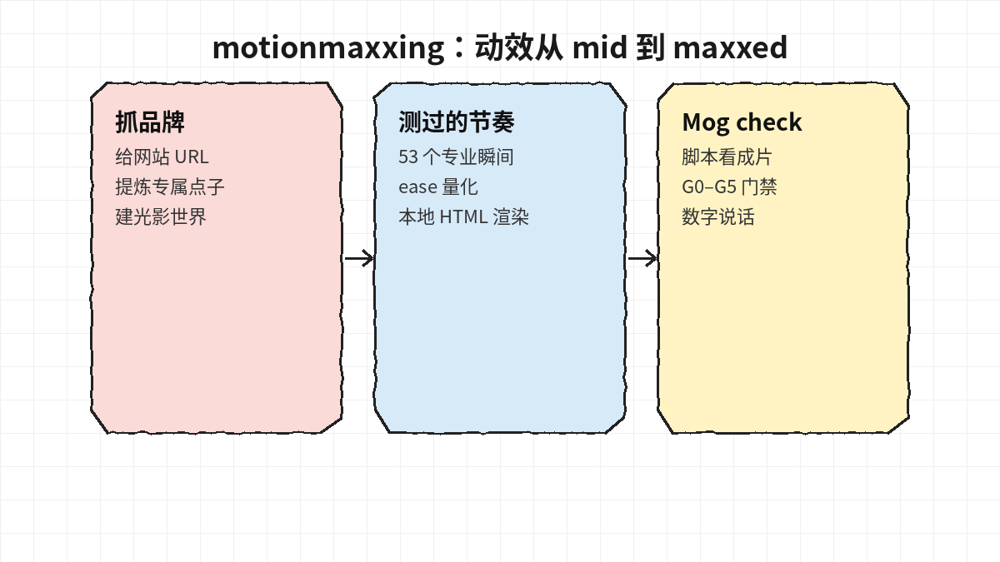
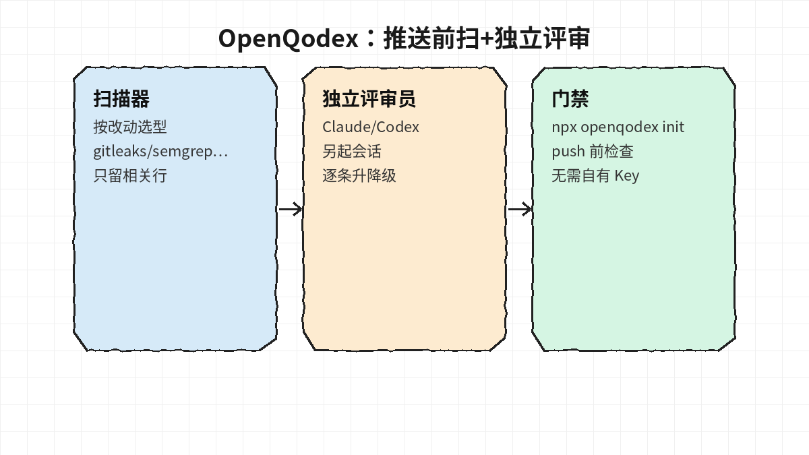
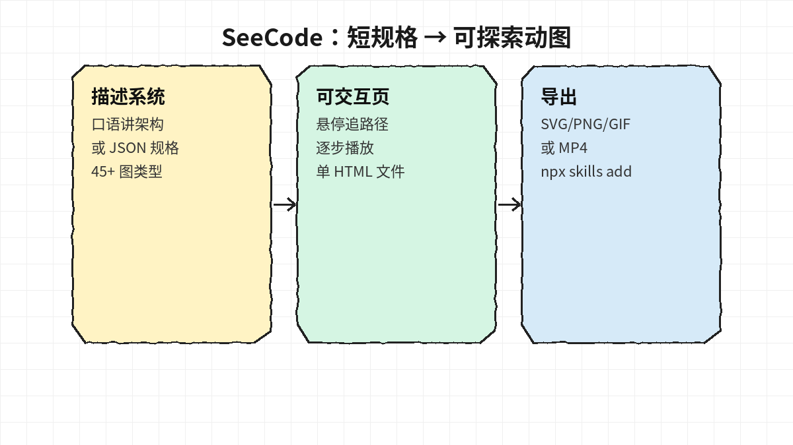

# 2026-10-13 Skills 日报

今日精选 5 个公开可靠的 Agent Skill（获奖级站点、原生 PPT、动效、推送前评审、架构图）。与黑名单及往日日报不重复。

## 1. juliobsz/skills — /awwwards：一句话做出获奖级网站

**介绍**  
10/12 开源的 Agent Skill：一句 brief（如「做我的作品集」）后，agent 兼任创意总监/设计/创意开发，并在真实浏览器里自检再交回。兼容 Claude Code / Codex / Cursor 等读 `SKILL.md` 的 harness；MIT；Node ≥ 22.20。

**用法**  
仓库：[github.com/juliobsz/skills](https://github.com/juliobsz/skills)。`npx skills add juliobsz/skills -g`，新开会话后打 `/awwwards` 或直接要站点。Claude 也可用 `/plugin install awwwards --marketplace juliobsz/skills`。可选搭配（非必需）他人 anatomy skill；本条只推 awwwards 本体。

**应用场景**  
个人站/活动页/作品集要「像参赛作品」而不是模板站，又希望 agent 自己验收动效与版式。

**推荐学习程度**：进阶

---

## 2. zhouwei713/luobo-ppt — 萝卜 PPT：生成/美化可编辑原生 .pptx

**介绍**  
中文友好的 PPT Skill：文章/大纲/口播稿 → 结论式标题 + 备注 + 排版；或朴素 pptx + 参考图 → **原文一字不改**换配色/版式/图标（程序绘图，不接生图模型）。强调公式可编辑、字号稳定、交付前脚本自检。MIT。

**用法**  
仓库：[github.com/zhouwei713/luobo-ppt](https://github.com/zhouwei713/luobo-ppt)。对 agent 说「帮我安装这个 skill：https://github.com/zhouwei713/luobo-ppt」，或 `npx skills add zhouwei713/luobo-ppt`，或跑 `bash install.sh`（可 `--agent codex`）。装后让 agent 按题目生成或按参考图美化。

**应用场景**  
汇报/课件要「真能改字的 pptx」，讨厌整页位图幻灯片，或要批量统一视觉又不让 AI 偷偷改文案。

**推荐学习程度**：入门

---

## 3. Tejashmakwana/motionmaxxing — 把 AI 广告片从 mid 拉到 maxxed

**介绍**  
动效「医美」式 Skill：给网站 → 抓品牌、找只有该品牌能讲的点子、按 53 个专业运动瞬间量化 ease，本地用 HTML/Chrome/ffmpeg 渲染，再用脚本做 Mog check（G0–G5）。定位 launch film / 产品 promo / 动能字标；Apache-2.0；early release。

**用法**  
仓库：[github.com/Tejashmakwana/motionmaxxing](https://github.com/Tejashmakwana/motionmaxxing)。需 Node 22+、Python 3、ffmpeg、Chrome。Claude：`git clone … ~/.claude/skills/motionmaxxing && bash …/install.sh`。其他 agent 把含 `SKILL.md` 的目录挂上即可；`bash scripts/providers.sh` 检查环境。

**应用场景**  
产品发布短片总是「左边标题右边卡片淡入淡出」，想用可度量门禁逼出设计师级节奏时。

**推荐学习程度**：深度

---

## 4. openqodex/openqodex — 推送前：扫描器 + 独立 AI 评审员

**介绍**  
本机代码评审：先按改动跑 gitleaks/semgrep 等扫描器，再**另起** Claude Code 或 Codex 会话当评审员（默认不让「写代码的那个」自评），强制对每条 finding 升降级并说明理由；可装 push 门禁。不收自有 API Key（用你已登录的 agent）。Apache-2.0；Node 22+。

**用法**  
仓库：[github.com/openqodex/openqodex](https://github.com/openqodex/openqodex)。人：`npx openqodex init`；agent：`npx -y openqodex@0.12.0 init --yes --agent <host>`（`claude-code`/`codex`/`cursor`/`cline`）。只装 skill：`npx skills add openqodex/openqodex -g`。之后对 agent 说「用 openqodex 审我的改动」或跑 `~/.openqodex/bin/openqodex review`。

**应用场景**  
个人或小团队要在 `git push` 前多一道「扫描仪 + 第二双眼睛」，又不想另开商业代码审查账号。

**推荐学习程度**：进阶

---

## 5. Aryanutkarsh/SeeCode — 短规格生成可探索、可导出的架构动图

**介绍**  
Agent Skill + 零依赖运行时：口语或短 JSON → 编辑级可交互动图（悬停追路径、逐步播放），45+ 图类型（架构/时序/ER/泳道等），可导出 SVG/PNG/GIF/MP4。MIT。

**用法**  
仓库：[github.com/Aryanutkarsh/SeeCode](https://github.com/Aryanutkarsh/SeeCode)（README 指向同仓）。Claude：`/plugin marketplace add Aryanutkarsh/seecode` 后 `/plugin install seecode@seecode`。其他：`npx skills add Aryanutkarsh/seecode -g`。然后说「用 SeeCode 画出结账链路：浏览器→API→Postgres→Stripe→Kafka」。

**应用场景**  
设计评审/文档/slides 需要「能点能导出」的系统图，而不是静态 Mermaid 截图。

**推荐学习程度**：入门
