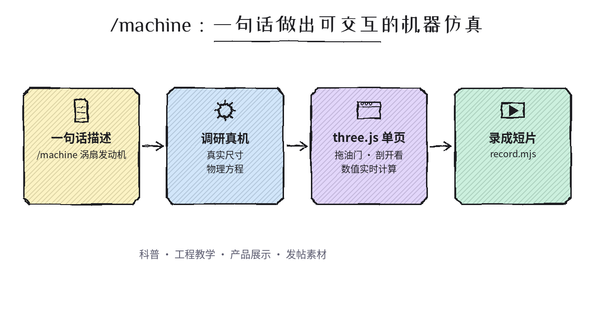
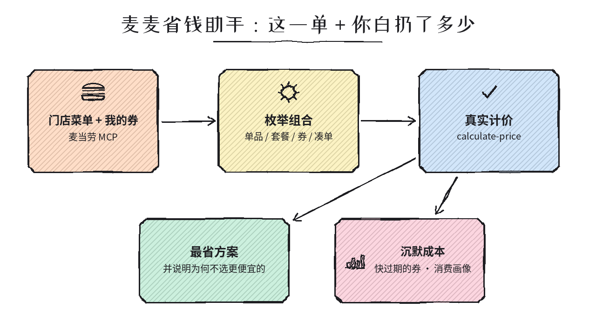
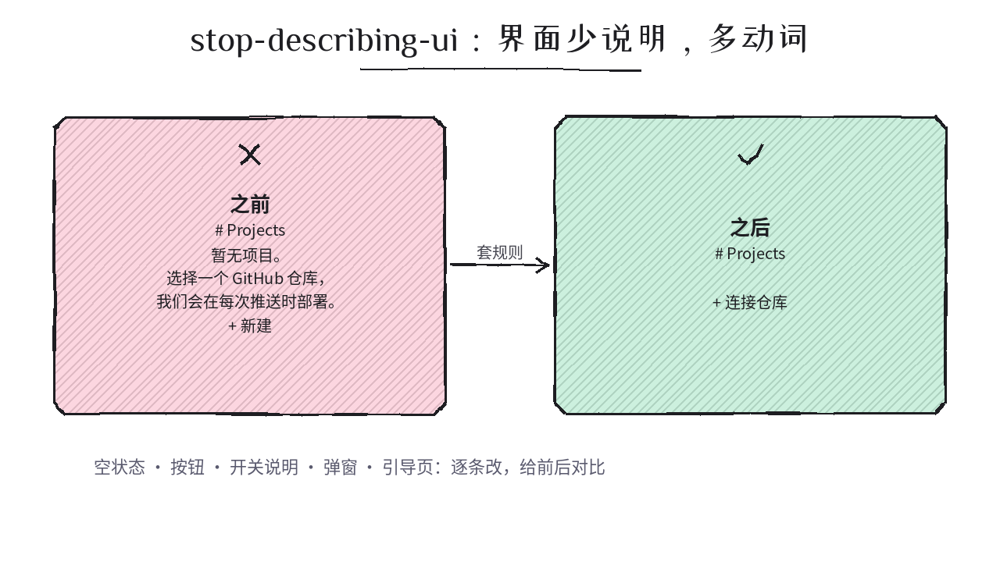
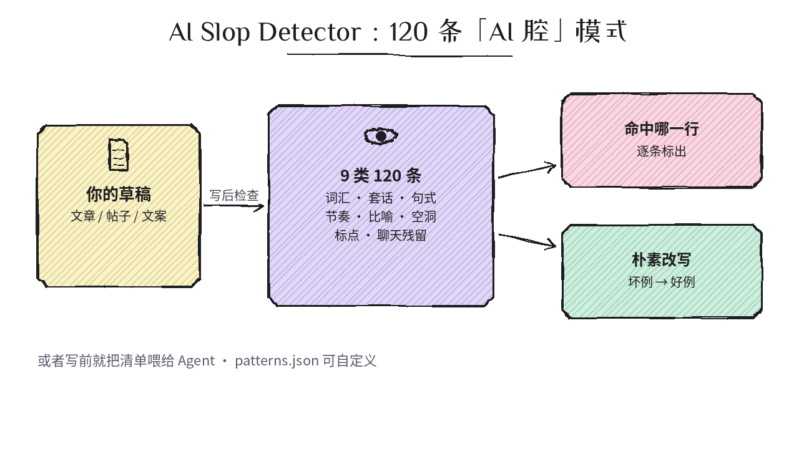
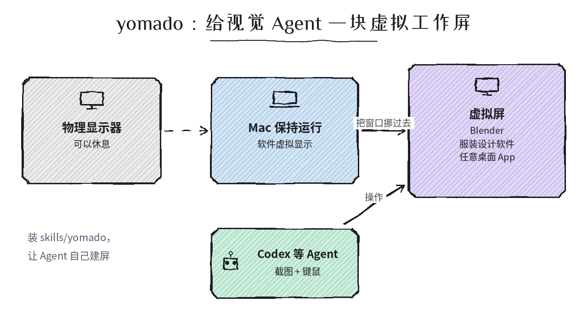

# 2026-10-14 Skills 日报

今日精选 5 个公开可靠的 Agent Skill（交互式机器仿真 / 麦当劳 MCP 省钱 / 界面文案瘦身 / 去 AI 腔清单 / 视觉 Agent 虚拟屏）。与黑名单及往日日报不重复。

## 1. AirsupHQ/machine-skill — /machine：一句话做出跑真实物理的交互式机器仿真

**介绍**  
10/13 开源（MIT）的标准 Agent Skill（仓库根即 `SKILL.md`）：输入「/machine 涡扇发动机」，Claude 先调研真机尺寸和背后物理，再生成**单个 HTML 的 three.js 写实交互仿真**——拖油门推力由循环方程实时算出，可剖开看截面；附 `scripts/record.mjs` 把仿真录成可发的短片。同团队另有 factory-skill（一句话做工厂 3D 仿真）。

**用法**  
仓库：[github.com/AirsupHQ/machine-skill](https://github.com/AirsupHQ/machine-skill)。全局装：`npx skills add AirsupHQ/machine-skill -g -a claude-code`（装到 `~/.claude/skills/machine`）；单项目去掉 `-g`。也可 `git clone https://github.com/AirsupHQ/machine-skill.git ~/.claude/skills/machine`。会话中若没识别到，跑 `/reload-skills`，然后 `/machine a mechanical watch movement, the escapement ticking`。

**应用场景**  
科普/工程教学的可交互演示、硬件产品展示页、技术类自媒体的「会动的原理图」素材。

**推荐学习程度**：入门

---

## 2. Ayzzz123/mcd-coupon-strategist — 麦麦省钱助手：基于麦当劳中国 MCP 的点餐成本 Skill

**介绍**  
近几天 GitHub 冒出一波「麦当劳 MCP Skill」，这个最完整（10/10 开源，MIT，零第三方依赖、带测试）：拉当前门店实时菜单与你账户可用券，枚举单品/套餐/券/凑单组合，逐方案调 MCP `calculate-price` **真实计价**，给出最省方案并解释为何不推荐更便宜但吃不饱的选项；长期侧算「沉默成本」——快过期的券、客单价偏高、该改套餐的单品。

**用法**  
仓库：[github.com/Ayzzz123/mcd-coupon-strategist](https://github.com/Ayzzz123/mcd-coupon-strategist)。先离线试：`git clone https://github.com/Ayzzz123/mcd-coupon-strategist.git && cd mcd-coupon-strategist && python demo.py`（读录制好的真实 MCP 响应，不需 Token、不联网）。真用：到 [open.mcd.cn/mcp](https://open.mcd.cn/mcp) 手机号登录拿 MCP Token，按 `mcp-config.example.json` 配 streamable HTTP（`https://mcp.mcd.cn`，Bearer Token），在支持 MCP 的 agent 客户端启用后直接对话。

**应用场景**  
常点麦当劳想少花冤枉钱；或想看一个「MCP 工具 + Skill 编排 + 真实计价」的小而完整的中文参考实现。

**推荐学习程度**：入门

---

## 3. artouc/stop-describing-ui — 把界面里「解释自己」的文案砍掉

**介绍**  
10/11 开源（MIT）的单一 Skill：写或审 UI 文案时（标题、空状态、按钮、开关说明、帮助文字、弹窗、横幅、引导页），用一组规则把「描述功能/副作用/后端行为」的句子换成**具体动词、控件、图标与留白**——例如「暂无项目。选择一个 GitHub 仓库，我们会在每次推送时部署。+ 新建」→「+ 连接仓库」；多个后果只留最关键那一条。审稿模式输出前后对比。

**用法**  
仓库：[github.com/artouc/stop-describing-ui](https://github.com/artouc/stop-describing-ui)。`npx skills add artouc/stop-describing-ui`；规则全文在 `skills/stop-describing-ui/SKILL.md`。之后让 agent「按 stop-describing-ui 审一遍这个页面的文案」。

**应用场景**  
agent 生成的前端页面总爱塞满说明文字；做 SaaS 后台、设置页、空状态时想要更干净的产品文案。

**推荐学习程度**：入门

---

## 4. FeedHive/ai-slop-detector — 120 条「AI 腔」写作模式清单 + Skill

**介绍**  
FeedHive 10/12 开源（MIT）：9 大类 120 条让文字读起来像 AI 糊出来的模式（词汇、套话、句式、结构节奏、比喻、空洞内容、标点格式、聊天残留、社媒/LinkedIn 腔），每条有解释、坏例与朴素改写。它不判断「是不是 AI 写的」，而是标出模式——一段里扎堆出现才是问题。附 `patterns.json` 结构化数据可自定义后重建。

**用法**  
仓库：[github.com/FeedHive/ai-slop-detector](https://github.com/FeedHive/ai-slop-detector)。Claude Code：`git clone https://github.com/FeedHive/ai-slop-detector.git && cp -r ai-slop-detector/skills/ai-slop-detector ~/.claude/skills/`；Codex 等可直接对 agent 说「Install the AI Slop Detector skill from https://github.com/FeedHive/ai-slop-detector」。写前喂给 agent 作约束，或写后让它逐行列出命中模式。

**应用场景**  
用 agent 写博客、推文、产品文案、周报，想在发布前去掉套话；也适合做团队写作规范的底稿（英文为主，思路可迁移到中文）。

**推荐学习程度**：入门

---

## 5. chekusu/yomado — 给视觉 Agent 一块 macOS 虚拟工作屏（附自配置 Skill）

**介绍**  
10/10 开源（MIT，Apple Silicon，已公证的实验版）：为 computer-use 类 agent 提供**软件虚拟显示器**——把 Blender、服装设计软件等没有合适 MCP 的桌面 App 挪到虚拟屏上，agent 照常截图 + 键鼠操作，物理显示器可以休息、不和你抢屏幕。仓库内 `skills/yomado/SKILL.md` 让 agent 自己创建虚拟屏、安排窗口。使用私有 macOS API，系统更新可能影响兼容；熄屏长时间无人值守尚未验证。

**用法**  
仓库：[github.com/chekusu/yomado](https://github.com/chekusu/yomado)。从 [Releases](https://github.com/chekusu/yomado/releases) 下 Apple Silicon 包并授予辅助功能权限；Codex 把仓库的 `skills/yomado` 目录放进 `~/.codex/skills`（其他 agent 按各自机制读取同一 `SKILL.md`），下一轮对话即可让 agent「用 yomado 开一块工作屏」。

**应用场景**  
让 agent 长时间操作 3D/设计类桌面软件，又不想它占用你正在用的显示器或依赖硬件假显示器插头。

**推荐学习程度**：进阶
