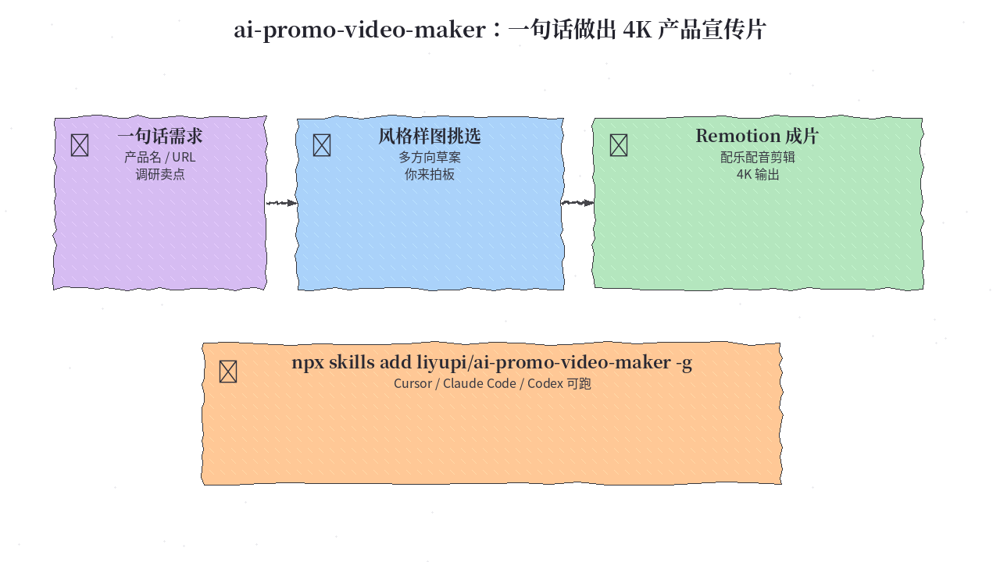
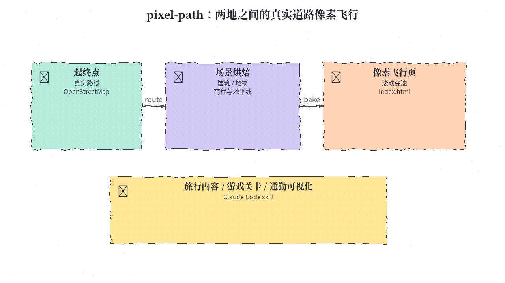
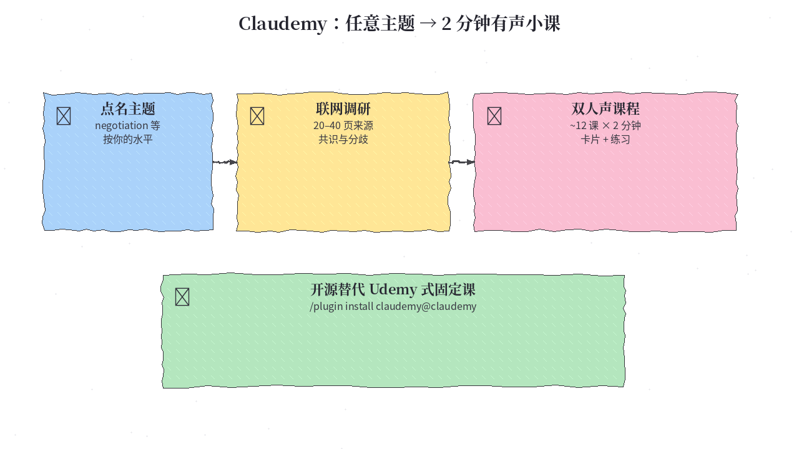
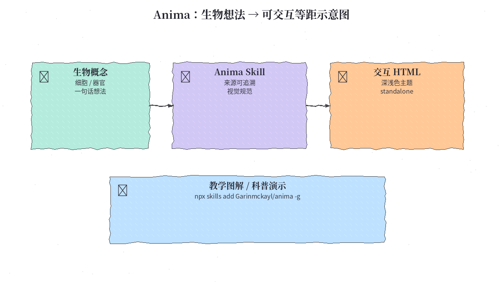
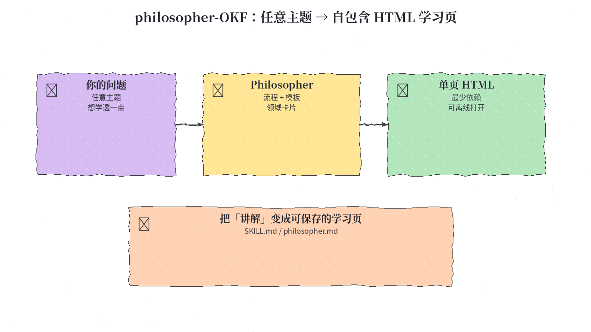

# 2026-10-15 Skills 日报

今日精选 5 个可安装的 Agent Skill（产品宣传片 / 真实道路像素飞行 / 有声小课 / 生物交互图解 / 单页 HTML 精讲）。避开已在日报与 10/12 周报写过的 anatomy、big-arrow 等条目。

## 1. liyupi/ai-promo-video-maker — 一句话让 AI 调研、选风格、剪出 4K 产品宣传片

**介绍**  
10/9 开源（MIT，★260+）：把「调研卖点 → 多风格样图给你挑 → 截图/配乐/配音/剪辑/校验」写成 agent 可执行的规范（`AGENTS.md` + Remotion 模板 + 辅助脚本）。可克隆仓库直接做，也可 `npx skills` 装成全局 Skill。成品风格不靠死模板，而是按产品提案再由你选定。需要 Node 18+、Python 3.9+、ffmpeg。

**用法**  
仓库：[github.com/liyupi/ai-promo-video-maker](https://github.com/liyupi/ai-promo-video-maker)。  
```bash
# 方式 A：当 Skill
npx skills add liyupi/ai-promo-video-maker -g

# 方式 B：克隆工程
git clone https://github.com/liyupi/ai-promo-video-maker.git
cd ai-promo-video-maker
pip install -r template/requirements.txt
playwright install chromium
python3 template/scripts/doctor.py   # 只检查、不安装
```
然后用 Cursor / Claude Code / Codex 打开目录，一句话说清要宣传的产品即可；成片在 `outputs/<项目名>/`。

**应用场景**  
开源项目、SaaS、课程需要一支像样宣传片，又不想外包整套后期。



**推荐学习程度**：进阶

---

## 2. jonwheatley/pixel-path — 任意两地：真实道路的像素风第一人称飞行

**介绍**  
10/12 开源：Claude Code skill。给定起终点，按真实路线（OpenStreetMap + 高程）烘焙沿途建筑、地表、地标与地平线，再用 RetroDiffusion 等生成区域美术，导出可滚动变速的 `index.html`。提供 placeholders（免费占位）到更高细节档；美术按「区域数」计费。适合内容、游戏关卡或通勤可视化，而不是又一个聊天 prompt。

**用法**  
仓库：[github.com/jonwheatley/pixel-path](https://github.com/jonwheatley/pixel-path)（含 `SKILL.md`）。把 skill 装进 Claude Code 的 skills 目录，或按仓库说明添加后，对 Claude 说例如：`a pixel path from Bath to Bristol`，先确认细节档与费用估算，再生成。打开产出目录里的页面需本地静态服务器。

**应用场景**  
旅行回顾、路线预告、把真实公路做成像素小游戏关卡或直播背景。



**推荐学习程度**：入门

---

## 3. assafkip/claudemy — 开源「点菜式」有声小课：主题 → 约 12×2 分钟双人声课程

**介绍**  
10/14 开源（MIT）：Claude Code skill。你点一个主题（如 negotiation），它联网读 20–40 页来源、合并共识与分歧，做成约 12 课、每课约 2 分钟的双人声课程 + 一页卡片 + 小练习，并拒绝「引用了没读过的页」。可选 ElevenLabs；没有 key 则退回 macOS 系统语音。定位是可完成的短课，不是 40 小时录像课目录。

**用法**  
仓库：[github.com/assafkip/claudemy](https://github.com/assafkip/claudemy)。  
```text
/plugin marketplace add assafkip/claudemy
/plugin install claudemy@claudemy
```
或把 `skills/claudemy/` 拷到 `~/.claude/skills/`，或下载 `dist/claudemy.skill`。依赖：Claude Code（需联网搜索）、`pip install beautifulsoup4`、`ffmpeg`；可选 `ELEVENLABS_API_KEY`。

**应用场景**  
临时要补一块可执行知识（谈判、定价、某技术主题），想要有出处的短音频课而不是长视频订阅。



**推荐学习程度**：入门

---

## 4. Garinmckayl/anima — 生物想法 → 带出处的交互式等距示意图

**介绍**  
10/11 开源（MIT）：Claude Code skill。输入一个生物学概念，按 `SKILL.md` 的视觉与溯源规则，生成可独立打开的交互 HTML 等距图（深/浅色主题）。强调来源可核对与安全边界（别当成医疗诊断）。适合教学与科普演示，和「只会生成一张静图」的流程不同。

**用法**  
仓库：[github.com/Garinmckayl/anima](https://github.com/Garinmckayl/anima)。  
```bash
npx skills add Garinmckayl/anima -g -a claude-code
```
装好后直接向 Claude 描述要画的生物结构/过程；示例页面见仓库 `examples/`。

**应用场景**  
备课、科普文章、内部培训需要一张能点、能讲清结构的生物示意图。



**推荐学习程度**：入门

---

## 5. frypan05/philosopher-OKF — 任意主题 → 一份自包含 HTML 精讲学习页

**介绍**  
10/8 开源：把「像哲学家/老师一样把主题讲透」固化成 skill + `philosopher.md` 模板与领域卡片。输出是**单页、少依赖、可离线打开的 HTML 学习页**，而不是一串聊天气泡。可用 `npx skills`、把 `SKILL.md` 放进规则，或把站点上的「copy skill」提示词贴进任意带浏览能力的对话。零星星标之外也有可复制的纯提示路径，适合不想装一堆工具时先试。

**用法**  
仓库：[github.com/frypan05/philosopher-OKF](https://github.com/frypan05/philosopher-OKF)；演示站：[frypan05.github.io/philosopher-OKF](https://frypan05.github.io/philosopher-OKF/)。  
```bash
npx skills add frypan05/philosopher-OKF -g
# 或：让模型打开 philosopher.md 并严格按其中流程生成页面
```
无终端时：打开演示站点「copy skill」，粘贴到对话并跟上你的主题。

**应用场景**  
想把一次「给我讲清楚 X」固化成可收藏、可转发的学习页（概念地图 + 要点 + 练习），而不是散落在聊天记录里。



**推荐学习程度**：入门
