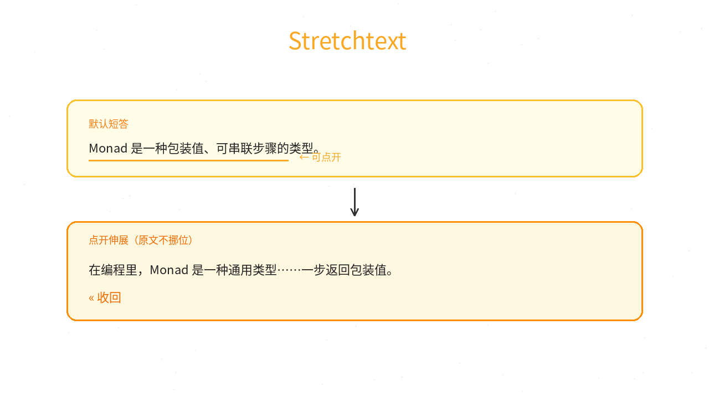
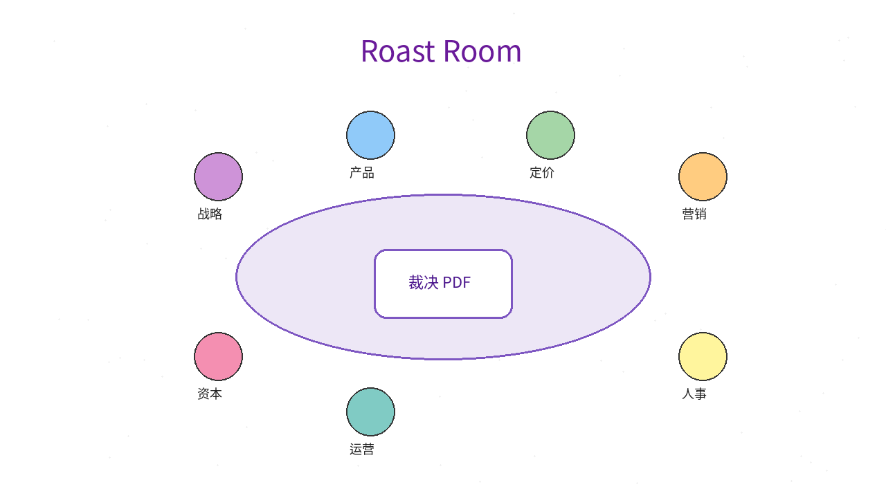
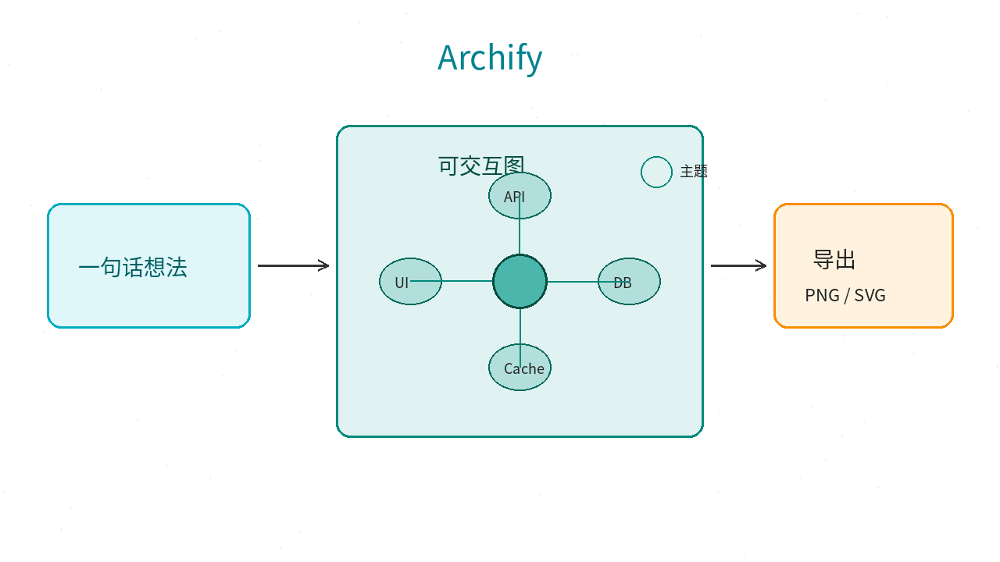
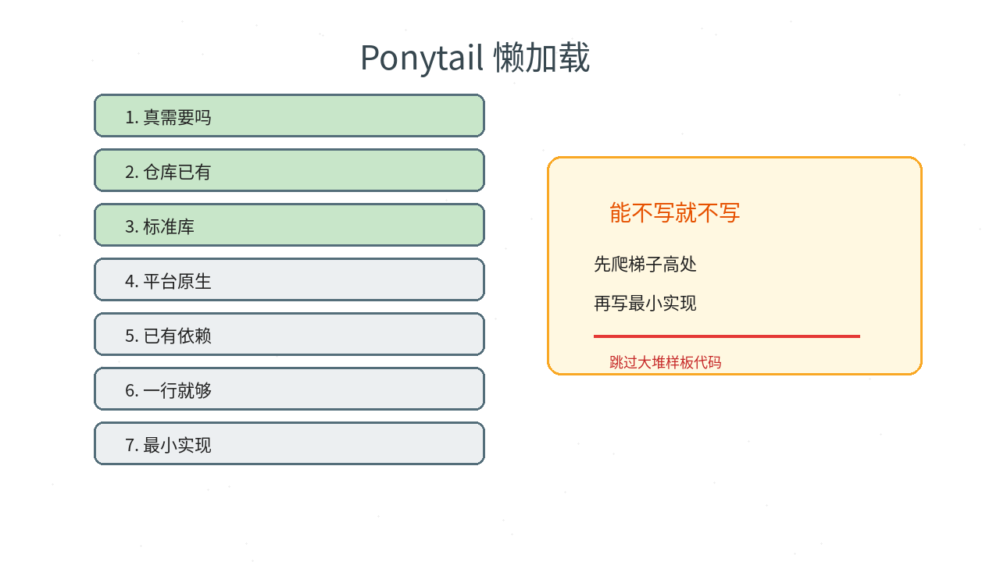
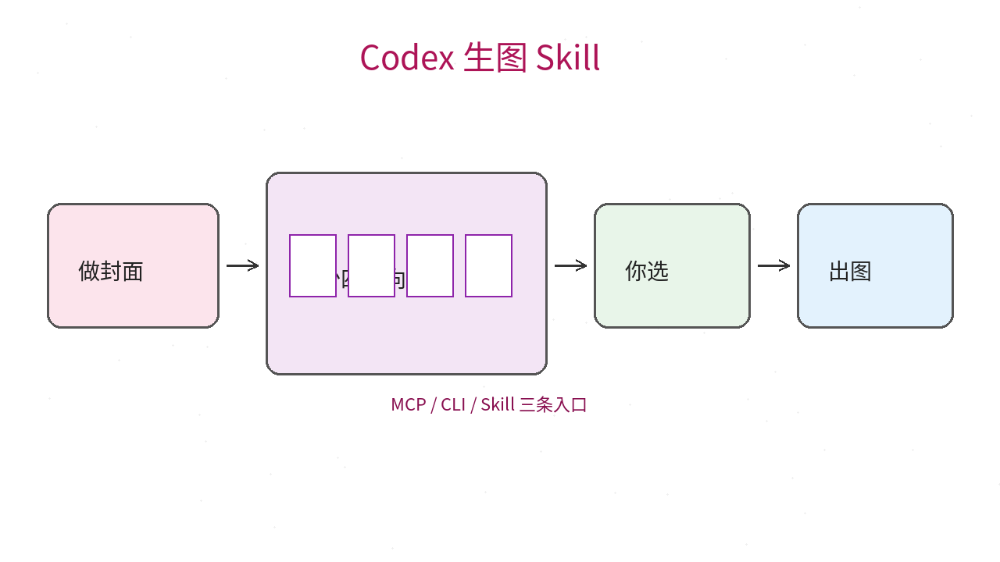

# 2026-10-16 Skills 日报

今日精选 5 个可安装的 Agent Skill / 插件（Stretchtext 阅读 / 商业顾问圆桌 / 交互示意图 / 懒惰高级工 / Codex 生图）。避开已在日报与周报写过的条目。

## 1. pro-vi/cc-stretch — Claude 默认短答，点开短语原地伸展

**介绍**  
10/14 开源（MIT，★300+）：把 Ted Nelson 的 Stretchtext 接到 Claude Code——回复先以短文出现，点链接短语就在原位变长，点 `«` 收回；Claude 会知道你点开了哪些，不假设你读完全文。作者在真实会话上测过：默认可见字数大约只有原文约 17%，但仍覆盖大部分要点。终端需 fullscreen TUI；桌面 App 里拉伸是可点链接。

**用法**  
仓库：[github.com/pro-vi/cc-stretch](https://github.com/pro-vi/cc-stretch)。在 Claude Code 会话里：  
```text
/plugin install cc-stretch --marketplace pro-vi/cc-stretch
/tui fullscreen
```

**应用场景**  
Claude 爱写长文、你只想先扫结论，需要时再展开细节，且不想丢掉阅读位置。



**推荐学习程度**：入门

---

## 2. nateherkai/roast-room — 七席商业顾问在 Claude Code 里当场吵出裁决

**介绍**  
10/10 开源（★620+）：七个「顾问位」（战略 / 产品 / 定价 / 营销 / 人事 / 运营 / 资本）用公开材料编译的 brain + sub-agent，在 Claude Code 里辩论你的商业决策，给出加权打分与可下载 PDF；可选本地房间页（`localhost:4730`）围桌回放。完整一场约 21 次 sub-agent，吃用量；小决策可用 `--quick`。

**用法**  
仓库：[github.com/nateherkai/roast-room](https://github.com/nateherkai/roast-room)。  
```bash
git clone https://github.com/nateherkai/roast-room.git
cd roast-room
npm start          # 可选：打开 http://localhost:4730
claude             # 同目录
# 然后：/roast-room <你的决策与数字>
```

**应用场景**  
涨价、招人、做不做某个产品线——想逼自己听多视角杠精，而不是单聊一个「请给建议」。



**推荐学习程度**：入门

---

## 3. tt-a1i/archify — 一句话想法 → 可交互 HTML 示意图（可导出）

**介绍**  
成熟 Skill（MIT，skills.sh 安装量很高，近版本 3.1.0）：描述想法 / 架构 / 路线，Agent 生成可点、可换主题的交互图，适合讲解与分享；支持 Claude Code / Cursor / Codex / OpenCode。和「只出一张静图」不同，输出是可探索的页面。

**用法**  
仓库：[github.com/tt-a1i/archify](https://github.com/tt-a1i/archify)；站：[archify.si](https://archify.si)。  
```bash
npx skills add tt-a1i/archify -g
```
然后对 Agent 说例如：用 Archify 画「浏览器 → API → DB」并标出缓存层。

**应用场景**  
技术方案评审、学习地图、把仓库结构讲给同事看——需要一张能点进去的图。



**推荐学习程度**：入门

---

## 4. DietrichGebert/ponytail — 让 Agent 像懒惰高级工：先爬梯子，少写代码

**介绍**  
长期维护的 Skill（MIT）：默认心态是「最好的代码是没写的那行」。先理解问题，再按梯子检查：真的需要？仓库已有？标准库 / 平台原生 / 已有依赖？一行？最后才最小实现；边界校验与安全不砍。Ponytail 5 宣传在 Claude Code 基准上少写代码、少花 token，同时提高风险逻辑带测试的比例（数字见仓库 README）。

**用法**  
仓库：[github.com/DietrichGebert/ponytail](https://github.com/DietrichGebert/ponytail)。  
```text
/plugin marketplace add DietrichGebert/ponytail
/plugin install ponytail@ponytail
```
Codex：`codex plugin marketplace add DietrichGebert/ponytail`。其他 Agent 可拷 `skills/ponytail/SKILL.md` 或 `AGENTS.md`（见 INSTALL.md）。

**应用场景**  
Agent 动不动拉新依赖、造轮子；想强制「先复用再发明」，尤其在已有组件库的前端/全栈仓。



**推荐学习程度**：入门

---

## 5. joeseesun/qiaomu-codex-imagegen — 任意 Agent 调用 Codex 生图：先四方向再出片

**介绍**  
10/4 开源（MIT，★130+）：把 Codex 内置生图接到 MCP + CLI + Skill。默认先 `suggest_directions` 给至少四个机制不同的风格方向（模板 / Mondo 设计师等），你选定后再构图与生成，并带验收规则，减少乱写字、编造事实。场景覆盖小红书竖版、视频封面、海报等。

**用法**  
仓库：[github.com/joeseesun/qiaomu-codex-imagegen](https://github.com/joeseesun/qiaomu-codex-imagegen)。按 README 安装 MCP 或 Skill 后，对 Agent 说「给这期视频做封面」；会先出方向再出图。需可用的 Codex 生图能力。

**应用场景**  
运营/内容要稳定出封面与配图，希望 Agent 先提案风格、你点头后再烧图。



**推荐学习程度**：进阶
