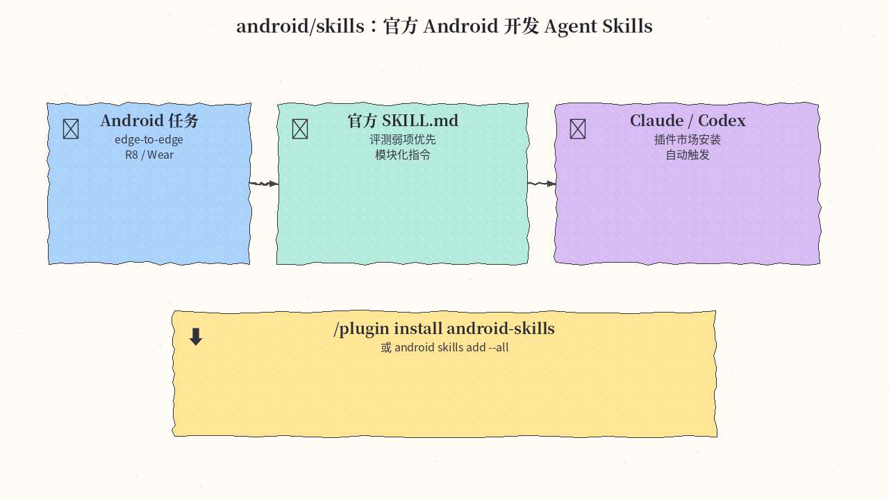
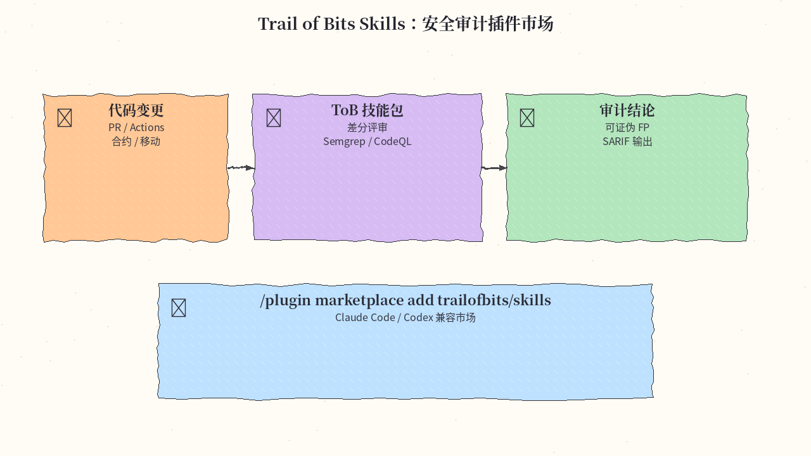
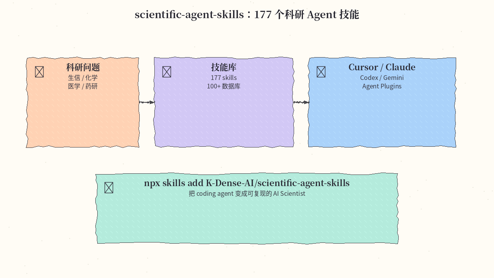
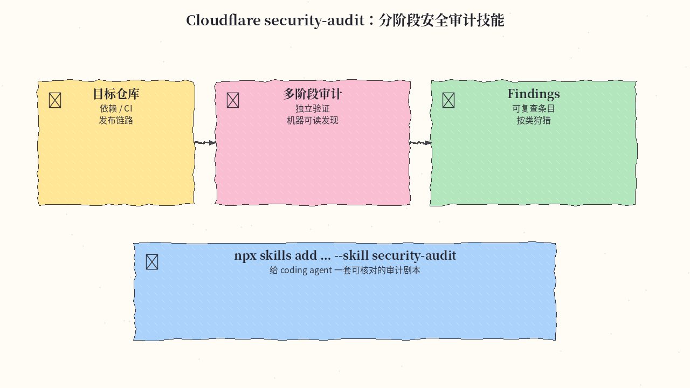
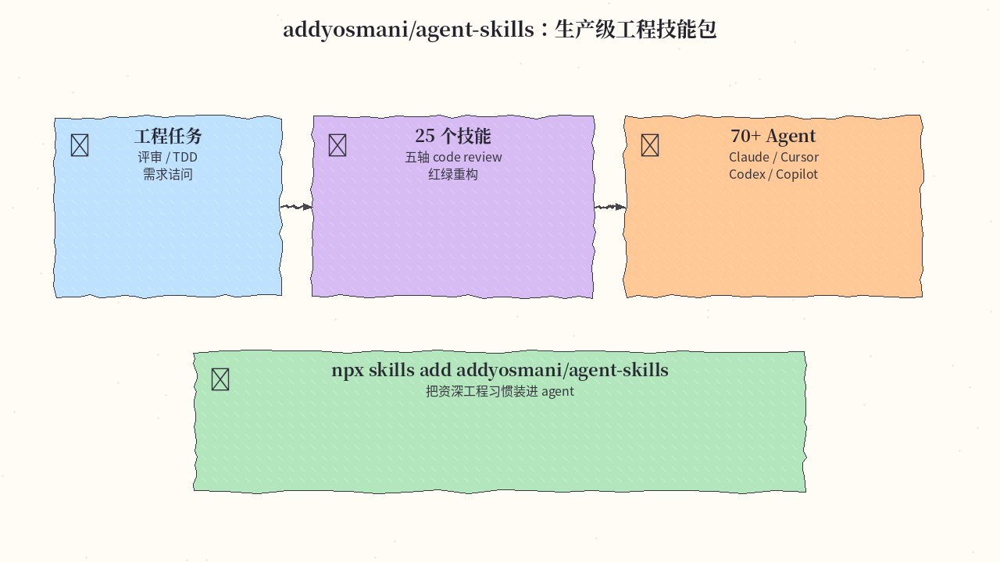

# 2026-10-19 Skills 日报

今日精选 5 个可装进 agent 工具箱的 Skill / 插件集（Android 官方 / 安全审计市场 / 科研技能库 / Cloudflare 审计剧本 / 生产级工程习惯）。与往日日报、周报不重复；来源含高质量 GitHub skill 仓库。

## 1. android/skills — Google 官方 Android Agent Skills

**介绍**  
Android 团队维护的 Agent Skills 仓库（Apache-2.0，★8790+）：模块化 `SKILL.md`，优先覆盖评测显示模型偏弱的工作流（而非已经很稳的基础 Compose）。支持 Android CLI 安装，以及 Claude Code / Codex 插件市场。

**用法**  
仓库：[github.com/android/skills](https://github.com/android/skills)。  
```bash
# Android CLI
android skills add --all
# 或 Claude Code：
/plugin install android-skills --marketplace android/skills
# Codex：
codex plugin marketplace add android/skills
codex plugin add android-skills@android-skills
```

**应用场景**  
让 Agent 做 edge-to-edge、R8 分析、Wear Compose 等 Android 专项时，自动对齐官方最佳实践。



**推荐学习程度**：入门

---

## 2. trailofbits/skills — Trail of Bits 安全研究插件市场

**介绍**  
ToB 的 Claude Code 插件市场（CC BY-SA 4.0，★7630+）：覆盖智能合约扫描、差分安全评审、C/Rust review、Semgrep/CodeQL、GitHub Actions agent 风险、Android APK Firebase 误配等。Codex 可直接加载同一 Claude marketplace。

**用法**  
仓库：[github.com/trailofbits/skills](https://github.com/trailofbits/skills)。  
```text
/plugin marketplace add trailofbits/skills
/plugin menu
```
Codex：`codex plugin marketplace add trailofbits/skills` 后 `codex plugin add <name>@trailofbits`。

**应用场景**  
PR 安全门禁、合约审计、或让 Agent 先建审计上下文再找 bug，需要可复用的专业工作流。



**推荐学习程度**：进阶

---

## 3. K-Dense-AI/scientific-agent-skills — 177 个科研 Agent Skills

**介绍**  
面向生命科学 / 化学 / 医学 / 药研的大型技能库（★52600+）：约 177 个已校验技能 + 100+ 科学数据库入口，兼容 Cursor、Claude Code、Codex、Gemini、Antigravity 与 Agent Skills / Agent Plugins 标准。文档称全球 25 万+ 科研用户在用。

**用法**  
仓库：[github.com/K-Dense-AI/scientific-agent-skills](https://github.com/K-Dense-AI/scientific-agent-skills)。  
```bash
npx skills add K-Dense-AI/scientific-agent-skills
# 或：gh skill install K-Dense-AI/scientific-agent-skills scanpy
```

**应用场景**  
用 coding agent 跑单细胞、分子对接、文献/数据库工作流，需要领域 skill 而不是裸提示。



**推荐学习程度**：进阶

---

## 4. cloudflare/security-audit-skill — 分阶段、可独立核验的安全审计 Skill

**介绍**  
Cloudflare 开源的 coding-agent 安全审计技能（★31100+）：多阶段狩猎（含供应链与发布链路等），产出**可独立验证、机器可读**的 findings，而不是一堆无法复查的建议。适合接到任意支持 Skills CLI 的 Agent。

**用法**  
仓库：[github.com/cloudflare/security-audit-skill](https://github.com/cloudflare/security-audit-skill)。  
```bash
npx skills add https://github.com/cloudflare/security-audit-skill \
  --skill security-audit
# 用户级：再加 --global
```
在目标仓库里对 Agent 说「做一次安全审计」即可按剧本推进。

**应用场景**  
开源/内部仓库要做可复查的安全巡检，希望 Agent 输出结构化发现而不是散文。



**推荐学习程度**：进阶

---

## 5. addyosmani/agent-skills — 生产级工程习惯技能包（25 个）

**介绍**  
Addy Osmani 维护的工程向技能集（★108200+）：含五轴 code review、逐问需求诘问（interview-me）、强制红绿重构的 TDD 等约 25 个技能；`npx skills` 可装进 70+ Agent，Claude Code 也支持 marketplace 插件形式。

**用法**  
仓库：[github.com/addyosmani/agent-skills](https://github.com/addyosmani/agent-skills)。  
```bash
npx skills add addyosmani/agent-skills
npx skills add addyosmani/agent-skills --skill code-review-and-quality
# Claude：
# /plugin marketplace add addyosmani/agent-skills
# /plugin install agent-skills@addy-agent-skills
```

**应用场景**  
合并前评审、需求澄清、测试驱动改动——想把资深工程节奏固化进 Agent，而不是每次口头叮嘱。



**推荐学习程度**：入门

---
