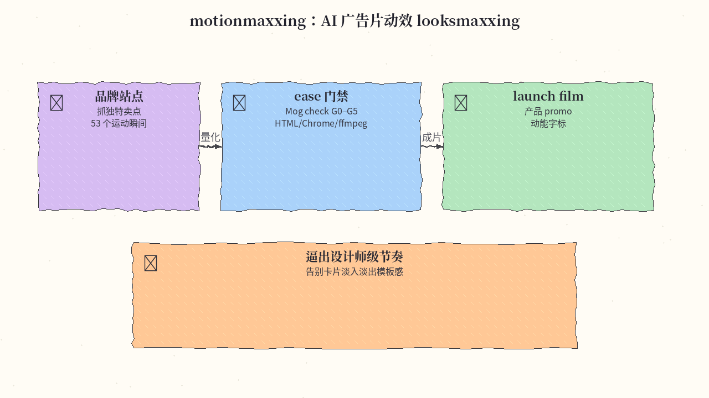
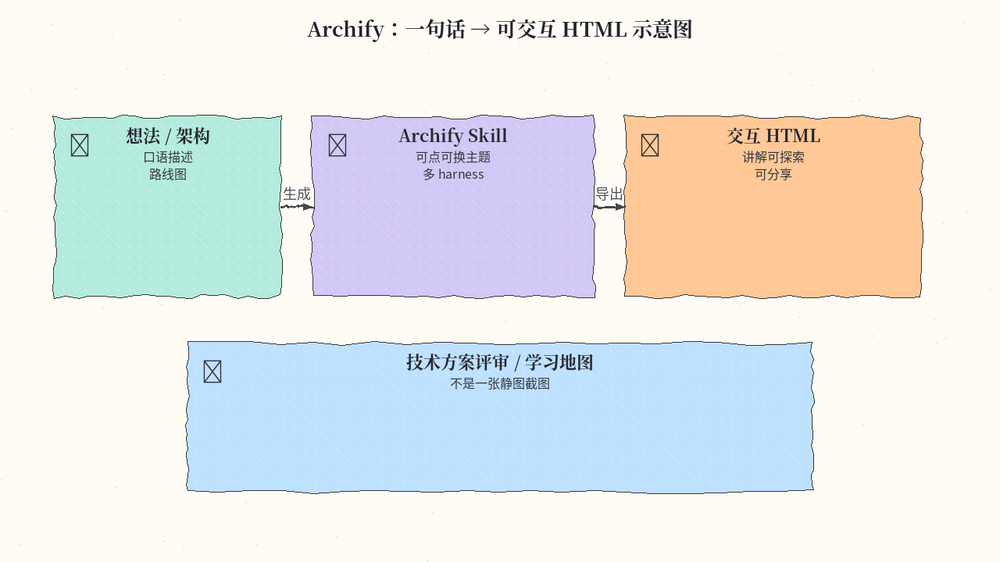
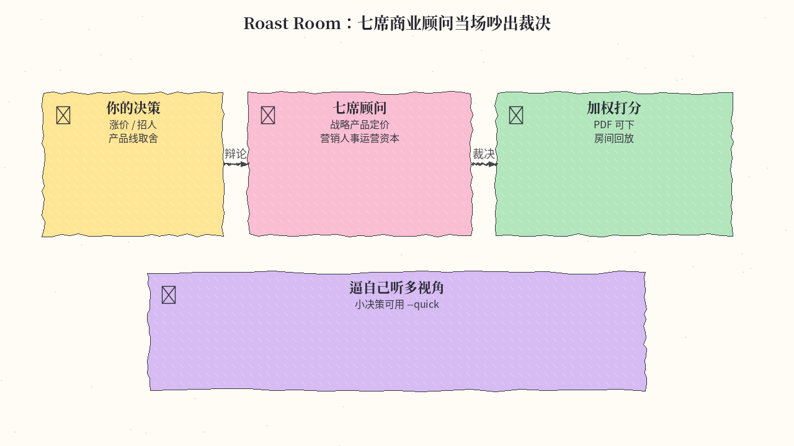
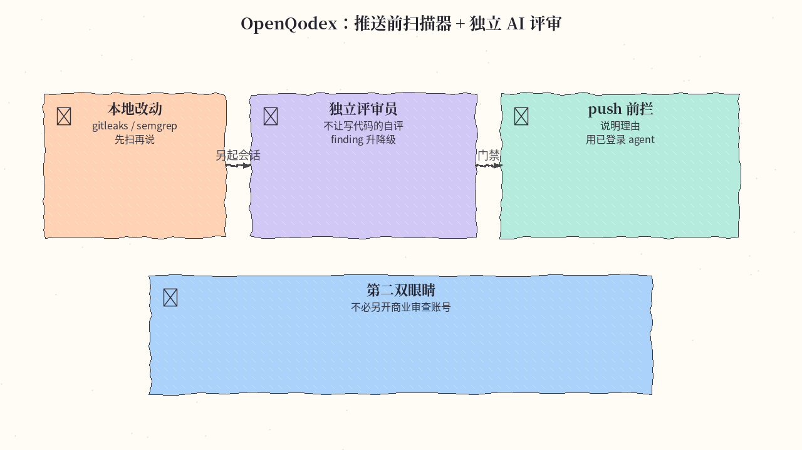
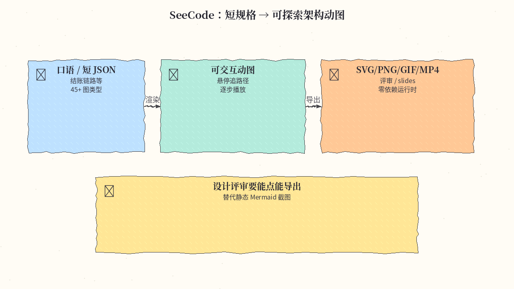
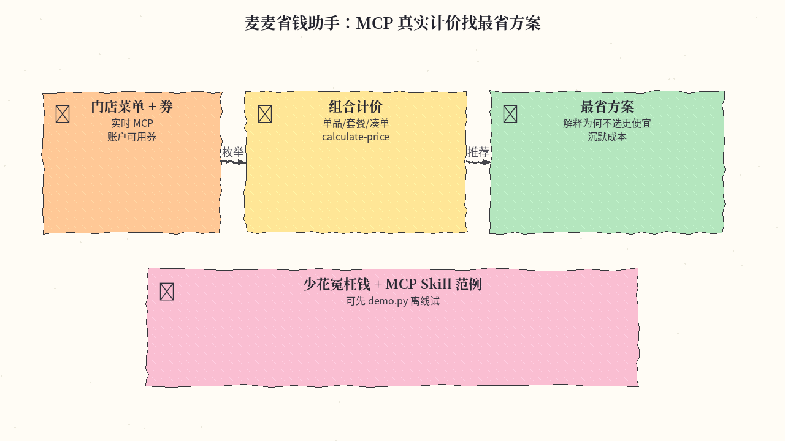
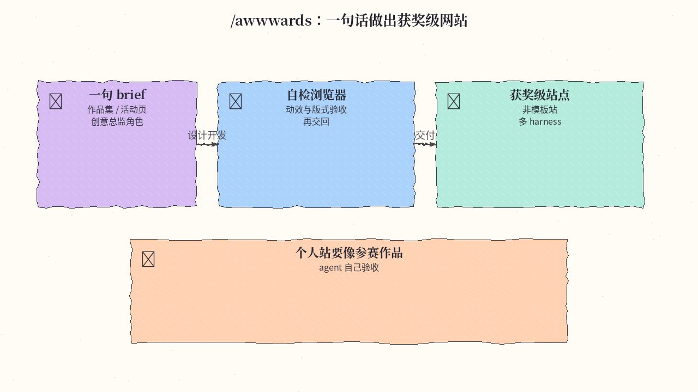
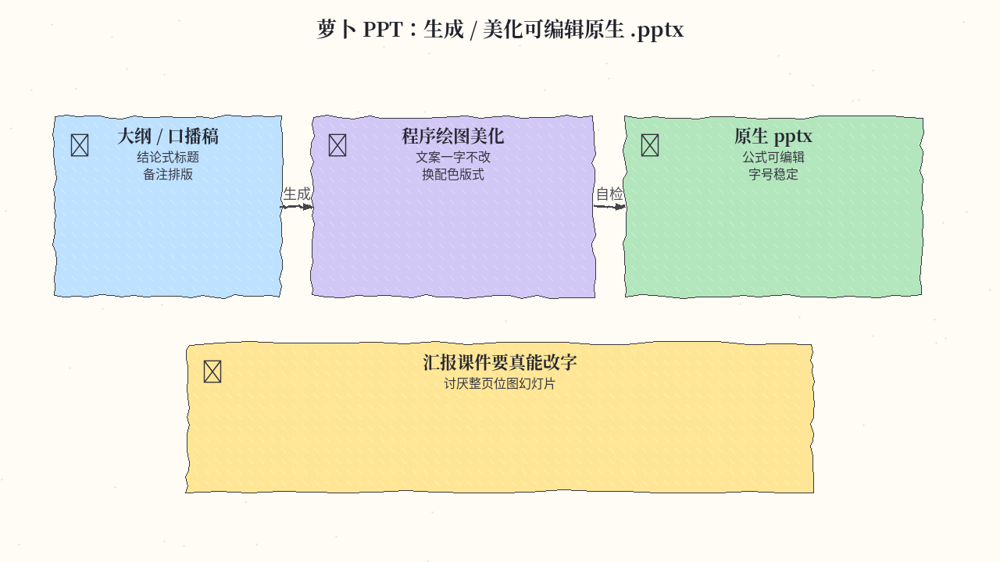
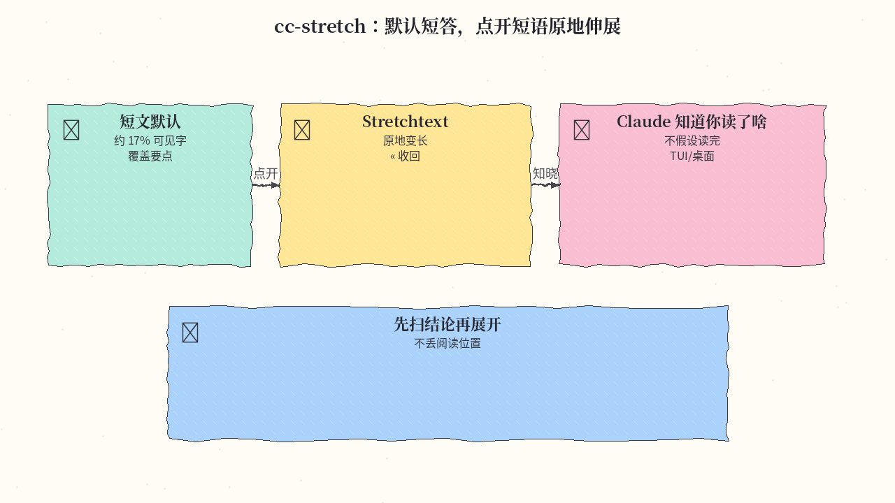
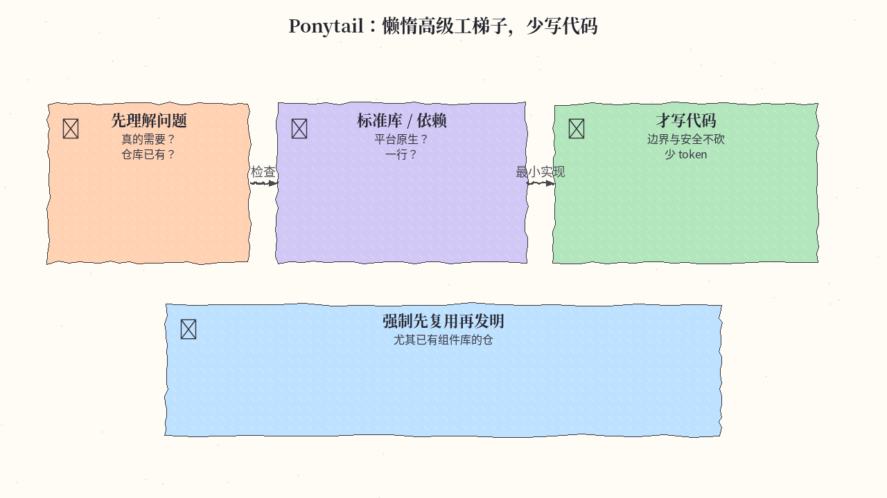

# 2026-10-19 Skills 周报

上周（10/12–10/18）精选 10 个值得装进 agent 工具箱的 Skill（动效 / 示意图 / 商业辩论 / 评审门禁 / 省钱点餐 / PPT 与写作习性；来源含高质量 GitHub skill 仓库）。

## 1. Tejashmakwana/motionmaxxing — AI 广告片 motion looksmaxxing

**介绍**  
动效「医美」式 Skill（★873，Apache-2.0）：给网站 → 抓品牌、找只有该品牌能讲的点子、按 53 个专业运动瞬间量化 ease，本地用 HTML/Chrome/ffmpeg 渲染，再用脚本做 Mog check（G0–G5）。定位 launch film / 产品 promo / 动能字标。

**用法**  
仓库：[github.com/Tejashmakwana/motionmaxxing](https://github.com/Tejashmakwana/motionmaxxing)。需 Node 22+、Python 3、ffmpeg、Chrome。Claude：`git clone … ~/.claude/skills/motionmaxxing && bash …/install.sh`。其他 agent 挂上含 `SKILL.md` 的目录即可；`bash scripts/providers.sh` 检查环境。

**应用场景**  
产品发布短片总是「左边标题右边卡片淡入淡出」，想用可度量门禁逼出设计师级节奏时。



**推荐学习程度**：进阶

---

## 2. tt-a1i/archify — 一句话 → 可交互 HTML 示意图

**介绍**  
成熟 Skill（MIT，高安装量）：描述想法 / 架构 / 路线，Agent 生成可点、可换主题的交互图；支持 Claude Code / Cursor / Codex / OpenCode。输出是可探索页面，而不是一张静图。

**用法**  
仓库：[github.com/tt-a1i/archify](https://github.com/tt-a1i/archify)；站：[archify.si](https://archify.si)。`npx skills add tt-a1i/archify -g`，然后对 Agent 说例如：用 Archify 画「浏览器 → API → DB」并标出缓存层。

**应用场景**  
技术方案评审、学习地图、把仓库结构讲给同事看——需要一张能点进去的图。



**推荐学习程度**：入门

---

## 3. nateherkai/roast-room — 七席商业顾问圆桌辩论

**介绍**  
七个「顾问位」（战略 / 产品 / 定价 / 营销 / 人事 / 运营 / 资本）在 Claude Code 里辩论你的商业决策（★792），给出加权打分与可下载 PDF；可选本地房间页围桌回放。完整一场约 21 次 sub-agent；小决策可用 `--quick`。

**用法**  
仓库：[github.com/nateherkai/roast-room](https://github.com/nateherkai/roast-room)。`git clone` → `npm start`（可选打开 localhost:4730）→ 同目录开 `claude`，再 `/roast-room <你的决策与数字>`。

**应用场景**  
涨价、招人、做不做某个产品线——想逼自己听多视角杠精，而不是单聊一个「请给建议」。



**推荐学习程度**：入门

---

## 4. openqodex/openqodex — 推送前扫描器 + 独立 AI 评审

**介绍**  
本机代码评审（★762，Apache-2.0）：先按改动跑 gitleaks/semgrep 等扫描器，再**另起** Claude Code 或 Codex 会话当评审员（默认不让「写代码的那个」自评），强制对每条 finding 升降级并说明理由；可装 push 门禁。不收自有 API Key（用你已登录的 agent）。

**用法**  
仓库：[github.com/openqodex/openqodex](https://github.com/openqodex/openqodex)。人：`npx openqodex init`；agent：`npx -y openqodex@0.12.0 init --yes --agent <host>`。只装 skill：`npx skills add openqodex/openqodex -g`。之后说「用 openqodex 审我的改动」或跑 `~/.openqodex/bin/openqodex review`。

**应用场景**  
个人或小团队要在 `git push` 前多一道「扫描仪 + 第二双眼睛」，又不想另开商业代码审查账号。



**推荐学习程度**：进阶

---

## 5. Aryanutkarsh/SeeCode — 短规格 → 可探索架构动图

**介绍**  
Agent Skill + 零依赖运行时（★658，MIT）：口语或短 JSON → 可交互动图（悬停追路径、逐步播放），45+ 图类型（架构/时序/ER/泳道等），可导出 SVG/PNG/GIF/MP4。

**用法**  
仓库：[github.com/Aryanutkarsh/SeeCode](https://github.com/Aryanutkarsh/SeeCode)。Claude：`/plugin marketplace add Aryanutkarsh/seecode` 后 `/plugin install seecode@seecode`。其他：`npx skills add Aryanutkarsh/seecode -g`。然后说「用 SeeCode 画出结账链路：浏览器→API→Postgres→Stripe→Kafka」。

**应用场景**  
设计评审/文档/slides 需要「能点能导出」的系统图，而不是静态 Mermaid 截图。



**推荐学习程度**：入门

---

## 6. Ayzzz123/mcd-coupon-strategist — 麦当劳中国 MCP 省钱点餐

**介绍**  
基于麦当劳中国 MCP 的点餐成本 Skill（★491，MIT）：拉当前门店实时菜单与账户可用券，枚举单品/套餐/券/凑单组合，逐方案调 MCP `calculate-price` **真实计价**，给出最省方案并解释；长期侧算「沉默成本」（快过期券、客单价偏高等）。

**用法**  
仓库：[github.com/Ayzzz123/mcd-coupon-strategist](https://github.com/Ayzzz123/mcd-coupon-strategist)。先离线试：`python demo.py`（读录制响应，不需 Token）。真用：到 [open.mcd.cn/mcp](https://open.mcd.cn/mcp) 登录拿 Token，按 `mcp-config.example.json` 配 streamable HTTP 后在支持 MCP 的客户端对话。

**应用场景**  
常点麦当劳想少花冤枉钱；或想看一个「MCP 工具 + Skill 编排 + 真实计价」的中文参考实现。



**推荐学习程度**：入门

---

## 7. juliobsz/skills — /awwwards 一句话获奖级网站

**介绍**  
一句 brief（如「做我的作品集」）后，agent 兼任创意总监/设计/创意开发，并在真实浏览器里自检再交回（★399，MIT）。兼容 Claude Code / Codex / Cursor 等读 `SKILL.md` 的 harness；Node ≥ 22.20。

**用法**  
仓库：[github.com/juliobsz/skills](https://github.com/juliobsz/skills)。`npx skills add juliobsz/skills -g`，新开会话后打 `/awwwards` 或直接要站点。Claude 也可用 `/plugin install awwwards --marketplace juliobsz/skills`。

**应用场景**  
个人站/活动页/作品集要「像参赛作品」而不是模板站，又希望 agent 自己验收动效与版式。



**推荐学习程度**：进阶

---

## 8. zhouwei713/luobo-ppt — 萝卜 PPT 原生 .pptx

**介绍**  
中文友好的 PPT Skill（★388，MIT）：文章/大纲/口播稿 → 结论式标题 + 备注 + 排版；或朴素 pptx + 参考图 → **原文一字不改**换配色/版式/图标（程序绘图，不接生图模型）。强调公式可编辑、字号稳定、交付前脚本自检。

**用法**  
仓库：[github.com/zhouwei713/luobo-ppt](https://github.com/zhouwei713/luobo-ppt)。对 agent 说「帮我安装这个 skill：https://github.com/zhouwei713/luobo-ppt」，或 `npx skills add zhouwei713/luobo-ppt`，或跑 `bash install.sh`。装后让 agent 按题目生成或按参考图美化。

**应用场景**  
汇报/课件要「真能改字的 pptx」，讨厌整页位图幻灯片，或要批量统一视觉又不让 AI 偷偷改文案。



**推荐学习程度**：入门

---

## 9. pro-vi/cc-stretch — Stretchtext 短答可展开

**介绍**  
把 Ted Nelson 的 Stretchtext 接到 Claude Code（★380，MIT）：回复先以短文出现，点链接短语就在原位变长，点 `«` 收回；Claude 会知道你点开了哪些。作者测过：默认可见字数大约只有原文约 17%，但仍覆盖大部分要点。

**用法**  
仓库：[github.com/pro-vi/cc-stretch](https://github.com/pro-vi/cc-stretch)。在 Claude Code 会话里：`/plugin install cc-stretch --marketplace pro-vi/cc-stretch`，再 `/tui fullscreen`。

**应用场景**  
Claude 爱写长文、你只想先扫结论，需要时再展开细节，且不想丢掉阅读位置。



**推荐学习程度**：入门

---

## 10. DietrichGebert/ponytail — 懒惰高级工少写代码梯子

**介绍**  
长期维护的 Skill（MIT，极高安装/星）：默认心态是「最好的代码是没写的那行」。先理解问题，再按梯子检查：真的需要？仓库已有？标准库 / 平台原生 / 已有依赖？一行？最后才最小实现；边界校验与安全不砍。宣称少写代码、少花 token，同时提高风险逻辑带测试的比例（数字见 README）。

**用法**  
仓库：[github.com/DietrichGebert/ponytail](https://github.com/DietrichGebert/ponytail)。  
```text
/plugin marketplace add DietrichGebert/ponytail
/plugin install ponytail@ponytail
```
Codex：`codex plugin marketplace add DietrichGebert/ponytail`。其他 Agent 可拷 `skills/ponytail/SKILL.md`（见 INSTALL.md）。

**应用场景**  
Agent 动不动拉新依赖、造轮子；想强制「先复用再发明」，尤其在已有组件库的前端/全栈仓。



**推荐学习程度**：入门
