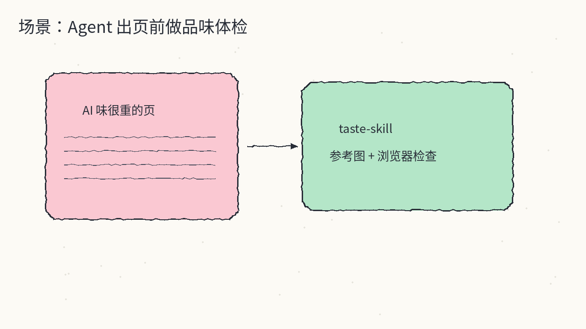
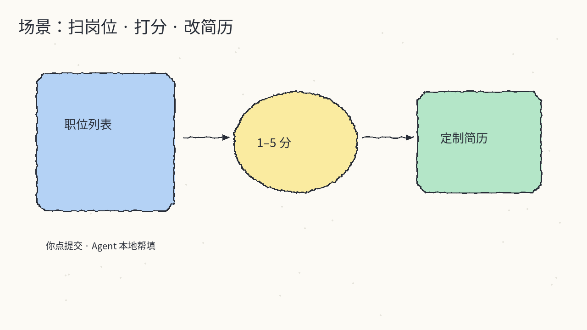
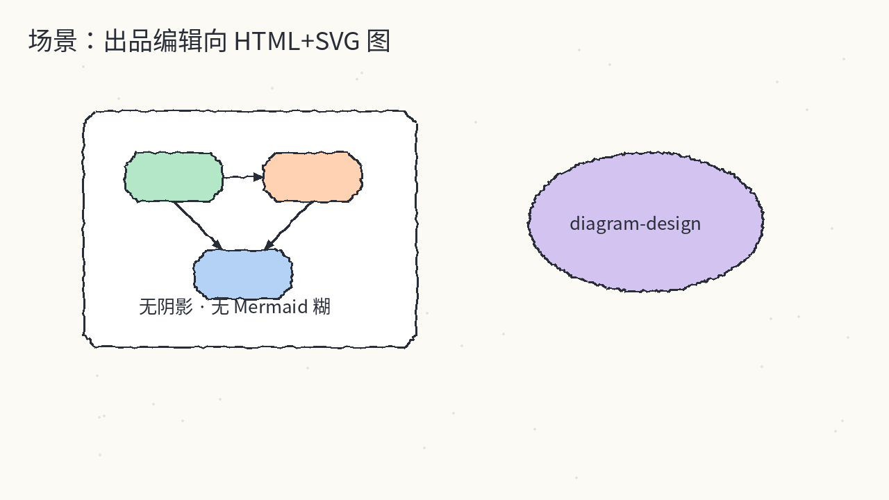
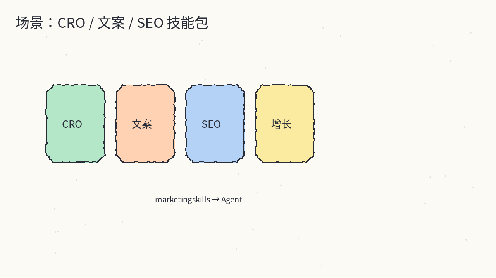
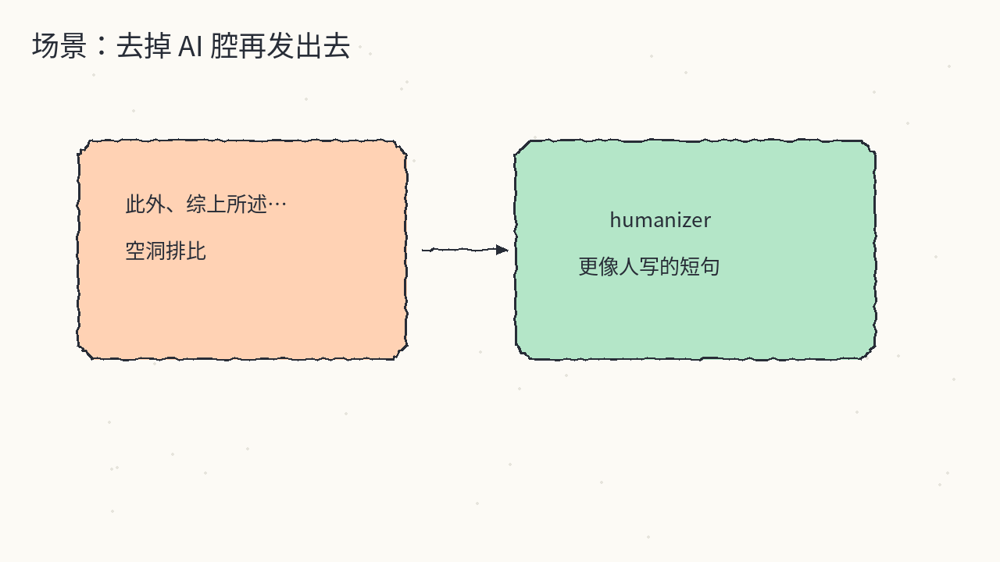
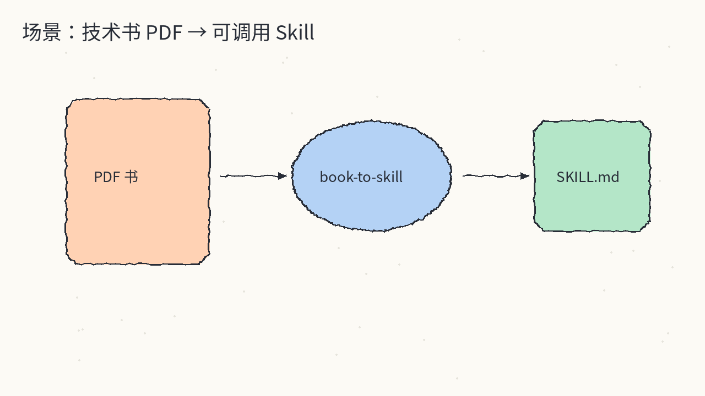
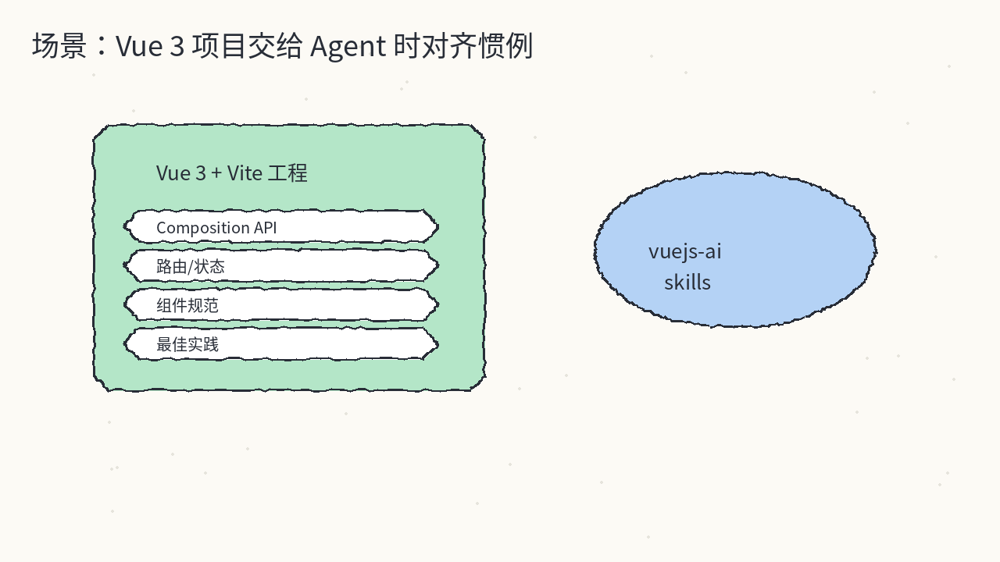

# 2026-10-20 Skills 日报

今日精选 7 个可装进 agent 工具箱的 Skill / 技能集（设计品味 / 求职流水线 / 编辑向图表 / 营销 CRO / 去 AI 腔 / 书转技能 / Vue 3）。与往日日报、周报不重复；来源为公开 GitHub skill 仓库。同日 GitHub 日报已覆盖 `cursor/plugins`，本栏不重复该条目。

## 1. Leonxlnx/taste-skill — 给前端页一点「品味」而不是 AI 糊

**介绍**  
Agent skill（MIT，★~99k）：用艺术指导、参考图和浏览器检查，替代千篇一律的 AI 落地页。站点 [tasteskill.dev](https://tasteskill.dev)。需 Node 22+ 与本机 Chrome/Edge/Chromium；不装额外服务、不强制 API key（找参考图需要网络）。

**用法**  
仓库：[github.com/Leonxlnx/taste-skill](https://github.com/Leonxlnx/taste-skill)。  
```bash
npx skills add https://github.com/Leonxlnx/taste-skill --skill "design-taste-frontend"
```

**应用场景**  
让 coding agent 改 landing / 营销页时，先按参考图和实机截图纠「AI 味」，再交付。



**推荐学习程度**：入门

---

## 2. career-ops-hq/career-ops — 本地 AI 求职流水线

**介绍**  
开源求职 agent（MIT，★~76k）：扫岗位、按简历 1–5 分、改 ATS 向简历与 cover letter、面试准备与申请追踪；帮你填表，提交按钮仍由你点。本地跑在 Claude Code / Codex / OpenCode 等 CLI 里。

**用法**  
仓库：[github.com/career-ops-hq/career-ops](https://github.com/career-ops-hq/career-ops)；站：[career-ops.org](https://career-ops.org)。  
```bash
npx @santifer/career-ops init
# PDF 相关可能需要：
npx playwright install chromium
```

**应用场景**  
海投前想自动筛匹配度并改出一版更贴 JD 的简历，又不想把材料交给不明云服务。



**推荐学习程度**：入门

---

## 3. cathrynlavery/diagram-design — 编辑向 HTML+SVG 图，不要 Mermaid 糊

**介绍**  
图表 skill（MIT，★~58k）：约 44 种图类型，输出自包含 HTML+SVG；明确反对阴影和「Mermaid slop」。兼容 Cursor / Claude Code / Codex / Copilot 等读 Agent Skills 的宿主；Claude 也可走插件市场拿更新与 slash command。

**用法**  
仓库：[github.com/cathrynlavery/diagram-design](https://github.com/cathrynlavery/diagram-design)；站：[diagramdesign.dev](https://diagramdesign.dev)。  
```bash
npx skills add cathrynlavery/diagram-design
# Claude Code 可选：
# /plugin marketplace add cathrynlavery/diagram-design
# /plugin install diagram-design@diagram-design
```

**应用场景**  
写设计文档 / RFC 时要一张干净可品牌化的结构图，而不是默认 Mermaid 皮肤。



**推荐学习程度**：入门

---

## 4. coreyhaines31/marketingskills — CRO / 文案 / SEO 增长技能包

**介绍**  
营销向 Agent Skills（MIT，★~56k）：CRO、copywriting、SEO、analytics、growth engineering。可用 `npx skills` 全量或按 skill 名安装，也可用 Claude 插件市场。

**用法**  
仓库：[github.com/coreyhaines31/marketingskills](https://github.com/coreyhaines31/marketingskills)；站：[marketing-skills.com](https://marketing-skills.com)。  
```bash
npx skills add coreyhaines31/marketingskills
# 只要部分：
npx skills add coreyhaines31/marketingskills --skill cro copywriting
npx skills add coreyhaines31/marketingskills --list
```

**应用场景**  
让 agent 改落地页转化、邮件文案或 SEO brief 时，有一套可安装的营销剧本而不是空 prompt。



**推荐学习程度**：进阶

---

## 5. blader/humanizer — 去掉 AI 写作痕迹

**介绍**  
写作 skill（MIT，★~59k）：专门剥 AI 生成文本里的套话与可识别痕迹。Claude Code 可用插件市场（需较新版本）或 `npx skills add`；Codex / 其他宿主走 skills CLI。装好后常见入口为 `/humanizer`。

**用法**  
仓库：[github.com/blader/humanizer](https://github.com/blader/humanizer)；索引：[skills.sh/blader/humanizer](https://skills.sh/blader/humanizer)。  
```bash
# Claude Code：
# /plugin marketplace add blader/humanizer
# /plugin install humanizer@humanizer
# 或：
npx skills add blader/humanizer --global --agent claude-code
# Codex：
npx skills add blader/humanizer --global --agent codex
```

**应用场景**  
对外发公告、邮件、文档前，先让 agent 把「此外、综上所述」一类腔调洗掉。



**推荐学习程度**：入门

---

## 6. virgiliojr94/book-to-skill — 技术书 PDF 转可调用 Skill

**介绍**  
把技术书 PDF（或文件夹 / glob）转成 Claude Code 可用 skill（MIT，★~35k）：可学习、可引用、可在干活时调用；转换后还能推到 GitHub 再 `npx skills add`。命令形如 `/book-to-skill <path|folder|glob> [skill-name]`。

**用法**  
仓库：[github.com/virgiliojr94/book-to-skill](https://github.com/virgiliojr94/book-to-skill)。  
```bash
npx skills add virgiliojr94/book-to-skill
# 或手动：
# git clone https://github.com/virgiliojr94/book-to-skill.git ~/.claude/skills/book-to-skill
```

**应用场景**  
手里有厚厚一本框架 / 协议书，想沉淀成 agent 随时可查的 skill，而不是每次重新喂长 PDF。



**推荐学习程度**：进阶

---

## 7. vuejs-ai/skills — Vue 3 开发 Agent Skills

**介绍**  
面向 Vue 3 的 Agent Skills 集（MIT，★~2.9k）：安装入口 `vuejs-ai/skills`，Claude Code 也可装 `vue-skills-bundle` 或单个如 `vue-best-practices`。体量不大但方向明确——适合默认 Vue 3 技术栈的日常开发代理。

**用法**  
仓库：[github.com/vuejs-ai/skills](https://github.com/vuejs-ai/skills)。  
```bash
npx skills add vuejs-ai/skills
# Claude Code 市场备选：
# /plugin marketplace add vuejs-ai/skills
# /plugin install vue-skills-bundle@vue-skills
```

**应用场景**  
Vue 3 + Vite 项目里让 agent 写组件 / 路由 / 状态时，自动贴近社区惯例而不是 React 腔。



**推荐学习程度**：入门
