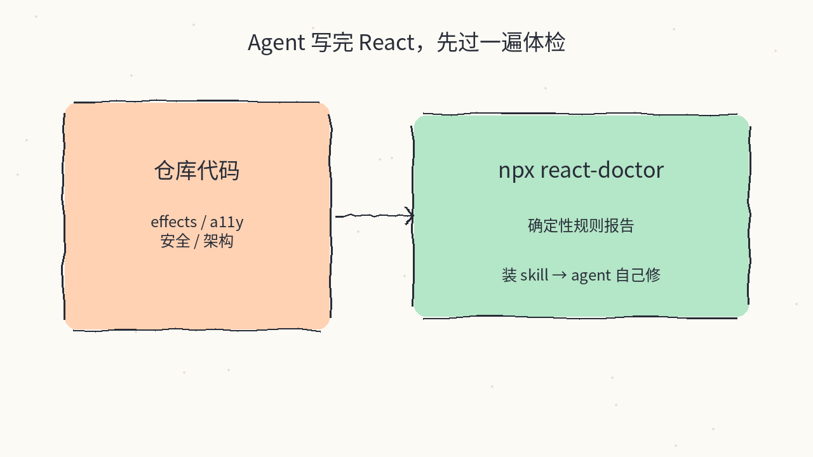
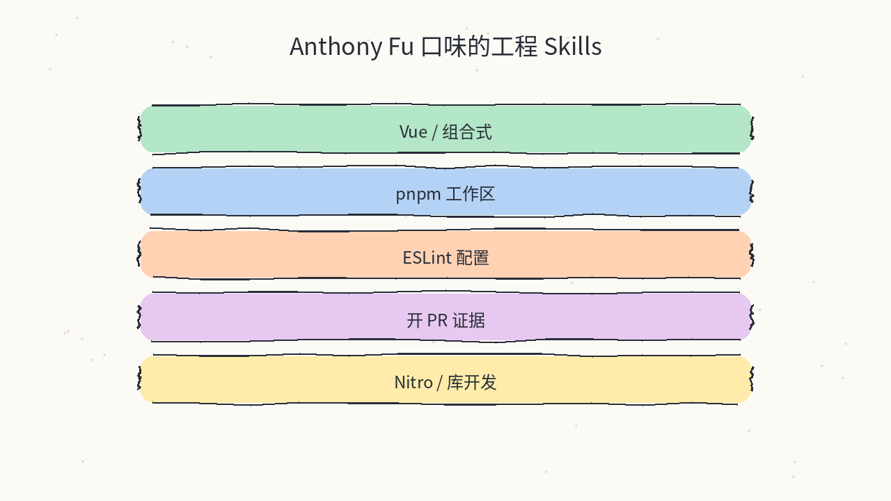
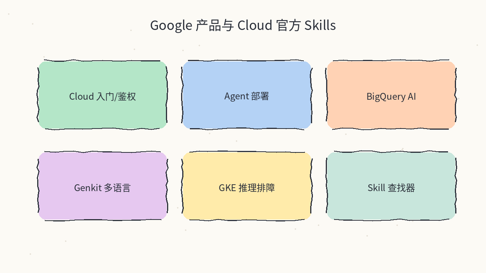
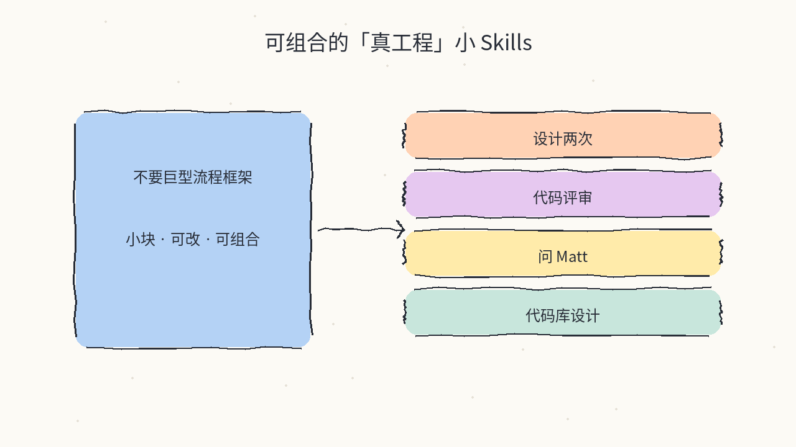
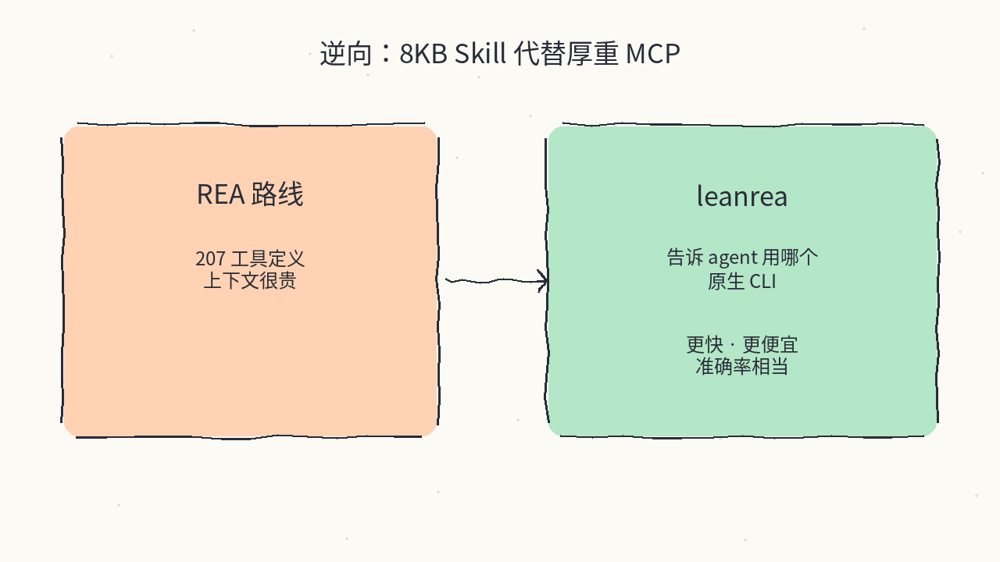
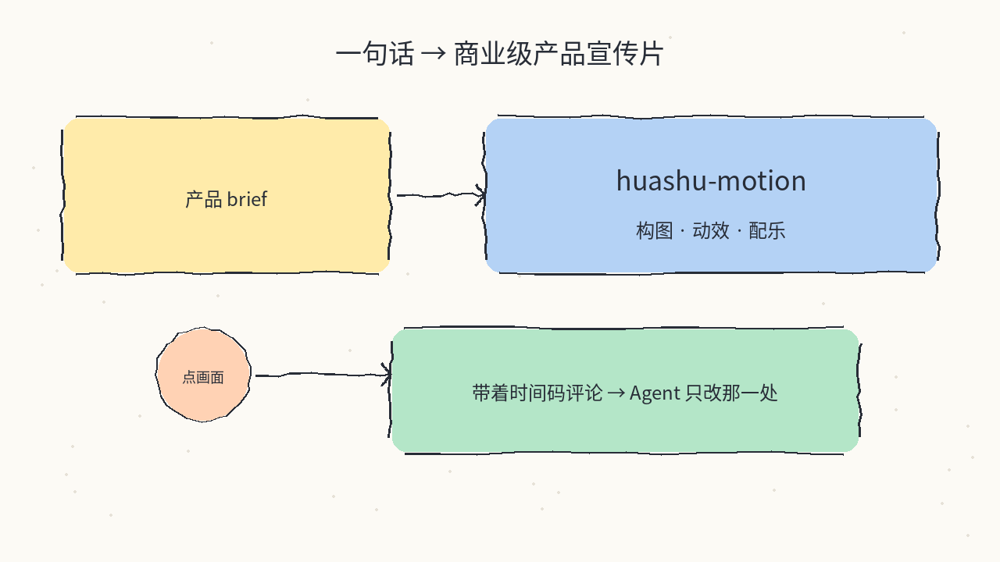
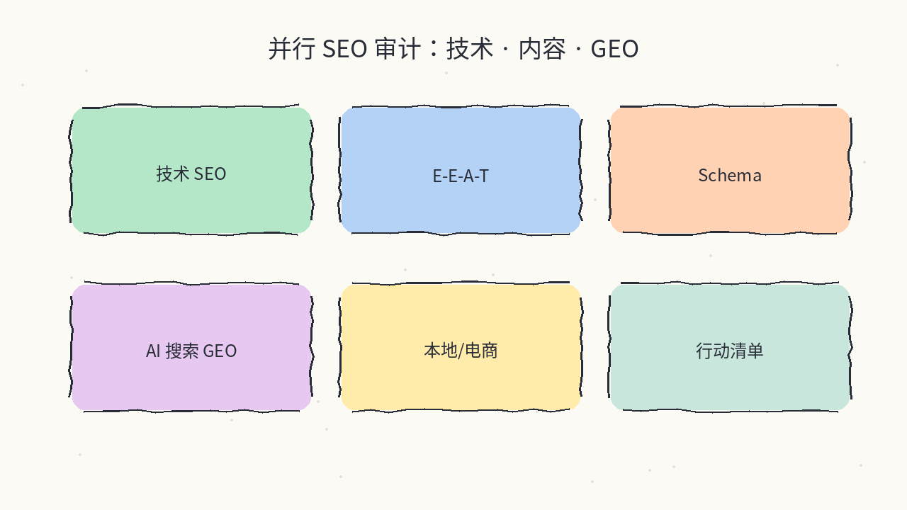
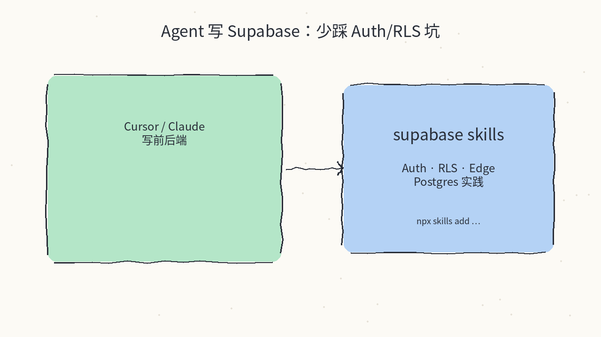

# 2026-10-21 Skills 日报

今日精选 8 个可安装的 Agent Skills / 技能包（React 体检 / Antfu 工程口味 / Google 官方 / Matt Pocock 真工程小技能 / 轻量逆向 leanrea / 画树宣传片 / Claude SEO / Supabase）。与往日日报、周报不重复。

## 1. millionco/react-doctor — Agent 写坏 React 时的确定性体检

**介绍**  
对 Next / Vite / Astro / RN 等 React 项目跑规则扫描（状态与 effect、性能、架构、安全、a11y 等），并提供可装进 Claude Code / Cursor / Codex / OpenCode 的 skill（另有 deslop、fuzz 等）。也有 CI 模式只报 PR 引入的问题。

**用法**  
仓库：[github.com/millionco/react-doctor](https://github.com/millionco/react-doctor)；站：[react.doctor](https://react.doctor)。Skill 路径：`.agents/skills/react-doctor/SKILL.md`。  
```bash
npx react-doctor@latest
npx react-doctor@latest install          # 给 coding agent 装 skill
npx react-doctor@latest ci install       # PR 扫描
```

**应用场景**  
Vue/前端工程师偶尔交 React/Next 活，或审查 agent 刚生成的 React 页面，想先拿到一份确定性清单再让模型修。



**推荐学习程度**：入门

---

## 2. antfu/skills — Anthony Fu 的 Vue / pnpm / 开 PR 口味

**介绍**  
Antfu 维护的 Agent Skills 集合（MIT，★~6k）：手写 `antfu`、`antfu-create-pr`，以及从官方文档生成的 Vue / Nitro 等技能。推荐经 `@antfu/skills` pack + `skills-npm` 同步；也可用 skills CLI 直接从本仓安装。对 maple 的 Vue 3 默认栈特别贴。

**用法**  
仓库：[github.com/antfu/skills](https://github.com/antfu/skills)；pack：[antfu/skills-pack](https://github.com/antfu/skills-pack)。  
```bash
pnpm i -D skills-npm @antfu/skills
pnpx skills-npm setup
# 或直接：
pnpx skills add antfu/skills --skill='*'
```

**应用场景**  
新开 Vue 3 + pnpm 仓库，希望 agent 默认按 Antfu 的 eslint/工作区/开 PR（带截图证据）习惯干活。



**推荐学习程度**：入门

---

## 3. google/skills — Google 产品与 Cloud 官方 Agent Skills

**介绍**  
Google 官方 Agent Skills 仓（Apache-2.0，★~21k）：覆盖 Cloud 入门/IAM、多产品解决方案、Agent Platform、BigQuery AI、Genkit（JS/Go/Python/Dart）、GKE 推理排障等；可用 `npx skills add google/skills` 按需勾选。适合把 GCP 操作手册变成可调用技能而不是长 README。

**用法**  
仓库：[github.com/google/skills](https://github.com/google/skills)；skills.sh：[skills.sh/google/skills](https://skills.sh/google/skills)。  
```bash
npx skills add google/skills
npx skills update
```

**应用场景**  
Agent 要在 GCP 上部署推理 / 配 IAM / 查 BigQuery，希望加载官方窄技能而不是把整本云文档塞进上下文。



**推荐学习程度**：进阶

---

## 4. mattpocock/skills — 可组合的「真工程」小 Skills

**介绍**  
Matt Pocock 日常用的工程向技能包（MIT，★很高）：强调小、可改、可组合，反对 GSD/BMAD 一类「抢走流程控制权」的大框架。含设计两次、代码评审、codebase-design、ask-matt 等。Claude Code / Codex / Copilot 可用插件市场安装（自更新）；skills.sh 则拷贝可编辑文件。

**用法**  
仓库：[github.com/mattpocock/skills](https://github.com/mattpocock/skills)；站：[aihero.dev/skills](https://aihero.dev/skills)。  
```bash
# Claude Code（插件，默认自更新）：
claude plugin install mattpocock-skills@claude-plugins-official
# 或见 README 的 Codex / Copilot / skills.sh 路径
```

**应用场景**  
想给 agent 加「先设计两次再写」「按工程方式做 code review」这类习惯，又不想引入一整套规范操作系统。



**推荐学习程度**：进阶

---

## 5. aicodeking/leanrea — 8KB 替代 REA MCP 的逆向 Skill

**介绍**  
单文件 `leanrea/SKILL.md`（MIT，★~1.2k）：不装 25MB MCP、不加 207 个工具定义，只告诉 agent 对 Electron/native/Go 等目标该先跑哪些原生 CLI（asar、otool、`go version -m`…）。作者基准：相对 REA 约少 38% 墙钟、35% 费用，准确率接近。

**用法**  
仓库：[github.com/aicodeking/leanrea](https://github.com/aicodeking/leanrea)。  
```bash
npx skills add aicodeking/leanrea
# 或：cp -R leanrea/leanrea ~/.claude/skills/
# 调用：/leanrea How does the search feature in Foo.app work?
```

**应用场景**  
需要拆桌面客户端或二进制，又不想为逆向任务付出 REA 那级工具定义/上下文税。



**推荐学习程度**：进阶

---

## 6. alchaincyf/huashu-motion — Agent 一键出商业级产品宣传片

**介绍**  
画树系 motion skill（MIT，★~1.2k，2026-10-18）：会构图、动效与配乐；支持在预览里「点画面 + 带时间码评论」，agent 只改那一处。作者展示可用 DeepSeek V4.1 Flash 等非 Opus 模型出片。与已推过的 `huashu-art-motion` 不同——这条更偏产品发布片工作流。

**用法**  
仓库：[github.com/alchaincyf/huashu-motion](https://github.com/alchaincyf/huashu-motion)。Skill：`skills/huashu-motion/SKILL.md`。  
```bash
npx skills add alchaincyf/huashu-motion
# 或让 agent：帮我安装 huashu-motion（github.com/alchaincyf/huashu-motion）并跑 demo
```

**应用场景**  
产品发版要一条带音乐的 launch film，希望 coding agent 出片后还能按你点的那一帧改。



**推荐学习程度**：入门

---

## 7. AgriciDaniel/claude-seo — 并行 SEO / GEO / Agent 就绪审计

**介绍**  
面向 Claude Code 的开源 SEO 插件（MIT，★~19k）：26 个子技能 + 最多约 17 路并行专家 agent，覆盖技术 SEO、E-E-A-T、Schema、AI 搜索（GEO）、本地/电商等；强调可证伪的行动项与 agentic browsing 就绪检查。公版 MIT，无会员墙。

**用法**  
仓库：[github.com/AgriciDaniel/claude-seo](https://github.com/AgriciDaniel/claude-seo)。  
```bash
# Claude Code：
/plugin marketplace add AgriciDaniel/claude-seo
/plugin install claude-seo@agricidaniel-claude-seo
/seo setup
/seo doctor
```

**应用场景**  
站点上线或改版前，想让 agent 并行扫技术项与「能不能被 AI 搜索引用」，并给出带验证方式的优先级清单。



**推荐学习程度**：进阶

---

## 8. supabase/agent-skills — 少踩 Auth / RLS / Postgres 坑

**介绍**  
Supabase 官方 Agent Skills（兼容 Claude Code、Cursor、Copilot 等）：覆盖 Database、Auth、Edge Functions、Realtime、Storage、Vectors 以及 `supabase-postgres-best-practices` 等。也提供 Claude Code 插件市场安装方式。

**用法**  
仓库：[github.com/supabase/agent-skills](https://github.com/supabase/agent-skills)；文档：[AI Skills](https://supabase.com/docs/guides/getting-started/ai-skills)。  
```bash
npx skills add supabase/agent-skills
npx skills add supabase/agent-skills --skill supabase-postgres-best-practices
# Claude Code 插件：
claude plugin marketplace add supabase/agent-skills
claude plugin install supabase@supabase-agent-skills
```

**应用场景**  
Agent 在 Next/Vue 项目里接 Supabase Auth 与 RLS，希望加载官方技能避免会话 Cookie / `getSession` 类常见坑。



**推荐学习程度**：入门

---
