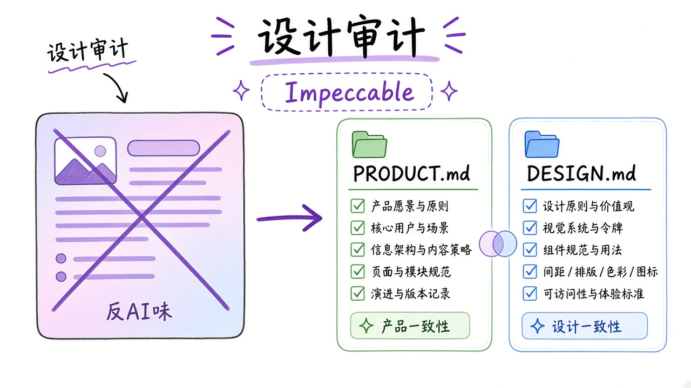
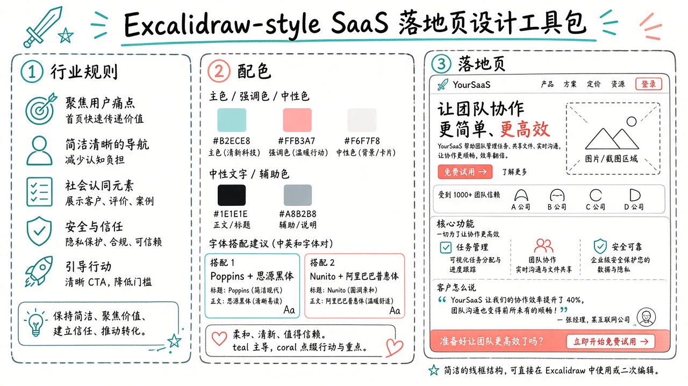
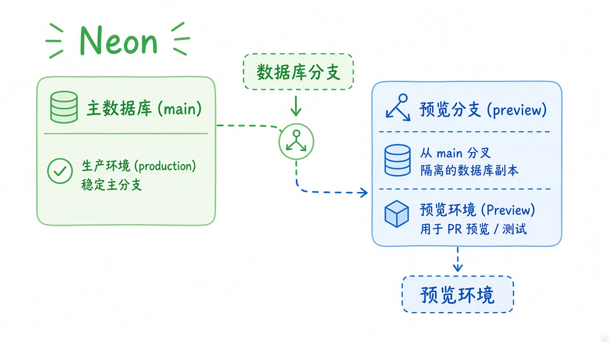
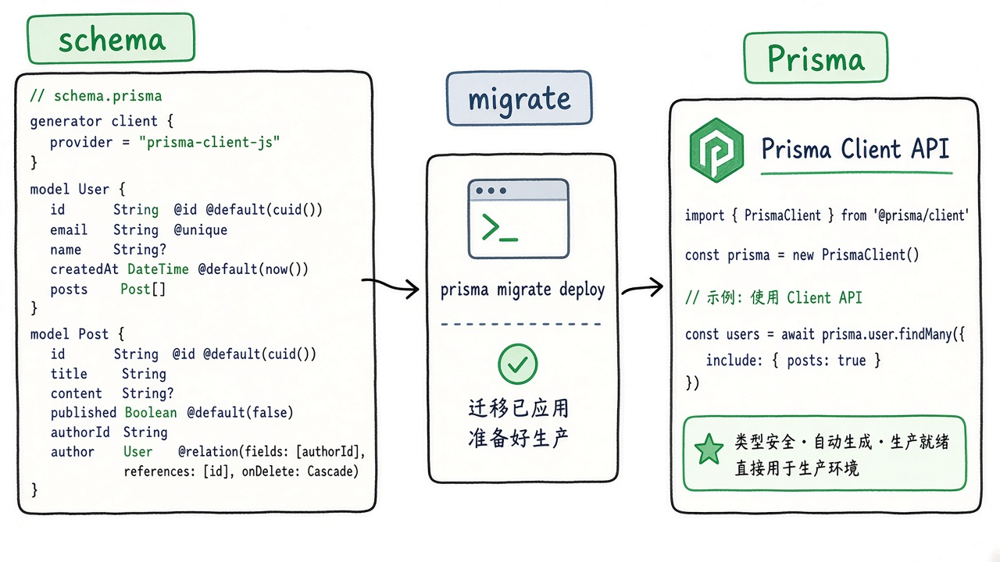
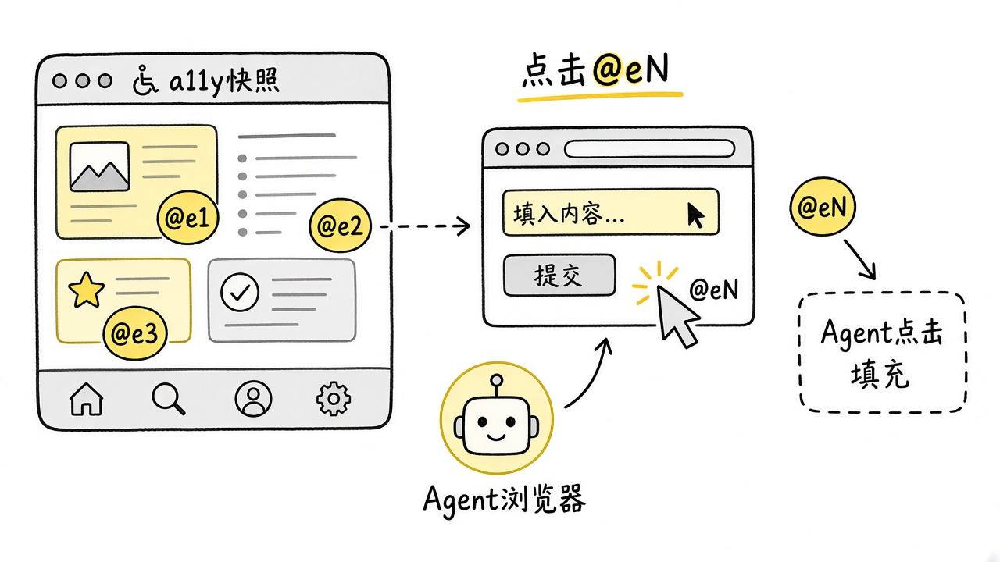
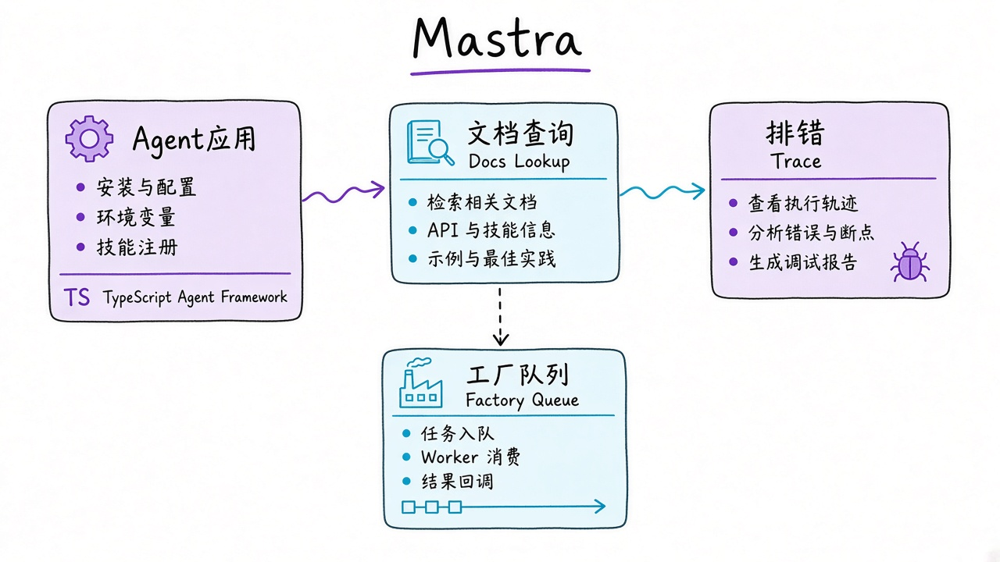
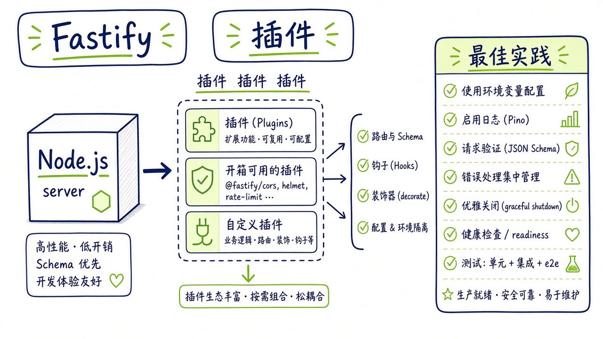

# 2026-10-22 Skills 日报

今日精选围绕设计品味与反 AI 味、Remotion/动效、官方数据栈 Neon/Prisma、浏览器自动化、Azure/Mastra/Fastify。共 10 条；跳过已在 GitHub 10-19 出现的 hyperframes。

## 1. remotion-dev/skills — Remotion 官方 best-practices 技能包

**介绍**  
Remotion 官方 skills（不同于往日「用 Remotion 的宣传片模板」）：把官方最佳实践收成可安装技能，让 agent 按 Remotion 习惯写动效/视频代码。

**用法**  
仓库：[github.com/remotion-dev/skills](https://github.com/remotion-dev/skills)。  
```bash
npx skills add remotion-dev/skills
```

**应用场景**  
用 Remotion 做产品演示片或 UI 动效时，让 agent 先对齐官方写法。


**推荐学习程度**：进阶

---

## 2. emilkowalski/skills — 动效与 Apple 设计口味

**介绍**  
Emil Kowalski 的技能包：含 animate、review-animations、apple-design 等，偏动效审阅与设计语言约束。

**用法**  
仓库：[github.com/emilkowalski/skills](https://github.com/emilkowalski/skills)。  
```bash
npx skills@latest add emilkowalski/skills
```

**应用场景**  
给 agent 生成的交互动效做一轮「像不像产品级动画」的自检。


**推荐学习程度**：进阶

---

## 3. pbakaus/impeccable — 设计品味审计与反 AI 味

**介绍**  
Impeccable：面向「去掉 AI 味、抬设计品味」的技能/CLI；站内有说明。装好后用 `/impeccable init|audit|critique` 一类命令驱动。

**用法**  
仓库：[github.com/pbakaus/impeccable](https://github.com/pbakaus/impeccable)；站：[impeccable.style](https://impeccable.style)。  
```bash
npx impeccable install
# 随后在 agent 里：
/impeccable init
/impeccable audit
/impeccable critique
```

**应用场景**  
UI 已经能跑，但看起来像默认模板时，用 audit/critique 压 AI 味。



**推荐学习程度**：深入

---

## 4. nextlevelbuilder/ui-ux-pro-max-skill — UI/UX 技能一键挂 Cursor

**介绍**  
UI/UX Pro Max skill：用 CLI 初始化并挂到 Cursor 等 AI 编码环境，降低「页面能用但不专业」的默认输出。

**用法**  
仓库：[github.com/nextlevelbuilder/ui-ux-pro-max-skill](https://github.com/nextlevelbuilder/ui-ux-pro-max-skill)。  
```bash
npx ui-ux-pro-max-cli init --ai cursor
```

**应用场景**  
新开前端项目，希望 Cursor agent 默认带上更完整的 UI/UX 约束。



**推荐学习程度**：入门

---

## 5. neondatabase/agent-skills — Neon 官方数据栈技能

**介绍**  
Neon 官方 agent skills：把分支数据库、连接串、迁移一类操作收成可调用技能，而不是长 README。

**用法**  
仓库：[github.com/neondatabase/agent-skills](https://github.com/neondatabase/agent-skills)。  
```bash
npx skills add neondatabase/agent-skills
```

**应用场景**  
Agent 要在 Neon 上开分支库、改 schema、跑迁移时加载官方窄技能。



**推荐学习程度**：进阶

---

## 6. prisma/skills — Prisma 官方 ORM 技能

**介绍**  
Prisma 官方 skills：schema、client、迁移等常见 ORM 任务的 agent 技能包。

**用法**  
仓库：[github.com/prisma/skills](https://github.com/prisma/skills)。  
```bash
npx skills add prisma/skills
```

**应用场景**  
改 Prisma schema / 迁移时让 agent 按官方习惯而不是瞎猜 API。



**推荐学习程度**：进阶

---

## 7. vercel-labs/agent-browser — 浏览器自动化技能 + CLI

**介绍**  
Vercel Labs 的 agent-browser：skills 安装之外，还有全局 CLI；`agent-browser install` 补浏览器侧依赖。

**用法**  
仓库：[github.com/vercel-labs/agent-browser](https://github.com/vercel-labs/agent-browser)。  
```bash
npx skills add vercel-labs/agent-browser
npm i -g agent-browser && agent-browser install
```

**应用场景**  
Coding agent 需要点网页、抓 DOM、跑端到端检查时的浏览器手。



**推荐学习程度**：进阶

---

## 8. microsoft/azure-skills — Azure 官方技能包

**介绍**  
Microsoft Azure skills：可用 `apm install` 或 Claude 插件路径装入，覆盖云资源与 Azure 产品向 agent 操作。

**用法**  
仓库：[github.com/microsoft/azure-skills](https://github.com/microsoft/azure-skills)。  
```bash
apm install microsoft/azure-skills
# 或按 README 走 Claude plugin 安装
```

**应用场景**  
Agent 要在 Azure 上配资源/排障时加载官方技能，而不是整本云文档塞进上下文。


**推荐学习程度**：深入

---

## 9. mastra-ai/skills — Mastra Agent 框架技能

**介绍**  
Mastra 官方 skills：给基于 Mastra 的 agent 工程补框架级最佳实践与脚手架习惯。

**用法**  
仓库：[github.com/mastra-ai/skills](https://github.com/mastra-ai/skills)。  
```bash
npx skills add mastra-ai/skills
```

**应用场景**  
用 Mastra 搭 TypeScript agent 时，让编码 agent 对齐官方 skill 约定。



**推荐学习程度**：进阶

---

## 10. mcollina/skills — Fastify / Node TSC 作者的最佳实践

**介绍**  
Matteo Collina（Fastify / Node TSC）维护的技能包：可用 `--skill fastify-best-practices` 精准装 Fastify 向实践。

**用法**  
仓库：[github.com/mcollina/skills](https://github.com/mcollina/skills)。  
```bash
npx skills add mcollina/skills --skill fastify-best-practices
```

**应用场景**  
写 Fastify 服务或审 agent 生成的 Node HTTP 层时，对齐维护者口味。



**推荐学习程度**：进阶
