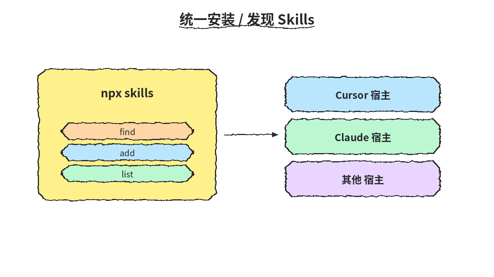
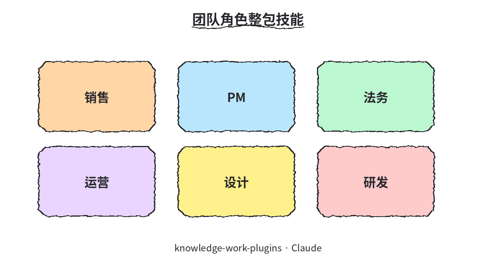
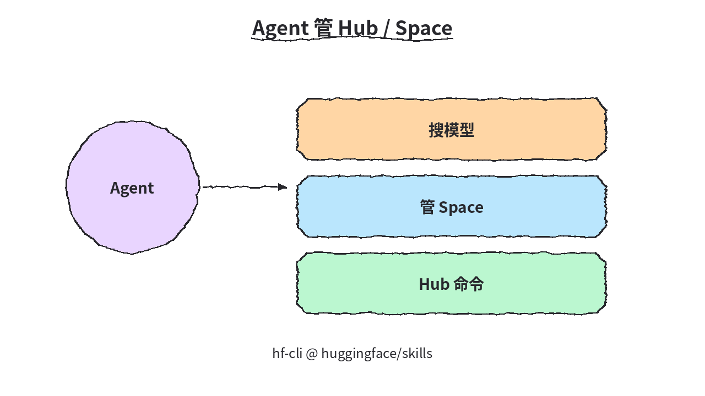
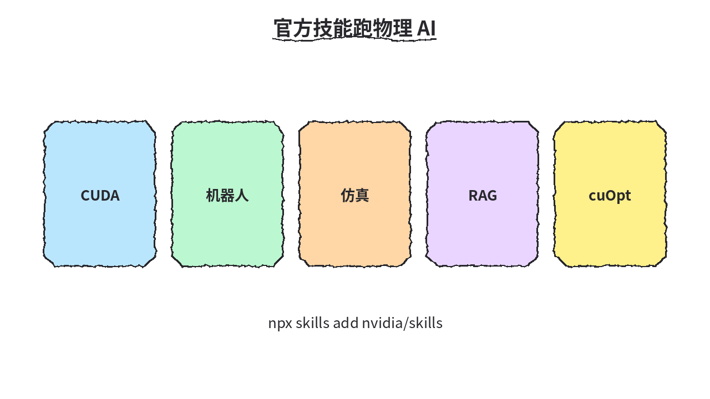
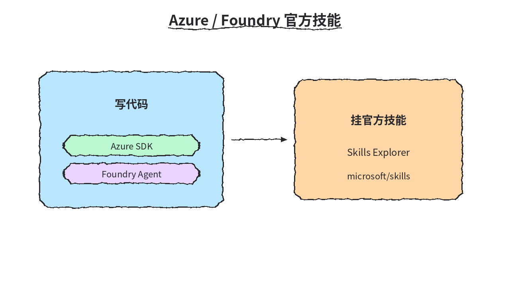
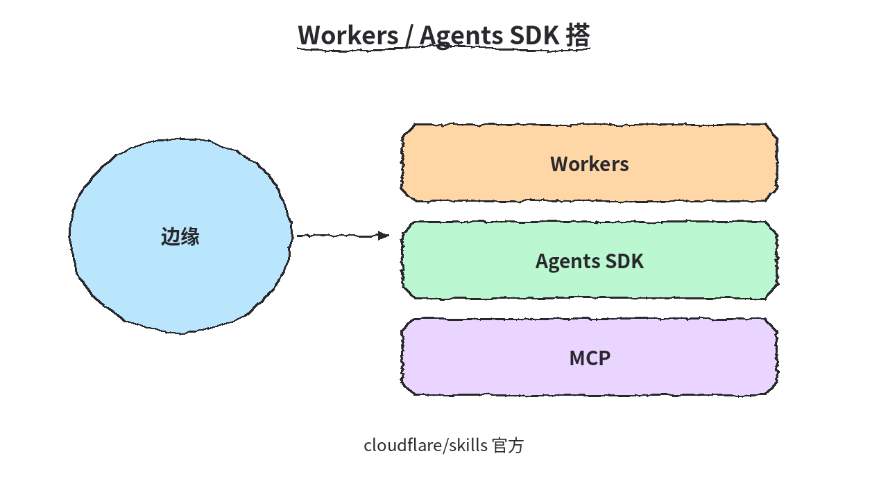

# 2026-10-23 Skills 日报

今日精选 6 条官方/平台技能：统一 CLI、知识工作角色包，以及 HF / NVIDIA / Microsoft / Cloudflare 宿主技能（不含已推过的 azure-skills、security-audit-skill）。

## 1. vercel-labs/skills — npx skills CLI

**介绍**  
skills（MIT，★~36156）：`npx skills` / skills.sh，给任意宿主统一发现与安装 agent skills。

**用法**  
仓库：[github.com/vercel-labs/skills](https://github.com/vercel-labs/skills)；站：[skills.sh](https://skills.sh)。  
```bash
npx skills find
npx skills add <source>
npx skills list
```

**应用场景**  
给任意宿主统一安装/发现 agent skills。



**推荐学习程度**：入门

---

## 2. anthropics/knowledge-work-plugins — 知识工作角色插件包

**介绍**  
knowledge-work-plugins（Apache-2.0，★~31650）：面向 Claude Cowork/Code 的 11 个角色插件（销售/PM/法务等）。

**用法**  
仓库：[github.com/anthropics/knowledge-work-plugins](https://github.com/anthropics/knowledge-work-plugins)；插件页：[claude.com/plugins](https://claude.com/plugins/)。  
```bash
claude plugin marketplace add anthropics/knowledge-work-plugins
claude plugin install sales@knowledge-work-plugins
```

**应用场景**  
给团队角色装销售/PM 等整包技能。



**推荐学习程度**：入门

---

## 3. huggingface/skills — HF Hub Agent Skills

**介绍**  
huggingface/skills（★~11199）：HF Hub agent skills，入口 hf-cli；可搜模型、管 Space、跑 Hub 命令。

**用法**  
仓库：[github.com/huggingface/skills](https://github.com/huggingface/skills)。  
```bash
# Claude：
/plugin marketplace add huggingface/skills
/plugin install hf-cli@huggingface/skills
hf skills add <name>
```

**应用场景**  
Agent 直接搜模型/管 Space/跑 Hub 命令。



**推荐学习程度**：入门

---

## 4. NVIDIA/skills — NVIDIA 官方验证技能

**介绍**  
NVIDIA/skills（Apache-2.0，★~3695）：官方验证技能集（CUDA/机器人/仿真/RAG 等）。

**用法**  
仓库：[github.com/NVIDIA/skills](https://github.com/NVIDIA/skills)；文档：[docs.nvidia.com/skills](https://docs.nvidia.com/skills)。  
```bash
npx skills add nvidia/skills
```

**应用场景**  
Agent 按官方技能跑 cuOpt/物理 AI 等。



**推荐学习程度**：进阶

---

## 5. microsoft/skills — Azure SDK + Foundry 技能

**介绍**  
microsoft/skills（★~3140）：Azure SDK 与 Foundry agent skills，附 Skills Explorer。与已覆盖的 microsoft/azure-skills 不是同一仓。

**用法**  
仓库：[github.com/microsoft/skills](https://github.com/microsoft/skills)；Explorer：[microsoft.github.io/skills](https://microsoft.github.io/skills/)。  
```bash
npx skills add microsoft/skills
```

**应用场景**  
写 Azure/Foundry 代码时挂官方技能。



**推荐学习程度**：进阶

---

## 6. cloudflare/skills — Workers / Agents SDK 平台技能

**介绍**  
cloudflare/skills（★~3147）：Workers / Agents SDK 平台技能 + MCP。与已覆盖的 cloudflare/security-audit-skill 不同仓。

**用法**  
仓库：[github.com/cloudflare/skills](https://github.com/cloudflare/skills)。  
```bash
# Claude：
/plugin marketplace add cloudflare/skills
/plugin install cloudflare@cloudflare
# Codex 类似，见仓内说明
```

**应用场景**  
在 Workers/Agents SDK 上按官方技能搭。



**推荐学习程度**：进阶
