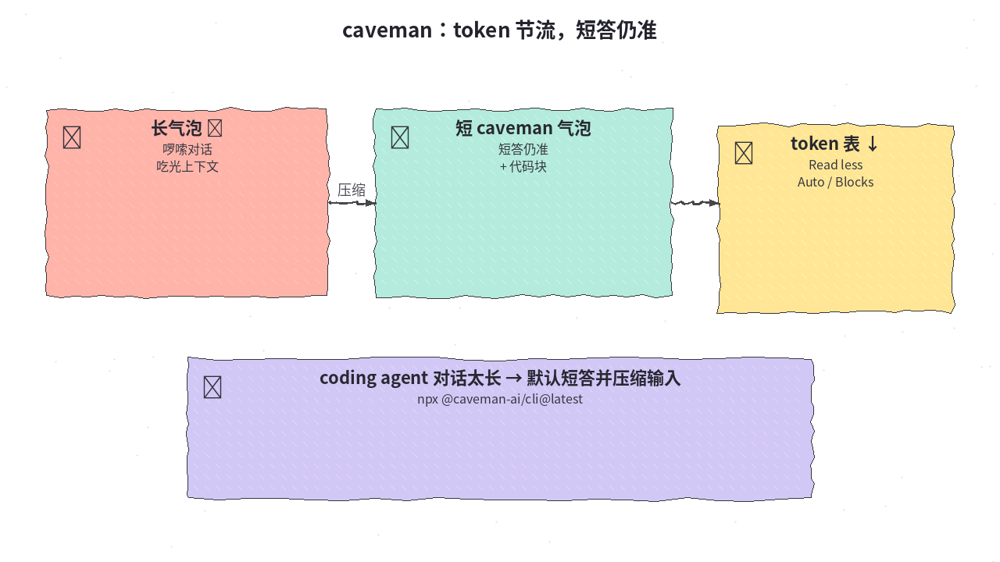
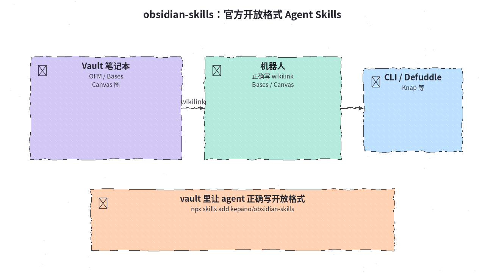
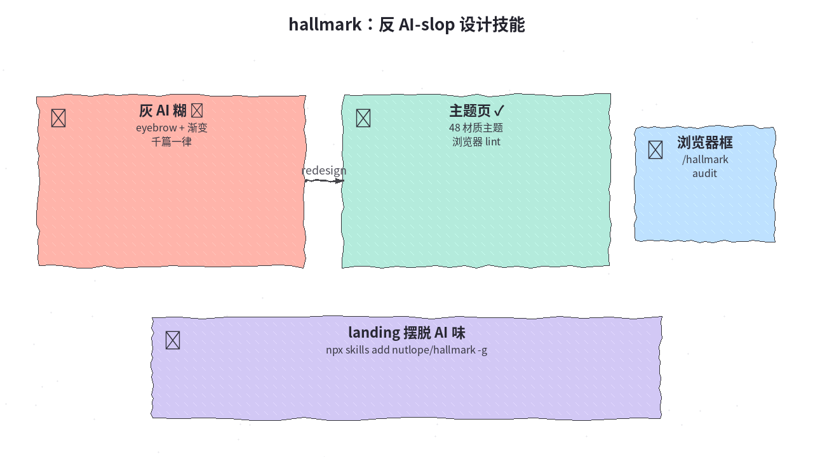
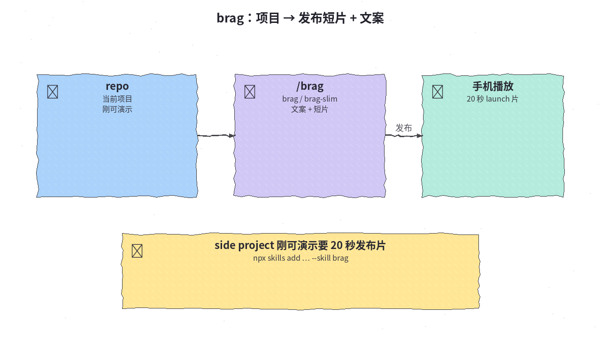
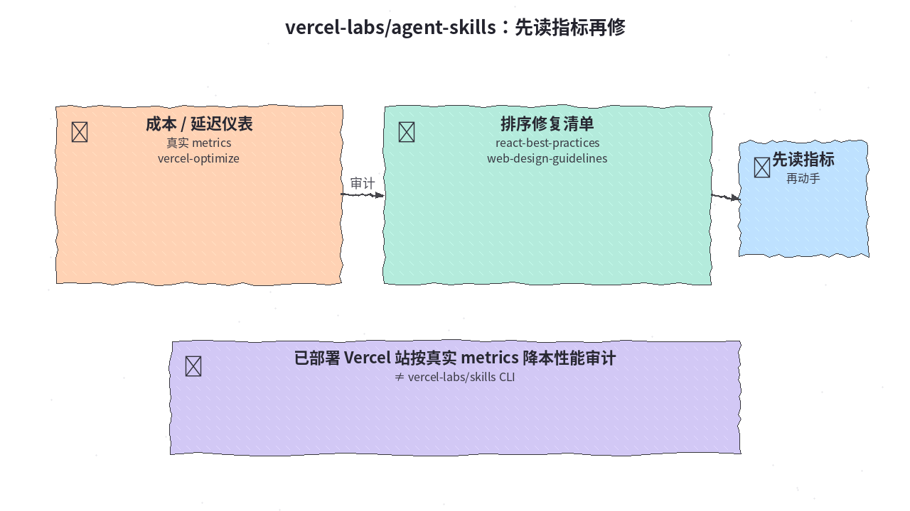
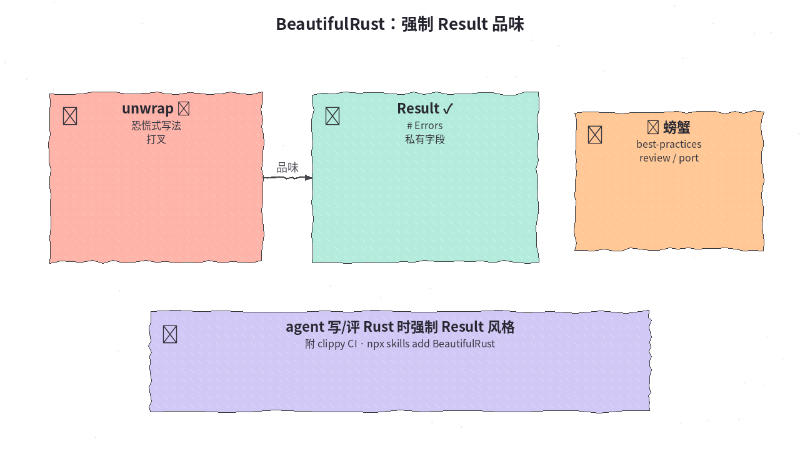
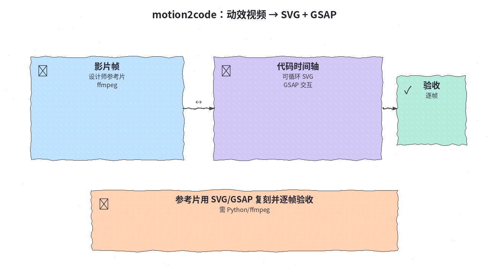
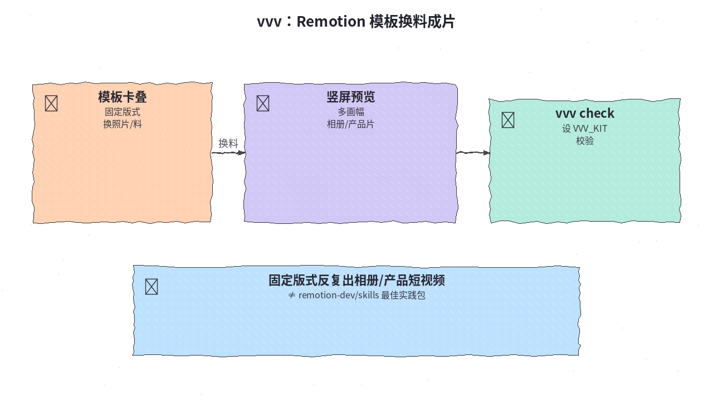

# 2026-10-26 Skills 日报

今日精选 8 条：省 token、Obsidian 官方格式、反 AI 糊设计、发布短片与 Remotion 模板、Vercel 官方技能包与 Rust 品味等。（已避开本周周报里的 security-audit / hyperframes / vercel-labs/skills CLI 等）

## 1. JuliusBrussee/caveman — token 节流技能

**介绍**  
caveman（★~115k）：token 节流技能 + 本地工具；短答仍准；Read less / Auto 模型 / Blocks / Browse 等。

**用法**  
仓库：[github.com/JuliusBrussee/caveman](https://github.com/JuliusBrussee/caveman)。  
```bash
npx @caveman-ai/cli@latest   # Node 22.13+
```

**应用场景**  
coding agent 对话太长要默认短答并压缩输入。



**推荐学习程度**：入门

---

## 2. kepano/obsidian-skills — Obsidian 官方开放格式 Skills

**介绍**  
obsidian-skills（★~50k）：Obsidian 官方开放格式 Agent Skills：OFM / Bases / Canvas / CLI / Defuddle / Knap。

**用法**  
仓库：[github.com/kepano/obsidian-skills](https://github.com/kepano/obsidian-skills)。  
```bash
npx skills add https://github.com/kepano/obsidian-skills
```

**应用场景**  
vault 里让 agent 正确写 wikilink / Bases / Canvas。



**推荐学习程度**：入门

---

## 3. Nutlope/hallmark — 反 AI-slop 设计技能

**介绍**  
hallmark（★~33900）：反 AI-slop 设计技能；48 材质主题；浏览器 lint；`/hallmark redesign|audit`。站：[usehallmark.com](https://www.usehallmark.com)。

**用法**  
仓库：[github.com/Nutlope/hallmark](https://github.com/Nutlope/hallmark)。  
```bash
npx skills add nutlope/hallmark -g
# 浏览器检查需 puppeteer-core + Chrome
```

**应用场景**  
landing 摆脱 eyebrow + 渐变 AI 味。



**推荐学习程度**：进阶

---

## 4. latent-spaces/brag — 项目变发布短片

**介绍**  
brag（★~18620）：`/brag` 把当前项目变成发布短片 + 文案；有 brag-slim。

**用法**  
仓库：[github.com/latent-spaces/brag](https://github.com/latent-spaces/brag)。  
```bash
npx skills add latent-spaces/brag --skill brag
# 或 --skill brag-slim
```

**应用场景**  
side project 刚可演示要 20 秒发布片。



**推荐学习程度**：入门

---

## 5. vercel-labs/agent-skills — Vercel 官方技能集合

**介绍**  
agent-skills（★~33010）：Vercel 官方技能集合（≠ vercel-labs/skills CLI）；含 react-best-practices、vercel-optimize、web-design-guidelines 等。

**用法**  
仓库：[github.com/vercel-labs/agent-skills](https://github.com/vercel-labs/agent-skills)。  
```bash
npx skills add vercel-labs/agent-skills
# vercel-optimize 需 vercel login + link
```

**应用场景**  
已部署 Vercel 站按真实 metrics 做降本性能审计。



**推荐学习程度**：进阶

---

## 6. morganlinton/BeautifulRust — Rust agent 品味技能

**介绍**  
BeautifulRust（★~754，2026-10-23）：Rust agent skills：best-practices / review / port；附 clippy CI 配置。

**用法**  
仓库：[github.com/morganlinton/BeautifulRust](https://github.com/morganlinton/BeautifulRust)。  
```bash
npx skills add morganlinton/BeautifulRust
```

**应用场景**  
agent 写/评 Rust 时强制 Result / # Errors / 私有字段。



**推荐学习程度**：进阶

---

## 7. lovisdotio/motion2code — 动效视频 → SVG + GSAP

**介绍**  
motion2code（★~262）：动效视频 → 可循环 SVG + GSAP；可还原可交互页。需 Python / ffmpeg。

**用法**  
仓库：[github.com/lovisdotio/motion2code](https://github.com/lovisdotio/motion2code)。  
```bash
npx skills add lovisdotio/motion2code
```

**应用场景**  
设计师参考片要用 SVG/GSAP 复刻并逐帧验收。



**推荐学习程度**：进阶

---

## 8. actionow-ai/vvv — Remotion 模板 + Skill

**介绍**  
vvv（★~374）：Remotion 模板 + Skill；换料成片；`vvv check`；多画幅。站：[vibevision.video](https://vibevision.video)。≠ remotion-dev/skills 最佳实践包。

**用法**  
仓库：[github.com/actionow-ai/vvv](https://github.com/actionow-ai/vvv)。  
```bash
npx skills add actionow-ai/vvv
# 设 VVV_KIT
```

**应用场景**  
固定版式反复出相册/产品短视频。



**推荐学习程度**：进阶
