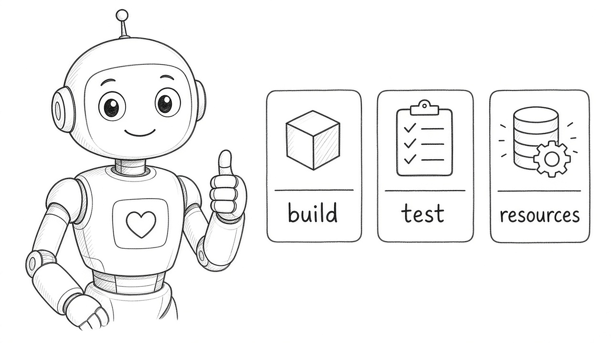
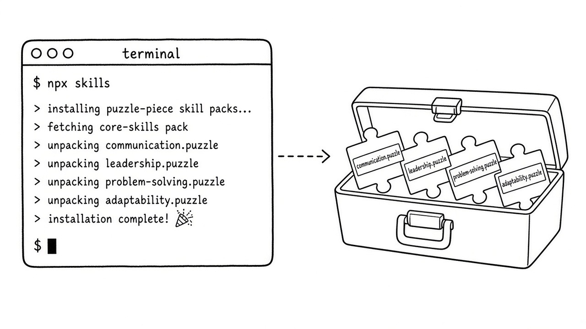
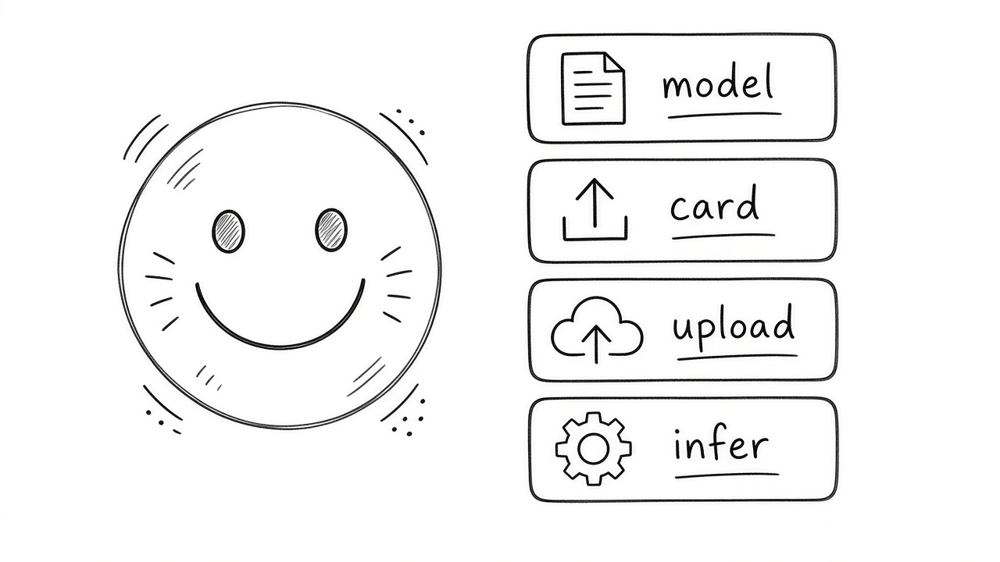
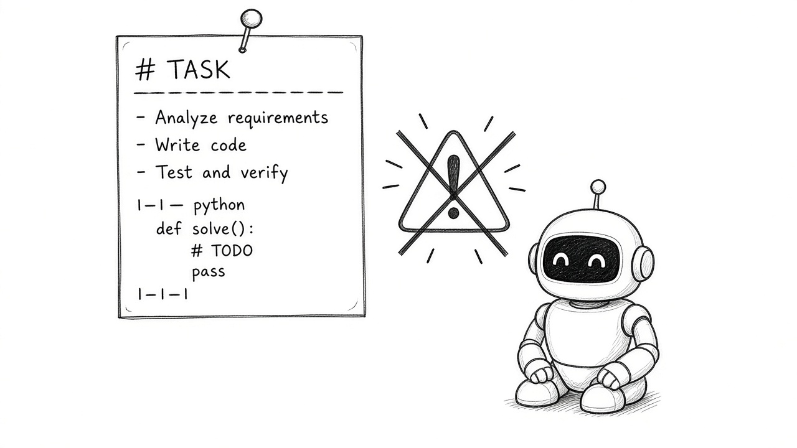
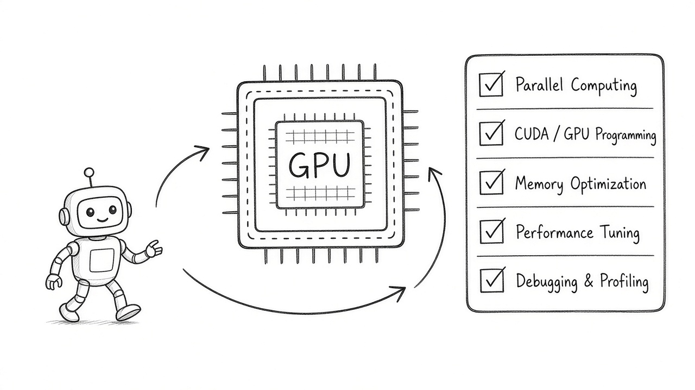
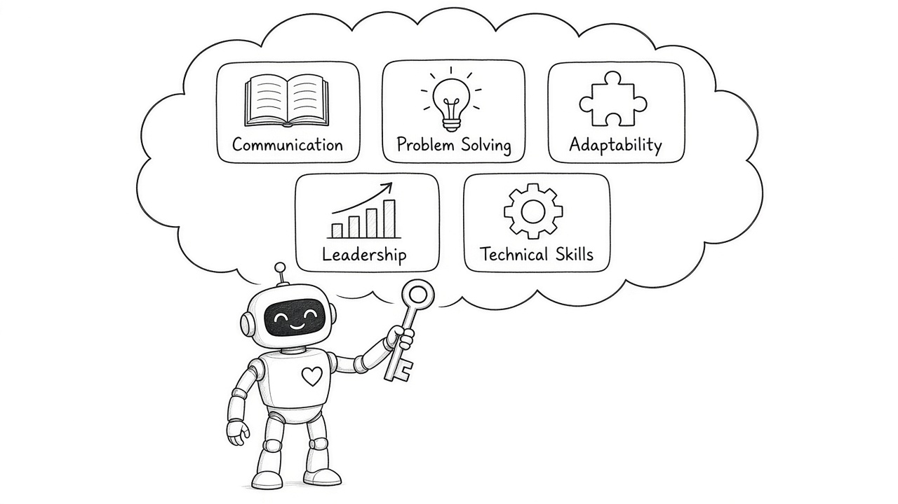
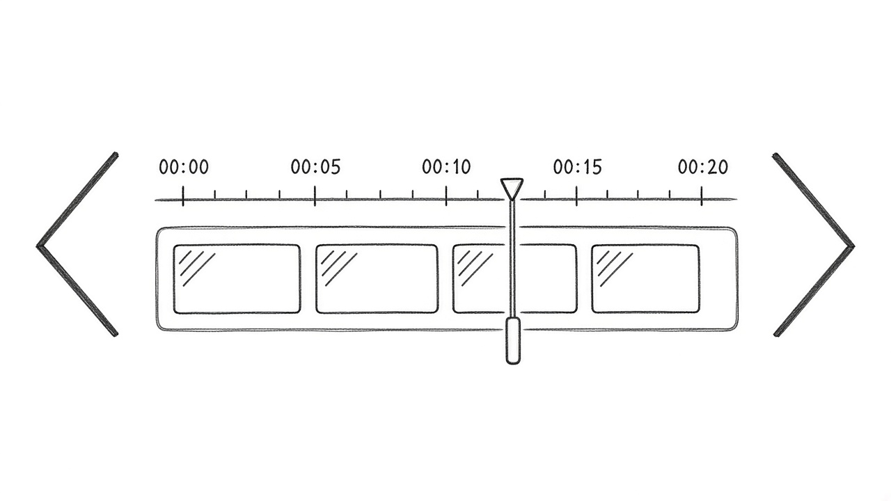
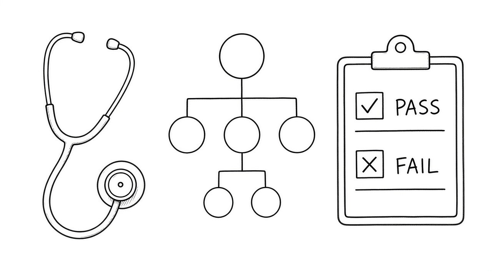

# 2026-10-26 Skills 周报

上周（10/19–10/25）精选 10 个值得装进 agent 工具箱的 Skill（安全审计 / 官方插件与 CLI / Android·HF·NVIDIA·Google / Remotion / React 体检）。

## 1. cloudflare/security-audit-skill — 分阶段、可独立核验的安全审计 Skill

**介绍**  
Cloudflare 开源的多阶段安全审计 Skill（本周 GitHub Trending 约 +15k★，总★46983）：产出可独立核验、机器可读的 findings，而不是一坨不可复查的「AI 说有风险」。

**用法**  
仓库：[github.com/cloudflare/security-audit-skill](https://github.com/cloudflare/security-audit-skill)。按 README 装进 Claude Code / 兼容 agent，对目标仓库跑分阶段审计，保留 findings 文件供人工复核。

**应用场景**  
发版前想让 agent 做安全初筛，但必须能逐条核验、不能只信一段散文。

**推荐学习程度**：进阶

---

## 2. anthropics/knowledge-work-plugins — 知识工作角色插件包

**介绍**  
Anthropic 开源的知识工作向插件集（★32990，本周约 +2.8k）：主要给 Claude Cowork / 知识工作者角色用，把调研、写作、整理等流程收成可装插件，而不是临时 prompt。

**用法**  
仓库：[github.com/anthropics/knowledge-work-plugins](https://github.com/anthropics/knowledge-work-plugins)。在 Claude 插件生态里按文档安装对应角色插件，或 clone 后按目录挂载。

**应用场景**  
做周报、竞品调研、会议纪要时，想固定角色与步骤，少每次重写 system prompt。

**推荐学习程度**：入门

---

## 3. android/skills — Google 官方 Android Agent Skills

**介绍**  
Google Android 官方 Agent Skills（Kotlin，★9722，本周仍在 trending）：把 Android 工程常见任务技能化，降低「通用 coding agent 乱改 Gradle」的风险。

**用法**  
仓库：[github.com/android/skills](https://github.com/android/skills)。按 README 装到支持 Skill 的 agent（Claude Code / Android Studio 相关流程），对模块执行官方技能而不是自由发挥。

**应用场景**  
维护 Android 多模块工程，想让 agent 按官方技能改资源、构建与测试。

**推荐学习程度**：进阶

---

## 4. vercel-labs/skills — npx skills CLI 与技能生态

**介绍**  
Vercel Labs 的 skills CLI / 生态入口（★36560）：用 `npx skills` 发现、添加、管理 agent skills，把「复制 SKILL.md」变成可重复安装。

**用法**  
仓库：[github.com/vercel-labs/skills](https://github.com/vercel-labs/skills)。`npx skills add <owner/repo>` 或按文档列出/更新已装技能；可与 Cursor / Claude Code 目录约定配合。

**应用场景**  
团队要统一安装同一批 skills，不想每人手动 clone 和改路径。

**推荐学习程度**：入门

---

## 5. huggingface/skills — HF Hub Agent Skills

**介绍**  
Hugging Face 官方 Hub 向 Agent Skills（★11212）：覆盖模型卡检索、推理、上传与空间常见操作，让 agent 少幻觉 HF 命令。

**用法**  
仓库：[github.com/huggingface/skills](https://github.com/huggingface/skills)。按 README 安装后，对 agent 说「用 HF skills 查某模型 / 推 space」；需本机已配置 `huggingface-cli` 登录时再做写操作。

**应用场景**  
评测或发模型卡时，希望 agent 按官方技能走，而不是瞎编 API。

**推荐学习程度**：入门

---

## 6. multica-ai/andrej-karpathy-skills — Karpathy 观察提炼的单一 CLAUDE.md

**介绍**  
把 Andrej Karpathy 对 LLM 写码坑点的观察收成单一 `CLAUDE.md`（本周 trending，★223870）：用短约束改善 Claude Code 行为，属于「轻量技能/规则包」。

**用法**  
仓库：[github.com/multica-ai/andrej-karpathy-skills](https://github.com/multica-ai/andrej-karpathy-skills)。把 `CLAUDE.md` 放进项目或全局指令目录，重启 Claude Code 会话后观察是否少踩所列坑。

**应用场景**  
个人项目想用一份短规则压住「瞎重构 / 假装跑过测试」一类常见失败。

**推荐学习程度**：入门

---

## 7. NVIDIA/skills — NVIDIA 官方验证技能

**介绍**  
NVIDIA 官方 Agent Skills 包（★3733）：围绕 CUDA / 推理 / 自家栈的可验证步骤，减少 agent 在 GPU 环境「猜命令」。

**用法**  
仓库：[github.com/NVIDIA/skills](https://github.com/NVIDIA/skills)。按 README 装入兼容 agent，在 NVIDIA 相关仓库里调用对应技能做构建、配置与检查。

**应用场景**  
在 NVIDIA 软件栈上做推理或驱动相关改动，想要官方技能当护栏。

**推荐学习程度**：进阶

---

## 8. google/skills — Google 产品与 Cloud 官方 Agent Skills

**介绍**  
Google 产品与 Cloud 官方技能包（★21576）：覆盖常见 Cloud / 产品操作路径，适合把「官方怎么做」固化进 agent。

**用法**  
仓库：[github.com/google/skills](https://github.com/google/skills)。按文档安装后，在涉及 GCP / Google API 的任务里显式调用对应 skill。

**应用场景**  
Agent 要改 Cloud 配置或调用 Google API，希望跟官方技能而不是论坛散帖。

**推荐学习程度**：进阶

---

## 9. remotion-dev/skills — Remotion 官方 best-practices 技能包

**介绍**  
Remotion 官方 best-practices skills（★5702）：把程序化视频的约定收成技能，降低 agent 写出不可渲染时间线的概率。

**用法**  
仓库：[github.com/remotion-dev/skills](https://github.com/remotion-dev/skills)。安装到 agent 后，在 Remotion 项目里让它按技能改 composition / 渲染参数。

**应用场景**  
用代码做产品演示视频，希望 agent 遵守 Remotion 官方习惯。

**推荐学习程度**：进阶

---

## 10. millionco/react-doctor — Agent 写坏 React 时的确定性体检

**介绍**  
给 Agent 写坏的 React 做确定性体检（★15048）：用可重复规则指出反模式，而不是再让同一个模型「自评一下」。

**用法**  
仓库：[github.com/millionco/react-doctor](https://github.com/millionco/react-doctor)。按 README 装 skill/CLI，对改动跑体检，把报告回灌给写码 agent 修。

**应用场景**  
Agent 狂写 React 组件后，需要一道不靠主观的体检门禁。

**推荐学习程度**：入门
