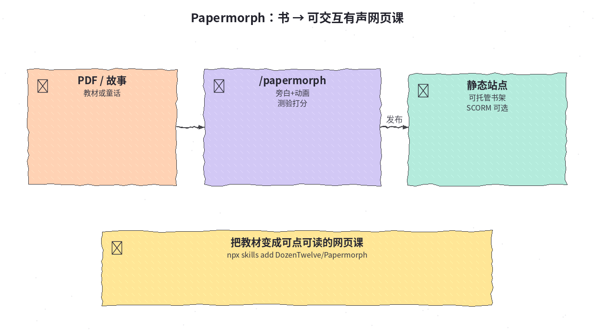
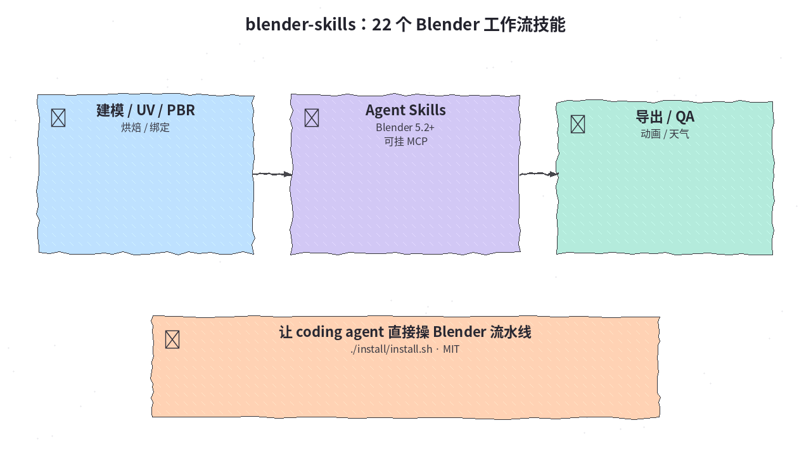
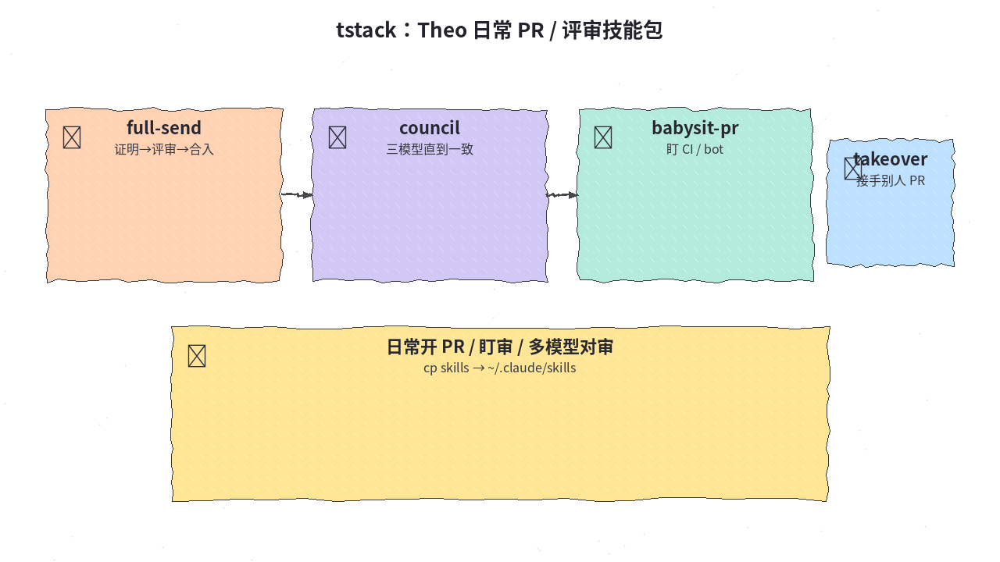
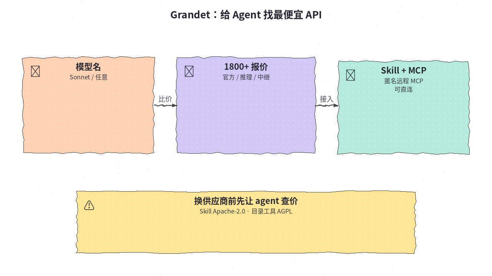
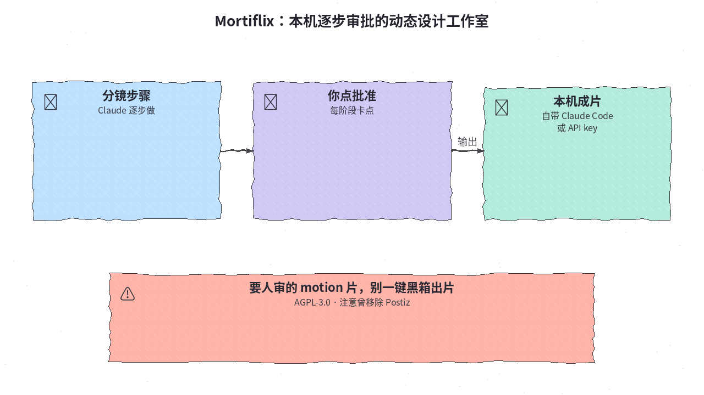

# 2026-10-27 Skills 日报

今日精选 5 个可装即用的 Agent Skill / 技能包（教材变有声网页课 / Blender 流水线 / Theo 日常 PR 流 / API 比价 / 本机逐步审批动效工作室）。与往日日报、周报不重复。

## 1. DozenTwelve/Papermorph — 书变成可交互有声网页课

**介绍**  
Papermorph（MIT，★~959）：Claude Code Skill——教材 PDF → 分步动画讲解 + 可判分测验；故事 → 纸偶短片；议题 → 公版画纪录片。产出是可托管的静态站点（自带播放器），可选导出 1080p+SRT 或 SCORM。演示书架见官网。

**用法**  
仓库：[github.com/DozenTwelve/Papermorph](https://github.com/DozenTwelve/Papermorph)；书架：[papermorph.diamonddoge.org](https://papermorph.diamonddoge.org/)。  
```bash
npx skills add DozenTwelve/Papermorph --skill papermorph --agent claude-code
# Claude Code 里：/papermorph
# 依赖：uv、ffmpeg、Playwright 浏览器；旁白可用 Edge TTS / Kokoro
```

**应用场景**  
有一份教材或故事 PDF，想做成可点、可听、可测验的网页课并自己托管。



**推荐学习程度**：进阶

---

## 2. EL4CTEO/blender-skills — 22 个 Blender 5.2 专业工作流技能

**介绍**  
Blender Agent Skills（MIT，★~530）：建模、UV、PBR、烘焙、绑定、动画、优化、导出、渲染、天气/模拟与 QA 等 22 个技能，面向 Claude Code / Codex / Gemini CLI / Copilot / Cursor。可配 Blender MCP 在打开的 Blender 里协作，也可后台跑 Blender。

**用法**  
仓库：[github.com/EL4CTEO/blender-skills](https://github.com/EL4CTEO/blender-skills)。需 Blender 5.2+。  
```bash
# Claude Code 插件：
# /plugin marketplace add EL4CTEO/blender-skills
# /plugin install blender-agent-skills@blender-agent-skills
git clone https://github.com/EL4CTEO/blender-skills
./blender-skills/install/install.sh   # 默认装到 ~/.claude/skills 与 ~/.agents/skills
```

**应用场景**  
让 coding agent 按专业流水线改 3D 资产，而不是临时拼 bpy 片段。



**推荐学习程度**：进阶

---

## 3. t3dotgg/tstack — Theo 日常用的 PR / 评审 Skills

**介绍**  
tstack（MIT，★~1.6k）：Theo 整理的日常 agent skills——`full-send` / `full-stop` 从改动到合入（或停在待合）、`council` 三模型对齐、`babysit-pr` 盯 CI 与 bot、`takeover` 接手他人 PR 等。Claude Code / Codex 可用；部分能力在 T3 Code 上更顺，其它 harness 可回退。

**用法**  
仓库：[github.com/t3dotgg/tstack](https://github.com/t3dotgg/tstack)。需已登录 `gh`；`babysit-pr` 要 python3。  
```bash
git clone https://github.com/t3dotgg/tstack
cp -R tstack/skills/* ~/.claude/skills/   # Claude Code
cp -R tstack/skills/* ~/.codex/skills/    # Codex
# 对话里说 full send / council / babysit 等触发
```

**应用场景**  
日常开 PR、多模型互审、盯 CI 修真实 finding，想要一套现成话术与流程。



**推荐学习程度**：入门

---

## 4. hanzohanzhe/Grandet — 让 Agent 找出最便宜的模型 API

**介绍**  
Grandet（Skill 部分 Apache-2.0，目录工具等 AGPL-3.0-only，★~837）：汇总 1800+ 官方 / 推理 / 中继挂牌价，Agent Skill + 匿名远程 MCP（`https://grandet.ai/mcp`）可查询并协助接入更便宜的端点。查价无需账号；装 Skill 可让 agent 自己完成安装步骤。

**用法**  
仓库：[github.com/hanzohanzhe/Grandet](https://github.com/hanzohanzhe/Grandet)；站：[grandet.ai](https://grandet.ai)。  
```text
# 对当前 agent 说：
Install Grandet Skill for me: https://grandet.ai/download.md
```
```json
{ "mcpServers": { "grandet": { "url": "https://grandet.ai/mcp" } } }
```
```bash
claude mcp add --transport http grandet https://grandet.ai/mcp
```

**应用场景**  
换模型供应商或中继前，先让 agent 按挂牌价对比，再决定接哪条 API。



**推荐学习程度**：入门

---

## 5. GTKottman/mortiflix-oss — 本机逐步审批的动态设计工作室

**介绍**  
Mortiflix（AGPL-3.0，★~658）：本机 motion 工作室——Claude（Claude Code 或 API key）分步做片，你在每个阶段批准。强调可控人审，而不是一键黑箱。README 提示曾移除 Postiz（与 2026-10-21 Railway 安全事件相关）；若旧环境接过 Postiz 需自行检查。

**用法**  
仓库：[github.com/GTKottman/mortiflix-oss](https://github.com/GTKottman/mortiflix-oss)。按 README 本机启动 Web UI，绑定 Claude Code 或 API key，按阶段批准分镜/成片；部署与分发前读 AGPL。

**应用场景**  
品牌/产品动效必须人工卡点验收，又想让 agent 做重活。



**推荐学习程度**：进阶
