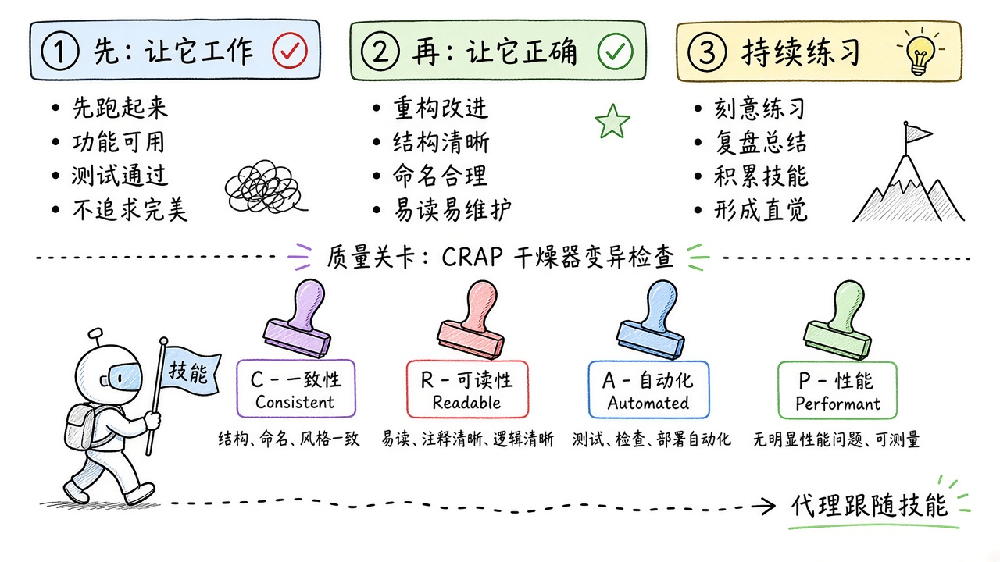
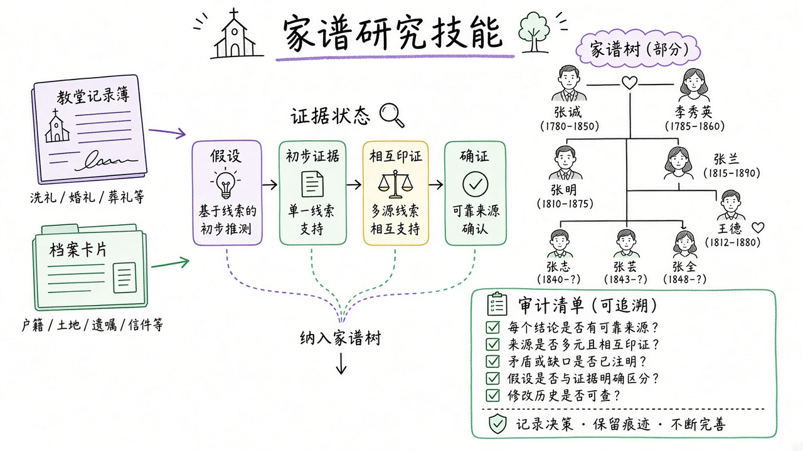
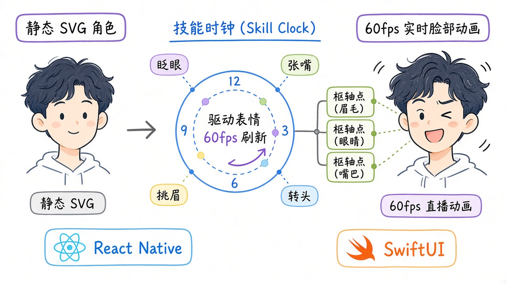

# 2026-10-28 Skills 日报

今日精选 7 条：工程纪律 ub-mode、数字人口播、谱系证据链、60fps 动效、电影感落地页、一人公司七步，以及给 skill 减肥的 skill-diet。

## 1. unclebob/ub-mode — 先跑通再做对的工程纪律 Skill

**介绍**  
ub-mode（★~2393，2026-10-25）：把 Uncle Bob / poteto 风格原则收成 agent skill，配 crapper / dryer / mutator 等确定性质量门（CRAP、重复、变异测试）。

**用法**  
仓库：[github.com/unclebob/ub-mode](https://github.com/unclebob/ub-mode)。  
```bash
# 拷到宿主 skills 目录后调用 /ub-mode
cp SKILL.md ~/.claude/skills/ub-mode/SKILL.md
```

**应用场景**  
让 coding agent 改代码时先过「能跑 → 做对 → 刻意练习」清单并卡质量门。



**推荐学习程度**：进阶

---

## 2. andyhuo520/digital-human-koubo — 一张照片做出数字人口播片

**介绍**  
digital-human-koubo（MIT，★~1092，2026-10-26）：照片 + 一句话 → 口型同步数字人短片；Renoise MCP 生成 + Remotion 五种剪辑风格 + 48 个包装组件，带成本报价与质检。

**用法**  
仓库：[github.com/andyhuo520/digital-human-koubo](https://github.com/andyhuo520/digital-human-koubo)。  
```bash
git clone https://github.com/andyhuo520/digital-human-koubo.git
cd digital-human-koubo
mkdir -p ~/.claude/skills && cp -R skills/digital-human-koubo skills/finance-explainer ~/.claude/skills/
```

**应用场景**  
课程带货/产品讲解短视频要数字人口播且可 agent 全流程代做。


**推荐学习程度**：进阶

---

## 3. DenisSergeevitch/ex-ussr-kinship-research — 证据优先的前苏联谱系 Skill

**介绍**  
ex-ussr-kinship-research（MIT，★~1059，2026-10-25）：面向 Codex/Claude 的谱系研究技能；历史辖区、姓名变体、证据状态机与审计脚本，用你的语言回复。

**用法**  
仓库：[github.com/DenisSergeevitch/ex-ussr-kinship-research](https://github.com/DenisSergeevitch/ex-ussr-kinship-research)。  
```bash
npx skills add https://github.com/DenisSergeevitch/ex-ussr-kinship-research
```

**应用场景**  
查前苏联地区教区/民事/军事档案并要求可追溯证据链时挂上。



**推荐学习程度**：深入

---

## 4. rossark0/rossark-motion-skill — SVG → 60fps 活体动画

**介绍**  
rossark-motion-skill（MIT，★~533，2026-10-22）：教 agent 用统一时钟与真实枢轴把 SVG 做成活脸/全身/场景动画；含 React Native 与 SwiftUI 模板。

**用法**  
仓库：[github.com/rossark0/rossark-motion-skill](https://github.com/rossark0/rossark-motion-skill)。  
```bash
npx skills@latest add rossark0/rossark-motion-skill
```

**应用场景**  
角色/图标要「活起来」而不是关键帧切换时用。



**推荐学习程度**：进阶

---

## 5. Motionsites-AI/claude-skill — 电影感落地页构建 Skill

**介绍**  
motionsites-web-builder（★~509，2026-10-26）：让 Claude 做电影感 landing page；可配 Playwright 看图回环审视觉。

**用法**  
仓库：[github.com/Motionsites-AI/claude-skill](https://github.com/Motionsites-AI/claude-skill)。  
```text
/plugin marketplace add Motionsites-AI/claude-skill
/plugin install motionsites-web-builder@motionsites
```

**应用场景**  
要一页有镜头感的营销落地页，并让 agent 截图自审迭代。


**推荐学习程度**：入门

---

## 6. huaxialucaicaizi/ai-startup-skills — 一人公司 AI 产品七步合集

**介绍**  
ai-startup-skills（MIT，★~435，2026-10-22）：验证 → BP → 政策 → 路演 → 获客 → 定价 → 注册，总入口按阶段路由到 7 个子 skill。

**用法**  
仓库：[github.com/huaxialucaicaizi/ai-startup-skills](https://github.com/huaxialucaicaizi/ai-startup-skills)。  
```bash
git clone https://github.com/huaxialucaicaizi/ai-startup-skills.git
mkdir -p ~/.claude/skills
cp -R ai-startup-skills/skills/* ~/.claude/skills/
cp -R ai-startup-skills ~/.claude/skills/ai-startup-skills
```

**应用场景**  
一个人做 AI 产品时按阶段问「我在哪一步、下一步做什么」。


**推荐学习程度**：入门

---

## 7. nicobailon/skill-diet — 给其他 Skill 减肥

**介绍**  
skill-diet（MIT，★~110，2026-10-24）：重写臃肿 SKILL.md（实测可砍 70–80% token 且测试不掉），并留下后续保持精简的规则；顺带核对工具文档是否过期。

**用法**  
仓库：[github.com/nicobailon/skill-diet](https://github.com/nicobailon/skill-diet)。  
```text
/plugin install skill-diet --marketplace nicobailon/skill-diet
# 或 Pi：pi install npm:skill-diet
```
对 agent 说：`把 deploy skill 减减肥`。

**应用场景**  
自建 skill 越写越长、占上下文时，先 diet 再继续改。


**推荐学习程度**：进阶
